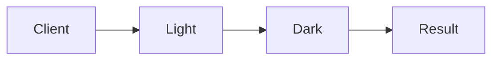

# Abstract Factory

**Season:** 1 · Creational · **Category:** GoF · **Level:** Beginner · **Runtime:** ~10–12 min · **Channel:** Build with Waqar

## Problem
**Light/Dark UI widget family stays consistent**

Key types: `Button`, `Checkbox`, `UiFactory`, `LightButton`, `DarkButton`, `LightCheckbox`.

## Hook
Picture this: you are mid-demo and «Light/Dark UI widget family stays consistent» blows up the naive way — you see `Failure path is asserted in ProblemTest (injected fault / invalid input)`. That is the pain. In the next ten minutes we introduce **Abstract Factory** with real types (Button, Checkbox, UiFactory), a runnable `ProblemDemo`, and the failure path locked in by tests. No abstract UML first — problem first.

## Intent
Use **Abstract Factory** to cleanly solve: Light/Dark UI widget family stays consistent.

**When to use:** the force behind «Light/Dark UI widget family stays consistent» shows up more than once and a simpler language feature does not erase it.

**When to refuse:** you are pattern-collecting, the boundary is still unclear, or the team cannot yet test the abstraction (compensations, half-open recovery, interpreters).

## The Pain — Naive Design
Naive version fails to cleanly solve: Light/Dark UI widget family stays consistent

```java
package com.buildwithwaqar.patterns.gof.creational.abstractfactory.problem;

import java.util.*;

public final class NaiveUi {
  public static String render(String theme) {
    if ("light".equals(theme)) return "light-button+dark-checkbox"; // BUG: mixed family
    return "dark-button+light-checkbox";
  }
}

```

On camera, point at the smell: missing compensations, leaked XML, null at the boundary,
illegal transitions, or hard-wired `System.out` that you cannot assert.

## Pattern Structure


These roles are for **«Light/Dark UI widget family stays consistent»** — not a generic Client→Pattern poster. Keep them on screen
while you type the solution.

## Refactor to the Pattern

### Stage 1 — Name the boundary
Introduce the client-facing API the rest of the app should depend on. Hide the incompatible or
distributed details behind it. For this episode that boundary is what makes «Light/Dark UI widget family stays consistent» testable.

### Stage 2 — Encode the solution
```java
package com.buildwithwaqar.patterns.gof.creational.abstractfactory.problem;

import java.util.*;

interface Button { String paint(); }
interface Checkbox { String paint(); }
interface UiFactory { Button button(); Checkbox checkbox(); }
record LightButton() implements Button { public String paint(){return "light-button";} }
record DarkButton() implements Button { public String paint(){return "dark-button";} }
record LightCheckbox() implements Checkbox { public String paint(){return "light-checkbox";} }
record DarkCheckbox() implements Checkbox { public String paint(){return "dark-checkbox";} }
record LightFactory() implements UiFactory {
  public Button button(){return new LightButton();} public Checkbox checkbox(){return new LightCheckbox();}
}
record DarkFactory() implements UiFactory {
  public Button button(){return new DarkButton();} public Checkbox checkbox(){return new DarkCheckbox();}
}
final class Dialog {
  private final UiFactory f; public Dialog(UiFactory f){this.f=f;}
  public String render(){ return f.button().paint()+"+"+f.checkbox().paint(); }
}

```

### Stage 3 — Runnable main
```java
package com.buildwithwaqar.patterns.gof.creational.abstractfactory.problem;

import java.util.*;

public final class ProblemDemo {
  public static void main(String[] args) {
    System.out.println("=== Abstract Factory: Light/Dark UI family ===");
    System.out.println("--- naive (mixed family bug) ---");
System.out.println(NaiveUi.render("light"));
System.out.println("--- abstract factory ---");
System.out.println(new Dialog(new LightFactory()).render());
System.out.println(new Dialog(new DarkFactory()).render());
  }
}

```

## Runnable Output (Verified on JDK 25)
Narrate each line. Do not invent numbers on camera.

```text
=== Abstract Factory: Light/Dark UI family ===
--- naive (mixed family bug) ---
light-button+dark-checkbox
--- abstract factory ---
light-button+light-checkbox
dark-button+dark-checkbox
```

Happy-path cue: `light-button+dark-checkbox`.
Failure-path cue: `Failure path is asserted in ProblemTest (injected fault / invalid input)`.
Fork the repo, set `JAVA_HOME` to JDK 25, and re-run the same `ProblemDemo` to verify.

## Modern Java 25 / Zazr Variant
**Records** carry the immutable results (`StepResult`, DTOs) with almost no boilerplate.

## Trade-offs
- **Clarity vs ceremony:** extra types for «Light/Dark UI widget family stays consistent» only pay off when the force repeats.
- **Testability:** inject collaborators; assert the failure path, not only the happy path.
- **Distributed / concurrent reality:** demos omit metrics, backpressure, and multi-region clocks.
- **Refuse Abstract Factory** when a sealed switch, a function value, or a simpler library call already erases the force.
- **Neighbor:** Builder — Abstract Factory picks a family; Builder assembles one complex object step by step.

## Interview Q&A
**Q1. What concrete problem does Abstract Factory solve here?**
A: Light/Dark UI widget family stays consistent.

**Q2. What does the naive design get wrong?**
A: Naive version fails to cleanly solve: Light/Dark UI widget family stays consistent

**Q3. How do you test the failure path?**
A: Inject the fault and assert the observable outcome — e.g. `Failure path is asserted in ProblemTest (injected fault / invalid input)`.

**Q4. When is Abstract Factory the wrong tool?**
A: When a smaller language feature erases the force, or when you really needed Builder.


## Key Takeaways
- Lead with the problem: Light/Dark UI widget family stays consistent.
- Show naive pain (`Failure path is asserted in ProblemTest (injected fault / invalid input)`) before naming Abstract Factory.
- Run the Demo; trust JDK 25 stdout (`light-button+dark-checkbox`).
- Teach when NOT to use Abstract Factory.

## Video Script (≈10–12 minutes)
Record for **Build with Waqar**. OBS for capture, CapCut for assembly. Import `slides.pdf`.
Facecam: full-screen for the hook, framed PiP over code slides.

**[0:00]** *(slide 01 title + talking head)*
Hey everyone — today we solve one concrete problem with **Abstract Factory**:
*Light/Dark UI widget family stays consistent*. Keep these names in your head: Button, Checkbox, UiFactory, LightButton.

**[0:45]** *(problem + hook slides)*
I am not starting with a textbook definition. Here is the product pain. By the end you will have
seen the naive leak, the pattern boundary, and real JDK 25 stdout.

**[2:00]** *(naive code)*
IDE time. This is the naive version. Call out the smell — that is what Abstract Factory exists to erase.

**[3:30]** *(structure diagram)*
Roles for **this** problem, not a generic UML poster. Point at each box while you talk.

**[4:30]** *(refactor / solution code)*
Stage the solution. Highlight failure injection and the tests that lock it in.

**[7:00]** *(walkthrough output)*
Real stdout. Happy path cue: `light-button+dark-checkbox`.
Failure cue: `Failure path is asserted in ProblemTest (injected fault / invalid input)`.
No invented numbers on camera.

**[8:30]** *(modern Java 25 / Zazr + trade-offs)*
Show the modernization, then slow down for when NOT to use Abstract Factory. That is what seniors listen for.

**[10:30]** *(Q&A + recap + outro)*
Two interview questions, three takeaways, link the GitHub episode folder. I am Waqar — see you in the next one.


## Walkthrough Beats (Say These Out Loud)
1. **Setup:** open `series/05-abstract-factory/` and `run-output.txt` beside the IDE.
2. **Naive:** reproduce the pain until you can point at `Failure path is asserted in ProblemTest (injected fault / invalid input)`.
3. **Structure:** on the diagram, trace `Client` → `Light`, `Light` → `Dark`, `Dark` → `Result`.
4. **Refactor:** encode the boundary, then run `ProblemDemo` — match `light-button+dark-checkbox`.
5. **Break it:** flip one `ProblemTest` assertion, watch red, restore it.
6. **Refuse:** Contrast with **Builder**: Abstract Factory picks a family; Builder assembles one complex object step by step.

## Practice Drill
- Clone `waqarys/java-design-patterns`, set `JAVA_HOME` to JDK 25.
- Run the episode `ProblemDemo` (see `EP_MAIN` in `tools/enrich/build_problems.py`).
- Mutate one collaborator to fail; confirm the observable compensation / error path.
- Explain Abstract Factory for «Light/Dark UI widget family stays consistent» in sixty seconds without notes.
