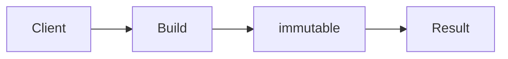

# Builder

**Season:** 1 · Creational · **Category:** GoF · **Level:** Beginner · **Runtime:** ~10–12 min · **Channel:** Build with Waqar

## Problem
**Build immutable HTTP requests with many optionals**

Key types: `HttpRequest`, `Builder`.

## Hook
Picture this: you are mid-demo and «Build immutable HTTP requests with many optionals» blows up the naive way — you see `caught=url required`. That is the pain. In the next ten minutes we introduce **Builder** with real types (HttpRequest, Builder), a runnable `ProblemDemo`, and the failure path locked in by tests. No abstract UML first — problem first.

## Intent
Use **Builder** to cleanly solve: Build immutable HTTP requests with many optionals.

**When to use:** the force behind «Build immutable HTTP requests with many optionals» shows up more than once and a simpler language feature does not erase it.

**When to refuse:** you are pattern-collecting, the boundary is still unclear, or the team cannot yet test the abstraction (compensations, half-open recovery, interpreters).

## The Pain — Naive Design
Naive version fails to cleanly solve: Build immutable HTTP requests with many optionals

```java
package com.buildwithwaqar.patterns.gof.creational.builder.problem;

import java.util.*;

public final class NaiveHttp {
  public static String build(String url, String method, String body, boolean auth) {
    if (url == null || url.isBlank()) throw new IllegalArgumentException("url");
    return method + " " + url + " body=" + body + " auth=" + auth;
  }
}

```

On camera, point at the smell: missing compensations, leaked XML, null at the boundary,
illegal transitions, or hard-wired `System.out` that you cannot assert.

## Pattern Structure


These roles are for **«Build immutable HTTP requests with many optionals»** — not a generic Client→Pattern poster. Keep them on screen
while you type the solution.

## Refactor to the Pattern

### Stage 1 — Name the boundary
Introduce the client-facing API the rest of the app should depend on. Hide the incompatible or
distributed details behind it. For this episode that boundary is what makes «Build immutable HTTP requests with many optionals» testable.

### Stage 2 — Encode the solution
```java
package com.buildwithwaqar.patterns.gof.creational.builder.problem;

import java.util.*;

final class HttpRequest {
  private final String url, method, body; private final boolean auth;
  private HttpRequest(Builder b){ url=b.url; method=b.method; body=b.body; auth=b.auth; }
  public String summarize(){ return method+" "+url+" body="+body+" auth="+auth; }
  public static final class Builder {
    private String url, method="GET", body=""; private boolean auth;
    public Builder url(String u){ this.url=u; return this; }
    public Builder method(String m){ this.method=m; return this; }
    public Builder body(String b){ this.body=b; return this; }
    public Builder auth(boolean a){ this.auth=a; return this; }
    public HttpRequest build(){
      if (url==null || url.isBlank()) throw new IllegalArgumentException("url required");
      return new HttpRequest(this);
    }
  }
}

```

### Stage 3 — Runnable main
```java
package com.buildwithwaqar.patterns.gof.creational.builder.problem;

import java.util.*;

public final class ProblemDemo {
  public static void main(String[] args) {
    System.out.println("=== Builder: immutable HTTP request ===");
    System.out.println("--- naive ---");
System.out.println(NaiveHttp.build("/x","POST","{}",true));
System.out.println("--- builder ---");
System.out.println(new HttpRequest.Builder().url("/v1/orders").method("POST").body("{}").auth(true).build().summarize());
try { new HttpRequest.Builder().method("GET").build(); } catch (IllegalArgumentException e) { System.out.println("caught="+e.getMessage()); }
  }
}

```

## Runnable Output (Verified on JDK 25)
Narrate each line. Do not invent numbers on camera.

```text
=== Builder: immutable HTTP request ===
--- naive ---
POST /x body={} auth=true
--- builder ---
POST /v1/orders body={} auth=true
caught=url required
```

Happy-path cue: `POST /x body={} auth=true`.
Failure-path cue: `caught=url required`.
Fork the repo, set `JAVA_HOME` to JDK 25, and re-run the same `ProblemDemo` to verify.

## Modern Java 25 / Zazr Variant
For **Builder**, prefer records for results, sealed types for closed variants, and Zazr `Option`/`Either`/`Validation` when the force is absence or accumulated errors. Keep the classic shape when interview literacy matters.

## Trade-offs
- **Clarity vs ceremony:** extra types for «Build immutable HTTP requests with many optionals» only pay off when the force repeats.
- **Testability:** inject collaborators; assert the failure path, not only the happy path.
- **Distributed / concurrent reality:** demos omit metrics, backpressure, and multi-region clocks.
- **Refuse Builder** when a sealed switch, a function value, or a simpler library call already erases the force.
- **Neighbor:** Factory Method — Builder is for many optionals / immutability; Factory Method for subtype choice.

## Interview Q&A
**Q1. What concrete problem does Builder solve here?**
A: Build immutable HTTP requests with many optionals.

**Q2. What does the naive design get wrong?**
A: Naive version fails to cleanly solve: Build immutable HTTP requests with many optionals

**Q3. How do you test the failure path?**
A: Inject the fault and assert the observable outcome — e.g. `caught=url required`.

**Q4. When is Builder the wrong tool?**
A: When a smaller language feature erases the force, or when you really needed Factory Method.


## Key Takeaways
- Lead with the problem: Build immutable HTTP requests with many optionals.
- Show naive pain (`caught=url required`) before naming Builder.
- Run the Demo; trust JDK 25 stdout (`POST /x body={} auth=true`).
- Teach when NOT to use Builder.

## Video Script (≈10–12 minutes)
Record for **Build with Waqar**. OBS for capture, CapCut for assembly. Import `slides.pdf`.
Facecam: full-screen for the hook, framed PiP over code slides.

**[0:00]** *(slide 01 title + talking head)*
Hey everyone — today we solve one concrete problem with **Builder**:
*Build immutable HTTP requests with many optionals*. Keep these names in your head: HttpRequest, Builder.

**[0:45]** *(problem + hook slides)*
I am not starting with a textbook definition. Here is the product pain. By the end you will have
seen the naive leak, the pattern boundary, and real JDK 25 stdout.

**[2:00]** *(naive code)*
IDE time. This is the naive version. Call out the smell — that is what Builder exists to erase.

**[3:30]** *(structure diagram)*
Roles for **this** problem, not a generic UML poster. Point at each box while you talk.

**[4:30]** *(refactor / solution code)*
Stage the solution. Highlight failure injection and the tests that lock it in.

**[7:00]** *(walkthrough output)*
Real stdout. Happy path cue: `POST /x body={} auth=true`.
Failure cue: `caught=url required`.
No invented numbers on camera.

**[8:30]** *(modern Java 25 / Zazr + trade-offs)*
Show the modernization, then slow down for when NOT to use Builder. That is what seniors listen for.

**[10:30]** *(Q&A + recap + outro)*
Two interview questions, three takeaways, link the GitHub episode folder. I am Waqar — see you in the next one.


## Walkthrough Beats (Say These Out Loud)
1. **Setup:** open `series/06-builder/` and `run-output.txt` beside the IDE.
2. **Naive:** reproduce the pain until you can point at `caught=url required`.
3. **Structure:** on the diagram, trace `Client` → `Build`, `Build` → `immutable`, `immutable` → `Result`.
4. **Refactor:** encode the boundary, then run `ProblemDemo` — match `POST /x body={} auth=true`.
5. **Break it:** flip one `ProblemTest` assertion, watch red, restore it.
6. **Refuse:** Contrast with **Factory Method**: Builder is for many optionals / immutability; Factory Method for subtype choice.

## Practice Drill
- Clone `waqarys/java-design-patterns`, set `JAVA_HOME` to JDK 25.
- Run the episode `ProblemDemo` (see `EP_MAIN` in `tools/enrich/build_problems.py`).
- Mutate one collaborator to fail; confirm the observable compensation / error path.
- Explain Builder for «Build immutable HTTP requests with many optionals» in sixty seconds without notes.
