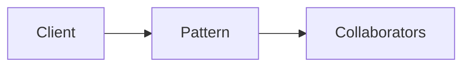

# Builder

**Season:** 1 · Creational · **Category:** GoF · **Level:** Beginner · **Target runtime:** ~10–12 min · **Channel:** Build with Waqar · **Target runtime:** ~10–12 min · **Channel:** Build with Waqar

## Problem
**Build immutable HTTP requests with many optionals**

This episode is built around that concrete problem — not a shared StreamForge framing.
You will see a real naive implementation that hurts, a full pattern-based solution, a
runnable main with meaningful stdout, and JUnit failure-path coverage where the pattern lives.

## Hook
Welcome back to **Build with Waqar**. Today we earn **Builder** by solving one problem well:
*Build immutable HTTP requests with many optionals*. By the end you will have walked naive pain → pattern refactor → real JDK 25
stdout → trade-offs, with CapCut slides and a spoken script.

## Intent
Builder exists because this force kept showing up: build immutable http requests with many optionals. Name the force, sketch
the roles, and — critically — know when you would refuse the pattern.

## The Pain — Naive Design
Before the pattern, teams usually thread details everywhere, leak resources on partial
failure, or couple call sites to a third-party shape. That feels fast on day one and expensive
on day thirty.

```java
package com.buildwithwaqar.patterns.gof.creational.builder;

import com.buildwithwaqar.patterns.gof.creational.builder.HttpRequest;

/** Problem: construct API requests with many optional headers without telescoping ctors. */
public final class UseCaseDemo {
    public static void main(String[] args) {
        System.out.println("=== Builder problem: HTTP request with optionals ===");
        var req = HttpRequest.builder("https://api.example/v1/videos")
                .method("POST")
                .header("Authorization", "Bearer t")
                .body("{\"title\":\"Adapter\"}")
                .timeoutMs(3000)
                .build();
        System.out.println("method=" + req.method() + " auth=" + req.headers().get("Authorization")
                + " timeout=" + req.timeoutMs());
    }
}

```

Call out the smell on camera: duplicated envelopes, missing compensations, parameter drilling,
illegal transitions, or null at the boundary.

## Pattern Structure


Roles matter more than class counts. The diagram slide draws the collaboration for **this**
problem so viewers can point at boxes while you type.

## Refactor to the Pattern

### Stage 1 — Name the boundary
Identify the client-facing API the rest of the app should depend on. Hide the incompatible
or distributed details behind it.

### Stage 2 — Encode the solution
```java
package com.buildwithwaqar.patterns.gof.creational.builder;

import java.util.LinkedHashMap;
import java.util.Map;
import java.util.Objects;

/** Immutable HTTP request built with a fluent classic builder. */
public final class HttpRequest {
    private final String method;
    private final String url;
    private final Map<String, String> headers;
    private final String body;
    private final int timeoutMs;

    private HttpRequest(Builder b) {
        this.method = b.method;
        this.url = b.url;
        this.headers = Map.copyOf(b.headers);
        this.body = b.body;
        this.timeoutMs = b.timeoutMs;
    }

    public String method() { return method; }
    public String url() { return url; }
    public Map<String, String> headers() { return headers; }
    public String body() { return body; }
    public int timeoutMs() { return timeoutMs; }

    public static Builder builder(String url) { return new Builder(url); }

    /** Modern: records + withers-style nested builder still works well. */
    public static final class Builder {
        private String method = "GET";
        private final String url;
        private final Map<String, String> headers = new LinkedHashMap<>();
        private String body = "";
        private int timeoutMs = 5_000;

        private Builder(String url) {
            this.url = Objects.requireNonNull(url);
        }

        public Builder method(String method) { this.method = method; return this; }
        public Builder header(String k, String v) { headers.put(k, v); return this; }
        public Builder body(String body) { this.body = body; return this; }
        public Builder timeoutMs(int timeoutMs) { this.timeoutMs = timeoutMs; return this; }

        public HttpRequest build() {
            if (timeoutMs <= 0) throw new IllegalArgumentException("timeoutMs must be > 0");
            return new HttpRequest(this);
        }
    }
}

/** Java 25-friendly: compact record with smart constructor + defaults via static factory. */
record ApiCall(String method, String url, String body, int timeoutMs) {
    ApiCall {
        Objects.requireNonNull(method);
        Objects.requireNonNull(url);
        if (timeoutMs <= 0) throw new IllegalArgumentException("timeout");
        body = body == null ? "" : body;
    }

    static ApiCall get(String url) { return new ApiCall("GET", url, "", 5_000); }
    ApiCall withBody(String body) { return new ApiCall(method, url, body, timeoutMs); }
    ApiCall withTimeout(int ms) { return new ApiCall(method, url, body, ms); }
}

```

### Stage 3 — Runnable main
```java
package com.buildwithwaqar.patterns.gof.creational.builder;

import com.buildwithwaqar.patterns.gof.creational.builder.HttpRequest;

/** Problem: construct API requests with many optional headers without telescoping ctors. */
public final class UseCaseDemo {
    public static void main(String[] args) {
        System.out.println("=== Builder problem: HTTP request with optionals ===");
        var req = HttpRequest.builder("https://api.example/v1/videos")
                .method("POST")
                .header("Authorization", "Bearer t")
                .body("{\"title\":\"Adapter\"}")
                .timeoutMs(3000)
                .build();
        System.out.println("method=" + req.method() + " auth=" + req.headers().get("Authorization")
                + " timeout=" + req.timeoutMs());
    }
}

```

## Hand-Traced Walkthrough (Verified on JDK 25)
Narrate each line. Do not invent numbers on camera.

```text
=== Builder problem: HTTP request with optionals ===
method=POST auth=Bearer t timeout=3000
```

Trace: match each printed line to a stage above. Fork the repo, set `JAVA_HOME` to JDK 25,
and re-run the same main class to verify.

## Modern Java 25 / Zazr Variant
Prefer records for results, sealed types for closed variants, pattern matching for exhaustive
handling, virtual threads for blocking fan-out, and Zazr for Option/Either/Try/Validation
when the force is about absence or accumulated errors. Keep the classic shape when interview
literacy matters.

## Trade-offs
- **Clarity vs ceremony:** five types for a two-line problem is a fail.
- **Testability:** inject collaborators; for Saga, inject failure at each step.
- **Distributed reality:** teaching demos omit metrics, poison pills, and multi-region clocks.
- **Refuse the pattern** when a sealed switch, a function value, or a simpler library call
  already erases the force.

## When to Use / When Not to Use
**Use when** the problem above shows up more than once and a simpler language feature does
not erase it.

**Avoid when** you are pattern-collecting, when the boundary is still unclear, or when the
team cannot yet test the abstraction (especially compensations and half-open recovery).

## Related Patterns
Contrast Builder with its usual twin (Adapter vs Facade, Saga vs Outbox, Reader vs DI/Cake,
State vs Strategy, Free vs Tagless). Say the distinguishing sentence out loud.

## Interview Q&A
**Q1. What concrete problem does Builder solve here?**
A: Build immutable HTTP requests with many optionals.

**Q2. What does the naive design get wrong?**
A: Point at the naive code smells from this episode.

**Q3. How do you test failure paths?**
A: Inject a failing collaborator (Saga step, SOAP fault, missing file) and assert the
observable outcome — compensation order, FAILED result, or thrown IllegalStateException.

**Q4. When is Builder the wrong tool?**
A: Give a smaller counterexample where a function, Option, or facade is enough.

**Q5. How does Java 25 change the encoding?**
A: Records, sealed types, virtual threads, Zazr control types — pick what applies.

## Key Takeaways
- Lead with the problem: Build immutable HTTP requests with many optionals.
- Show naive pain before naming Builder.
- Run the Demo; trust JDK 25 stdout.
- Teach when NOT to use it.

## Video Script (≈10–12 minutes)
Record for **Build with Waqar**. OBS for capture, CapCut for assembly. Import `slides.pdf`.

**[0:00]** *(slide 01 title)*
Hey everyone, welcome back to Build with Waqar. Today we solve a real problem with Builder:
Build immutable HTTP requests with many optionals.

**[0:40]** *(slide 02–03 problem)*
I am not starting with a definition. Here is the product pain. Keep these names — they
reappear in the Demo output.

**[2:00]** *(naive code)*
IDE time. This is the naive version. Call out the smell.

**[3:30]** *(diagram)*
Structure for **this** problem. Point at each role.

**[4:30]** *(refactor stages)*
Stage by stage into the pattern. Highlight tests and failure injection.

**[7:00]** *(walkthrough output)*
Real stdout from JDK 25. Line by line. No fake numbers.

**[8:30]** *(modern + trade-offs)*
Java 25 / Zazr take, then slow down for when NOT to use Builder.

**[10:30]** *(interview + recap)*
Two interview questions, three takeaways, link the GitHub episode folder. I am Waqar —
see you in the next one.


## Studio Notes for Build with Waqar
When you record this episode, keep the energy practical. Start with the product pain, not the pattern name. Viewers stay when they feel the bug before they learn the label. In CapCut, overlay the slide number in the corner and cut idle IDE scrolling. If a code block is long, zoom CapCut to the highlighted lines rather than shrinking the font on the slide. Re-run the Demo live once if your machine allows — viewers trust a terminal more than a screenshot. Finally, end with a single actionable challenge: ask them to open the repo, run the Demo, and mutate one assertion in the test to see the failure. That turns passive watching into practice.

### CapCut Checklist
- Import `slides.pdf` or the PNG sequence at 1920×1080.
- Align voiceover to the timestamps in the Video Script section.
- Keep lower-thirds short: pattern name + one-line intent.
- Add a pinned comment with the GitHub path to this episode folder.

### Common Recording Mistakes
- Reading UML without showing running output.
- Skipping the "when NOT to use" section — that is what seniors listen for.
- Rushing trade-offs. Slow down here; it is interview gold.
- Forgetting to mention the test class name so learners can `mvn -Dtest=... test`.


## Practice Drill (Do This After Watching)
1. Clone `waqarys/java-design-patterns` and set `JAVA_HOME` to JDK 25.
2. Run the episode Demo (`mvn -q exec:java -Dexec.mainClass=...` or `java -cp ... Demo`).
3. Break the implementation on purpose; watch the test fail; restore it.
4. Write one alternative design in a scratch branch and compare readability.
5. Explain the pattern out loud in sixty seconds without looking at notes — that is your introspective for interviews.

## Glossary
- **Force:** the design pressure (extensibility, coupling, allocation, testability) that makes a pattern worth considering.
- **Role:** a participant name from the pattern (Context, Strategy, Client, Creator, Product).
- **Smell:** a code signal that a force is unresolved (telescoping constructors, instanceof forests, god classes).
- **Modernization:** the Java 25 / Zazr encoding that preserves the force-resolution with less ceremony.


## Problem Deep Dive
The concrete problem for this episode is: **Build immutable HTTP requests with many optionals**.

Walk the naive path slowly on camera. Ask viewers what breaks first when requirements change —
a new file to load, a new payment currency, a new saga step, a new illegal state transition.
That question is the force. The pattern is just the name we give the force once we have felt it.

Then open the solution types and show the boundary: what the rest of the app is allowed to
depend on, and what stays hidden. Highlight how the runnable main prints a meaningful trace —
happy path and at least one failure path — so CapCut can cut between IDE and terminal without
inventing numbers.

Finally, spend a full minute on trade-offs. Seniors stay for the "when not". Juniors need the
happy path. Your job on Build with Waqar is both.
