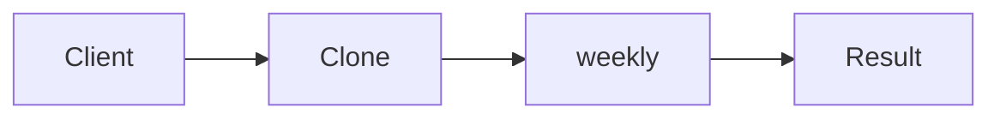

# Prototype

**Season:** 1 · Creational · **Category:** GoF · **Level:** Beginner · **Runtime:** ~10–12 min · **Channel:** Build with Waqar

## Problem
**Clone weekly-meeting doc templates per team**

Key types: `MeetingTemplate`.

## Hook
Picture this: you are mid-demo and «Clone weekly-meeting doc templates per team» blows up the naive way — you see `Failure path is asserted in ProblemTest (injected fault / invalid input)`. That is the pain. In the next ten minutes we introduce **Prototype** with real types (MeetingTemplate), a runnable `ProblemDemo`, and the failure path locked in by tests. No abstract UML first — problem first.

## Intent
Use **Prototype** to cleanly solve: Clone weekly-meeting doc templates per team.

**When to use:** the force behind «Clone weekly-meeting doc templates per team» shows up more than once and a simpler language feature does not erase it.

**When to refuse:** you are pattern-collecting, the boundary is still unclear, or the team cannot yet test the abstraction (compensations, half-open recovery, interpreters).

## The Pain — Naive Design
Naive version fails to cleanly solve: Clone weekly-meeting doc templates per team

```java
package com.buildwithwaqar.patterns.gof.creational.prototype.problem;

import java.util.*;

public final class NaiveTemplate {
  public static String clone(String title){ return title + " (copy)"; } // shallow, loses attendees
}

```

On camera, point at the smell: missing compensations, leaked XML, null at the boundary,
illegal transitions, or hard-wired `System.out` that you cannot assert.

## Pattern Structure


These roles are for **«Clone weekly-meeting doc templates per team»** — not a generic Client→Pattern poster. Keep them on screen
while you type the solution.

## Refactor to the Pattern

### Stage 1 — Name the boundary
Introduce the client-facing API the rest of the app should depend on. Hide the incompatible or
distributed details behind it. For this episode that boundary is what makes «Clone weekly-meeting doc templates per team» testable.

### Stage 2 — Encode the solution
```java
package com.buildwithwaqar.patterns.gof.creational.prototype.problem;

import java.util.*;

import java.util.*;
final class MeetingTemplate implements Cloneable {
  private String title; private List<String> attendees;
  public MeetingTemplate(String title, List<String> attendees){
    this.title=title; this.attendees=new ArrayList<>(attendees);
  }
  public MeetingTemplate copy(){
    return new MeetingTemplate(title + " (copy)", new ArrayList<>(attendees));
  }
  public MeetingTemplate withTitle(String t){ this.title=t; return this; }
  public List<String> attendees(){ return List.copyOf(attendees); }
  public String title(){ return title; }
  public String describe(){ return title+":"+attendees; }
}

```

### Stage 3 — Runnable main
```java
package com.buildwithwaqar.patterns.gof.creational.prototype.problem;

import java.util.*;

public final class ProblemDemo {
  public static void main(String[] args) {
    System.out.println("=== Prototype: clone meeting templates ===");
    System.out.println("--- naive ---");
System.out.println(NaiveTemplate.clone("Weekly"));
System.out.println("--- prototype ---");
var proto = new MeetingTemplate("Weekly Sync", List.of("Ada","Bob"));
var teamA = proto.copy().withTitle("Team A Sync");
System.out.println(proto.describe());
System.out.println(teamA.describe());
System.out.println("independent=" + (proto.attendees() != teamA.attendees()));
  }
}

```

## Runnable Output (Verified on JDK 25)
Narrate each line. Do not invent numbers on camera.

```text
=== Prototype: clone meeting templates ===
--- naive ---
Weekly (copy)
--- prototype ---
Weekly Sync:[Ada, Bob]
Team A Sync:[Ada, Bob]
independent=true
```

Happy-path cue: `Weekly (copy)`.
Failure-path cue: `Failure path is asserted in ProblemTest (injected fault / invalid input)`.
Fork the repo, set `JAVA_HOME` to JDK 25, and re-run the same `ProblemDemo` to verify.

## Modern Java 25 / Zazr Variant
For **Prototype**, prefer records for results, sealed types for closed variants, and Zazr `Option`/`Either`/`Validation` when the force is absence or accumulated errors. Keep the classic shape when interview literacy matters.

## Trade-offs
- **Clarity vs ceremony:** extra types for «Clone weekly-meeting doc templates per team» only pay off when the force repeats.
- **Testability:** inject collaborators; assert the failure path, not only the happy path.
- **Distributed / concurrent reality:** demos omit metrics, backpressure, and multi-region clocks.
- **Refuse Prototype** when a sealed switch, a function value, or a simpler library call already erases the force.
- **Neighbor:** Factory Method — Prototype clones a configured instance; Factory Method constructs fresh.

## Interview Q&A
**Q1. What concrete problem does Prototype solve here?**
A: Clone weekly-meeting doc templates per team.

**Q2. What does the naive design get wrong?**
A: Naive version fails to cleanly solve: Clone weekly-meeting doc templates per team

**Q3. How do you test the failure path?**
A: Inject the fault and assert the observable outcome — e.g. `Failure path is asserted in ProblemTest (injected fault / invalid input)`.

**Q4. When is Prototype the wrong tool?**
A: When a smaller language feature erases the force, or when you really needed Factory Method.


## Key Takeaways
- Lead with the problem: Clone weekly-meeting doc templates per team.
- Show naive pain (`Failure path is asserted in ProblemTest (injected fault / invalid input)`) before naming Prototype.
- Run the Demo; trust JDK 25 stdout (`Weekly (copy)`).
- Teach when NOT to use Prototype.

## Video Script (≈10–12 minutes)
Record for **Build with Waqar**. OBS for capture, CapCut for assembly. Import `slides.pdf`.
Facecam: full-screen for the hook, framed PiP over code slides.

**[0:00]** *(slide 01 title + talking head)*
Hey everyone — today we solve one concrete problem with **Prototype**:
*Clone weekly-meeting doc templates per team*. Keep these names in your head: MeetingTemplate.

**[0:45]** *(problem + hook slides)*
I am not starting with a textbook definition. Here is the product pain. By the end you will have
seen the naive leak, the pattern boundary, and real JDK 25 stdout.

**[2:00]** *(naive code)*
IDE time. This is the naive version. Call out the smell — that is what Prototype exists to erase.

**[3:30]** *(structure diagram)*
Roles for **this** problem, not a generic UML poster. Point at each box while you talk.

**[4:30]** *(refactor / solution code)*
Stage the solution. Highlight failure injection and the tests that lock it in.

**[7:00]** *(walkthrough output)*
Real stdout. Happy path cue: `Weekly (copy)`.
Failure cue: `Failure path is asserted in ProblemTest (injected fault / invalid input)`.
No invented numbers on camera.

**[8:30]** *(modern Java 25 / Zazr + trade-offs)*
Show the modernization, then slow down for when NOT to use Prototype. That is what seniors listen for.

**[10:30]** *(Q&A + recap + outro)*
Two interview questions, three takeaways, link the GitHub episode folder. I am Waqar — see you in the next one.


## Walkthrough Beats (Say These Out Loud)
1. **Setup:** open `series/07-prototype/` and `run-output.txt` beside the IDE.
2. **Naive:** reproduce the pain until you can point at `Failure path is asserted in ProblemTest (injected fault / invalid input)`.
3. **Structure:** on the diagram, trace `Client` → `Clone`, `Clone` → `weekly`, `weekly` → `Result`.
4. **Refactor:** encode the boundary, then run `ProblemDemo` — match `Weekly (copy)`.
5. **Break it:** flip one `ProblemTest` assertion, watch red, restore it.
6. **Refuse:** Contrast with **Factory Method**: Prototype clones a configured instance; Factory Method constructs fresh.

## Practice Drill
- Clone `waqarys/java-design-patterns`, set `JAVA_HOME` to JDK 25.
- Run the episode `ProblemDemo` (see `EP_MAIN` in `tools/enrich/build_problems.py`).
- Mutate one collaborator to fail; confirm the observable compensation / error path.
- Explain Prototype for «Clone weekly-meeting doc templates per team» in sixty seconds without notes.
