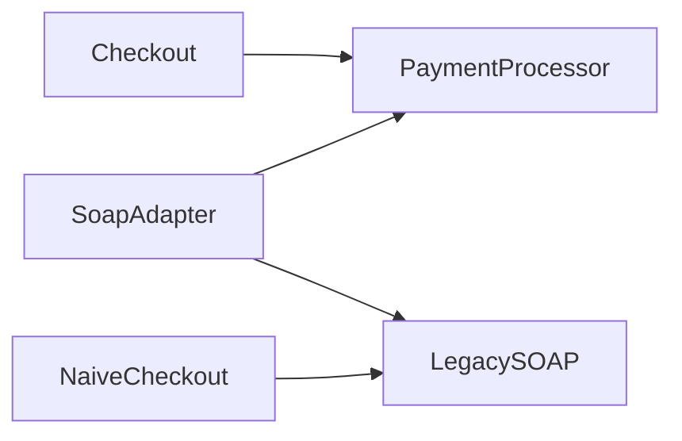

# Adapter

**Season:** 2 · Structural · **Category:** GoF · **Level:** Beginner · **Runtime:** ~10–12 min · **Channel:** Build with Waqar

## Problem
**Wrap legacy XML SOAP payment gateway as PaymentProcessor**

Key types: `SoapPaymentAdapter`.

**Adapter nuance:** the target interface (`PaymentProcessor`) belongs to *your* domain. The adaptee (`LegacySoapGateway`) stays untouched. The adapter owns XML envelopes, currency checks, and fault scraping so checkout never sees SOAP.

## Hook
Picture this: you are mid-demo and «Wrap legacy XML SOAP payment gateway as PaymentProcessor» blows up the naive way — you see `FAILED:<Fault>non-positive</Fault>`. That is the pain. In the next ten minutes we introduce **Adapter** with real types (SoapPaymentAdapter), a runnable `ProblemDemo`, and the failure path locked in by tests. No abstract UML first — problem first.

## Intent
Make a legacy SOAP payment gateway look like your domain `PaymentProcessor` without rewriting checkout.

**When to use:** the force behind «Wrap legacy XML SOAP payment gateway as PaymentProcessor» shows up more than once and a simpler language feature does not erase it.

**When to refuse:** you are pattern-collecting, the boundary is still unclear, or the team cannot yet test the abstraction (compensations, half-open recovery, interpreters).

## The Pain — Naive Design
Naive: checkout knows SOAP XML and dollar conversion. Every call site duplicates envelope formatting and response scraping.

```java
package com.buildwithwaqar.patterns.gof.structural.adapter.problem;

/**
 * Naive: checkout knows SOAP XML and dollar conversion.
 * Every call site duplicates envelope formatting and response scraping.
 */
public final class NaiveCheckout {
    private final LegacySoapGateway gateway = new LegacySoapGateway();

    public String pay(String customerId, int amountCents) {
        double dollars = amountCents / 100.0;
        String xml = "<Envelope><Customer>" + customerId + "</Customer><Amount>"
                + dollars + "</Amount></Envelope>";
        String ack = gateway.submitXml(xml);
        if (ack.contains("<Fault>")) {
            return "FAILED:" + ack;
        }
        int ts = ack.indexOf("<Txn>") + 5;
        int te = ack.indexOf("</Txn>");
        return "OK:" + ack.substring(ts, te);
    }
}

```

On camera, point at the smell: missing compensations, leaked XML, null at the boundary,
illegal transitions, or hard-wired `System.out` that you cannot assert.

## Pattern Structure


These roles are for **«Wrap legacy XML SOAP payment gateway as PaymentProcessor»** — not a generic Client→Pattern poster. Keep them on screen
while you type the solution.

## Refactor to the Pattern

### Stage 1 — Name the boundary
Introduce the client-facing API the rest of the app should depend on. Hide the incompatible or
distributed details behind it. For this episode that boundary is what makes «Wrap legacy XML SOAP payment gateway as PaymentProcessor» testable.

### Stage 2 — Encode the solution
```java
package com.buildwithwaqar.patterns.gof.structural.adapter.problem;

/** Adapter: translates PaymentProcessor calls into LegacySoapGateway XML. */
public final class SoapPaymentAdapter implements PaymentProcessor {
    private final LegacySoapGateway gateway;

    public SoapPaymentAdapter(LegacySoapGateway gateway) {
        this.gateway = gateway;
    }

    @Override
    public PaymentResult charge(String customerId, int amountCents, String currency) {
        if (!"USD".equalsIgnoreCase(currency)) {
            return new PaymentResult(false, null, "unsupported currency " + currency);
        }
        double dollars = amountCents / 100.0;
        String xml = "<Envelope><Customer>" + customerId
                + "</Customer><Amount>" + dollars + "</Amount><Currency>USD</Currency></Envelope>";
        String ack = gateway.submitXml(xml);
        if (ack.contains("<Fault>")) {
            return new PaymentResult(false, null, ack);
        }
        int ts = ack.indexOf("<Txn>") + 5;
        int te = ack.indexOf("</Txn>");
        return new PaymentResult(true, ack.substring(ts, te), "charged");
    }
}

```

### Stage 3 — Runnable main
```java
package com.buildwithwaqar.patterns.gof.structural.adapter.problem;

/** Problem: checkout must talk PaymentProcessor; legacy SOAP gateway speaks XML. */
public final class ProblemDemo {
    public static void main(String[] args) {
        System.out.println("=== Adapter problem: legacy SOAP payment gateway ===");
        System.out.println("--- naive (controller knows SOAP XML) ---");
        System.out.println(new NaiveCheckout().pay("alice", 1999));
        System.out.println("--- adapter (PaymentProcessor) ---");
        var checkout = new CheckoutService(new SoapPaymentAdapter(new LegacySoapGateway()));
        System.out.println(checkout.checkout("alice", 1999));
        System.out.println(checkout.checkout("alice", 0));
        System.out.println(new SoapPaymentAdapter(new LegacySoapGateway()).charge("a", 100, "INR"));
    }
}

```

## Runnable Output (Verified on JDK 25)
Narrate each line. Do not invent numbers on camera.

```text
=== Adapter problem: legacy SOAP payment gateway ===
--- naive (controller knows SOAP XML) ---
OK:SOAP-alice-1998
--- adapter (PaymentProcessor) ---
OK:SOAP-alice-1998
FAILED:<Fault>non-positive</Fault>
PaymentResult[ok=false, transactionId=null, message=unsupported currency INR]
```

Happy-path cue: `OK:SOAP-alice-1998`.
Failure-path cue: `FAILED:<Fault>non-positive</Fault>`.
Fork the repo, set `JAVA_HOME` to JDK 25, and re-run the same `ProblemDemo` to verify.

## Modern Java 25 / Zazr Variant
For **Adapter**, prefer records for results, sealed types for closed variants, and Zazr `Option`/`Either`/`Validation` when the force is absence or accumulated errors. Keep the classic shape when interview literacy matters.

## Trade-offs
- **Clarity vs ceremony:** one adapter class beats leaking SOAP XML into every controller.
- **Testability:** fake `LegacySoapGateway` or assert on `PaymentResult` without standing up SOAP.
- **Refuse Adapter** when you own both sides — just change the interface once.
- **Watch currency / fault scraping** — that mapping is the adapter's real job.
- **Neighbor:** Facade — Adapter converts one incompatible API; Facade simplifies a whole subsystem.

## Interview Q&A
**Q1. What is the target interface in this episode?**
A: `PaymentProcessor` — checkout depends only on it. The adaptee `LegacySoapGateway` stays untouched.

**Q2. Where do currency checks and SOAP faults belong?**
A: Inside the adapter. Controllers must never scrape `<Fault>` XML.

**Q3. How do you prove the adapter failed cleanly?**
A: Drive a non-positive amount or unsupported currency and assert `PaymentResult.ok=false` with a clear message.

**Q4. When is Adapter the wrong tool?**
A: When a smaller language feature erases the force, or when you really needed Facade.


## Key Takeaways
- Lead with the problem: Wrap legacy XML SOAP payment gateway as PaymentProcessor.
- Show naive pain (`FAILED:<Fault>non-positive</Fault>`) before naming Adapter.
- Run the Demo; trust JDK 25 stdout (`OK:SOAP-alice-1998`).
- Teach when NOT to use Adapter.

## Video Script (≈10–12 minutes)
Record for **Build with Waqar**. OBS for capture, CapCut for assembly. Import `slides.pdf`.
Facecam: full-screen for the hook, framed PiP over code slides.

**[0:00]** *(slide 01 title + talking head)*
Hey everyone — today we solve one concrete problem with **Adapter**:
*Wrap legacy XML SOAP payment gateway as PaymentProcessor*. Keep these names in your head: SoapPaymentAdapter.

**[0:45]** *(problem + hook slides)*
I am not starting with a textbook definition. Here is the product pain. By the end you will have
seen the naive leak, the pattern boundary, and real JDK 25 stdout.

**[2:00]** *(naive code)*
IDE time. This is the naive version. Call out the smell — that is what Adapter exists to erase.

**[3:30]** *(structure diagram)*
Roles for **this** problem, not a generic UML poster. Point at each box while you talk.

**[4:30]** *(refactor / solution code)*
Stage the solution. Highlight failure injection and the tests that lock it in.

**[7:00]** *(walkthrough output)*
Real stdout. Happy path cue: `OK:SOAP-alice-1998`.
Failure cue: `FAILED:<Fault>non-positive</Fault>`.
No invented numbers on camera.

**[8:30]** *(modern Java 25 / Zazr + trade-offs)*
Show the modernization, then slow down for when NOT to use Adapter. That is what seniors listen for.

**[10:30]** *(Q&A + recap + outro)*
Two interview questions, three takeaways, link the GitHub episode folder. I am Waqar — see you in the next one.


## Walkthrough Beats (Say These Out Loud)
1. **Setup:** open `series/08-adapter/` and `run-output.txt` beside the IDE.
2. **Naive:** reproduce the pain until you can point at `FAILED:<Fault>non-positive</Fault>`.
3. **Structure:** on the diagram, trace `Checkout` → `PaymentProcessor`, `SoapAdapter` → `PaymentProcessor`, `SoapAdapter` → `LegacySOAP`, `NaiveCheckout` → `LegacySOAP`.
4. **Refactor:** encode the boundary, then run `ProblemDemo` — match `OK:SOAP-alice-1998`.
5. **Break it:** flip one `ProblemTest` assertion, watch red, restore it.
6. **Refuse:** Contrast with **Facade**: Adapter converts one incompatible API; Facade simplifies a whole subsystem.

## Practice Drill
- Clone `waqarys/java-design-patterns`, set `JAVA_HOME` to JDK 25.
- Run the episode `ProblemDemo` (see `EP_MAIN` in `tools/enrich/build_problems.py`).
- Mutate one collaborator to fail; confirm the observable compensation / error path.
- Explain Adapter for «Wrap legacy XML SOAP payment gateway as PaymentProcessor» in sixty seconds without notes.
