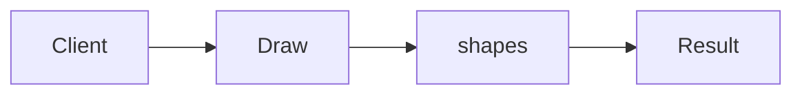

# Bridge

**Season:** 2 · Structural · **Category:** GoF · **Level:** Beginner · **Runtime:** ~10–12 min · **Channel:** Build with Waqar

## Problem
**Draw shapes with Vector vs Raster renderers independently**

Key types: `Renderer`, `VectorRenderer`, `RasterRenderer`, `Shape`, `Circle`, `Square`.

## Hook
Picture this: you are mid-demo and «Draw shapes with Vector vs Raster renderers independently» blows up the naive way — you see `Failure path is asserted in ProblemTest (injected fault / invalid input)`. That is the pain. In the next ten minutes we introduce **Bridge** with real types (Renderer, VectorRenderer, RasterRenderer), a runnable `ProblemDemo`, and the failure path locked in by tests. No abstract UML first — problem first.

## Intent
Use **Bridge** to cleanly solve: Draw shapes with Vector vs Raster renderers independently.

**When to use:** the force behind «Draw shapes with Vector vs Raster renderers independently» shows up more than once and a simpler language feature does not erase it.

**When to refuse:** you are pattern-collecting, the boundary is still unclear, or the team cannot yet test the abstraction (compensations, half-open recovery, interpreters).

## The Pain — Naive Design
explosion of combinations

```java
package com.buildwithwaqar.patterns.gof.structural.bridge.problem;

import java.util.*;

public final class NaiveShapes {
  public static String vectorCircle(int r){ return "vector-circle r="+r; }
  public static String rasterCircle(int r){ return "raster-circle r="+r; }
  public static String vectorSquare(int s){ return "vector-square s="+s; }
  // explosion of combinations
}

```

On camera, point at the smell: missing compensations, leaked XML, null at the boundary,
illegal transitions, or hard-wired `System.out` that you cannot assert.

## Pattern Structure


These roles are for **«Draw shapes with Vector vs Raster renderers independently»** — not a generic Client→Pattern poster. Keep them on screen
while you type the solution.

## Refactor to the Pattern

### Stage 1 — Name the boundary
Introduce the client-facing API the rest of the app should depend on. Hide the incompatible or
distributed details behind it. For this episode that boundary is what makes «Draw shapes with Vector vs Raster renderers independently» testable.

### Stage 2 — Encode the solution
```java
package com.buildwithwaqar.patterns.gof.structural.bridge.problem;

import java.util.*;

interface Renderer { String draw(String shape); }
record VectorRenderer() implements Renderer { public String draw(String s){ return "vector-"+s; } }
record RasterRenderer() implements Renderer { public String draw(String s){ return "raster-"+s; } }
abstract class Shape {
  protected final Renderer r; protected Shape(Renderer r){ this.r=r; }
  public abstract String draw();
}
final class Circle extends Shape {
  private final int radius; public Circle(Renderer r, int radius){ super(r); this.radius=radius; }
  public String draw(){ return r.draw("circle r="+radius); }
}
final class Square extends Shape {
  private final int side; public Square(Renderer r, int side){ super(r); this.side=side; }
  public String draw(){ return r.draw("square s="+side); }
}

```

### Stage 3 — Runnable main
```java
package com.buildwithwaqar.patterns.gof.structural.bridge.problem;

import java.util.*;

public final class ProblemDemo {
  public static void main(String[] args) {
    System.out.println("=== Bridge: shape × renderer ===");
    System.out.println("--- naive ---");
System.out.println(NaiveShapes.vectorCircle(3));
System.out.println("--- bridge ---");
System.out.println(new Circle(new VectorRenderer(), 3).draw());
System.out.println(new Square(new RasterRenderer(), 4).draw());
  }
}

```

## Runnable Output (Verified on JDK 25)
Narrate each line. Do not invent numbers on camera.

```text
=== Bridge: shape × renderer ===
--- naive ---
vector-circle r=3
--- bridge ---
vector-circle r=3
raster-square s=4
```

Happy-path cue: `vector-circle r=3`.
Failure-path cue: `Failure path is asserted in ProblemTest (injected fault / invalid input)`.
Fork the repo, set `JAVA_HOME` to JDK 25, and re-run the same `ProblemDemo` to verify.

## Modern Java 25 / Zazr Variant
**Records** carry the immutable results (`StepResult`, DTOs) with almost no boilerplate.

## Trade-offs
- **Clarity vs ceremony:** extra types for «Draw shapes with Vector vs Raster renderers independently» only pay off when the force repeats.
- **Testability:** inject collaborators; assert the failure path, not only the happy path.
- **Distributed / concurrent reality:** demos omit metrics, backpressure, and multi-region clocks.
- **Refuse Bridge** when a sealed switch, a function value, or a simpler library call already erases the force.
- **Neighbor:** Adapter — Bridge is designed up-front for two hierarchies; Adapter is retrofit.

## Interview Q&A
**Q1. What concrete problem does Bridge solve here?**
A: Draw shapes with Vector vs Raster renderers independently.

**Q2. What does the naive design get wrong?**
A: explosion of combinations

**Q3. How do you test the failure path?**
A: Inject the fault and assert the observable outcome — e.g. `Failure path is asserted in ProblemTest (injected fault / invalid input)`.

**Q4. When is Bridge the wrong tool?**
A: When a smaller language feature erases the force, or when you really needed Adapter.


## Key Takeaways
- Lead with the problem: Draw shapes with Vector vs Raster renderers independently.
- Show naive pain (`Failure path is asserted in ProblemTest (injected fault / invalid input)`) before naming Bridge.
- Run the Demo; trust JDK 25 stdout (`vector-circle r=3`).
- Teach when NOT to use Bridge.

## Video Script (≈10–12 minutes)
Record for **Build with Waqar**. OBS for capture, CapCut for assembly. Import `slides.pdf`.
Facecam: full-screen for the hook, framed PiP over code slides.

**[0:00]** *(slide 01 title + talking head)*
Hey everyone — today we solve one concrete problem with **Bridge**:
*Draw shapes with Vector vs Raster renderers independently*. Keep these names in your head: Renderer, VectorRenderer, RasterRenderer, Shape.

**[0:45]** *(problem + hook slides)*
I am not starting with a textbook definition. Here is the product pain. By the end you will have
seen the naive leak, the pattern boundary, and real JDK 25 stdout.

**[2:00]** *(naive code)*
IDE time. This is the naive version. Call out the smell — that is what Bridge exists to erase.

**[3:30]** *(structure diagram)*
Roles for **this** problem, not a generic UML poster. Point at each box while you talk.

**[4:30]** *(refactor / solution code)*
Stage the solution. Highlight failure injection and the tests that lock it in.

**[7:00]** *(walkthrough output)*
Real stdout. Happy path cue: `vector-circle r=3`.
Failure cue: `Failure path is asserted in ProblemTest (injected fault / invalid input)`.
No invented numbers on camera.

**[8:30]** *(modern Java 25 / Zazr + trade-offs)*
Show the modernization, then slow down for when NOT to use Bridge. That is what seniors listen for.

**[10:30]** *(Q&A + recap + outro)*
Two interview questions, three takeaways, link the GitHub episode folder. I am Waqar — see you in the next one.


## Walkthrough Beats (Say These Out Loud)
1. **Setup:** open `series/09-bridge/` and `run-output.txt` beside the IDE.
2. **Naive:** reproduce the pain until you can point at `Failure path is asserted in ProblemTest (injected fault / invalid input)`.
3. **Structure:** on the diagram, trace `Client` → `Draw`, `Draw` → `shapes`, `shapes` → `Result`.
4. **Refactor:** encode the boundary, then run `ProblemDemo` — match `vector-circle r=3`.
5. **Break it:** flip one `ProblemTest` assertion, watch red, restore it.
6. **Refuse:** Contrast with **Adapter**: Bridge is designed up-front for two hierarchies; Adapter is retrofit.

## Practice Drill
- Clone `waqarys/java-design-patterns`, set `JAVA_HOME` to JDK 25.
- Run the episode `ProblemDemo` (see `EP_MAIN` in `tools/enrich/build_problems.py`).
- Mutate one collaborator to fail; confirm the observable compensation / error path.
- Explain Bridge for «Draw shapes with Vector vs Raster renderers independently» in sixty seconds without notes.
