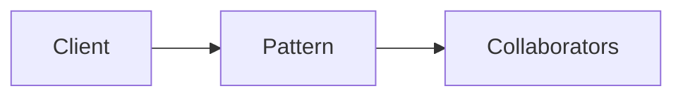

# Bridge

**Season:** 2 · Structural · **Category:** GoF · **Level:** Beginner

## Intent
Decouple abstraction from implementation so both vary independently.

## Problem
Without this pattern, code tends toward: New things up with conditionals and duplicated construction.

## Real-world Analogy
Remote control (abstraction) vs TV brand (implementor).

## When to Use
- See Intent.
- The design force named in Intent shows up more than once.

## When Not to Use
- When a simpler redesign removes the need.
- A simpler language feature (record, sealed switch, function value) already solves it.

## Naive Approach
```text
New things up with conditionals and duplicated construction.
```

## Pattern Structure

Client -> Pattern -> Collaborators

## Classic Implementation
Primary code lives under `src/main/java/com/buildwithwaqar/patterns/gof/structural/bridge/`.

```java
package com.buildwithwaqar.patterns.gof.structural.bridge;

interface Renderer { String render(String shape); }

record VectorRenderer() implements Renderer {
    public String render(String shape) { return "vector:" + shape; }
}
record RasterRenderer() implements Renderer {
    public String render(String shape) { return "raster:" + shape; }
}

/** Abstraction decoupled from implementation via composition. */
public abstract class Shape {
    protected final Renderer renderer;
    protected Shape(Renderer renderer) { this.renderer = renderer; }
    public abstract String draw();
}

final class Circle extends Shape {
    private final int radius;
    Circle(Renderer renderer, int radius) { super(renderer); this.radius = radius; }
    public String draw() { return renderer.render("circle(" + radius + ")"); }
}

final class Square extends Shape {
    private final int side;
    Square(Renderer renderer, int side) { super(renderer); this.side = side; }
    public String draw() { return renderer.render("square(" + side + ")"); }
}
```

## Modern Java 25 / Functional
Prefer sealed interfaces + records; virtual proxy uses synchronized lazy init.

## Worked Example
```text
See the JUnit test beside the implementation.
Run: mvn -Dtest=*Test test
Focus package matching: gof/structural/bridge/
```

## Pitfalls
- Keep adapters thin.
- Decorators should preserve the interface.
- Facades must not become god objects.

## Interview Q&A
**Q: When is Bridge the wrong choice?**
A: When you can change the adaptee/subject API or collapse the hierarchy.

**Q: How would you test this?**
A: Prefer injecting interfaces or interpreters; keep demos deterministic (fixed clocks, canned inputs).

## Key Takeaways
- Decouple abstraction from implementation so both vary independently.
- Prefer Java 25 sealed types / records / virtual threads where they simplify the classic shape.
- Ship working tests with every episode.

## Video Script
**[0:00] Hook** — Open with the analogy: Remote control (abstraction) vs TV brand (implementor).
**[0:40] Intent** — State the design force in one sentence: Decouple abstraction from implementation so both vary independently.
**[1:30] Naive pain** — Show the messy approach: New things up with conditionals and duplicated construction.
**[3:00] Pattern** — Walk the code under `gof/structural/bridge/`; draw the mermaid structure on-screen.
**[6:00] Modern take** — Prefer sealed interfaces + records; virtual proxy uses synchronized lazy init.
**[8:00] Pitfalls & interview** — Cover: When is Bridge the wrong choice?
**[9:30] Outro** — Tease the next episode; point viewers to the GitHub repo and slides PDF.
