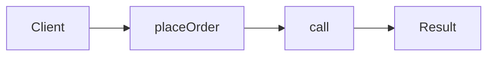

# Facade

**Season:** 2 · Structural · **Category:** GoF · **Level:** Beginner · **Runtime:** ~10–12 min · **Channel:** Build with Waqar

## Problem
**One placeOrder call over inventory+payment+shipping**

Key types: `Inventory`, `Payments`, `Shipping`, `OrderFacade`.

## Hook
Picture this: you are mid-demo and «One placeOrder call over inventory+payment+shipping» blows up the naive way — you see `FAIL:payment`. That is the pain. In the next ten minutes we introduce **Facade** with real types (Inventory, Payments, Shipping), a runnable `ProblemDemo`, and the failure path locked in by tests. No abstract UML first — problem first.

## Intent
Hide inventory + payment + shipping behind one `placeOrder` call.

**When to use:** the force behind «One placeOrder call over inventory+payment+shipping» shows up more than once and a simpler language feature does not erase it.

**When to refuse:** you are pattern-collecting, the boundary is still unclear, or the team cannot yet test the abstraction (compensations, half-open recovery, interpreters).

## The Pain — Naive Design
client calls three services itself

```java
package com.buildwithwaqar.patterns.gof.structural.facade.problem;

import java.util.*;

public final class NaiveCheckout {
  public static String place(String sku, int cents) {
    // client calls three services itself
    boolean inv = true; boolean pay = cents > 0; boolean ship = true;
    if (!inv || !pay || !ship) return "FAIL";
    return "OK:"+sku;
  }
}

```

On camera, point at the smell: missing compensations, leaked XML, null at the boundary,
illegal transitions, or hard-wired `System.out` that you cannot assert.

## Pattern Structure


These roles are for **«One placeOrder call over inventory+payment+shipping»** — not a generic Client→Pattern poster. Keep them on screen
while you type the solution.

## Refactor to the Pattern

### Stage 1 — Name the boundary
Introduce the client-facing API the rest of the app should depend on. Hide the incompatible or
distributed details behind it. For this episode that boundary is what makes «One placeOrder call over inventory+payment+shipping» testable.

### Stage 2 — Encode the solution
```java
package com.buildwithwaqar.patterns.gof.structural.facade.problem;

import java.util.*;
import java.util.concurrent.*;
import java.util.function.*;

final class Inventory { boolean reserve(String sku){ return sku!=null && !sku.isBlank(); } void release(String sku){} }
final class Payments { boolean charge(int cents){ return cents>0; } }
final class Shipping { boolean ship(String addr){ return addr!=null; } }
final class OrderFacade {
  private final Inventory inv=new Inventory();
  private final Payments pay=new Payments();
  private final Shipping ship=new Shipping();
  String placeOrder(String sku, int cents, String addr){
    if (!inv.reserve(sku)) return "FAIL:inventory";
    if (!pay.charge(cents)) { inv.release(sku); return "FAIL:payment"; }
    if (!ship.ship(addr)) return "FAIL:shipping";
    return "OK:"+sku;
  }
}

```

### Stage 3 — Runnable main
```java
package com.buildwithwaqar.patterns.gof.structural.facade.problem;

import java.util.*;
import java.util.concurrent.*;

public final class ProblemDemo {
  public static void main(String[] args) {
    System.out.println("=== Facade: placeOrder over inventory+payment+shipping ===");
    System.out.println("--- naive ---");
System.out.println(NaiveCheckout.place("SKU", 100));
System.out.println("--- facade ---");
var f=new OrderFacade();
System.out.println(f.placeOrder("SKU", 100, "X"));
System.out.println(f.placeOrder("SKU", 0, "X"));
  }
}

```

## Runnable Output (Verified on JDK 25)
Narrate each line. Do not invent numbers on camera.

```text
=== Facade: placeOrder over inventory+payment+shipping ===
--- naive ---
OK:SKU
--- facade ---
OK:SKU
FAIL:payment
```

Happy-path cue: `OK:SKU`.
Failure-path cue: `FAIL:payment`.
Fork the repo, set `JAVA_HOME` to JDK 25, and re-run the same `ProblemDemo` to verify.

## Modern Java 25 / Zazr Variant
For **Facade**, prefer records for results, sealed types for closed variants, and Zazr `Option`/`Either`/`Validation` when the force is absence or accumulated errors. Keep the classic shape when interview literacy matters.

## Trade-offs
- **Clarity vs ceremony:** extra types for «One placeOrder call over inventory+payment+shipping» only pay off when the force repeats.
- **Testability:** inject collaborators; assert the failure path, not only the happy path.
- **Distributed / concurrent reality:** demos omit metrics, backpressure, and multi-region clocks.
- **Refuse Facade** when a sealed switch, a function value, or a simpler library call already erases the force.
- **Neighbor:** Adapter — Facade does not convert interfaces — it hides them behind one call.

## Interview Q&A
**Q1. What concrete problem does Facade solve here?**
A: One placeOrder call over inventory+payment+shipping.

**Q2. What does the naive design get wrong?**
A: client calls three services itself

**Q3. How do you test the failure path?**
A: Inject the fault and assert the observable outcome — e.g. `FAIL:payment`.

**Q4. When is Facade the wrong tool?**
A: When a smaller language feature erases the force, or when you really needed Adapter.


## Key Takeaways
- Lead with the problem: One placeOrder call over inventory+payment+shipping.
- Show naive pain (`FAIL:payment`) before naming Facade.
- Run the Demo; trust JDK 25 stdout (`OK:SKU`).
- Teach when NOT to use Facade.

## Video Script (≈10–12 minutes)
Record for **Build with Waqar**. OBS for capture, CapCut for assembly. Import `slides.pdf`.
Facecam: full-screen for the hook, framed PiP over code slides.

**[0:00]** *(slide 01 title + talking head)*
Hey everyone — today we solve one concrete problem with **Facade**:
*One placeOrder call over inventory+payment+shipping*. Keep these names in your head: Inventory, Payments, Shipping, OrderFacade.

**[0:45]** *(problem + hook slides)*
I am not starting with a textbook definition. Here is the product pain. By the end you will have
seen the naive leak, the pattern boundary, and real JDK 25 stdout.

**[2:00]** *(naive code)*
IDE time. This is the naive version. Call out the smell — that is what Facade exists to erase.

**[3:30]** *(structure diagram)*
Roles for **this** problem, not a generic UML poster. Point at each box while you talk.

**[4:30]** *(refactor / solution code)*
Stage the solution. Highlight failure injection and the tests that lock it in.

**[7:00]** *(walkthrough output)*
Real stdout. Happy path cue: `OK:SKU`.
Failure cue: `FAIL:payment`.
No invented numbers on camera.

**[8:30]** *(modern Java 25 / Zazr + trade-offs)*
Show the modernization, then slow down for when NOT to use Facade. That is what seniors listen for.

**[10:30]** *(Q&A + recap + outro)*
Two interview questions, three takeaways, link the GitHub episode folder. I am Waqar — see you in the next one.


## Walkthrough Beats (Say These Out Loud)
1. **Setup:** open `series/12-facade/` and `run-output.txt` beside the IDE.
2. **Naive:** reproduce the pain until you can point at `FAIL:payment`.
3. **Structure:** on the diagram, trace `Client` → `placeOrder`, `placeOrder` → `call`, `call` → `Result`.
4. **Refactor:** encode the boundary, then run `ProblemDemo` — match `OK:SKU`.
5. **Break it:** flip one `ProblemTest` assertion, watch red, restore it.
6. **Refuse:** Contrast with **Adapter**: Facade does not convert interfaces — it hides them behind one call.

## Practice Drill
- Clone `waqarys/java-design-patterns`, set `JAVA_HOME` to JDK 25.
- Run the episode `ProblemDemo` (see `EP_MAIN` in `tools/enrich/build_problems.py`).
- Mutate one collaborator to fail; confirm the observable compensation / error path.
- Explain Facade for «One placeOrder call over inventory+payment+shipping» in sixty seconds without notes.
