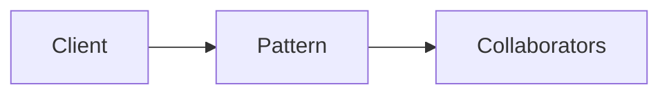

# Chain of Responsibility

**Season:** 3 · Behavioral · **Category:** GoF · **Level:** Intermediate

## Intent
Pass a request along a chain until a handler processes it.

## Problem
Without this pattern, code tends toward: New things up with conditionals and duplicated construction.

## Real-world Analogy
Support tiers: billing → tech → general.

## When to Use
- See Intent.
- The design force named in Intent shows up more than once.

## When Not to Use
- Overkill for one-off behavior.
- A simpler language feature (record, sealed switch, function value) already solves it.

## Naive Approach
```text
New things up with conditionals and duplicated construction.
```

## Pattern Structure

Client -> Pattern -> Collaborators

## Classic Implementation
Primary code lives under `src/main/java/com/buildwithwaqar/patterns/gof/behavioral/chain/`.

```java
package com.buildwithwaqar.patterns.gof.behavioral.chain;

public abstract class SupportHandler {
    private SupportHandler next;

    public SupportHandler linkWith(SupportHandler next) {
        this.next = next;
        return next;
    }

    public final String handle(String request) {
        var result = doHandle(request);
        if (result != null) return result;
        return next != null ? next.handle(request) : "unhandled:" + request;
    }

    protected abstract String doHandle(String request);
}

final class BillingHandler extends SupportHandler {
    protected String doHandle(String request) {
        return request.startsWith("bill:") ? "billing-ok" : null;
    }
}

final class TechHandler extends SupportHandler {
    protected String doHandle(String request) {
        return request.startsWith("tech:") ? "tech-ok" : null;
    }
}

final class GeneralHandler extends SupportHandler {
    protected String doHandle(String request) { return "general-ok"; }
}
```

## Modern Java 25 / Functional
Java 25 pattern matching often replaces Visitor/Interpreter boilerplate.

## Worked Example
```text
See the JUnit test beside the implementation.
Run: mvn -Dtest=*Test test
Focus package matching: gof/behavioral/chain/
```

## Pitfalls
- Prefer sealed + switch over classic Visitor in Java 25.
- Strategy as a function value.
- Observer: unsubscribe to avoid leaks.

## Interview Q&A
**Q: Key interview angle for Chain of Responsibility?**
A: Name the force (undo, open/closed, open for extension) and a modern alternative.

**Q: How would you test this?**
A: Prefer injecting interfaces or interpreters; keep demos deterministic (fixed clocks, canned inputs).

## Key Takeaways
- Pass a request along a chain until a handler processes it.
- Prefer Java 25 sealed types / records / virtual threads where they simplify the classic shape.
- Ship working tests with every episode.

## Video Script
**[0:00] Hook** — Open with the analogy: Support tiers: billing → tech → general.
**[0:40] Intent** — State the design force in one sentence: Pass a request along a chain until a handler processes it.
**[1:30] Naive pain** — Show the messy approach: New things up with conditionals and duplicated construction.
**[3:00] Pattern** — Walk the code under `gof/behavioral/chain/`; draw the mermaid structure on-screen.
**[6:00] Modern take** — Java 25 pattern matching often replaces Visitor/Interpreter boilerplate.
**[8:00] Pitfalls & interview** — Cover: Key interview angle for Chain of Responsibility?
**[9:30] Outro** — Tease the next episode; point viewers to the GitHub repo and slides PDF.
