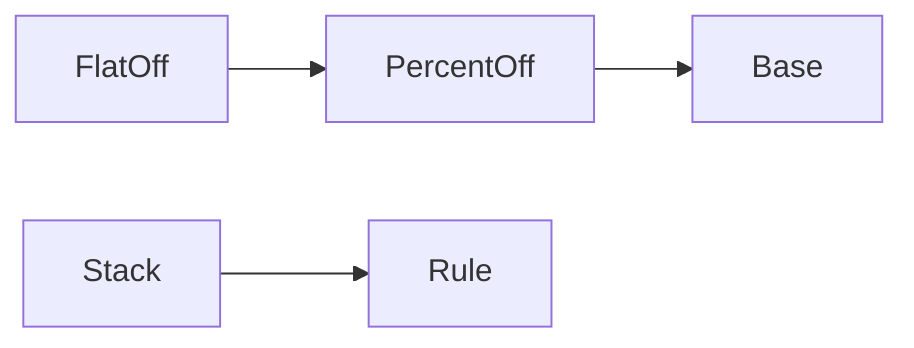

# Interpreter

**Season:** 3 · Behavioral · **Category:** GoF · **Level:** Intermediate · **Runtime:** ~10–12 min · **Channel:** Build with Waqar

## Problem
**Pricing-rule DSL: base + percent + flat discounts**

Key types: `PricingDsl`, `Rule`, `Base`, `PercentOff`, `FlatOff`, `Stack`.

## Hook
Picture this: you are mid-demo and «Pricing-rule DSL: base + percent + flat discounts» blows up the naive way — you see `caught=unknown sku NOPE`. That is the pain. In the next ten minutes we introduce **Interpreter** with real types (PricingDsl, Rule, Base), a runnable `ProblemDemo`, and the failure path locked in by tests. No abstract UML first — problem first.

## Intent
Evaluate a pricing-rule DSL (base + percent + flat) as an expression tree.

**When to use:** the force behind «Pricing-rule DSL: base + percent + flat discounts» shows up more than once and a simpler language feature does not erase it.

**When to refuse:** you are pattern-collecting, the boundary is still unclear, or the team cannot yet test the abstraction (compensations, half-open recovery, interpreters).

## The Pain — Naive Design
Naive: stringly if/else discount codes — untestable composition.

```java
package com.buildwithwaqar.patterns.gof.behavioral.interpreter.problem;

import java.util.Map;

/** Naive: stringly if/else discount codes — untestable composition. */
public final class NaivePricing {
    public static int price(String code, Map<String, Integer> prices) {
        int base = prices.getOrDefault("SKU", 0);
        if ("PCT10".equals(code)) return base * 90 / 100;
        if ("FLAT200".equals(code)) return Math.max(0, base - 200);
        if ("STACK".equals(code)) return Math.max(0, base * 90 / 100 - 200);
        throw new IllegalArgumentException("unknown " + code);
    }
}

```

On camera, point at the smell: missing compensations, leaked XML, null at the boundary,
illegal transitions, or hard-wired `System.out` that you cannot assert.

## Pattern Structure


These roles are for **«Pricing-rule DSL: base + percent + flat discounts»** — not a generic Client→Pattern poster. Keep them on screen
while you type the solution.

## Refactor to the Pattern

### Stage 1 — Name the boundary
Introduce the client-facing API the rest of the app should depend on. Hide the incompatible or
distributed details behind it. For this episode that boundary is what makes «Pricing-rule DSL: base + percent + flat discounts» testable.

### Stage 2 — Encode the solution
```java
package com.buildwithwaqar.patterns.gof.behavioral.interpreter.problem;

import java.util.Map;

/** Pricing-rule DSL: Base / PercentOff / FlatOff / Stack as an Expression AST. */
public final class PricingDsl {
    private PricingDsl() {}
    public sealed interface Rule permits Base, PercentOff, FlatOff, Stack {
        int apply(Map<String, Integer> ctx);
    }
    public record Base(String skuKey) implements Rule {
        public int apply(Map<String, Integer> ctx) {
            Integer v = ctx.get(skuKey);
            if (v == null) throw new IllegalArgumentException("unknown sku " + skuKey);
            return v;
        }
    }
    public record PercentOff(Rule inner, int percent) implements Rule {
        public int apply(Map<String, Integer> ctx) {
            if (percent < 0 || percent > 100) throw new IllegalArgumentException("bad percent");
            return inner.apply(ctx) * (100 - percent) / 100;
        }
    }
    public record FlatOff(Rule inner, int cents) implements Rule {
        public int apply(Map<String, Integer> ctx) {
            return Math.max(0, inner.apply(ctx) - cents);
        }
    }
    public record Stack(Rule left, Rule right) implements Rule {
        public int apply(Map<String, Integer> ctx) { return left.apply(ctx) + right.apply(ctx); }
    }
}

```

### Stage 3 — Runnable main
```java
package com.buildwithwaqar.patterns.gof.behavioral.interpreter.problem;

import java.util.Map;

public final class ProblemDemo {
    public static void main(String[] args) {
        System.out.println("=== Interpreter: pricing-rule DSL ===");
        var ctx = Map.of("SKU", 2000, "ADDON", 500);
        System.out.println("--- naive ---");
        System.out.println(NaivePricing.price("STACK", ctx));
        System.out.println("--- DSL AST ---");
        PricingDsl.Rule rule = new PricingDsl.FlatOff(
                new PricingDsl.PercentOff(new PricingDsl.Base("SKU"), 10), 200);
        System.out.println("price=" + rule.apply(ctx));
        PricingDsl.Rule stack = new PricingDsl.Stack(rule, new PricingDsl.Base("ADDON"));
        System.out.println("cart=" + stack.apply(ctx));
        try {
            new PricingDsl.Base("NOPE").apply(ctx);
        } catch (IllegalArgumentException e) {
            System.out.println("caught=" + e.getMessage());
        }
    }
}

```

## Runnable Output (Verified on JDK 25)
Narrate each line. Do not invent numbers on camera.

```text
=== Interpreter: pricing-rule DSL ===
--- naive ---
1600
--- DSL AST ---
price=1600
cart=2100
caught=unknown sku NOPE
```

Happy-path cue: `1600`.
Failure-path cue: `caught=unknown sku NOPE`.
Fork the repo, set `JAVA_HOME` to JDK 25, and re-run the same `ProblemDemo` to verify.

## Modern Java 25 / Zazr Variant
This solution already leans on **sealed types** — keep the exhaustive `switch`. **Records** carry the immutable results (`StepResult`, DTOs) with almost no boilerplate.

## Trade-offs
- **Clarity vs ceremony:** extra types for «Pricing-rule DSL: base + percent + flat discounts» only pay off when the force repeats.
- **Testability:** inject collaborators; assert the failure path, not only the happy path.
- **Distributed / concurrent reality:** demos omit metrics, backpressure, and multi-region clocks.
- **Refuse Interpreter** when a sealed switch, a function value, or a simpler library call already erases the force.
- **Neighbor:** Visitor — Interpreter evaluates a grammar; Visitor adds operations across an AST.

## Interview Q&A
**Q1. What concrete problem does Interpreter solve here?**
A: Pricing-rule DSL: base + percent + flat discounts.

**Q2. What does the naive design get wrong?**
A: Naive: stringly if/else discount codes — untestable composition.

**Q3. How do you test the failure path?**
A: Inject the fault and assert the observable outcome — e.g. `caught=unknown sku NOPE`.

**Q4. When is Interpreter the wrong tool?**
A: When a smaller language feature erases the force, or when you really needed Visitor.


## Key Takeaways
- Lead with the problem: Pricing-rule DSL: base + percent + flat discounts.
- Show naive pain (`caught=unknown sku NOPE`) before naming Interpreter.
- Run the Demo; trust JDK 25 stdout (`1600`).
- Teach when NOT to use Interpreter.

## Video Script (≈10–12 minutes)
Record for **Build with Waqar**. OBS for capture, CapCut for assembly. Import `slides.pdf`.
Facecam: full-screen for the hook, framed PiP over code slides.

**[0:00]** *(slide 01 title + talking head)*
Hey everyone — today we solve one concrete problem with **Interpreter**:
*Pricing-rule DSL: base + percent + flat discounts*. Keep these names in your head: PricingDsl, Rule, Base, PercentOff.

**[0:45]** *(problem + hook slides)*
I am not starting with a textbook definition. Here is the product pain. By the end you will have
seen the naive leak, the pattern boundary, and real JDK 25 stdout.

**[2:00]** *(naive code)*
IDE time. This is the naive version. Call out the smell — that is what Interpreter exists to erase.

**[3:30]** *(structure diagram)*
Roles for **this** problem, not a generic UML poster. Point at each box while you talk.

**[4:30]** *(refactor / solution code)*
Stage the solution. Highlight failure injection and the tests that lock it in.

**[7:00]** *(walkthrough output)*
Real stdout. Happy path cue: `1600`.
Failure cue: `caught=unknown sku NOPE`.
No invented numbers on camera.

**[8:30]** *(modern Java 25 / Zazr + trade-offs)*
Show the modernization, then slow down for when NOT to use Interpreter. That is what seniors listen for.

**[10:30]** *(Q&A + recap + outro)*
Two interview questions, three takeaways, link the GitHub episode folder. I am Waqar — see you in the next one.


## Walkthrough Beats (Say These Out Loud)
1. **Setup:** open `series/17-interpreter/` and `run-output.txt` beside the IDE.
2. **Naive:** reproduce the pain until you can point at `caught=unknown sku NOPE`.
3. **Structure:** on the diagram, trace `PercentOff` → `Base`, `FlatOff` → `PercentOff`, `Stack` → `Rule`.
4. **Refactor:** encode the boundary, then run `ProblemDemo` — match `1600`.
5. **Break it:** flip one `ProblemTest` assertion, watch red, restore it.
6. **Refuse:** Contrast with **Visitor**: Interpreter evaluates a grammar; Visitor adds operations across an AST.

## Practice Drill
- Clone `waqarys/java-design-patterns`, set `JAVA_HOME` to JDK 25.
- Run the episode `ProblemDemo` (see `EP_MAIN` in `tools/enrich/build_problems.py`).
- Mutate one collaborator to fail; confirm the observable compensation / error path.
- Explain Interpreter for «Pricing-rule DSL: base + percent + flat discounts» in sixty seconds without notes.
