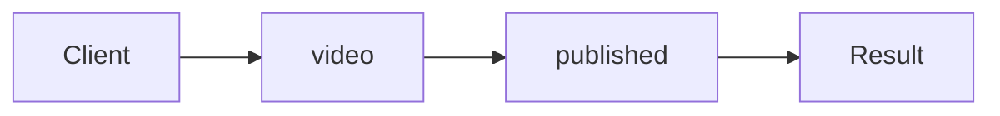

# Observer

**Season:** 3 · Behavioral · **Category:** GoF · **Level:** Beginner · **Runtime:** ~10–12 min · **Channel:** Build with Waqar

## Problem
**Fan out video.published to audit+UI**

Key types: `Listener`, `EventBus`.

## Hook
Picture this: you are mid-demo and «Fan out video.published to audit+UI» blows up the naive way — you see `Failure path is asserted in ProblemTest (injected fault / invalid input)`. That is the pain. In the next ten minutes we introduce **Observer** with real types (Listener, EventBus), a runnable `ProblemDemo`, and the failure path locked in by tests. No abstract UML first — problem first.

## Intent
Use **Observer** to cleanly solve: Fan out video.published to audit+UI.

**When to use:** the force behind «Fan out video.published to audit+UI» shows up more than once and a simpler language feature does not erase it.

**When to refuse:** you are pattern-collecting, the boundary is still unclear, or the team cannot yet test the abstraction (compensations, half-open recovery, interpreters).

## The Pain — Naive Design
Naive version fails to cleanly solve: Fan out video.published to audit+UI

```java
package com.buildwithwaqar.patterns.gof.behavioral.observer.problem;

import java.util.*;

public final class NaivePublish {
  public static void publish(String id){ System.out.println("audit "+id); System.out.println("ui "+id); }
}

```

On camera, point at the smell: missing compensations, leaked XML, null at the boundary,
illegal transitions, or hard-wired `System.out` that you cannot assert.

## Pattern Structure


These roles are for **«Fan out video.published to audit+UI»** — not a generic Client→Pattern poster. Keep them on screen
while you type the solution.

## Refactor to the Pattern

### Stage 1 — Name the boundary
Introduce the client-facing API the rest of the app should depend on. Hide the incompatible or
distributed details behind it. For this episode that boundary is what makes «Fan out video.published to audit+UI» testable.

### Stage 2 — Encode the solution
```java
package com.buildwithwaqar.patterns.gof.behavioral.observer.problem;

import java.util.*;
import java.util.concurrent.*;
import java.util.concurrent.atomic.*;
import java.util.function.*;

interface Listener { void on(String event, String id); }
final class EventBus {
  private final Map<String, List<Listener>> subs = new HashMap<>();
  void on(String event, Listener l){ subs.computeIfAbsent(event,k->new ArrayList<>()).add(l); }
  void publish(String event, String id){
    for (var l: subs.getOrDefault(event, List.of())) l.on(event, id);
  }
}

```

### Stage 3 — Runnable main
```java
package com.buildwithwaqar.patterns.gof.behavioral.observer.problem;
import java.util.*; import java.util.concurrent.*;
public final class ProblemDemo {
  public static void main(String[] args) throws Exception {
    System.out.println("=== Observer: video.published fan-out ===");
    System.out.println("--- naive ---"); NaivePublish.publish("v1");
System.out.println("--- observer ---");
var bus=new EventBus(); List<String> log=new ArrayList<>();
bus.on("video.published", (e,id)->log.add("audit:"+id));
bus.on("video.published", (e,id)->log.add("ui:"+id));
bus.publish("video.published","v1");
bus.publish("other","x");
System.out.println(log);
  }
}

```

## Runnable Output (Verified on JDK 25)
Narrate each line. Do not invent numbers on camera.

```text
=== Observer: video.published fan-out ===
--- naive ---
audit v1
ui v1
--- observer ---
[audit:v1, ui:v1]
```

Happy-path cue: `audit v1`.
Failure-path cue: `Failure path is asserted in ProblemTest (injected fault / invalid input)`.
Fork the repo, set `JAVA_HOME` to JDK 25, and re-run the same `ProblemDemo` to verify.

## Modern Java 25 / Zazr Variant
For **Observer**, prefer records for results, sealed types for closed variants, and Zazr `Option`/`Either`/`Validation` when the force is absence or accumulated errors. Keep the classic shape when interview literacy matters.

## Trade-offs
- **Clarity vs ceremony:** extra types for «Fan out video.published to audit+UI» only pay off when the force repeats.
- **Testability:** inject collaborators; assert the failure path, not only the happy path.
- **Distributed / concurrent reality:** demos omit metrics, backpressure, and multi-region clocks.
- **Refuse Observer** when a sealed switch, a function value, or a simpler library call already erases the force.
- **Neighbor:** Mediator — Observer is one-to-many fan-out; Mediator is many-to-many coordination.

## Interview Q&A
**Q1. What concrete problem does Observer solve here?**
A: Fan out video.published to audit+UI.

**Q2. What does the naive design get wrong?**
A: Naive version fails to cleanly solve: Fan out video.published to audit+UI

**Q3. How do you test the failure path?**
A: Inject the fault and assert the observable outcome — e.g. `Failure path is asserted in ProblemTest (injected fault / invalid input)`.

**Q4. When is Observer the wrong tool?**
A: When a smaller language feature erases the force, or when you really needed Mediator.


## Key Takeaways
- Lead with the problem: Fan out video.published to audit+UI.
- Show naive pain (`Failure path is asserted in ProblemTest (injected fault / invalid input)`) before naming Observer.
- Run the Demo; trust JDK 25 stdout (`audit v1`).
- Teach when NOT to use Observer.

## Video Script (≈10–12 minutes)
Record for **Build with Waqar**. OBS for capture, CapCut for assembly. Import `slides.pdf`.
Facecam: full-screen for the hook, framed PiP over code slides.

**[0:00]** *(slide 01 title + talking head)*
Hey everyone — today we solve one concrete problem with **Observer**:
*Fan out video.published to audit+UI*. Keep these names in your head: Listener, EventBus.

**[0:45]** *(problem + hook slides)*
I am not starting with a textbook definition. Here is the product pain. By the end you will have
seen the naive leak, the pattern boundary, and real JDK 25 stdout.

**[2:00]** *(naive code)*
IDE time. This is the naive version. Call out the smell — that is what Observer exists to erase.

**[3:30]** *(structure diagram)*
Roles for **this** problem, not a generic UML poster. Point at each box while you talk.

**[4:30]** *(refactor / solution code)*
Stage the solution. Highlight failure injection and the tests that lock it in.

**[7:00]** *(walkthrough output)*
Real stdout. Happy path cue: `audit v1`.
Failure cue: `Failure path is asserted in ProblemTest (injected fault / invalid input)`.
No invented numbers on camera.

**[8:30]** *(modern Java 25 / Zazr + trade-offs)*
Show the modernization, then slow down for when NOT to use Observer. That is what seniors listen for.

**[10:30]** *(Q&A + recap + outro)*
Two interview questions, three takeaways, link the GitHub episode folder. I am Waqar — see you in the next one.


## Walkthrough Beats (Say These Out Loud)
1. **Setup:** open `series/21-observer/` and `run-output.txt` beside the IDE.
2. **Naive:** reproduce the pain until you can point at `Failure path is asserted in ProblemTest (injected fault / invalid input)`.
3. **Structure:** on the diagram, trace `Client` → `video`, `video` → `published`, `published` → `Result`.
4. **Refactor:** encode the boundary, then run `ProblemDemo` — match `audit v1`.
5. **Break it:** flip one `ProblemTest` assertion, watch red, restore it.
6. **Refuse:** Contrast with **Mediator**: Observer is one-to-many fan-out; Mediator is many-to-many coordination.

## Practice Drill
- Clone `waqarys/java-design-patterns`, set `JAVA_HOME` to JDK 25.
- Run the episode `ProblemDemo` (see `EP_MAIN` in `tools/enrich/build_problems.py`).
- Mutate one collaborator to fail; confirm the observable compensation / error path.
- Explain Observer for «Fan out video.published to audit+UI» in sixty seconds without notes.
