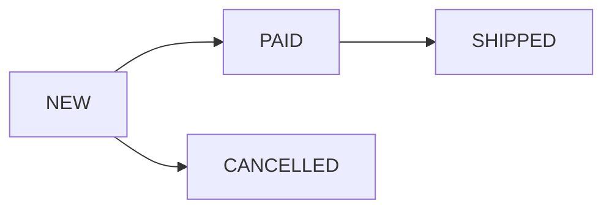

# State

**Season:** 3 · Behavioral · **Category:** GoF · **Level:** Beginner · **Runtime:** ~10–12 min · **Channel:** Build with Waqar

## Problem
**Order lifecycle NEW→PAID→SHIPPED with illegal guards**

Key types: `Phase`, `Order`.

## Hook
Picture this: you are mid-demo and «Order lifecycle NEW→PAID→SHIPPED with illegal guards» blows up the naive way — you see `caught=ship from NEW`. That is the pain. In the next ten minutes we introduce **State** with real types (Phase, Order), a runnable `ProblemDemo`, and the failure path locked in by tests. No abstract UML first — problem first.

## Intent
Enforce order lifecycle NEW→PAID→SHIPPED with illegal-transition guards.

**When to use:** the force behind «Order lifecycle NEW→PAID→SHIPPED with illegal guards» shows up more than once and a simpler language feature does not erase it.

**When to refuse:** you are pattern-collecting, the boundary is still unclear, or the team cannot yet test the abstraction (compensations, half-open recovery, interpreters).

## The Pain — Naive Design
Naive version fails to cleanly solve: Order lifecycle NEW→PAID→SHIPPED with illegal guards

```java
package com.buildwithwaqar.patterns.gof.behavioral.state.problem;

import java.util.*;

public final class NaiveOrder {
  public String state="NEW";
  public void pay(){ state="PAID"; }
  public void ship(){ state="SHIPPED"; } // allows ship from NEW
}

```

On camera, point at the smell: missing compensations, leaked XML, null at the boundary,
illegal transitions, or hard-wired `System.out` that you cannot assert.

## Pattern Structure


These roles are for **«Order lifecycle NEW→PAID→SHIPPED with illegal guards»** — not a generic Client→Pattern poster. Keep them on screen
while you type the solution.

## Refactor to the Pattern

### Stage 1 — Name the boundary
Introduce the client-facing API the rest of the app should depend on. Hide the incompatible or
distributed details behind it. For this episode that boundary is what makes «Order lifecycle NEW→PAID→SHIPPED with illegal guards» testable.

### Stage 2 — Encode the solution
```java
package com.buildwithwaqar.patterns.gof.behavioral.state.problem;

import java.util.*;
import java.util.concurrent.*;
import java.util.concurrent.atomic.*;
import java.util.function.*;

enum Phase { NEW, PAID, SHIPPED, CANCELLED }
final class Order {
  private Phase phase=Phase.NEW;
  Phase phase(){ return phase; }
  void pay(){ if(phase!=Phase.NEW) throw new IllegalStateException("pay from "+phase); phase=Phase.PAID; }
  void ship(){ if(phase!=Phase.PAID) throw new IllegalStateException("ship from "+phase); phase=Phase.SHIPPED; }
  void cancel(){ if(phase==Phase.SHIPPED) throw new IllegalStateException("cancel shipped"); phase=Phase.CANCELLED; }
}

```

### Stage 3 — Runnable main
```java
package com.buildwithwaqar.patterns.gof.behavioral.state.problem;
import java.util.*; import java.util.concurrent.*;
public final class ProblemDemo {
  public static void main(String[] args) throws Exception {
    System.out.println("=== State: order lifecycle ===");
    System.out.println("--- naive (illegal ship) ---");
var n=new NaiveOrder(); n.ship(); System.out.println(n.state);
System.out.println("--- state ---");
var o=new Order(); o.pay(); o.ship(); System.out.println(o.phase());
try { new Order().ship(); } catch (IllegalStateException e){ System.out.println("caught="+e.getMessage()); }
  }
}

```

## Runnable Output (Verified on JDK 25)
Narrate each line. Do not invent numbers on camera.

```text
=== State: order lifecycle ===
--- naive (illegal ship) ---
SHIPPED
--- state ---
SHIPPED
caught=ship from NEW
```

Happy-path cue: `SHIPPED`.
Failure-path cue: `caught=ship from NEW`.
Fork the repo, set `JAVA_HOME` to JDK 25, and re-run the same `ProblemDemo` to verify.

## Modern Java 25 / Zazr Variant
For **State**, prefer records for results, sealed types for closed variants, and Zazr `Option`/`Either`/`Validation` when the force is absence or accumulated errors. Keep the classic shape when interview literacy matters.

## Trade-offs
- **Clarity vs ceremony:** extra types for «Order lifecycle NEW→PAID→SHIPPED with illegal guards» only pay off when the force repeats.
- **Testability:** inject collaborators; assert the failure path, not only the happy path.
- **Distributed / concurrent reality:** demos omit metrics, backpressure, and multi-region clocks.
- **Refuse State** when a sealed switch, a function value, or a simpler library call already erases the force.
- **Neighbor:** Strategy — State transitions are internal and guarded; Strategy is chosen by the client.

## Interview Q&A
**Q1. What concrete problem does State solve here?**
A: Order lifecycle NEW→PAID→SHIPPED with illegal guards.

**Q2. What does the naive design get wrong?**
A: Naive version fails to cleanly solve: Order lifecycle NEW→PAID→SHIPPED with illegal guards

**Q3. How do you test the failure path?**
A: Inject the fault and assert the observable outcome — e.g. `caught=ship from NEW`.

**Q4. When is State the wrong tool?**
A: When a smaller language feature erases the force, or when you really needed Strategy.


## Key Takeaways
- Lead with the problem: Order lifecycle NEW→PAID→SHIPPED with illegal guards.
- Show naive pain (`caught=ship from NEW`) before naming State.
- Run the Demo; trust JDK 25 stdout (`SHIPPED`).
- Teach when NOT to use State.

## Video Script (≈10–12 minutes)
Record for **Build with Waqar**. OBS for capture, CapCut for assembly. Import `slides.pdf`.
Facecam: full-screen for the hook, framed PiP over code slides.

**[0:00]** *(slide 01 title + talking head)*
Hey everyone — today we solve one concrete problem with **State**:
*Order lifecycle NEW→PAID→SHIPPED with illegal guards*. Keep these names in your head: Phase, Order.

**[0:45]** *(problem + hook slides)*
I am not starting with a textbook definition. Here is the product pain. By the end you will have
seen the naive leak, the pattern boundary, and real JDK 25 stdout.

**[2:00]** *(naive code)*
IDE time. This is the naive version. Call out the smell — that is what State exists to erase.

**[3:30]** *(structure diagram)*
Roles for **this** problem, not a generic UML poster. Point at each box while you talk.

**[4:30]** *(refactor / solution code)*
Stage the solution. Highlight failure injection and the tests that lock it in.

**[7:00]** *(walkthrough output)*
Real stdout. Happy path cue: `SHIPPED`.
Failure cue: `caught=ship from NEW`.
No invented numbers on camera.

**[8:30]** *(modern Java 25 / Zazr + trade-offs)*
Show the modernization, then slow down for when NOT to use State. That is what seniors listen for.

**[10:30]** *(Q&A + recap + outro)*
Two interview questions, three takeaways, link the GitHub episode folder. I am Waqar — see you in the next one.


## Walkthrough Beats (Say These Out Loud)
1. **Setup:** open `series/22-state/` and `run-output.txt` beside the IDE.
2. **Naive:** reproduce the pain until you can point at `caught=ship from NEW`.
3. **Structure:** on the diagram, trace `NEW` → `PAID`, `PAID` → `SHIPPED`, `NEW` → `CANCELLED`.
4. **Refactor:** encode the boundary, then run `ProblemDemo` — match `SHIPPED`.
5. **Break it:** flip one `ProblemTest` assertion, watch red, restore it.
6. **Refuse:** Contrast with **Strategy**: State transitions are internal and guarded; Strategy is chosen by the client.

## Practice Drill
- Clone `waqarys/java-design-patterns`, set `JAVA_HOME` to JDK 25.
- Run the episode `ProblemDemo` (see `EP_MAIN` in `tools/enrich/build_problems.py`).
- Mutate one collaborator to fail; confirm the observable compensation / error path.
- Explain State for «Order lifecycle NEW→PAID→SHIPPED with illegal guards» in sixty seconds without notes.
