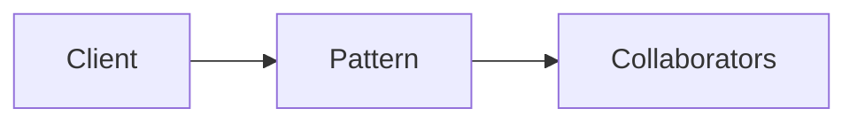

# State

**Season:** 3 · Behavioral · **Category:** GoF · **Level:** Intermediate

## Intent
Alter behavior when internal state changes.

## Problem
Without this pattern, code tends toward: New things up with conditionals and duplicated construction.

## Real-world Analogy
Order: NEW → PAID → SHIPPED.

## When to Use
- See Intent.
- The design force named in Intent shows up more than once.

## When Not to Use
- Overkill for one-off behavior.
- A simpler language feature (record, sealed switch, function value) already solves it.

## Naive Approach
```text
New things up with conditionals and duplicated construction.
```

## Pattern Structure

Client -> Pattern -> Collaborators

## Classic Implementation
Primary code lives under `src/main/java/com/buildwithwaqar/patterns/gof/behavioral/state/`.

```java
package com.buildwithwaqar.patterns.gof.behavioral.state;

public final class OrderStateMachine {
    private State state = new NewState();

    public String status() { return state.name(); }
    public void pay() { state = state.pay(this); }
    public void ship() { state = state.ship(this); }
    public void cancel() { state = state.cancel(this); }

    private sealed interface State permits NewState, PaidState, ShippedState, CancelledState {
        String name();
        default State pay(OrderStateMachine ctx) { throw new IllegalStateException(name()); }
        default State ship(OrderStateMachine ctx) { throw new IllegalStateException(name()); }
        default State cancel(OrderStateMachine ctx) { throw new IllegalStateException(name()); }
    }

    private static final class NewState implements State {
        public String name() { return "NEW"; }
        public State pay(OrderStateMachine ctx) { return new PaidState(); }
        public State cancel(OrderStateMachine ctx) { return new CancelledState(); }
    }
    private static final class PaidState implements State {
        public String name() { return "PAID"; }
        public State ship(OrderStateMachine ctx) { return new ShippedState(); }
        public State cancel(OrderStateMachine ctx) { return new CancelledState(); }
    }
    private static final class ShippedState implements State {
        public String name() { return "SHIPPED"; }
    }
    private static final class CancelledState implements State {
        public String name() { return "CANCELLED"; }
    }
}
```

## Modern Java 25 / Functional
Java 25 pattern matching often replaces Visitor/Interpreter boilerplate.

## Worked Example
```text
See the JUnit test beside the implementation.
Run: mvn -Dtest=*Test test
Focus package matching: gof/behavioral/state/
```

## Pitfalls
- Prefer sealed + switch over classic Visitor in Java 25.
- Strategy as a function value.
- Observer: unsubscribe to avoid leaks.

## Interview Q&A
**Q: Key interview angle for State?**
A: Name the force (undo, open/closed, open for extension) and a modern alternative.

**Q: How would you test this?**
A: Prefer injecting interfaces or interpreters; keep demos deterministic (fixed clocks, canned inputs).

## Key Takeaways
- Alter behavior when internal state changes.
- Prefer Java 25 sealed types / records / virtual threads where they simplify the classic shape.
- Ship working tests with every episode.

## Video Script
**[0:00] Hook** — Open with the analogy: Order: NEW → PAID → SHIPPED.
**[0:40] Intent** — State the design force in one sentence: Alter behavior when internal state changes.
**[1:30] Naive pain** — Show the messy approach: New things up with conditionals and duplicated construction.
**[3:00] Pattern** — Walk the code under `gof/behavioral/state/`; draw the mermaid structure on-screen.
**[6:00] Modern take** — Java 25 pattern matching often replaces Visitor/Interpreter boilerplate.
**[8:00] Pitfalls & interview** — Cover: Key interview angle for State?
**[9:30] Outro** — Tease the next episode; point viewers to the GitHub repo and slides PDF.
