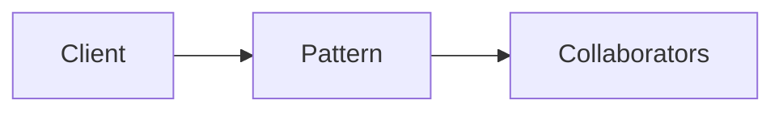

# Strategy

**Season:** 3 · Behavioral · **Category:** GoF · **Level:** Intermediate

## Intent
Swap algorithms behind a common interface.

## Problem
Without this pattern, code tends toward: New things up with conditionals and duplicated construction.

## Real-world Analogy
Maps app: car vs bike routing.

## When to Use
- See Intent.
- The design force named in Intent shows up more than once.

## When Not to Use
- Overkill for one-off behavior.
- A simpler language feature (record, sealed switch, function value) already solves it.

## Naive Approach
```text
New things up with conditionals and duplicated construction.
```

## Pattern Structure

Client -> Pattern -> Collaborators

## Classic Implementation
Primary code lives under `src/main/java/com/buildwithwaqar/patterns/gof/behavioral/strategy/`.

```java
package com.buildwithwaqar.patterns.gof.behavioral.strategy;

import java.util.function.IntUnaryOperator;

interface PricingStrategy {
    int priceCents(int baseCents);

    static PricingStrategy percentageOff(int percent) {
        return base -> base - base * percent / 100;
    }

    static PricingStrategy flatOff(int cents) {
        return base -> Math.max(0, base - cents);
    }
}

/** Context that delegates to a pluggable pricing strategy. */
public final class Cart {
    private final PricingStrategy strategy;

    public Cart(PricingStrategy strategy) { this.strategy = strategy; }

    /** Java 25 style: accept a function directly. */
    public Cart(IntUnaryOperator fn) { this.strategy = fn::applyAsInt; }

    public int checkout(int baseCents) { return strategy.priceCents(baseCents); }
}
```

## Modern Java 25 / Functional
Java 25 pattern matching often replaces Visitor/Interpreter boilerplate.

## Worked Example
```text
See the JUnit test beside the implementation.
Run: mvn -Dtest=*Test test
Focus package matching: gof/behavioral/strategy/
```

## Pitfalls
- Prefer sealed + switch over classic Visitor in Java 25.
- Strategy as a function value.
- Observer: unsubscribe to avoid leaks.

## Interview Q&A
**Q: Key interview angle for Strategy?**
A: Name the force (undo, open/closed, open for extension) and a modern alternative.

**Q: How would you test this?**
A: Prefer injecting interfaces or interpreters; keep demos deterministic (fixed clocks, canned inputs).

## Key Takeaways
- Swap algorithms behind a common interface.
- Prefer Java 25 sealed types / records / virtual threads where they simplify the classic shape.
- Ship working tests with every episode.

## Video Script
**[0:00] Hook** — Open with the analogy: Maps app: car vs bike routing.
**[0:40] Intent** — State the design force in one sentence: Swap algorithms behind a common interface.
**[1:30] Naive pain** — Show the messy approach: New things up with conditionals and duplicated construction.
**[3:00] Pattern** — Walk the code under `gof/behavioral/strategy/`; draw the mermaid structure on-screen.
**[6:00] Modern take** — Java 25 pattern matching often replaces Visitor/Interpreter boilerplate.
**[8:00] Pitfalls & interview** — Cover: Key interview angle for Strategy?
**[9:30] Outro** — Tease the next episode; point viewers to the GitHub repo and slides PDF.
