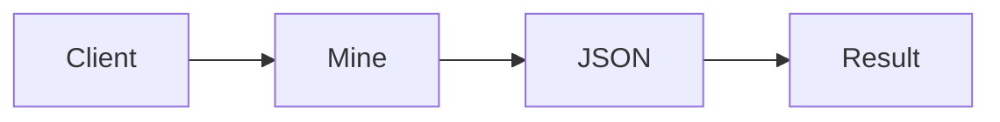

# Template Method

**Season:** 3 · Behavioral · **Category:** GoF · **Level:** Beginner · **Runtime:** ~10–12 min · **Channel:** Build with Waqar

## Problem
**Mine CSV/JSON reports with shared pipeline**

Key types: `DataMiner`, `CsvMiner`, `JsonMiner`.

## Hook
Picture this: you are mid-demo and «Mine CSV/JSON reports with shared pipeline» blows up the naive way — you see `Failure path is asserted in ProblemTest (injected fault / invalid input)`. That is the pain. In the next ten minutes we introduce **Template Method** with real types (DataMiner, CsvMiner, JsonMiner), a runnable `ProblemDemo`, and the failure path locked in by tests. No abstract UML first — problem first.

## Intent
Use **Template Method** to cleanly solve: Mine CSV/JSON reports with shared pipeline.

**When to use:** the force behind «Mine CSV/JSON reports with shared pipeline» shows up more than once and a simpler language feature does not erase it.

**When to refuse:** you are pattern-collecting, the boundary is still unclear, or the team cannot yet test the abstraction (compensations, half-open recovery, interpreters).

## The Pain — Naive Design
Naive version fails to cleanly solve: Mine CSV/JSON reports with shared pipeline

```java
package com.buildwithwaqar.patterns.gof.behavioral.templatemethod.problem;

import java.util.*;

public final class NaiveMine {
  public static String csv(String raw){ return "rows=" + raw.split("\n").length; }
  public static String json(String raw){ return "rows=" + raw.split("\\{", -1).length; }
}

```

On camera, point at the smell: missing compensations, leaked XML, null at the boundary,
illegal transitions, or hard-wired `System.out` that you cannot assert.

## Pattern Structure


These roles are for **«Mine CSV/JSON reports with shared pipeline»** — not a generic Client→Pattern poster. Keep them on screen
while you type the solution.

## Refactor to the Pattern

### Stage 1 — Name the boundary
Introduce the client-facing API the rest of the app should depend on. Hide the incompatible or
distributed details behind it. For this episode that boundary is what makes «Mine CSV/JSON reports with shared pipeline» testable.

### Stage 2 — Encode the solution
```java
package com.buildwithwaqar.patterns.gof.behavioral.templatemethod.problem;

import java.util.*;
import java.util.concurrent.*;
import java.util.concurrent.atomic.*;
import java.util.function.*;

abstract class DataMiner {
  final String mine(String raw){ String opened=open(raw); List<String> rows=parse(opened); return analyze(rows); }
  abstract String open(String raw); abstract List<String> parse(String opened);
  String analyze(List<String> rows){ return "rows="+rows.size(); }
}
final class CsvMiner extends DataMiner {
  String open(String raw){ return raw; }
  List<String> parse(String opened){ return Arrays.stream(opened.split("\n")).filter(s->!s.isBlank()).toList(); }
}
final class JsonMiner extends DataMiner {
  String open(String raw){ return raw; }
  List<String> parse(String opened){ return Arrays.stream(opened.split("\n")).filter(s->s.contains(":")).toList(); }
}

```

### Stage 3 — Runnable main
```java
package com.buildwithwaqar.patterns.gof.behavioral.templatemethod.problem;
import java.util.*; import java.util.concurrent.*;
public final class ProblemDemo {
  public static void main(String[] args) throws Exception {
    System.out.println("=== Template Method: CSV/JSON mine ===");
    System.out.println("--- naive ---"); System.out.println(NaiveMine.csv("a\nb"));
System.out.println("--- template ---");
System.out.println(new CsvMiner().mine("a\nb\n"));
System.out.println(new JsonMiner().mine("{\n x:1\n}\n"));
  }
}

```

## Runnable Output (Verified on JDK 25)
Narrate each line. Do not invent numbers on camera.

```text
=== Template Method: CSV/JSON mine ===
--- naive ---
rows=2
--- template ---
rows=2
rows=1
```

Happy-path cue: `rows=2`.
Failure-path cue: `Failure path is asserted in ProblemTest (injected fault / invalid input)`.
Fork the repo, set `JAVA_HOME` to JDK 25, and re-run the same `ProblemDemo` to verify.

## Modern Java 25 / Zazr Variant
For **Template Method**, prefer records for results, sealed types for closed variants, and Zazr `Option`/`Either`/`Validation` when the force is absence or accumulated errors. Keep the classic shape when interview literacy matters.

## Trade-offs
- **Clarity vs ceremony:** extra types for «Mine CSV/JSON reports with shared pipeline» only pay off when the force repeats.
- **Testability:** inject collaborators; assert the failure path, not only the happy path.
- **Distributed / concurrent reality:** demos omit metrics, backpressure, and multi-region clocks.
- **Refuse Template Method** when a sealed switch, a function value, or a simpler library call already erases the force.
- **Neighbor:** Strategy — Template Method uses inheritance hooks; Strategy uses composition.

## Interview Q&A
**Q1. What concrete problem does Template Method solve here?**
A: Mine CSV/JSON reports with shared pipeline.

**Q2. What does the naive design get wrong?**
A: Naive version fails to cleanly solve: Mine CSV/JSON reports with shared pipeline

**Q3. How do you test the failure path?**
A: Inject the fault and assert the observable outcome — e.g. `Failure path is asserted in ProblemTest (injected fault / invalid input)`.

**Q4. When is Template Method the wrong tool?**
A: When a smaller language feature erases the force, or when you really needed Strategy.


## Key Takeaways
- Lead with the problem: Mine CSV/JSON reports with shared pipeline.
- Show naive pain (`Failure path is asserted in ProblemTest (injected fault / invalid input)`) before naming Template Method.
- Run the Demo; trust JDK 25 stdout (`rows=2`).
- Teach when NOT to use Template Method.

## Video Script (≈10–12 minutes)
Record for **Build with Waqar**. OBS for capture, CapCut for assembly. Import `slides.pdf`.
Facecam: full-screen for the hook, framed PiP over code slides.

**[0:00]** *(slide 01 title + talking head)*
Hey everyone — today we solve one concrete problem with **Template Method**:
*Mine CSV/JSON reports with shared pipeline*. Keep these names in your head: DataMiner, CsvMiner, JsonMiner.

**[0:45]** *(problem + hook slides)*
I am not starting with a textbook definition. Here is the product pain. By the end you will have
seen the naive leak, the pattern boundary, and real JDK 25 stdout.

**[2:00]** *(naive code)*
IDE time. This is the naive version. Call out the smell — that is what Template Method exists to erase.

**[3:30]** *(structure diagram)*
Roles for **this** problem, not a generic UML poster. Point at each box while you talk.

**[4:30]** *(refactor / solution code)*
Stage the solution. Highlight failure injection and the tests that lock it in.

**[7:00]** *(walkthrough output)*
Real stdout. Happy path cue: `rows=2`.
Failure cue: `Failure path is asserted in ProblemTest (injected fault / invalid input)`.
No invented numbers on camera.

**[8:30]** *(modern Java 25 / Zazr + trade-offs)*
Show the modernization, then slow down for when NOT to use Template Method. That is what seniors listen for.

**[10:30]** *(Q&A + recap + outro)*
Two interview questions, three takeaways, link the GitHub episode folder. I am Waqar — see you in the next one.


## Walkthrough Beats (Say These Out Loud)
1. **Setup:** open `series/24-template-method/` and `run-output.txt` beside the IDE.
2. **Naive:** reproduce the pain until you can point at `Failure path is asserted in ProblemTest (injected fault / invalid input)`.
3. **Structure:** on the diagram, trace `Client` → `Mine`, `Mine` → `JSON`, `JSON` → `Result`.
4. **Refactor:** encode the boundary, then run `ProblemDemo` — match `rows=2`.
5. **Break it:** flip one `ProblemTest` assertion, watch red, restore it.
6. **Refuse:** Contrast with **Strategy**: Template Method uses inheritance hooks; Strategy uses composition.

## Practice Drill
- Clone `waqarys/java-design-patterns`, set `JAVA_HOME` to JDK 25.
- Run the episode `ProblemDemo` (see `EP_MAIN` in `tools/enrich/build_problems.py`).
- Mutate one collaborator to fail; confirm the observable compensation / error path.
- Explain Template Method for «Mine CSV/JSON reports with shared pipeline» in sixty seconds without notes.
