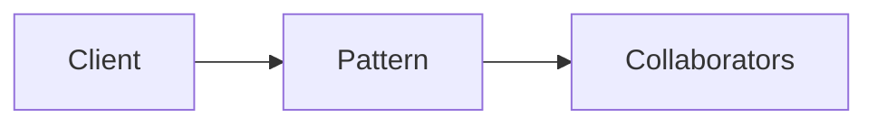

# Template Method

**Season:** 3 · Behavioral · **Category:** GoF · **Level:** Intermediate

## Intent
Define algorithm skeleton; subclasses fill steps.

## Problem
Without this pattern, code tends toward: New things up with conditionals and duplicated construction.

## Real-world Analogy
Airline boarding process with airline-specific checks.

## When to Use
- See Intent.
- The design force named in Intent shows up more than once.

## When Not to Use
- Overkill for one-off behavior.
- A simpler language feature (record, sealed switch, function value) already solves it.

## Naive Approach
```text
New things up with conditionals and duplicated construction.
```

## Pattern Structure

Client -> Pattern -> Collaborators

## Classic Implementation
Primary code lives under `src/main/java/com/buildwithwaqar/patterns/gof/behavioral/templatemethod/`.

```java
package com.buildwithwaqar.patterns.gof.behavioral.templatemethod;

import java.util.List;

public abstract class DataMiner {
    /** Template method — fixed algorithm skeleton. */
    public final String mine(String path) {
        var raw = open(path);
        var data = parse(raw);
        var report = analyze(data);
        close();
        return report;
    }

    protected abstract String open(String path);
    protected abstract List<String> parse(String raw);
    protected String analyze(List<String> data) { return "rows=" + data.size(); }
    protected void close() {}
}

final class CsvMiner extends DataMiner {
    protected String open(String path) { return "a,b\nc,d"; }
    protected List<String> parse(String raw) { return List.of(raw.split("\\n")); }
}
```

## Modern Java 25 / Functional
Java 25 pattern matching often replaces Visitor/Interpreter boilerplate.

## Worked Example
```text
See the JUnit test beside the implementation.
Run: mvn -Dtest=*Test test
Focus package matching: gof/behavioral/templatemethod/
```

## Pitfalls
- Prefer sealed + switch over classic Visitor in Java 25.
- Strategy as a function value.
- Observer: unsubscribe to avoid leaks.

## Interview Q&A
**Q: Key interview angle for Template Method?**
A: Name the force (undo, open/closed, open for extension) and a modern alternative.

**Q: How would you test this?**
A: Prefer injecting interfaces or interpreters; keep demos deterministic (fixed clocks, canned inputs).

## Key Takeaways
- Define algorithm skeleton; subclasses fill steps.
- Prefer Java 25 sealed types / records / virtual threads where they simplify the classic shape.
- Ship working tests with every episode.

## Video Script
**[0:00] Hook** — Open with the analogy: Airline boarding process with airline-specific checks.
**[0:40] Intent** — State the design force in one sentence: Define algorithm skeleton; subclasses fill steps.
**[1:30] Naive pain** — Show the messy approach: New things up with conditionals and duplicated construction.
**[3:00] Pattern** — Walk the code under `gof/behavioral/templatemethod/`; draw the mermaid structure on-screen.
**[6:00] Modern take** — Java 25 pattern matching often replaces Visitor/Interpreter boilerplate.
**[8:00] Pitfalls & interview** — Cover: Key interview angle for Template Method?
**[9:30] Outro** — Tease the next episode; point viewers to the GitHub repo and slides PDF.
