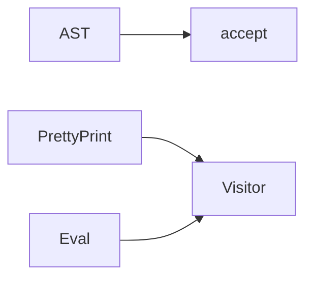

# Visitor

**Season:** 3 · Behavioral · **Category:** GoF · **Level:** Intermediate · **Runtime:** ~10–12 min · **Channel:** Build with Waqar

## Problem
**Pretty-print / evaluate expression AST**

Key types: `Expr`, `Num`, `Add`, `Mul`, `Visitor`, `Pretty`.

## Hook
Picture this: you are mid-demo and «Pretty-print / evaluate expression AST» blows up the naive way — you see `Failure path is asserted in ProblemTest (injected fault / invalid input)`. That is the pain. In the next ten minutes we introduce **Visitor** with real types (Expr, Num, Add), a runnable `ProblemDemo`, and the failure path locked in by tests. No abstract UML first — problem first.

## Intent
Use **Visitor** to cleanly solve: Pretty-print / evaluate expression AST.

**When to use:** the force behind «Pretty-print / evaluate expression AST» shows up more than once and a simpler language feature does not erase it.

**When to refuse:** you are pattern-collecting, the boundary is still unclear, or the team cannot yet test the abstraction (compensations, half-open recovery, interpreters).

## The Pain — Naive Design
Naive version fails to cleanly solve: Pretty-print / evaluate expression AST

```java
package com.buildwithwaqar.patterns.gof.behavioral.visitor.problem;

import java.util.*;

public final class NaiveAst {
  public static String show(String kind, int a, int b){
    if("add".equals(kind)) return "("+a+"+"+b+")";
    return "("+a+"*"+b+")";
  }
}

```

On camera, point at the smell: missing compensations, leaked XML, null at the boundary,
illegal transitions, or hard-wired `System.out` that you cannot assert.

## Pattern Structure


These roles are for **«Pretty-print / evaluate expression AST»** — not a generic Client→Pattern poster. Keep them on screen
while you type the solution.

## Refactor to the Pattern

### Stage 1 — Name the boundary
Introduce the client-facing API the rest of the app should depend on. Hide the incompatible or
distributed details behind it. For this episode that boundary is what makes «Pretty-print / evaluate expression AST» testable.

### Stage 2 — Encode the solution
```java
package com.buildwithwaqar.patterns.gof.behavioral.visitor.problem;

import java.util.*;
import java.util.concurrent.*;
import java.util.concurrent.atomic.*;
import java.util.function.*;

sealed interface Expr permits Num, Add, Mul { <R> R accept(Visitor<R> v); }
record Num(int v) implements Expr { public <R> R accept(Visitor<R> v){ return v.visit(this); } }
record Add(Expr l, Expr r) implements Expr { public <R> R accept(Visitor<R> v){ return v.visit(this); } }
record Mul(Expr l, Expr r) implements Expr { public <R> R accept(Visitor<R> v){ return v.visit(this); } }
interface Visitor<R> { R visit(Num n); R visit(Add a); R visit(Mul m); }
final class Pretty implements Visitor<String> {
  public String visit(Num n){ return Integer.toString(n.v()); }
  public String visit(Add a){ return "("+a.l().accept(this)+"+"+a.r().accept(this)+")"; }
  public String visit(Mul m){ return "("+m.l().accept(this)+"*"+m.r().accept(this)+")"; }
}
final class Eval implements Visitor<Integer> {
  public Integer visit(Num n){ return n.v(); }
  public Integer visit(Add a){ return a.l().accept(this)+a.r().accept(this); }
  public Integer visit(Mul m){ return m.l().accept(this)*m.r().accept(this); }
}

```

### Stage 3 — Runnable main
```java
package com.buildwithwaqar.patterns.gof.behavioral.visitor.problem;
import java.util.*; import java.util.concurrent.*;
public final class ProblemDemo {
  public static void main(String[] args) throws Exception {
    System.out.println("=== Visitor: AST pretty-print / eval ===");
    System.out.println("--- naive ---"); System.out.println(NaiveAst.show("add",2,3));
System.out.println("--- visitor ---");
Expr e=new Mul(new Add(new Num(2), new Num(3)), new Num(4));
System.out.println(e.accept(new Pretty()));
System.out.println("value="+e.accept(new Eval()));
  }
}

```

## Runnable Output (Verified on JDK 25)
Narrate each line. Do not invent numbers on camera.

```text
=== Visitor: AST pretty-print / eval ===
--- naive ---
(2+3)
--- visitor ---
((2+3)*4)
value=20
```

Happy-path cue: `(2+3)`.
Failure-path cue: `Failure path is asserted in ProblemTest (injected fault / invalid input)`.
Fork the repo, set `JAVA_HOME` to JDK 25, and re-run the same `ProblemDemo` to verify.

## Modern Java 25 / Zazr Variant
This solution already leans on **sealed types** — keep the exhaustive `switch`. **Records** carry the immutable results (`StepResult`, DTOs) with almost no boilerplate.

## Trade-offs
- **Clarity vs ceremony:** extra types for «Pretty-print / evaluate expression AST» only pay off when the force repeats.
- **Testability:** inject collaborators; assert the failure path, not only the happy path.
- **Distributed / concurrent reality:** demos omit metrics, backpressure, and multi-region clocks.
- **Refuse Visitor** when a sealed switch, a function value, or a simpler library call already erases the force.
- **Neighbor:** Interpreter — Visitor adds ops without touching nodes; Interpreter embeds eval in nodes.

## Interview Q&A
**Q1. What concrete problem does Visitor solve here?**
A: Pretty-print / evaluate expression AST.

**Q2. What does the naive design get wrong?**
A: Naive version fails to cleanly solve: Pretty-print / evaluate expression AST

**Q3. How do you test the failure path?**
A: Inject the fault and assert the observable outcome — e.g. `Failure path is asserted in ProblemTest (injected fault / invalid input)`.

**Q4. When is Visitor the wrong tool?**
A: When a smaller language feature erases the force, or when you really needed Interpreter.


## Key Takeaways
- Lead with the problem: Pretty-print / evaluate expression AST.
- Show naive pain (`Failure path is asserted in ProblemTest (injected fault / invalid input)`) before naming Visitor.
- Run the Demo; trust JDK 25 stdout (`(2+3)`).
- Teach when NOT to use Visitor.

## Video Script (≈10–12 minutes)
Record for **Build with Waqar**. OBS for capture, CapCut for assembly. Import `slides.pdf`.
Facecam: full-screen for the hook, framed PiP over code slides.

**[0:00]** *(slide 01 title + talking head)*
Hey everyone — today we solve one concrete problem with **Visitor**:
*Pretty-print / evaluate expression AST*. Keep these names in your head: Expr, Num, Add, Mul.

**[0:45]** *(problem + hook slides)*
I am not starting with a textbook definition. Here is the product pain. By the end you will have
seen the naive leak, the pattern boundary, and real JDK 25 stdout.

**[2:00]** *(naive code)*
IDE time. This is the naive version. Call out the smell — that is what Visitor exists to erase.

**[3:30]** *(structure diagram)*
Roles for **this** problem, not a generic UML poster. Point at each box while you talk.

**[4:30]** *(refactor / solution code)*
Stage the solution. Highlight failure injection and the tests that lock it in.

**[7:00]** *(walkthrough output)*
Real stdout. Happy path cue: `(2+3)`.
Failure cue: `Failure path is asserted in ProblemTest (injected fault / invalid input)`.
No invented numbers on camera.

**[8:30]** *(modern Java 25 / Zazr + trade-offs)*
Show the modernization, then slow down for when NOT to use Visitor. That is what seniors listen for.

**[10:30]** *(Q&A + recap + outro)*
Two interview questions, three takeaways, link the GitHub episode folder. I am Waqar — see you in the next one.


## Walkthrough Beats (Say These Out Loud)
1. **Setup:** open `series/25-visitor/` and `run-output.txt` beside the IDE.
2. **Naive:** reproduce the pain until you can point at `Failure path is asserted in ProblemTest (injected fault / invalid input)`.
3. **Structure:** on the diagram, trace `AST` → `accept`, `PrettyPrint` → `Visitor`, `Eval` → `Visitor`.
4. **Refactor:** encode the boundary, then run `ProblemDemo` — match `(2+3)`.
5. **Break it:** flip one `ProblemTest` assertion, watch red, restore it.
6. **Refuse:** Contrast with **Interpreter**: Visitor adds ops without touching nodes; Interpreter embeds eval in nodes.

## Practice Drill
- Clone `waqarys/java-design-patterns`, set `JAVA_HOME` to JDK 25.
- Run the episode `ProblemDemo` (see `EP_MAIN` in `tools/enrich/build_problems.py`).
- Mutate one collaborator to fail; confirm the observable compensation / error path.
- Explain Visitor for «Pretty-print / evaluate expression AST» in sixty seconds without notes.
