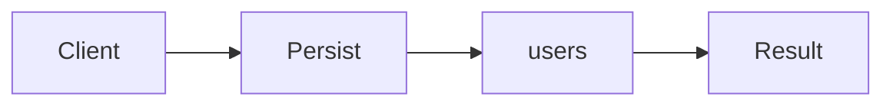

# Repository

**Season:** 4 · Enterprise · **Category:** Enterprise · **Level:** Intermediate · **Runtime:** ~10–12 min · **Channel:** Build with Waqar

## Problem
**Persist users behind collection-like API**

Key types: `User`, `UserRepository`, `InMemoryUserRepository`.

## Hook
Picture this: you are mid-demo and «Persist users behind collection-like API» blows up the naive way — you see `Optional.empty`. That is the pain. In the next ten minutes we introduce **Repository** with real types (User, UserRepository, InMemoryUserRepository), a runnable `ProblemDemo`, and the failure path locked in by tests. No abstract UML first — problem first.

## Intent
Use **Repository** to cleanly solve: Persist users behind collection-like API.

**When to use:** the force behind «Persist users behind collection-like API» shows up more than once and a simpler language feature does not erase it.

**When to refuse:** you are pattern-collecting, the boundary is still unclear, or the team cannot yet test the abstraction (compensations, half-open recovery, interpreters).

## The Pain — Naive Design
Naive version fails to cleanly solve: Persist users behind collection-like API

```java
package com.buildwithwaqar.patterns.enterprise.repository.problem;

import java.util.*;

public final class NaiveUsers {
  private final Map<String,String> db=new HashMap<>();
  public void insert(String id,String email){ db.put(id,email); }
  public String get(String id){ return db.get(id); } // null
}

```

On camera, point at the smell: missing compensations, leaked XML, null at the boundary,
illegal transitions, or hard-wired `System.out` that you cannot assert.

## Pattern Structure


These roles are for **«Persist users behind collection-like API»** — not a generic Client→Pattern poster. Keep them on screen
while you type the solution.

## Refactor to the Pattern

### Stage 1 — Name the boundary
Introduce the client-facing API the rest of the app should depend on. Hide the incompatible or
distributed details behind it. For this episode that boundary is what makes «Persist users behind collection-like API» testable.

### Stage 2 — Encode the solution
```java
package com.buildwithwaqar.patterns.enterprise.repository.problem;

import java.util.*;
import java.util.concurrent.*;
import java.util.concurrent.atomic.*;
import java.util.concurrent.locks.*;
import java.util.function.*;

record User(String id, String email){}
interface UserRepository {
  void save(User u); Optional<User> findById(String id); List<User> findAll();
}
final class InMemoryUserRepository implements UserRepository {
  private final Map<String,User> db=new LinkedHashMap<>();
  public void save(User u){ db.put(u.id(), u); }
  public Optional<User> findById(String id){ return Optional.ofNullable(db.get(id)); }
  public List<User> findAll(){ return List.copyOf(db.values()); }
}

```

### Stage 3 — Runnable main
```java
package com.buildwithwaqar.patterns.enterprise.repository.problem;
import java.util.*; import java.util.concurrent.*;
public final class ProblemDemo {
  public static void main(String[] args) throws Exception {
    System.out.println("=== Repository: users collection API ===");
    System.out.println("--- naive ---");
var n=new NaiveUsers(); n.insert("1","a@b.c"); System.out.println(n.get("missing"));
System.out.println("--- repository ---");
UserRepository repo=new InMemoryUserRepository(); repo.save(new User("1","a@b.c"));
System.out.println(repo.findById("1")); System.out.println(repo.findById("x"));
  }
}

```

## Runnable Output (Verified on JDK 25)
Narrate each line. Do not invent numbers on camera.

```text
=== Repository: users collection API ===
--- naive ---
null
--- repository ---
Optional[User[id=1, email=a@b.c]]
Optional.empty
```

Happy-path cue: `null`.
Failure-path cue: `Optional.empty`.
Fork the repo, set `JAVA_HOME` to JDK 25, and re-run the same `ProblemDemo` to verify.

## Modern Java 25 / Zazr Variant
**Records** carry the immutable results (`StepResult`, DTOs) with almost no boilerplate. Absence / errors use **Optional or Zazr/VAVR** control types instead of null.

## Trade-offs
- **Clarity vs ceremony:** extra types for «Persist users behind collection-like API» only pay off when the force repeats.
- **Testability:** inject collaborators; assert the failure path, not only the happy path.
- **Distributed / concurrent reality:** demos omit metrics, backpressure, and multi-region clocks.
- **Refuse Repository** when a sealed switch, a function value, or a simpler library call already erases the force.
- **Neighbor:** DAO — Repository speaks collection language; keep persistence details behind it.

## Interview Q&A
**Q1. What concrete problem does Repository solve here?**
A: Persist users behind collection-like API.

**Q2. What does the naive design get wrong?**
A: Naive version fails to cleanly solve: Persist users behind collection-like API

**Q3. How do you test the failure path?**
A: Inject the fault and assert the observable outcome — e.g. `Optional.empty`.

**Q4. When is Repository the wrong tool?**
A: When a smaller language feature erases the force, or when you really needed DAO.


## Key Takeaways
- Lead with the problem: Persist users behind collection-like API.
- Show naive pain (`Optional.empty`) before naming Repository.
- Run the Demo; trust JDK 25 stdout (`null`).
- Teach when NOT to use Repository.

## Video Script (≈10–12 minutes)
Record for **Build with Waqar**. OBS for capture, CapCut for assembly. Import `slides.pdf`.
Facecam: full-screen for the hook, framed PiP over code slides.

**[0:00]** *(slide 01 title + talking head)*
Hey everyone — today we solve one concrete problem with **Repository**:
*Persist users behind collection-like API*. Keep these names in your head: User, UserRepository, InMemoryUserRepository.

**[0:45]** *(problem + hook slides)*
I am not starting with a textbook definition. Here is the product pain. By the end you will have
seen the naive leak, the pattern boundary, and real JDK 25 stdout.

**[2:00]** *(naive code)*
IDE time. This is the naive version. Call out the smell — that is what Repository exists to erase.

**[3:30]** *(structure diagram)*
Roles for **this** problem, not a generic UML poster. Point at each box while you talk.

**[4:30]** *(refactor / solution code)*
Stage the solution. Highlight failure injection and the tests that lock it in.

**[7:00]** *(walkthrough output)*
Real stdout. Happy path cue: `null`.
Failure cue: `Optional.empty`.
No invented numbers on camera.

**[8:30]** *(modern Java 25 / Zazr + trade-offs)*
Show the modernization, then slow down for when NOT to use Repository. That is what seniors listen for.

**[10:30]** *(Q&A + recap + outro)*
Two interview questions, three takeaways, link the GitHub episode folder. I am Waqar — see you in the next one.


## Walkthrough Beats (Say These Out Loud)
1. **Setup:** open `series/26-repository/` and `run-output.txt` beside the IDE.
2. **Naive:** reproduce the pain until you can point at `Optional.empty`.
3. **Structure:** on the diagram, trace `Client` → `Persist`, `Persist` → `users`, `users` → `Result`.
4. **Refactor:** encode the boundary, then run `ProblemDemo` — match `null`.
5. **Break it:** flip one `ProblemTest` assertion, watch red, restore it.
6. **Refuse:** Contrast with **DAO**: Repository speaks collection language; keep persistence details behind it.

## Practice Drill
- Clone `waqarys/java-design-patterns`, set `JAVA_HOME` to JDK 25.
- Run the episode `ProblemDemo` (see `EP_MAIN` in `tools/enrich/build_problems.py`).
- Mutate one collaborator to fail; confirm the observable compensation / error path.
- Explain Repository for «Persist users behind collection-like API» in sixty seconds without notes.
