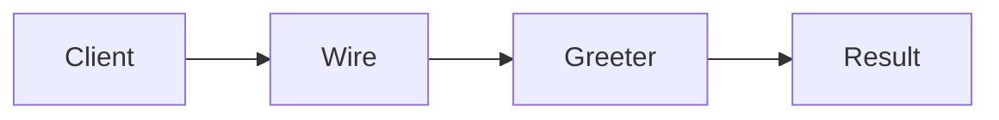

# Dependency Injection

**Season:** 4 · Enterprise · **Category:** Enterprise · **Level:** Intermediate · **Runtime:** ~10–12 min · **Channel:** Build with Waqar

## Problem
**Wire Greeter without hard `new` in controllers**

Key types: `Greeter`, `FormalGreeter`, `DiContainer`, `HelloController`, `GreeterHard`.

## Hook
Picture this: you are mid-demo and «Wire Greeter without hard `new` in controllers» blows up the naive way — you see `caught=missing Greeter`. That is the pain. In the next ten minutes we introduce **DI** with real types (Greeter, FormalGreeter, DiContainer), a runnable `ProblemDemo`, and the failure path locked in by tests. No abstract UML first — problem first.

## Intent
Use **DI** to cleanly solve: Wire Greeter without hard `new` in controllers.

**When to use:** the force behind «Wire Greeter without hard `new` in controllers» shows up more than once and a simpler language feature does not erase it.

**When to refuse:** you are pattern-collecting, the boundary is still unclear, or the team cannot yet test the abstraction (compensations, half-open recovery, interpreters).

## The Pain — Naive Design
Naive version fails to cleanly solve: Wire Greeter without hard `new` in controllers

```java
package com.buildwithwaqar.patterns.enterprise.di.problem;

import java.util.*;

public final class NaiveController {
  public String hello(String name){ return new GreeterHard().greet(name); }
}
final class GreeterHard { String greet(String n){ return "hi "+n; } }


```

On camera, point at the smell: missing compensations, leaked XML, null at the boundary,
illegal transitions, or hard-wired `System.out` that you cannot assert.

## Pattern Structure


These roles are for **«Wire Greeter without hard `new` in controllers»** — not a generic Client→Pattern poster. Keep them on screen
while you type the solution.

## Refactor to the Pattern

### Stage 1 — Name the boundary
Introduce the client-facing API the rest of the app should depend on. Hide the incompatible or
distributed details behind it. For this episode that boundary is what makes «Wire Greeter without hard `new` in controllers» testable.

### Stage 2 — Encode the solution
```java
package com.buildwithwaqar.patterns.enterprise.di.problem;

import java.util.*;
import java.util.concurrent.*;
import java.util.concurrent.atomic.*;
import java.util.concurrent.locks.*;
import java.util.function.*;

interface Greeter { String greet(String name); }
final class FormalGreeter implements Greeter { public String greet(String n){ return "Hello, "+n; } }
final class DiContainer {
  private final Map<Class<?>, Object> beans=new HashMap<>();
  <T> void register(Class<T> type, T impl){ beans.put(type, impl); }
  @SuppressWarnings("unchecked") <T> T get(Class<T> type){
    Object o=beans.get(type); if(o==null) throw new IllegalStateException("missing "+type.getSimpleName()); return (T)o;
  }
}
final class HelloController {
  private final Greeter greeter; HelloController(Greeter g){ greeter=g; }
  String hello(String name){ return greeter.greet(name); }
}

```

### Stage 3 — Runnable main
```java
package com.buildwithwaqar.patterns.enterprise.di.problem;
import java.util.*; import java.util.concurrent.*;
public final class ProblemDemo {
  public static void main(String[] args) throws Exception {
    System.out.println("=== DI: wire Greeter without hard new ===");
    System.out.println("--- naive ---"); System.out.println(new NaiveController().hello("Ada"));
System.out.println("--- DI ---");
var c=new DiContainer(); c.register(Greeter.class, new FormalGreeter());
var ctl=new HelloController(c.get(Greeter.class));
System.out.println(ctl.hello("Ada"));
try { new DiContainer().get(Greeter.class); } catch (IllegalStateException e){ System.out.println("caught="+e.getMessage()); }
  }
}

```

## Runnable Output (Verified on JDK 25)
Narrate each line. Do not invent numbers on camera.

```text
=== DI: wire Greeter without hard new ===
--- naive ---
hi Ada
--- DI ---
Hello, Ada
caught=missing Greeter
```

Happy-path cue: `hi Ada`.
Failure-path cue: `caught=missing Greeter`.
Fork the repo, set `JAVA_HOME` to JDK 25, and re-run the same `ProblemDemo` to verify.

## Modern Java 25 / Zazr Variant
For **DI**, prefer records for results, sealed types for closed variants, and Zazr `Option`/`Either`/`Validation` when the force is absence or accumulated errors. Keep the classic shape when interview literacy matters.

## Trade-offs
- **Clarity vs ceremony:** extra types for «Wire Greeter without hard `new` in controllers» only pay off when the force repeats.
- **Testability:** inject collaborators; assert the failure path, not only the happy path.
- **Distributed / concurrent reality:** demos omit metrics, backpressure, and multi-region clocks.
- **Refuse DI** when a sealed switch, a function value, or a simpler library call already erases the force.
- **Neighbor:** Service Locator — DI pushes deps in; Service Locator pulls — prefer DI for testability.

## Interview Q&A
**Q1. What concrete problem does DI solve here?**
A: Wire Greeter without hard `new` in controllers.

**Q2. What does the naive design get wrong?**
A: Naive version fails to cleanly solve: Wire Greeter without hard `new` in controllers

**Q3. How do you test the failure path?**
A: Inject the fault and assert the observable outcome — e.g. `caught=missing Greeter`.

**Q4. When is DI the wrong tool?**
A: When a smaller language feature erases the force, or when you really needed Service Locator.


## Key Takeaways
- Lead with the problem: Wire Greeter without hard `new` in controllers.
- Show naive pain (`caught=missing Greeter`) before naming DI.
- Run the Demo; trust JDK 25 stdout (`hi Ada`).
- Teach when NOT to use DI.

## Video Script (≈10–12 minutes)
Record for **Build with Waqar**. OBS for capture, CapCut for assembly. Import `slides.pdf`.
Facecam: full-screen for the hook, framed PiP over code slides.

**[0:00]** *(slide 01 title + talking head)*
Hey everyone — today we solve one concrete problem with **DI**:
*Wire Greeter without hard `new` in controllers*. Keep these names in your head: Greeter, FormalGreeter, DiContainer, HelloController.

**[0:45]** *(problem + hook slides)*
I am not starting with a textbook definition. Here is the product pain. By the end you will have
seen the naive leak, the pattern boundary, and real JDK 25 stdout.

**[2:00]** *(naive code)*
IDE time. This is the naive version. Call out the smell — that is what DI exists to erase.

**[3:30]** *(structure diagram)*
Roles for **this** problem, not a generic UML poster. Point at each box while you talk.

**[4:30]** *(refactor / solution code)*
Stage the solution. Highlight failure injection and the tests that lock it in.

**[7:00]** *(walkthrough output)*
Real stdout. Happy path cue: `hi Ada`.
Failure cue: `caught=missing Greeter`.
No invented numbers on camera.

**[8:30]** *(modern Java 25 / Zazr + trade-offs)*
Show the modernization, then slow down for when NOT to use DI. That is what seniors listen for.

**[10:30]** *(Q&A + recap + outro)*
Two interview questions, three takeaways, link the GitHub episode folder. I am Waqar — see you in the next one.


## Walkthrough Beats (Say These Out Loud)
1. **Setup:** open `series/27-dependency-injection/` and `run-output.txt` beside the IDE.
2. **Naive:** reproduce the pain until you can point at `caught=missing Greeter`.
3. **Structure:** on the diagram, trace `Client` → `Wire`, `Wire` → `Greeter`, `Greeter` → `Result`.
4. **Refactor:** encode the boundary, then run `ProblemDemo` — match `hi Ada`.
5. **Break it:** flip one `ProblemTest` assertion, watch red, restore it.
6. **Refuse:** Contrast with **Service Locator**: DI pushes deps in; Service Locator pulls — prefer DI for testability.

## Practice Drill
- Clone `waqarys/java-design-patterns`, set `JAVA_HOME` to JDK 25.
- Run the episode `ProblemDemo` (see `EP_MAIN` in `tools/enrich/build_problems.py`).
- Mutate one collaborator to fail; confirm the observable compensation / error path.
- Explain DI for «Wire Greeter without hard `new` in controllers» in sixty seconds without notes.
