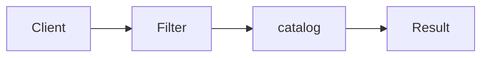

# Specification

**Season:** 4 · Enterprise · **Category:** Enterprise · **Level:** Intermediate · **Runtime:** ~10–12 min · **Channel:** Build with Waqar

## Problem
**Filter catalog: cheap AND in-stock**

Key types: `Product`, `Spec`, `CheapSpec`, `InStockSpec`.

## Hook
Picture this: you are mid-demo and «Filter catalog: cheap AND in-stock» blows up the naive way — you see `Failure path is asserted in ProblemTest (injected fault / invalid input)`. That is the pain. In the next ten minutes we introduce **Specification** with real types (Product, Spec, CheapSpec), a runnable `ProblemDemo`, and the failure path locked in by tests. No abstract UML first — problem first.

## Intent
Use **Specification** to cleanly solve: Filter catalog: cheap AND in-stock.

**When to use:** the force behind «Filter catalog: cheap AND in-stock» shows up more than once and a simpler language feature does not erase it.

**When to refuse:** you are pattern-collecting, the boundary is still unclear, or the team cannot yet test the abstraction (compensations, half-open recovery, interpreters).

## The Pain — Naive Design
Naive version fails to cleanly solve: Filter catalog: cheap AND in-stock

```java
package com.buildwithwaqar.patterns.enterprise.specification.problem;

import java.util.*;

public final class NaiveFilter {
  public static List<String> filter(List<int[]> items){ // [price, stock]
    List<String> out=new ArrayList<>();
    for (int i=0;i<items.size();i++) if(items.get(i)[0]<1000 && items.get(i)[1]>0) out.add("item"+i);
    return out;
  }
}

```

On camera, point at the smell: missing compensations, leaked XML, null at the boundary,
illegal transitions, or hard-wired `System.out` that you cannot assert.

## Pattern Structure


These roles are for **«Filter catalog: cheap AND in-stock»** — not a generic Client→Pattern poster. Keep them on screen
while you type the solution.

## Refactor to the Pattern

### Stage 1 — Name the boundary
Introduce the client-facing API the rest of the app should depend on. Hide the incompatible or
distributed details behind it. For this episode that boundary is what makes «Filter catalog: cheap AND in-stock» testable.

### Stage 2 — Encode the solution
```java
package com.buildwithwaqar.patterns.enterprise.specification.problem;

import java.util.*;
import java.util.concurrent.*;
import java.util.concurrent.atomic.*;
import java.util.concurrent.locks.*;
import java.util.function.*;

record Product(String id, int priceCents, int stock){}
interface Spec { boolean isSatisfiedBy(Product p); default Spec and(Spec o){ return p -> this.isSatisfiedBy(p) && o.isSatisfiedBy(p); } }
final class CheapSpec implements Spec { private final int max; CheapSpec(int max){this.max=max;} public boolean isSatisfiedBy(Product p){ return p.priceCents()<max; } }
final class InStockSpec implements Spec { public boolean isSatisfiedBy(Product p){ return p.stock()>0; } }

```

### Stage 3 — Runnable main
```java
package com.buildwithwaqar.patterns.enterprise.specification.problem;
import java.util.*; import java.util.concurrent.*;
public final class ProblemDemo {
  public static void main(String[] args) throws Exception {
    System.out.println("=== Specification: cheap AND in-stock ===");
    System.out.println("--- naive ---"); System.out.println(NaiveFilter.filter(List.of(new int[]{500,1}, new int[]{2000,5}, new int[]{100,0})));
System.out.println("--- specification ---");
var catalog=List.of(new Product("a",500,1), new Product("b",2000,5), new Product("c",100,0));
Spec spec=new CheapSpec(1000).and(new InStockSpec());
System.out.println(catalog.stream().filter(spec::isSatisfiedBy).map(Product::id).toList());
  }
}

```

## Runnable Output (Verified on JDK 25)
Narrate each line. Do not invent numbers on camera.

```text
=== Specification: cheap AND in-stock ===
--- naive ---
[item0]
--- specification ---
[a]
```

Happy-path cue: `[item0]`.
Failure-path cue: `Failure path is asserted in ProblemTest (injected fault / invalid input)`.
Fork the repo, set `JAVA_HOME` to JDK 25, and re-run the same `ProblemDemo` to verify.

## Modern Java 25 / Zazr Variant
**Records** carry the immutable results (`StepResult`, DTOs) with almost no boilerplate.

## Trade-offs
- **Clarity vs ceremony:** extra types for «Filter catalog: cheap AND in-stock» only pay off when the force repeats.
- **Testability:** inject collaborators; assert the failure path, not only the happy path.
- **Distributed / concurrent reality:** demos omit metrics, backpressure, and multi-region clocks.
- **Refuse Specification** when a sealed switch, a function value, or a simpler library call already erases the force.
- **Neighbor:** Strategy — Specification composes business rules as objects; Strategy swaps one algorithm.

## Interview Q&A
**Q1. What concrete problem does Specification solve here?**
A: Filter catalog: cheap AND in-stock.

**Q2. What does the naive design get wrong?**
A: Naive version fails to cleanly solve: Filter catalog: cheap AND in-stock

**Q3. How do you test the failure path?**
A: Inject the fault and assert the observable outcome — e.g. `Failure path is asserted in ProblemTest (injected fault / invalid input)`.

**Q4. When is Specification the wrong tool?**
A: When a smaller language feature erases the force, or when you really needed Strategy.


## Key Takeaways
- Lead with the problem: Filter catalog: cheap AND in-stock.
- Show naive pain (`Failure path is asserted in ProblemTest (injected fault / invalid input)`) before naming Specification.
- Run the Demo; trust JDK 25 stdout (`[item0]`).
- Teach when NOT to use Specification.

## Video Script (≈10–12 minutes)
Record for **Build with Waqar**. OBS for capture, CapCut for assembly. Import `slides.pdf`.
Facecam: full-screen for the hook, framed PiP over code slides.

**[0:00]** *(slide 01 title + talking head)*
Hey everyone — today we solve one concrete problem with **Specification**:
*Filter catalog: cheap AND in-stock*. Keep these names in your head: Product, Spec, CheapSpec, InStockSpec.

**[0:45]** *(problem + hook slides)*
I am not starting with a textbook definition. Here is the product pain. By the end you will have
seen the naive leak, the pattern boundary, and real JDK 25 stdout.

**[2:00]** *(naive code)*
IDE time. This is the naive version. Call out the smell — that is what Specification exists to erase.

**[3:30]** *(structure diagram)*
Roles for **this** problem, not a generic UML poster. Point at each box while you talk.

**[4:30]** *(refactor / solution code)*
Stage the solution. Highlight failure injection and the tests that lock it in.

**[7:00]** *(walkthrough output)*
Real stdout. Happy path cue: `[item0]`.
Failure cue: `Failure path is asserted in ProblemTest (injected fault / invalid input)`.
No invented numbers on camera.

**[8:30]** *(modern Java 25 / Zazr + trade-offs)*
Show the modernization, then slow down for when NOT to use Specification. That is what seniors listen for.

**[10:30]** *(Q&A + recap + outro)*
Two interview questions, three takeaways, link the GitHub episode folder. I am Waqar — see you in the next one.


## Walkthrough Beats (Say These Out Loud)
1. **Setup:** open `series/29-specification/` and `run-output.txt` beside the IDE.
2. **Naive:** reproduce the pain until you can point at `Failure path is asserted in ProblemTest (injected fault / invalid input)`.
3. **Structure:** on the diagram, trace `Client` → `Filter`, `Filter` → `catalog`, `catalog` → `Result`.
4. **Refactor:** encode the boundary, then run `ProblemDemo` — match `[item0]`.
5. **Break it:** flip one `ProblemTest` assertion, watch red, restore it.
6. **Refuse:** Contrast with **Strategy**: Specification composes business rules as objects; Strategy swaps one algorithm.

## Practice Drill
- Clone `waqarys/java-design-patterns`, set `JAVA_HOME` to JDK 25.
- Run the episode `ProblemDemo` (see `EP_MAIN` in `tools/enrich/build_problems.py`).
- Mutate one collaborator to fail; confirm the observable compensation / error path.
- Explain Specification for «Filter catalog: cheap AND in-stock» in sixty seconds without notes.
