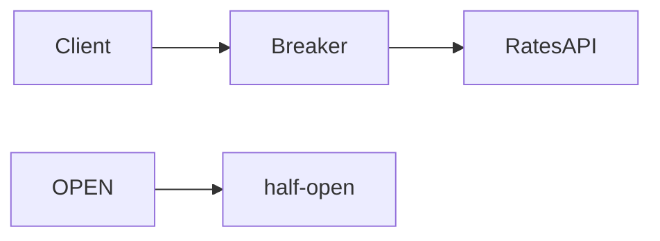

# Circuit Breaker

**Season:** 4 · Enterprise · **Category:** Enterprise · **Level:** Intermediate · **Runtime:** ~10–12 min · **Channel:** Build with Waqar

## Problem
**Protect calls to flaky rates API**

Key types: `CbState`, `CircuitBreaker`.

## Hook
Picture this: you are mid-demo and «Protect calls to flaky rates API» blows up the naive way — you see `fail`. That is the pain. In the next ten minutes we introduce **Circuit Breaker** with real types (CbState, CircuitBreaker), a runnable `ProblemDemo`, and the failure path locked in by tests. No abstract UML first — problem first.

## Intent
Fail fast against a flaky rates API once the error threshold trips — then probe half-open.

**When to use:** the force behind «Protect calls to flaky rates API» shows up more than once and a simpler language feature does not erase it.

**When to refuse:** you are pattern-collecting, the boundary is still unclear, or the team cannot yet test the abstraction (compensations, half-open recovery, interpreters).

## The Pain — Naive Design
Naive version fails to cleanly solve: Protect calls to flaky rates API

```java
package com.buildwithwaqar.patterns.enterprise.circuitbreaker.problem;

import java.util.*;

public final class NaiveRates {
  private int fails;
  public String rate(){ if(fails++ < 3) throw new RuntimeException("down"); return "83.2"; }
}

```

On camera, point at the smell: missing compensations, leaked XML, null at the boundary,
illegal transitions, or hard-wired `System.out` that you cannot assert.

## Pattern Structure


These roles are for **«Protect calls to flaky rates API»** — not a generic Client→Pattern poster. Keep them on screen
while you type the solution.

## Refactor to the Pattern

### Stage 1 — Name the boundary
Introduce the client-facing API the rest of the app should depend on. Hide the incompatible or
distributed details behind it. For this episode that boundary is what makes «Protect calls to flaky rates API» testable.

### Stage 2 — Encode the solution
```java
package com.buildwithwaqar.patterns.enterprise.circuitbreaker.problem;

import java.util.*;
import java.util.concurrent.*;
import java.util.concurrent.atomic.*;
import java.util.concurrent.locks.*;
import java.util.function.*;

enum CbState { CLOSED, OPEN, HALF_OPEN }
final class CircuitBreaker {
  private final int threshold; private int failures; private CbState state=CbState.CLOSED; private long openedAt;
  private final long resetMs; CircuitBreaker(int threshold, long resetMs){ this.threshold=threshold; this.resetMs=resetMs; }
  CbState state(){ return state; }
  String call(Supplier<String> action){
    if (state==CbState.OPEN){
      if (System.currentTimeMillis()-openedAt < resetMs) throw new IllegalStateException("circuit open");
      state=CbState.HALF_OPEN;
    }
    try {
      String r=action.get(); failures=0; state=CbState.CLOSED; return r;
    } catch (RuntimeException e){
      failures++;
      if (failures>=threshold || state==CbState.HALF_OPEN){ state=CbState.OPEN; openedAt=System.currentTimeMillis(); }
      throw e;
    }
  }
}

```

### Stage 3 — Runnable main
```java
package com.buildwithwaqar.patterns.enterprise.circuitbreaker.problem;

import java.util.concurrent.atomic.AtomicInteger;
import java.util.function.Supplier;

public final class ProblemDemo {
  public static void main(String[] args) throws Exception {
    System.out.println("=== Circuit Breaker: flaky rates API ===");
    System.out.println("--- naive ---");
    var n=new NaiveRates();
    for(int i=0;i<4;i++){ try{ System.out.println(n.rate()); } catch(Exception e){ System.out.println("fail"); } }
    System.out.println("--- circuit breaker ---");
    AtomicInteger blows=new AtomicInteger();
    var cb=new CircuitBreaker(2, 10);
    Supplier<String> flaky=() -> { if(blows.getAndIncrement()<2) throw new RuntimeException("down"); return "rate=83.2"; };
    for (int i=0;i<2;i++){ try{ System.out.println(cb.call(flaky)); } catch(Exception e){ System.out.println("fail state="+cb.state()); } }
    try { cb.call(flaky); } catch(IllegalStateException e){ System.out.println("shortCircuit="+e.getMessage()+" state="+cb.state()); }
    Thread.sleep(15); blows.set(100);
    System.out.println("recovered="+cb.call(() -> "rate=83.2")+" state="+cb.state());
  }
}

```

## Runnable Output (Verified on JDK 25)
Narrate each line. Do not invent numbers on camera.

```text
=== Circuit Breaker: flaky rates API ===
--- naive ---
fail
fail
fail
83.2
--- circuit breaker ---
fail state=CLOSED
fail state=OPEN
shortCircuit=circuit open state=OPEN
recovered=rate=83.2 state=CLOSED
```

Happy-path cue: `fail`.
Failure-path cue: `fail`.
Fork the repo, set `JAVA_HOME` to JDK 25, and re-run the same `ProblemDemo` to verify.

## Modern Java 25 / Zazr Variant
For **Circuit Breaker**, prefer records for results, sealed types for closed variants, and Zazr `Option`/`Either`/`Validation` when the force is absence or accumulated errors. Keep the classic shape when interview literacy matters.

## Trade-offs
- **Clarity vs ceremony:** thresholds and half-open probes need tuning — wrong numbers flap or hide outages.
- **Testability:** inject a flaky dependency and assert OPEN → HALF_OPEN → CLOSED transitions.
- **Refuse Breaker** for a dependency that almost never fails — a simple timeout may suffice.
- **Pair with Retry** for blips; open the breaker when the dependency is truly down.
- **Neighbor:** Retry — Breaker fails fast after a threshold; Retry keeps trying with backoff.

## Interview Q&A
**Q1. What concrete problem does Circuit Breaker solve here?**
A: Protect calls to flaky rates API.

**Q2. What does the naive design get wrong?**
A: Naive version fails to cleanly solve: Protect calls to flaky rates API

**Q3. How do you test the failure path?**
A: Inject the fault and assert the observable outcome — e.g. `fail`.

**Q4. When is Circuit Breaker the wrong tool?**
A: When a smaller language feature erases the force, or when you really needed Retry.


## Key Takeaways
- Lead with the problem: Protect calls to flaky rates API.
- Show naive pain (`fail`) before naming Circuit Breaker.
- Run the Demo; trust JDK 25 stdout (`fail`).
- Teach when NOT to use Circuit Breaker.

## Video Script (≈10–12 minutes)
Record for **Build with Waqar**. OBS for capture, CapCut for assembly. Import `slides.pdf`.
Facecam: full-screen for the hook, framed PiP over code slides.

**[0:00]** *(slide 01 title + talking head)*
Hey everyone — today we solve one concrete problem with **Circuit Breaker**:
*Protect calls to flaky rates API*. Keep these names in your head: CbState, CircuitBreaker.

**[0:45]** *(problem + hook slides)*
I am not starting with a textbook definition. Here is the product pain. By the end you will have
seen the naive leak, the pattern boundary, and real JDK 25 stdout.

**[2:00]** *(naive code)*
IDE time. This is the naive version. Call out the smell — that is what Circuit Breaker exists to erase.

**[3:30]** *(structure diagram)*
Roles for **this** problem, not a generic UML poster. Point at each box while you talk.

**[4:30]** *(refactor / solution code)*
Stage the solution. Highlight failure injection and the tests that lock it in.

**[7:00]** *(walkthrough output)*
Real stdout. Happy path cue: `fail`.
Failure cue: `fail`.
No invented numbers on camera.

**[8:30]** *(modern Java 25 / Zazr + trade-offs)*
Show the modernization, then slow down for when NOT to use Circuit Breaker. That is what seniors listen for.

**[10:30]** *(Q&A + recap + outro)*
Two interview questions, three takeaways, link the GitHub episode folder. I am Waqar — see you in the next one.


## Walkthrough Beats (Say These Out Loud)
1. **Setup:** open `series/30-circuit-breaker/` and `run-output.txt` beside the IDE.
2. **Naive:** reproduce the pain until you can point at `fail`.
3. **Structure:** on the diagram, trace `Client` → `Breaker`, `Breaker` → `RatesAPI`, `OPEN` → `half-open`.
4. **Refactor:** encode the boundary, then run `ProblemDemo` — match `fail`.
5. **Break it:** flip one `ProblemTest` assertion, watch red, restore it.
6. **Refuse:** Contrast with **Retry**: Breaker fails fast after a threshold; Retry keeps trying with backoff.

## Practice Drill
- Clone `waqarys/java-design-patterns`, set `JAVA_HOME` to JDK 25.
- Run the episode `ProblemDemo` (see `EP_MAIN` in `tools/enrich/build_problems.py`).
- Mutate one collaborator to fail; confirm the observable compensation / error path.
- Explain Circuit Breaker for «Protect calls to flaky rates API» in sixty seconds without notes.
