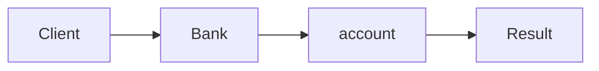

# Event Sourcing & CQRS

**Season:** 4 · Enterprise · **Category:** Enterprise · **Level:** Advanced · **Runtime:** ~10–12 min · **Channel:** Build with Waqar

## Problem
**Bank account ledger + balance read model**

Key types: `Event`, `Deposited`, `Withdrawn`, `Account`.

## Hook
Picture this: you are mid-demo and «Bank account ledger + balance read model» blows up the naive way — you see `caught=funds`. That is the pain. In the next ten minutes we introduce **Event Sourcing/CQRS** with real types (Event, Deposited, Withdrawn), a runnable `ProblemDemo`, and the failure path locked in by tests. No abstract UML first — problem first.

## Intent
Use **Event Sourcing/CQRS** to cleanly solve: Bank account ledger + balance read model.

**When to use:** the force behind «Bank account ledger + balance read model» shows up more than once and a simpler language feature does not erase it.

**When to refuse:** you are pattern-collecting, the boundary is still unclear, or the team cannot yet test the abstraction (compensations, half-open recovery, interpreters).

## The Pain — Naive Design
Naive version fails to cleanly solve: Bank account ledger + balance read model

```java
package com.buildwithwaqar.patterns.enterprise.eventsourcing.problem;

import java.util.*;

public final class NaiveAccount {
  private int bal; void deposit(int c){ bal+=c; } void withdraw(int c){ bal-=c; } int bal(){ return bal; }
}

```

On camera, point at the smell: missing compensations, leaked XML, null at the boundary,
illegal transitions, or hard-wired `System.out` that you cannot assert.

## Pattern Structure


These roles are for **«Bank account ledger + balance read model»** — not a generic Client→Pattern poster. Keep them on screen
while you type the solution.

## Refactor to the Pattern

### Stage 1 — Name the boundary
Introduce the client-facing API the rest of the app should depend on. Hide the incompatible or
distributed details behind it. For this episode that boundary is what makes «Bank account ledger + balance read model» testable.

### Stage 2 — Encode the solution
```java
package com.buildwithwaqar.patterns.enterprise.eventsourcing.problem;

import java.util.*;
import java.util.concurrent.*;
import java.util.concurrent.atomic.*;
import java.util.concurrent.locks.*;
import java.util.function.*;

sealed interface Event permits Deposited, Withdrawn {}
record Deposited(int cents) implements Event {}
record Withdrawn(int cents) implements Event {}
final class Account {
  private final List<Event> events=new ArrayList<>();
  void deposit(int c){ if(c<=0) throw new IllegalArgumentException("deposit"); events.add(new Deposited(c)); }
  void withdraw(int c){ if(c<=0 || balance()<c) throw new IllegalStateException("funds"); events.add(new Withdrawn(c)); }
  int balance(){ int b=0; for(Event e: events){ if(e instanceof Deposited d) b+=d.cents(); else if(e instanceof Withdrawn w) b-=w.cents(); } return b; }
  List<Event> history(){ return List.copyOf(events); }
}

```

### Stage 3 — Runnable main
```java
package com.buildwithwaqar.patterns.enterprise.eventsourcing.problem;
import java.util.*; import java.util.concurrent.*;
public final class ProblemDemo {
  public static void main(String[] args) throws Exception {
    System.out.println("=== Event Sourcing: bank ledger + balance ===");
    System.out.println("--- naive ---"); var n=new NaiveAccount(); n.deposit(100); n.withdraw(40); System.out.println(n.bal());
System.out.println("--- event sourcing ---");
var a=new Account(); a.deposit(100); a.withdraw(40); System.out.println("bal="+a.balance()); System.out.println("events="+a.history());
try { a.withdraw(1000); } catch(IllegalStateException e){ System.out.println("caught="+e.getMessage()); }
  }
}

```

## Runnable Output (Verified on JDK 25)
Narrate each line. Do not invent numbers on camera.

```text
=== Event Sourcing: bank ledger + balance ===
--- naive ---
60
--- event sourcing ---
bal=60
events=[Deposited[cents=100], Withdrawn[cents=40]]
caught=funds
```

Happy-path cue: `bal=60`.
Failure-path cue: `caught=funds`.
Fork the repo, set `JAVA_HOME` to JDK 25, and re-run the same `ProblemDemo` to verify.

## Modern Java 25 / Zazr Variant
This solution already leans on **sealed types** — keep the exhaustive `switch`. **Records** carry the immutable results (`StepResult`, DTOs) with almost no boilerplate.

## Trade-offs
- **Clarity vs ceremony:** extra types for «Bank account ledger + balance read model» only pay off when the force repeats.
- **Testability:** inject collaborators; assert the failure path, not only the happy path.
- **Distributed / concurrent reality:** demos omit metrics, backpressure, and multi-region clocks.
- **Refuse Event Sourcing/CQRS** when a sealed switch, a function value, or a simpler library call already erases the force.
- **Neighbor:** Saga — ES/CQRS records facts + read models; Saga coordinates multi-step reactions.

## Interview Q&A
**Q1. What concrete problem does Event Sourcing/CQRS solve here?**
A: Bank account ledger + balance read model.

**Q2. What does the naive design get wrong?**
A: Naive version fails to cleanly solve: Bank account ledger + balance read model

**Q3. How do you test the failure path?**
A: Inject the fault and assert the observable outcome — e.g. `caught=funds`.

**Q4. When is Event Sourcing/CQRS the wrong tool?**
A: When a smaller language feature erases the force, or when you really needed Saga.


## Key Takeaways
- Lead with the problem: Bank account ledger + balance read model.
- Show naive pain (`caught=funds`) before naming Event Sourcing/CQRS.
- Run the Demo; trust JDK 25 stdout (`bal=60`).
- Teach when NOT to use Event Sourcing/CQRS.

## Video Script (≈10–12 minutes)
Record for **Build with Waqar**. OBS for capture, CapCut for assembly. Import `slides.pdf`.
Facecam: full-screen for the hook, framed PiP over code slides.

**[0:00]** *(slide 01 title + talking head)*
Hey everyone — today we solve one concrete problem with **Event Sourcing/CQRS**:
*Bank account ledger + balance read model*. Keep these names in your head: Event, Deposited, Withdrawn, Account.

**[0:45]** *(problem + hook slides)*
I am not starting with a textbook definition. Here is the product pain. By the end you will have
seen the naive leak, the pattern boundary, and real JDK 25 stdout.

**[2:00]** *(naive code)*
IDE time. This is the naive version. Call out the smell — that is what Event Sourcing/CQRS exists to erase.

**[3:30]** *(structure diagram)*
Roles for **this** problem, not a generic UML poster. Point at each box while you talk.

**[4:30]** *(refactor / solution code)*
Stage the solution. Highlight failure injection and the tests that lock it in.

**[7:00]** *(walkthrough output)*
Real stdout. Happy path cue: `bal=60`.
Failure cue: `caught=funds`.
No invented numbers on camera.

**[8:30]** *(modern Java 25 / Zazr + trade-offs)*
Show the modernization, then slow down for when NOT to use Event Sourcing/CQRS. That is what seniors listen for.

**[10:30]** *(Q&A + recap + outro)*
Two interview questions, three takeaways, link the GitHub episode folder. I am Waqar — see you in the next one.


## Walkthrough Beats (Say These Out Loud)
1. **Setup:** open `series/32-event-sourcing-cqrs/` and `run-output.txt` beside the IDE.
2. **Naive:** reproduce the pain until you can point at `caught=funds`.
3. **Structure:** on the diagram, trace `Client` → `Bank`, `Bank` → `account`, `account` → `Result`.
4. **Refactor:** encode the boundary, then run `ProblemDemo` — match `bal=60`.
5. **Break it:** flip one `ProblemTest` assertion, watch red, restore it.
6. **Refuse:** Contrast with **Saga**: ES/CQRS records facts + read models; Saga coordinates multi-step reactions.

## Practice Drill
- Clone `waqarys/java-design-patterns`, set `JAVA_HOME` to JDK 25.
- Run the episode `ProblemDemo` (see `EP_MAIN` in `tools/enrich/build_problems.py`).
- Mutate one collaborator to fail; confirm the observable compensation / error path.
- Explain Event Sourcing/CQRS for «Bank account ledger + balance read model» in sixty seconds without notes.
