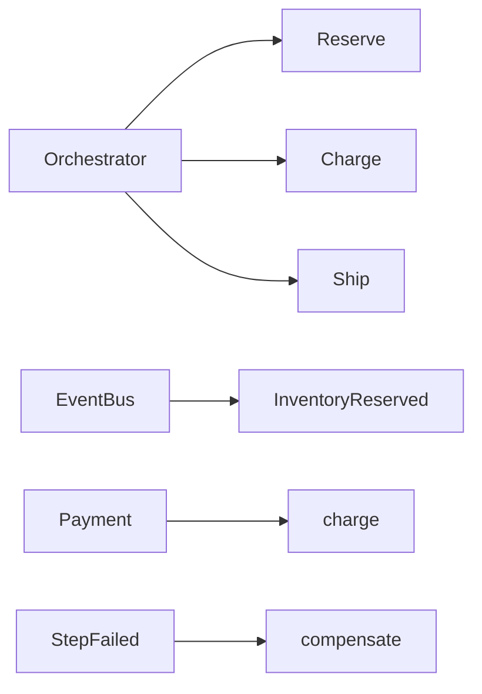

# Saga

**Season:** 4 · Enterprise · **Category:** Enterprise · **Level:** Intermediate · **Runtime:** ~10–12 min · **Channel:** Build with Waqar

## Problem
**Order booking: orchestration + event-bus choreography with compensations**

Key types: `OrderBookingSaga`, `StepResult`, `Inventory`, `Payments`, `Shipping`, `InMemoryPartners`.

**Saga nuance:** **orchestration** (coordinator calls reserve→charge→ship and registers compensations). On failure, compensations run in **reverse**. Steps are idempotent via `orderId:step` keys. **Choreography** (events between services) is the twin style — same compensations, no central coordinator.

## Hook
Picture this: you are mid-demo and «Order booking: orchestration + event-bus choreography with compensations» blows up the naive way — you see `--- naive (payment fails → inventory leak) ---`. That is the pain. In the next ten minutes we introduce **Saga** with real types (OrderBookingSaga, StepResult, Inventory), a runnable `ProblemDemo`, and the failure path locked in by tests. No abstract UML first — problem first.

## Intent
Keep reserve → charge → ship consistent across services by registering reverse compensations (orchestration) or reacting on an event bus (choreography).

**When to use:** the force behind «Order booking: orchestration + event-bus choreography with compensations» shows up more than once and a simpler language feature does not erase it.

**When to refuse:** you are pattern-collecting, the boundary is still unclear, or the team cannot yet test the abstraction (compensations, half-open recovery, interpreters).

## The Pain — Naive Design
Naive: sequential calls with no compensation registry. If shipping fails after payment, money is taken and inventory stays reserved.

```java
package com.buildwithwaqar.patterns.enterprise.saga.problem;

/**
 * Naive: sequential calls with no compensation registry.
 * If shipping fails after payment, money is taken and inventory stays reserved.
 */
public final class NaiveOrderFlow {
    private final OrderBookingSaga.InMemoryPartners partners;

    public NaiveOrderFlow(OrderBookingSaga.InMemoryPartners partners) {
        this.partners = partners;
    }

    public boolean book(String orderId, String sku, int qty, int cents, String address) {
        var r1 = partners.reserve(orderId, sku, qty);
        if (!r1.ok()) return false;
        var r2 = partners.charge(orderId, cents);
        if (!r2.ok()) return false; // inventory still reserved — leak
        var r3 = partners.ship(orderId, address);
        return r3.ok(); // payment charged even if ship fails — leak
    }
}

```

On camera, point at the smell: missing compensations, leaked XML, null at the boundary,
illegal transitions, or hard-wired `System.out` that you cannot assert.

## Pattern Structure


These roles are for **«Order booking: orchestration + event-bus choreography with compensations»** — not a generic Client→Pattern poster. Keep them on screen
while you type the solution.

## Refactor to the Pattern

### Stage 1 — Name the boundary
Introduce the client-facing API the rest of the app should depend on. Hide the incompatible or
distributed details behind it. For this episode that boundary is what makes «Order booking: orchestration + event-bus choreography with compensations» testable.

### Stage 2 — Encode the solution
```java
package com.buildwithwaqar.patterns.enterprise.saga.problem;

import java.util.ArrayList;
import java.util.List;
import java.util.Objects;
import java.util.function.Supplier;

/**
 * Orchestration saga for: reserve inventory → charge payment → create shipment.
 * Each step registers a compensation; on failure compensations run in reverse order.
 * Steps are idempotent via a simple seen-set keyed by orderId+step.
 */
public final class OrderBookingSaga {
    public record StepResult(boolean ok, String detail) {}

    public interface Inventory { StepResult reserve(String orderId, String sku, int qty); void release(String orderId); }
    public interface Payments { StepResult charge(String orderId, int cents); void refund(String orderId); }
    public interface Shipping { StepResult ship(String orderId, String address); void recall(String orderId); }

    private final Inventory inventory;
    private final Payments payments;
    private final Shipping shipping;
    private final List<String> log = new ArrayList<>();
    private final List<String> seen = new ArrayList<>();

    public OrderBookingSaga(Inventory inventory, Payments payments, Shipping shipping) {
        this.inventory = inventory;
        this.payments = payments;
        this.shipping = shipping;
    }

    public List<String> log() { return List.copyOf(log); }

    public boolean book(String orderId, String sku, int qty, int cents, String address) {
        List<Runnable> compensations = new ArrayList<>();
        try {
            runOnce(orderId + ":reserve", () -> {
                var r = inventory.reserve(orderId, sku, qty);
                if (!r.ok()) throw new IllegalStateException("inventory:" + r.detail());
                log.add("ok:reserve");
                compensations.addFirst(() -> { inventory.release(orderId); log.add("compensate:release"); });
            });
            runOnce(orderId + ":charge", () -> {
                var r = payments.charge(orderId, cents);
                if (!r.ok()) throw new IllegalStateException("payment:" + r.detail());
                log.add("ok:charge");
                compensations.addFirst(() -> { payments.refund(orderId); log.add("compensate:refund"); });
            });
            runOnce(orderId + ":ship", () -> {
                var r = shipping.ship(orderId, address);
                if (!r.ok()) throw new IllegalStateException("shipping:" + r.detail());
                log.add("ok:ship");
                compensations.addFirst(() -> { shipping.recall(orderId); log.add("compensate:recall"); });
            });
            log.add("committed");
            return true;
        } catch (RuntimeException e) {
            log.add("abort:" + e.getMessage());
            for (var c : compensations) c.run();
            log.add("rolled_back");
            return false;
        }
    }

    private void runOnce(String key, Runnable action) {
        if (seen.contains(key)) {
            log.add("skip-idempotent:" + key);
            return;
        }
        action.run();
        seen.add(key);
    }

    /** In-memory collaborators with injectable failure points. */
    public static final class InMemoryPartners implements 
```

### Stage 3 — Runnable main
```java
package com.buildwithwaqar.patterns.enterprise.saga.problem;

/** Problem: reserve → charge → ship with reverse compensations (orchestration + choreography). */
public final class ProblemDemo {
    public static void main(String[] args) {
        System.out.println("=== Saga problem: order booking with rollback ===");
        System.out.println("--- naive (payment fails → inventory leak) ---");
        var leak = new OrderBookingSaga.InMemoryPartners(() -> true, () -> false, () -> true);
        System.out.println("naiveBooked=" + new NaiveOrderFlow(leak).book("N1", "SKU", 1, 100, "A"));
        System.out.println("naiveReserved=" + leak.reserved());

        System.out.println("--- orchestration happy path ---");
        var okP = OrderBookingSaga.InMemoryPartners.alwaysOk();
        var ok = new OrderBookingSaga(okP, okP, okP);
        System.out.println("booked=" + ok.book("S1", "SKU", 1, 1000, "Ship St"));
        System.out.println("log=" + ok.log());

        System.out.println("--- orchestration fails at ship; compensates reverse ---");
        var failP = new OrderBookingSaga.InMemoryPartners(() -> true, () -> true, () -> false);
        var fail = new OrderBookingSaga(failP, failP, failP);
        System.out.println("booked=" + fail.book("S2", "SKU", 1, 1000, "Ship St"));
        System.out.println("log=" + fail.log());

        System.out.println("--- choreography happy path (event bus) ---");
        var bus = new EventBus();
        var cOk = OrderBookingSaga.InMemoryPartners.alwaysOk();
        var choreo = new ChoreographyOrderSaga(bus, cOk);
        System.out.println("booked=" + choreo.book("C1", "SKU", 1, 500, "Bus Ave"));
        System.out.println("log=" + choreo.log());
        System.out.println("events=" + bus.history().stream().map(e -> e.getClass().getSimpleName()).toList());

        System.out.println("--- choreography fails at charge; compensates ---");
        var bus2 = new EventBus();
        var cFail = new OrderBookingSaga.InMemoryPartners(() -> true, () -> false, () -> true);
        var choreoFail = new ChoreographyOrderSaga(bus2, cFail);
        System.out.println("booked=" + choreoFail.book("C2", "SKU", 1, 500, "Bus Ave"));
        System.out.println("log=" + choreoFail.log());
        System.out.println("reserved=" + cFail.reserved() + " charged=" + cFail.charged());
    }
}

```

## Runnable Output (Verified on JDK 25)
Narrate each line. Do not invent numbers on camera.

```text
=== Saga problem: order booking with rollback ===
--- naive (payment fails → inventory leak) ---
naiveBooked=false
naiveReserved=[N1]
--- orchestration happy path ---
booked=true
log=[ok:reserve, ok:charge, ok:ship, committed]
--- orchestration fails at ship; compensates reverse ---
booked=false
log=[ok:reserve, ok:charge, abort:shipping:carrier_down, compensate:refund, compensate:release, rolled_back]
--- choreography happy path (event bus) ---
booked=true
log=[ok:reserve, react:payment-on-reserved, ok:charge, react:ship-on-charged, ok:ship, committed]
events=[InventoryReserved, PaymentCharged, ShipmentCreated]
--- choreography fails at charge; compensates ---
booked=false
log=[ok:reserve, react:payment-on-reserved, abort:charge:card_declined, compensate:release, rolled_back]
reserved=[] charged=[]
```

Happy-path cue: `booked=true`.
Failure-path cue: `--- naive (payment fails → inventory leak) ---`.
Fork the repo, set `JAVA_HOME` to JDK 25, and re-run the same `ProblemDemo` to verify.

## Modern Java 25 / Zazr Variant
**Records** carry the immutable results (`StepResult`, DTOs) with almost no boilerplate. In production you would add idempotency keys, metrics, and a durable compensation log — the teaching demo keeps those out of frame on purpose.

## Trade-offs
- **Clarity vs ceremony:** a three-step booking needs a compensation stack; a single DB transaction does not.
- **Testability:** inject `InMemoryPartners` failure at reserve / charge / ship and assert reverse compensation order.
- **Distributed reality:** teaching demos omit poison pills, multi-region clocks, and durable saga logs.
- **Refuse Saga** when one local ACID transaction already covers the business step.
- **Neighbor:** Outbox — Saga orchestrates compensations across services; Outbox reliably publishes after commit.

## Interview Q&A
**Q1. What does orchestration buy you over naive sequential calls for «Order booking: orchestration + event-bus choreography with compensations»?**
A: A compensation stack that runs in reverse on abort, plus idempotency keys per `orderId:step`.

**Q2. How does choreography differ here?**
A: No central coordinator — `EventBus` reactions (`InventoryReserved` → charge → ship) own the next step; compensations still reverse.

**Q3. How do you test ship failure?**
A: Inject `shippingOk=false`; assert log contains `compensate:refund` then `compensate:release` and partners are clean.

**Q4. When is Saga the wrong tool?**
A: When a smaller language feature erases the force, or when you really needed Outbox.


## Key Takeaways
- Lead with the problem: Order booking: orchestration + event-bus choreography with compensations.
- Show naive pain (`--- naive (payment fails → inventory leak) ---`) before naming Saga.
- Run the Demo; trust JDK 25 stdout (`booked=true`).
- Teach when NOT to use Saga.

## Video Script (≈10–12 minutes)
Record for **Build with Waqar**. OBS for capture, CapCut for assembly. Import `slides.pdf`.
Facecam: full-screen for the hook, framed PiP over code slides.

**[0:00]** *(slide 01 title + talking head)*
Hey everyone — today we solve one concrete problem with **Saga**:
*Order booking: orchestration + event-bus choreography with compensations*. Keep these names in your head: OrderBookingSaga, StepResult, Inventory, Payments.

**[0:45]** *(problem + hook slides)*
I am not starting with a textbook definition. Here is the product pain. By the end you will have
seen the naive leak, the pattern boundary, and real JDK 25 stdout.

**[2:00]** *(naive code)*
IDE time. This is the naive version. Call out the smell — that is what Saga exists to erase.

**[3:30]** *(structure diagram)*
Roles for **this** problem, not a generic UML poster. Point at each box while you talk.

**[4:30]** *(refactor / solution code)*
Stage the solution. Highlight failure injection and the tests that lock it in.

**[7:00]** *(walkthrough output)*
Real stdout. Happy path cue: `booked=true`.
Failure cue: `--- naive (payment fails → inventory leak) ---`.
No invented numbers on camera.

**[8:30]** *(modern Java 25 / Zazr + trade-offs)*
Show the modernization, then slow down for when NOT to use Saga. That is what seniors listen for.

**[10:30]** *(Q&A + recap + outro)*
Two interview questions, three takeaways, link the GitHub episode folder. I am Waqar — see you in the next one.

