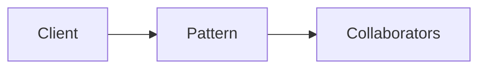

# Saga

**Season:** 4 · Enterprise · **Category:** Enterprise · **Level:** Intermediate · **Target runtime:** ~10–12 min · **Channel:** Build with Waqar · **Target runtime:** ~10–12 min · **Channel:** Build with Waqar · **Target runtime:** ~10–12 min · **Channel:** Build with Waqar · **Target runtime:** ~10–12 min · **Channel:** Build with Waqar

## Problem
**Order booking: orchestration + event-bus choreography with compensations**

This episode is built around that concrete problem — not a shared StreamForge framing.
You will see a real naive implementation that hurts, a full pattern-based solution, a
runnable main with meaningful stdout, and JUnit failure-path coverage where the pattern lives.


**Saga nuance:** this episode shows **orchestration** (a coordinator calls reserve→charge→ship and registers compensations). On failure, compensations run in **reverse** order. Steps are idempotent via `orderId:step` keys. Choreography (events between services) is the twin style — same compensations, no central coordinator.

## Hook
Welcome back to **Build with Waqar**. Today we earn **Saga** by solving one problem well:
*Order booking: orchestration + event-bus choreography with compensations*. By the end you will have walked naive pain → pattern refactor → real JDK 25
stdout → trade-offs, with CapCut slides and a spoken script.

## Intent
Saga exists because this force kept showing up: order booking: orchestration + event-bus choreography with compensations. Name the force, sketch
the roles, and — critically — know when you would refuse the pattern.

## The Pain — Naive Design
Before the pattern, teams usually thread details everywhere, leak resources on partial
failure, or couple call sites to a third-party shape. That feels fast on day one and expensive
on day thirty.

```java
package com.buildwithwaqar.patterns.enterprise.saga.problem;

/**
 * Naive: sequential calls with no compensation registry.
 * If shipping fails after payment, money is taken and inventory stays reserved.
 */
public final class NaiveOrderFlow {
    private final OrderBookingSaga.InMemoryPartners partners;

    public NaiveOrderFlow(OrderBookingSaga.InMemoryPartners partners) {
        this.partners = partners;
    }

    public boolean book(String orderId, String sku, int qty, int cents, String address) {
        var r1 = partners.reserve(orderId, sku, qty);
        if (!r1.ok()) return false;
        var r2 = partners.charge(orderId, cents);
        if (!r2.ok()) return false; // inventory still reserved — leak
        var r3 = partners.ship(orderId, address);
        return r3.ok(); // payment charged even if ship fails — leak
    }
}

```

Call out the smell on camera: duplicated envelopes, missing compensations, parameter drilling,
illegal transitions, or null at the boundary.

## Pattern Structure


Roles matter more than class counts. The diagram slide draws the collaboration for **this**
problem so viewers can point at boxes while you type.

## Refactor to the Pattern

### Stage 1 — Name the boundary
Identify the client-facing API the rest of the app should depend on. Hide the incompatible
or distributed details behind it.

### Stage 2 — Encode the solution
```java
package com.buildwithwaqar.patterns.enterprise.saga.problem;

import java.util.ArrayList;
import java.util.List;
import java.util.Objects;
import java.util.function.Supplier;

/**
 * Orchestration saga for: reserve inventory → charge payment → create shipment.
 * Each step registers a compensation; on failure compensations run in reverse order.
 * Steps are idempotent via a simple seen-set keyed by orderId+step.
 */
public final class OrderBookingSaga {
    public record StepResult(boolean ok, String detail) {}

    public interface Inventory { StepResult reserve(String orderId, String sku, int qty); void release(String orderId); }
    public interface Payments { StepResult charge(String orderId, int cents); void refund(String orderId); }
    public interface Shipping { StepResult ship(String orderId, String address); void recall(String orderId); }

    private final Inventory inventory;
    private final Payments payments;
    private final Shipping shipping;
    private final List<String> log = new ArrayList<>();
    private final List<String> seen = new ArrayList<>();

    public OrderBookingSaga(Inventory inventory, Payments payments, Shipping shipping) {
        this.inventory = inventory;
        this.payments = payments;
        this.shipping = shipping;
    }

    public List<String> log() { return List.copyOf(log); }

    public boolean book(String orderId, String sku, int qty, int cents, String address) {
        List<Runnable> compensations = new ArrayList<>();
        try {
            runOnce(orderId + ":reserve", () -> {
                var r = inventory.reserve(orderId, sku, qty);
                if (!r.ok()) throw new IllegalStateException("inventory:" + r.detail());
                log.add("ok:reserve");
                compensations.addFirst(() -> { inventory.release(orderId); log.add("compensate:release"); });
            });
            runOnce(orderId + ":charge", () -> {
                var r = payments.charge(orderId, cents);
                if (!r.ok()) throw new IllegalStateException("payment:" + r.detail());
                log.add("ok:charge");
                compensations.addFirst(() -> { payments.refund(orderId); log.add("compensate:refund"); });
            });
            runOnce(orderId + ":ship", () -> {
                var r = shipping.ship(orderId, address);
                if (!r.ok()) throw new IllegalStateException("shipping:" + r.detail());
                log.add("ok:ship");
                compensations.addFirst(() -> { shipping.recall(orderId); log.add("compensate:recall"); });
            });
            log.add("committed");
            return true;
        } catch (RuntimeException e) {
            log.add("abort:" + e.getMessage());
            for (var c : compensations) c.run();
            log.add("rolled_back");
            return false;
        }
    }

    private void runOnce(String key, Runnable action) {
        if (seen.contains(key)) {
            log.add("skip-idempotent:" + key);
            return;
        }
        action.run();
        seen.add(key);
    }

    /** In-memory collaborators with injectable failure points. */
    public static final class InMemoryPartners implements Inventory, Payments, Shipping {
        private final Supplier<Boolean> inventoryOk;
        private final Supplier<Boolean> paymentOk;
        private final Supplier<Boolean> shippingOk;
        private final List<String> reserved = new ArrayList<>();
        private final List<String> charged = ne
```

### Stage 3 — Runnable main
```java
package com.buildwithwaqar.patterns.enterprise.saga.problem;

/** Problem: reserve → charge → ship with reverse compensations (orchestration + choreography). */
public final class ProblemDemo {
    public static void main(String[] args) {
        System.out.println("=== Saga problem: order booking with rollback ===");
        System.out.println("--- naive (payment fails → inventory leak) ---");
        var leak = new OrderBookingSaga.InMemoryPartners(() -> true, () -> false, () -> true);
        System.out.println("naiveBooked=" + new NaiveOrderFlow(leak).book("N1", "SKU", 1, 100, "A"));
        System.out.println("naiveReserved=" + leak.reserved());

        System.out.println("--- orchestration happy path ---");
        var okP = OrderBookingSaga.InMemoryPartners.alwaysOk();
        var ok = new OrderBookingSaga(okP, okP, okP);
        System.out.println("booked=" + ok.book("S1", "SKU", 1, 1000, "Ship St"));
        System.out.println("log=" + ok.log());

        System.out.println("--- orchestration fails at ship; compensates reverse ---");
        var failP = new OrderBookingSaga.InMemoryPartners(() -> true, () -> true, () -> false);
        var fail = new OrderBookingSaga(failP, failP, failP);
        System.out.println("booked=" + fail.book("S2", "SKU", 1, 1000, "Ship St"));
        System.out.println("log=" + fail.log());

        System.out.println("--- choreography happy path (event bus) ---");
        var bus = new EventBus();
        var cOk = OrderBookingSaga.InMemoryPartners.alwaysOk();
        var choreo = new ChoreographyOrderSaga(bus, cOk);
        System.out.println("booked=" + choreo.book("C1", "SKU", 1, 500, "Bus Ave"));
        System.out.println("log=" + choreo.log());
        System.out.println("events=" + bus.history().stream().map(e -> e.getClass().getSimpleName()).toList());

        System.out.println("--- choreography fails at charge; compensates ---");
        var bus2 = new EventBus();
        var cFail = new OrderBookingSaga.InMemoryPartners(() -> true, () -> false, () -> true);
        var choreoFail = new ChoreographyOrderSaga(bus2, cFail);
        System.out.println("booked=" + choreoFail.book("C2", "SKU", 1, 500, "Bus Ave"));
        System.out.println("log=" + choreoFail.log());
        System.out.println("reserved=" + cFail.reserved() + " charged=" + cFail.charged());
    }
}

```

## Hand-Traced Walkthrough (Verified on JDK 25)
Narrate each line. Do not invent numbers on camera.

```text
=== Saga problem: order booking with rollback ===
--- naive (payment fails → inventory leak) ---
naiveBooked=false
naiveReserved=[N1]
--- orchestration happy path ---
booked=true
log=[ok:reserve, ok:charge, ok:ship, committed]
--- orchestration fails at ship; compensates reverse ---
booked=false
log=[ok:reserve, ok:charge, abort:shipping:carrier_down, compensate:refund, compensate:release, rolled_back]
--- choreography happy path (event bus) ---
booked=true
log=[ok:reserve, react:payment-on-reserved, ok:charge, react:ship-on-charged, ok:ship, committed]
events=[InventoryReserved, PaymentCharged, ShipmentCreated]
--- choreography fails at charge; compensates ---
booked=false
log=[ok:reserve, react:payment-on-reserved, abort:charge:card_declined, compensate:release, rolled_back]
reserved=[] charged=[]
```

Trace: match each printed line to a stage above. Fork the repo, set `JAVA_HOME` to JDK 25,
and re-run the same main class to verify.

## Modern Java 25 / Zazr Variant
Prefer records for results, sealed types for closed variants, pattern matching for exhaustive
handling, virtual threads for blocking fan-out, and Zazr for Option/Either/Try/Validation
when the force is about absence or accumulated errors. Keep the classic shape when interview
literacy matters.

## Trade-offs
- **Clarity vs ceremony:** five types for a two-line problem is a fail.
- **Testability:** inject collaborators; for Saga, inject failure at each step.
- **Distributed reality:** teaching demos omit metrics, poison pills, and multi-region clocks.
- **Refuse the pattern** when a sealed switch, a function value, or a simpler library call
  already erases the force.

## When to Use / When Not to Use
**Use when** the problem above shows up more than once and a simpler language feature does
not erase it.

**Avoid when** you are pattern-collecting, when the boundary is still unclear, or when the
team cannot yet test the abstraction (especially compensations and half-open recovery).

## Related Patterns
Contrast Saga with its usual twin (Adapter vs Facade, Saga vs Outbox, Reader vs DI/Cake,
State vs Strategy, Free vs Tagless). Say the distinguishing sentence out loud.

## Interview Q&A
**Q1. What concrete problem does Saga solve here?**
A: Order booking: orchestration + event-bus choreography with compensations.

**Q2. What does the naive design get wrong?**
A: Point at the naive code smells from this episode.

**Q3. How do you test failure paths?**
A: Inject a failing collaborator (Saga step, SOAP fault, missing file) and assert the
observable outcome — compensation order, FAILED result, or thrown IllegalStateException.

**Q4. When is Saga the wrong tool?**
A: Give a smaller counterexample where a function, Option, or facade is enough.

**Q5. How does Java 25 change the encoding?**
A: Records, sealed types, virtual threads, Zazr control types — pick what applies.

## Key Takeaways
- Lead with the problem: Order booking: orchestration + event-bus choreography with compensations.
- Show naive pain before naming Saga.
- Run the Demo; trust JDK 25 stdout.
- Teach when NOT to use it.

## Video Script (≈10–12 minutes)
Record for **Build with Waqar**. OBS for capture, CapCut for assembly. Import `slides.pdf`.

**[0:00]** *(slide 01 title)*
Hey everyone, welcome back to Build with Waqar. Today we solve a real problem with Saga:
Order booking: orchestration + event-bus choreography with compensations.

**[0:40]** *(slide 02–03 problem)*
I am not starting with a definition. Here is the product pain. Keep these names — they
reappear in the Demo output.

**[2:00]** *(naive code)*
IDE time. This is the naive version. Call out the smell.

**[3:30]** *(diagram)*
Structure for **this** problem. Point at each role.

**[4:30]** *(refactor stages)*
Stage by stage into the pattern. Highlight tests and failure injection.

**[7:00]** *(walkthrough output)*
Real stdout from JDK 25. Line by line. No fake numbers.

**[8:30]** *(modern + trade-offs)*
Java 25 / Zazr take, then slow down for when NOT to use Saga.

**[10:30]** *(interview + recap)*
Two interview questions, three takeaways, link the GitHub episode folder. I am Waqar —
see you in the next one.
