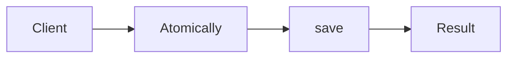

# Transactional Outbox

**Season:** 4 · Enterprise · **Category:** Enterprise · **Level:** Intermediate · **Runtime:** ~10–12 min · **Channel:** Build with Waqar

## Problem
**Atomically save order + outbox row, relay later**

Key types: `OutboxRow`, `OutboxStore`, `OutboxRelay`.

## Hook
Picture this: you are mid-demo and «Atomically save order + outbox row, relay later» blows up the naive way — you see `caught=broker down`. That is the pain. In the next ten minutes we introduce **Outbox** with real types (OutboxRow, OutboxStore, OutboxRelay), a runnable `ProblemDemo`, and the failure path locked in by tests. No abstract UML first — problem first.

## Intent
Use **Outbox** to cleanly solve: Atomically save order + outbox row, relay later.

**When to use:** the force behind «Atomically save order + outbox row, relay later» shows up more than once and a simpler language feature does not erase it.

**When to refuse:** you are pattern-collecting, the boundary is still unclear, or the team cannot yet test the abstraction (compensations, half-open recovery, interpreters).

## The Pain — Naive Design
Naive version fails to cleanly solve: Atomically save order + outbox row, relay later

```java
package com.buildwithwaqar.patterns.enterprise.outbox.problem;

import java.util.*;

public final class NaiveOrderPub {
  public static void place(String id){ /* save order */ System.out.println("saved "+id); /* publish may fail after */ throw new RuntimeException("broker down"); }
}

```

On camera, point at the smell: missing compensations, leaked XML, null at the boundary,
illegal transitions, or hard-wired `System.out` that you cannot assert.

## Pattern Structure


These roles are for **«Atomically save order + outbox row, relay later»** — not a generic Client→Pattern poster. Keep them on screen
while you type the solution.

## Refactor to the Pattern

### Stage 1 — Name the boundary
Introduce the client-facing API the rest of the app should depend on. Hide the incompatible or
distributed details behind it. For this episode that boundary is what makes «Atomically save order + outbox row, relay later» testable.

### Stage 2 — Encode the solution
```java
package com.buildwithwaqar.patterns.enterprise.outbox.problem;

import java.util.*;
import java.util.concurrent.*;
import java.util.concurrent.atomic.*;
import java.util.concurrent.locks.*;
import java.util.function.*;

record OutboxRow(String id, String payload, boolean published){}
final class OutboxStore {
  private final List<OutboxRow> rows=new ArrayList<>();
  private final List<String> orders=new ArrayList<>();
  void placeOrder(String id, String payload){ orders.add(id); rows.add(new OutboxRow(id, payload, false)); }
  List<OutboxRow> unpublished(){ return rows.stream().filter(r->!r.published()).toList(); }
  void markPublished(String id){
    for (int i=0;i<rows.size();i++) if(rows.get(i).id().equals(id)) rows.set(i, new OutboxRow(id, rows.get(i).payload(), true));
  }
  List<String> orders(){ return List.copyOf(orders); }
}
final class OutboxRelay {
  private final OutboxStore store; private final List<String> published=new ArrayList<>();
  OutboxRelay(OutboxStore store){ this.store=store; }
  int relayOnce(){ int n=0; for(var r: store.unpublished()){ published.add(r.payload()); store.markPublished(r.id()); n++; } return n; }
  List<String> published(){ return List.copyOf(published); }
}

```

### Stage 3 — Runnable main
```java
package com.buildwithwaqar.patterns.enterprise.outbox.problem;
import java.util.*; import java.util.concurrent.*;
public final class ProblemDemo {
  public static void main(String[] args) throws Exception {
    System.out.println("=== Outbox: order + event atomically ===");
    System.out.println("--- naive ---");
try { NaiveOrderPub.place("o1"); } catch(Exception e){ System.out.println("caught="+e.getMessage()); }
System.out.println("--- outbox ---");
var store=new OutboxStore(); store.placeOrder("o1","OrderPlaced:o1");
var relay=new OutboxRelay(store); System.out.println("relayed="+relay.relayOnce()); System.out.println("published="+relay.published());
System.out.println("relayedAgain="+relay.relayOnce());
  }
}

```

## Runnable Output (Verified on JDK 25)
Narrate each line. Do not invent numbers on camera.

```text
=== Outbox: order + event atomically ===
--- naive ---
saved o1
caught=broker down
--- outbox ---
relayed=1
published=[OrderPlaced:o1]
relayedAgain=0
```

Happy-path cue: `saved o1`.
Failure-path cue: `caught=broker down`.
Fork the repo, set `JAVA_HOME` to JDK 25, and re-run the same `ProblemDemo` to verify.

## Modern Java 25 / Zazr Variant
**Records** carry the immutable results (`StepResult`, DTOs) with almost no boilerplate.

## Trade-offs
- **Clarity vs ceremony:** extra types for «Atomically save order + outbox row, relay later» only pay off when the force repeats.
- **Testability:** inject collaborators; assert the failure path, not only the happy path.
- **Distributed / concurrent reality:** demos omit metrics, backpressure, and multi-region clocks.
- **Refuse Outbox** when a sealed switch, a function value, or a simpler library call already erases the force.
- **Neighbor:** Saga — Outbox is about atomic publish; Saga is about multi-step business rollback.

## Interview Q&A
**Q1. What concrete problem does Outbox solve here?**
A: Atomically save order + outbox row, relay later.

**Q2. What does the naive design get wrong?**
A: Naive version fails to cleanly solve: Atomically save order + outbox row, relay later

**Q3. How do you test the failure path?**
A: Inject the fault and assert the observable outcome — e.g. `caught=broker down`.

**Q4. When is Outbox the wrong tool?**
A: When a smaller language feature erases the force, or when you really needed Saga.


## Key Takeaways
- Lead with the problem: Atomically save order + outbox row, relay later.
- Show naive pain (`caught=broker down`) before naming Outbox.
- Run the Demo; trust JDK 25 stdout (`saved o1`).
- Teach when NOT to use Outbox.

## Video Script (≈10–12 minutes)
Record for **Build with Waqar**. OBS for capture, CapCut for assembly. Import `slides.pdf`.
Facecam: full-screen for the hook, framed PiP over code slides.

**[0:00]** *(slide 01 title + talking head)*
Hey everyone — today we solve one concrete problem with **Outbox**:
*Atomically save order + outbox row, relay later*. Keep these names in your head: OutboxRow, OutboxStore, OutboxRelay.

**[0:45]** *(problem + hook slides)*
I am not starting with a textbook definition. Here is the product pain. By the end you will have
seen the naive leak, the pattern boundary, and real JDK 25 stdout.

**[2:00]** *(naive code)*
IDE time. This is the naive version. Call out the smell — that is what Outbox exists to erase.

**[3:30]** *(structure diagram)*
Roles for **this** problem, not a generic UML poster. Point at each box while you talk.

**[4:30]** *(refactor / solution code)*
Stage the solution. Highlight failure injection and the tests that lock it in.

**[7:00]** *(walkthrough output)*
Real stdout. Happy path cue: `saved o1`.
Failure cue: `caught=broker down`.
No invented numbers on camera.

**[8:30]** *(modern Java 25 / Zazr + trade-offs)*
Show the modernization, then slow down for when NOT to use Outbox. That is what seniors listen for.

**[10:30]** *(Q&A + recap + outro)*
Two interview questions, three takeaways, link the GitHub episode folder. I am Waqar — see you in the next one.


## Walkthrough Beats (Say These Out Loud)
1. **Setup:** open `series/34-outbox/` and `run-output.txt` beside the IDE.
2. **Naive:** reproduce the pain until you can point at `caught=broker down`.
3. **Structure:** on the diagram, trace `Client` → `Atomically`, `Atomically` → `save`, `save` → `Result`.
4. **Refactor:** encode the boundary, then run `ProblemDemo` — match `saved o1`.
5. **Break it:** flip one `ProblemTest` assertion, watch red, restore it.
6. **Refuse:** Contrast with **Saga**: Outbox is about atomic publish; Saga is about multi-step business rollback.

## Practice Drill
- Clone `waqarys/java-design-patterns`, set `JAVA_HOME` to JDK 25.
- Run the episode `ProblemDemo` (see `EP_MAIN` in `tools/enrich/build_problems.py`).
- Mutate one collaborator to fail; confirm the observable compensation / error path.
- Explain Outbox for «Atomically save order + outbox row, relay later» in sixty seconds without notes.
