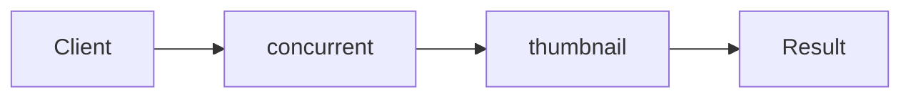

# Thread Pool

**Season:** 5 · Concurrency · **Category:** Concurrency · **Level:** Intermediate · **Runtime:** ~10–12 min · **Channel:** Build with Waqar

## Problem
**Cap concurrent thumbnail jobs**

Key types: `SimpleThreadPool`.

## Hook
Picture this: you are mid-demo and «Cap concurrent thumbnail jobs» blows up the naive way — you see `Failure path is asserted in ProblemTest (injected fault / invalid input)`. That is the pain. In the next ten minutes we introduce **Thread Pool** with real types (SimpleThreadPool), a runnable `ProblemDemo`, and the failure path locked in by tests. No abstract UML first — problem first.

## Intent
Use **Thread Pool** to cleanly solve: Cap concurrent thumbnail jobs.

**When to use:** the force behind «Cap concurrent thumbnail jobs» shows up more than once and a simpler language feature does not erase it.

**When to refuse:** you are pattern-collecting, the boundary is still unclear, or the team cannot yet test the abstraction (compensations, half-open recovery, interpreters).

## The Pain — Naive Design
Naive version fails to cleanly solve: Cap concurrent thumbnail jobs

```java
package com.buildwithwaqar.patterns.concurrency.threadpool.problem;

import java.util.*;

public final class NaiveThumbs {
  public static int run(int n){ int c=0; for(int i=0;i<n;i++) c++; return c; } // unbounded threads in real life
}

```

On camera, point at the smell: missing compensations, leaked XML, null at the boundary,
illegal transitions, or hard-wired `System.out` that you cannot assert.

## Pattern Structure


These roles are for **«Cap concurrent thumbnail jobs»** — not a generic Client→Pattern poster. Keep them on screen
while you type the solution.

## Refactor to the Pattern

### Stage 1 — Name the boundary
Introduce the client-facing API the rest of the app should depend on. Hide the incompatible or
distributed details behind it. For this episode that boundary is what makes «Cap concurrent thumbnail jobs» testable.

### Stage 2 — Encode the solution
```java
package com.buildwithwaqar.patterns.concurrency.threadpool.problem;

import java.util.*;
import java.util.concurrent.*;
import java.util.concurrent.atomic.*;
import java.util.concurrent.locks.*;
import java.util.function.*;

final class SimpleThreadPool {
  private final ExecutorService pool;
  SimpleThreadPool(int n){ pool=Executors.newFixedThreadPool(n); }
  <T> Future<T> submit(Callable<T> c){ return pool.submit(c); }
  void shutdown(){ pool.shutdown(); }
}

```

### Stage 3 — Runnable main
```java
package com.buildwithwaqar.patterns.concurrency.threadpool.problem;
import java.util.*; import java.util.concurrent.*; import java.util.concurrent.atomic.*;
public final class ProblemDemo {
  public static void main(String[] args) throws Exception {
    System.out.println("=== Thread Pool: cap thumbnail jobs ===");
    System.out.println("--- naive ---"); System.out.println(NaiveThumbs.run(5));
System.out.println("--- thread pool ---");
var pool=new SimpleThreadPool(2); List<Future<Integer>> fs=new ArrayList<>();
for(int i=0;i<5;i++){ int id=i; fs.add(pool.submit(() -> id*id)); }
System.out.println(fs.stream().map(f -> { try { return f.get(); } catch(Exception e){ throw new RuntimeException(e);} }).toList());
pool.shutdown();
  }
}

```

## Runnable Output (Verified on JDK 25)
Narrate each line. Do not invent numbers on camera.

```text
=== Thread Pool: cap thumbnail jobs ===
--- naive ---
5
--- thread pool ---
[0, 1, 4, 9, 16]
```

Happy-path cue: `5`.
Failure-path cue: `Failure path is asserted in ProblemTest (injected fault / invalid input)`.
Fork the repo, set `JAVA_HOME` to JDK 25, and re-run the same `ProblemDemo` to verify.

## Modern Java 25 / Zazr Variant
For **Thread Pool**, prefer records for results, sealed types for closed variants, and Zazr `Option`/`Either`/`Validation` when the force is absence or accumulated errors. Keep the classic shape when interview literacy matters.

## Trade-offs
- **Clarity vs ceremony:** extra types for «Cap concurrent thumbnail jobs» only pay off when the force repeats.
- **Testability:** inject collaborators; assert the failure path, not only the happy path.
- **Distributed / concurrent reality:** demos omit metrics, backpressure, and multi-region clocks.
- **Refuse Thread Pool** when a sealed switch, a function value, or a simpler library call already erases the force.
- **Neighbor:** Virtual Threads — Pool reuses platform threads; virtual threads scale blocking fan-out.

## Interview Q&A
**Q1. What concrete problem does Thread Pool solve here?**
A: Cap concurrent thumbnail jobs.

**Q2. What does the naive design get wrong?**
A: Naive version fails to cleanly solve: Cap concurrent thumbnail jobs

**Q3. How do you test the failure path?**
A: Inject the fault and assert the observable outcome — e.g. `Failure path is asserted in ProblemTest (injected fault / invalid input)`.

**Q4. When is Thread Pool the wrong tool?**
A: When a smaller language feature erases the force, or when you really needed Virtual Threads.


## Key Takeaways
- Lead with the problem: Cap concurrent thumbnail jobs.
- Show naive pain (`Failure path is asserted in ProblemTest (injected fault / invalid input)`) before naming Thread Pool.
- Run the Demo; trust JDK 25 stdout (`5`).
- Teach when NOT to use Thread Pool.

## Video Script (≈10–12 minutes)
Record for **Build with Waqar**. OBS for capture, CapCut for assembly. Import `slides.pdf`.
Facecam: full-screen for the hook, framed PiP over code slides.

**[0:00]** *(slide 01 title + talking head)*
Hey everyone — today we solve one concrete problem with **Thread Pool**:
*Cap concurrent thumbnail jobs*. Keep these names in your head: SimpleThreadPool.

**[0:45]** *(problem + hook slides)*
I am not starting with a textbook definition. Here is the product pain. By the end you will have
seen the naive leak, the pattern boundary, and real JDK 25 stdout.

**[2:00]** *(naive code)*
IDE time. This is the naive version. Call out the smell — that is what Thread Pool exists to erase.

**[3:30]** *(structure diagram)*
Roles for **this** problem, not a generic UML poster. Point at each box while you talk.

**[4:30]** *(refactor / solution code)*
Stage the solution. Highlight failure injection and the tests that lock it in.

**[7:00]** *(walkthrough output)*
Real stdout. Happy path cue: `5`.
Failure cue: `Failure path is asserted in ProblemTest (injected fault / invalid input)`.
No invented numbers on camera.

**[8:30]** *(modern Java 25 / Zazr + trade-offs)*
Show the modernization, then slow down for when NOT to use Thread Pool. That is what seniors listen for.

**[10:30]** *(Q&A + recap + outro)*
Two interview questions, three takeaways, link the GitHub episode folder. I am Waqar — see you in the next one.


## Walkthrough Beats (Say These Out Loud)
1. **Setup:** open `series/36-thread-pool/` and `run-output.txt` beside the IDE.
2. **Naive:** reproduce the pain until you can point at `Failure path is asserted in ProblemTest (injected fault / invalid input)`.
3. **Structure:** on the diagram, trace `Client` → `concurrent`, `concurrent` → `thumbnail`, `thumbnail` → `Result`.
4. **Refactor:** encode the boundary, then run `ProblemDemo` — match `5`.
5. **Break it:** flip one `ProblemTest` assertion, watch red, restore it.
6. **Refuse:** Contrast with **Virtual Threads**: Pool reuses platform threads; virtual threads scale blocking fan-out.

## Practice Drill
- Clone `waqarys/java-design-patterns`, set `JAVA_HOME` to JDK 25.
- Run the episode `ProblemDemo` (see `EP_MAIN` in `tools/enrich/build_problems.py`).
- Mutate one collaborator to fail; confirm the observable compensation / error path.
- Explain Thread Pool for «Cap concurrent thumbnail jobs» in sixty seconds without notes.
