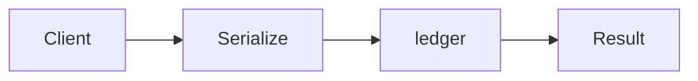

# Active Object

**Season:** 5 · Concurrency · **Category:** Concurrency · **Level:** Intermediate · **Runtime:** ~10–12 min · **Channel:** Build with Waqar

## Problem
**Serialize ledger mutations on one servant**

Key types: `ActiveLedger`.

## Hook
Picture this: you are mid-demo and «Serialize ledger mutations on one servant» blows up the naive way — you see `Failure path is asserted in ProblemTest (injected fault / invalid input)`. That is the pain. In the next ten minutes we introduce **Active Object** with real types (ActiveLedger), a runnable `ProblemDemo`, and the failure path locked in by tests. No abstract UML first — problem first.

## Intent
Use **Active Object** to cleanly solve: Serialize ledger mutations on one servant.

**When to use:** the force behind «Serialize ledger mutations on one servant» shows up more than once and a simpler language feature does not erase it.

**When to refuse:** you are pattern-collecting, the boundary is still unclear, or the team cannot yet test the abstraction (compensations, half-open recovery, interpreters).

## The Pain — Naive Design
Naive version fails to cleanly solve: Serialize ledger mutations on one servant

```java
package com.buildwithwaqar.patterns.concurrency.activeobject.problem;

import java.util.*;

public final class NaiveLedger {
  private int bal; public void deposit(int c){ bal+=c; } public int bal(){ return bal; }
}

```

On camera, point at the smell: missing compensations, leaked XML, null at the boundary,
illegal transitions, or hard-wired `System.out` that you cannot assert.

## Pattern Structure


These roles are for **«Serialize ledger mutations on one servant»** — not a generic Client→Pattern poster. Keep them on screen
while you type the solution.

## Refactor to the Pattern

### Stage 1 — Name the boundary
Introduce the client-facing API the rest of the app should depend on. Hide the incompatible or
distributed details behind it. For this episode that boundary is what makes «Serialize ledger mutations on one servant» testable.

### Stage 2 — Encode the solution
```java
package com.buildwithwaqar.patterns.concurrency.activeobject.problem;

import java.util.*;
import java.util.concurrent.*;
import java.util.concurrent.atomic.*;
import java.util.concurrent.locks.*;
import java.util.function.*;

final class ActiveLedger implements AutoCloseable {
  private int bal; private final ExecutorService servant=Executors.newSingleThreadExecutor();
  CompletableFuture<Void> deposit(int c){ return CompletableFuture.runAsync(() -> { bal+=c; }, servant); }
  CompletableFuture<Integer> balance(){ return CompletableFuture.supplyAsync(() -> bal, servant); }
  public void close(){ servant.shutdown(); }
}

```

### Stage 3 — Runnable main
```java
package com.buildwithwaqar.patterns.concurrency.activeobject.problem;
import java.util.*; import java.util.concurrent.*; import java.util.concurrent.atomic.*;
public final class ProblemDemo {
  public static void main(String[] args) throws Exception {
    System.out.println("=== Active Object: serialize ledger ===");
    System.out.println("--- naive ---"); var n=new NaiveLedger(); n.deposit(5); System.out.println(n.bal());
System.out.println("--- active object ---");
try (var a=new ActiveLedger()) {
  a.deposit(10).join(); a.deposit(5).join();
  System.out.println("bal="+a.balance().join());
}
  }
}

```

## Runnable Output (Verified on JDK 25)
Narrate each line. Do not invent numbers on camera.

```text
=== Active Object: serialize ledger ===
--- naive ---
5
--- active object ---
bal=15
```

Happy-path cue: `bal=15`.
Failure-path cue: `Failure path is asserted in ProblemTest (injected fault / invalid input)`.
Fork the repo, set `JAVA_HOME` to JDK 25, and re-run the same `ProblemDemo` to verify.

## Modern Java 25 / Zazr Variant
`CompletableFuture` composition covers the async variant; prefer virtual threads when the work is blocking I/O.

## Trade-offs
- **Clarity vs ceremony:** extra types for «Serialize ledger mutations on one servant» only pay off when the force repeats.
- **Testability:** inject collaborators; assert the failure path, not only the happy path.
- **Distributed / concurrent reality:** demos omit metrics, backpressure, and multi-region clocks.
- **Refuse Active Object** when a sealed switch, a function value, or a simpler library call already erases the force.
- **Neighbor:** Actor — Active Object serializes calls on a servant; actors add location transparency.

## Interview Q&A
**Q1. What concrete problem does Active Object solve here?**
A: Serialize ledger mutations on one servant.

**Q2. What does the naive design get wrong?**
A: Naive version fails to cleanly solve: Serialize ledger mutations on one servant

**Q3. How do you test the failure path?**
A: Inject the fault and assert the observable outcome — e.g. `Failure path is asserted in ProblemTest (injected fault / invalid input)`.

**Q4. When is Active Object the wrong tool?**
A: When a smaller language feature erases the force, or when you really needed Actor.


## Key Takeaways
- Lead with the problem: Serialize ledger mutations on one servant.
- Show naive pain (`Failure path is asserted in ProblemTest (injected fault / invalid input)`) before naming Active Object.
- Run the Demo; trust JDK 25 stdout (`bal=15`).
- Teach when NOT to use Active Object.

## Video Script (≈10–12 minutes)
Record for **Build with Waqar**. OBS for capture, CapCut for assembly. Import `slides.pdf`.
Facecam: full-screen for the hook, framed PiP over code slides.

**[0:00]** *(slide 01 title + talking head)*
Hey everyone — today we solve one concrete problem with **Active Object**:
*Serialize ledger mutations on one servant*. Keep these names in your head: ActiveLedger.

**[0:45]** *(problem + hook slides)*
I am not starting with a textbook definition. Here is the product pain. By the end you will have
seen the naive leak, the pattern boundary, and real JDK 25 stdout.

**[2:00]** *(naive code)*
IDE time. This is the naive version. Call out the smell — that is what Active Object exists to erase.

**[3:30]** *(structure diagram)*
Roles for **this** problem, not a generic UML poster. Point at each box while you talk.

**[4:30]** *(refactor / solution code)*
Stage the solution. Highlight failure injection and the tests that lock it in.

**[7:00]** *(walkthrough output)*
Real stdout. Happy path cue: `bal=15`.
Failure cue: `Failure path is asserted in ProblemTest (injected fault / invalid input)`.
No invented numbers on camera.

**[8:30]** *(modern Java 25 / Zazr + trade-offs)*
Show the modernization, then slow down for when NOT to use Active Object. That is what seniors listen for.

**[10:30]** *(Q&A + recap + outro)*
Two interview questions, three takeaways, link the GitHub episode folder. I am Waqar — see you in the next one.


## Walkthrough Beats (Say These Out Loud)
1. **Setup:** open `series/39-active-object/` and `run-output.txt` beside the IDE.
2. **Naive:** reproduce the pain until you can point at `Failure path is asserted in ProblemTest (injected fault / invalid input)`.
3. **Structure:** on the diagram, trace `Client` → `Serialize`, `Serialize` → `ledger`, `ledger` → `Result`.
4. **Refactor:** encode the boundary, then run `ProblemDemo` — match `bal=15`.
5. **Break it:** flip one `ProblemTest` assertion, watch red, restore it.
6. **Refuse:** Contrast with **Actor**: Active Object serializes calls on a servant; actors add location transparency.

## Practice Drill
- Clone `waqarys/java-design-patterns`, set `JAVA_HOME` to JDK 25.
- Run the episode `ProblemDemo` (see `EP_MAIN` in `tools/enrich/build_problems.py`).
- Mutate one collaborator to fail; confirm the observable compensation / error path.
- Explain Active Object for «Serialize ledger mutations on one servant» in sixty seconds without notes.
