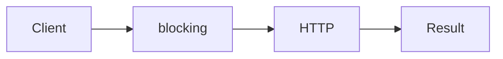

# Virtual Threads

**Season:** 5 · Concurrency · **Category:** Concurrency · **Level:** Intermediate · **Runtime:** ~10–12 min · **Channel:** Build with Waqar

## Problem
**Fan-out 10k blocking HTTP checks**

Key types: `UrlChecker`.

## Hook
Picture this: you are mid-demo and «Fan-out 10k blocking HTTP checks» blows up the naive way — you see `Failure path is asserted in ProblemTest (injected fault / invalid input)`. That is the pain. In the next ten minutes we introduce **Virtual Threads** with real types (UrlChecker), a runnable `ProblemDemo`, and the failure path locked in by tests. No abstract UML first — problem first.

## Intent
Use **Virtual Threads** to cleanly solve: Fan-out 10k blocking HTTP checks.

**When to use:** the force behind «Fan-out 10k blocking HTTP checks» shows up more than once and a simpler language feature does not erase it.

**When to refuse:** you are pattern-collecting, the boundary is still unclear, or the team cannot yet test the abstraction (compensations, half-open recovery, interpreters).

## The Pain — Naive Design
Naive version fails to cleanly solve: Fan-out 10k blocking HTTP checks

```java
package com.buildwithwaqar.patterns.concurrency.virtualthreads.problem;

import java.util.*;

public final class NaiveChecks {
  public static int run(int n){ int ok=0; for(int i=0;i<n;i++) ok++; return ok; }
}

```

On camera, point at the smell: missing compensations, leaked XML, null at the boundary,
illegal transitions, or hard-wired `System.out` that you cannot assert.

## Pattern Structure


These roles are for **«Fan-out 10k blocking HTTP checks»** — not a generic Client→Pattern poster. Keep them on screen
while you type the solution.

## Refactor to the Pattern

### Stage 1 — Name the boundary
Introduce the client-facing API the rest of the app should depend on. Hide the incompatible or
distributed details behind it. For this episode that boundary is what makes «Fan-out 10k blocking HTTP checks» testable.

### Stage 2 — Encode the solution
```java
package com.buildwithwaqar.patterns.concurrency.virtualthreads.problem;

import java.util.*;
import java.util.concurrent.*;
import java.util.concurrent.atomic.*;
import java.util.concurrent.locks.*;
import java.util.function.*;

final class UrlChecker {
  int checkAll(int n) throws Exception {
    try (var scope = Executors.newVirtualThreadPerTaskExecutor()) {
      List<Future<Boolean>> fs=new ArrayList<>();
      for (int i=0;i<n;i++) fs.add(scope.submit(() -> true));
      int ok=0; for (var f: fs) if (f.get()) ok++;
      return ok;
    }
  }
}

```

### Stage 3 — Runnable main
```java
package com.buildwithwaqar.patterns.concurrency.virtualthreads.problem;
import java.util.*; import java.util.concurrent.*; import java.util.concurrent.atomic.*;
public final class ProblemDemo {
  public static void main(String[] args) throws Exception {
    System.out.println("=== Virtual Threads: fan-out HTTP checks ===");
    System.out.println("--- naive ---"); System.out.println(NaiveChecks.run(200));
System.out.println("--- virtual threads ---");
System.out.println("checks="+new UrlChecker().checkAll(200));
  }
}

```

## Runnable Output (Verified on JDK 25)
Narrate each line. Do not invent numbers on camera.

```text
=== Virtual Threads: fan-out HTTP checks ===
--- naive ---
200
--- virtual threads ---
checks=200
```

Happy-path cue: `200`.
Failure-path cue: `Failure path is asserted in ProblemTest (injected fault / invalid input)`.
Fork the repo, set `JAVA_HOME` to JDK 25, and re-run the same `ProblemDemo` to verify.

## Modern Java 25 / Zazr Variant
Blocking fan-out belongs on **virtual threads** (Java 21+).

## Trade-offs
- **Clarity vs ceremony:** extra types for «Fan-out 10k blocking HTTP checks» only pay off when the force repeats.
- **Testability:** inject collaborators; assert the failure path, not only the happy path.
- **Distributed / concurrent reality:** demos omit metrics, backpressure, and multi-region clocks.
- **Refuse Virtual Threads** when a sealed switch, a function value, or a simpler library call already erases the force.
- **Neighbor:** Thread Pool — Prefer VTs for many blocking tasks; keep pools for CPU-bound work.

## Interview Q&A
**Q1. What concrete problem does Virtual Threads solve here?**
A: Fan-out 10k blocking HTTP checks.

**Q2. What does the naive design get wrong?**
A: Naive version fails to cleanly solve: Fan-out 10k blocking HTTP checks

**Q3. How do you test the failure path?**
A: Inject the fault and assert the observable outcome — e.g. `Failure path is asserted in ProblemTest (injected fault / invalid input)`.

**Q4. When is Virtual Threads the wrong tool?**
A: When a smaller language feature erases the force, or when you really needed Thread Pool.


## Key Takeaways
- Lead with the problem: Fan-out 10k blocking HTTP checks.
- Show naive pain (`Failure path is asserted in ProblemTest (injected fault / invalid input)`) before naming Virtual Threads.
- Run the Demo; trust JDK 25 stdout (`200`).
- Teach when NOT to use Virtual Threads.

## Video Script (≈10–12 minutes)
Record for **Build with Waqar**. OBS for capture, CapCut for assembly. Import `slides.pdf`.
Facecam: full-screen for the hook, framed PiP over code slides.

**[0:00]** *(slide 01 title + talking head)*
Hey everyone — today we solve one concrete problem with **Virtual Threads**:
*Fan-out 10k blocking HTTP checks*. Keep these names in your head: UrlChecker.

**[0:45]** *(problem + hook slides)*
I am not starting with a textbook definition. Here is the product pain. By the end you will have
seen the naive leak, the pattern boundary, and real JDK 25 stdout.

**[2:00]** *(naive code)*
IDE time. This is the naive version. Call out the smell — that is what Virtual Threads exists to erase.

**[3:30]** *(structure diagram)*
Roles for **this** problem, not a generic UML poster. Point at each box while you talk.

**[4:30]** *(refactor / solution code)*
Stage the solution. Highlight failure injection and the tests that lock it in.

**[7:00]** *(walkthrough output)*
Real stdout. Happy path cue: `200`.
Failure cue: `Failure path is asserted in ProblemTest (injected fault / invalid input)`.
No invented numbers on camera.

**[8:30]** *(modern Java 25 / Zazr + trade-offs)*
Show the modernization, then slow down for when NOT to use Virtual Threads. That is what seniors listen for.

**[10:30]** *(Q&A + recap + outro)*
Two interview questions, three takeaways, link the GitHub episode folder. I am Waqar — see you in the next one.


## Walkthrough Beats (Say These Out Loud)
1. **Setup:** open `series/40-virtual-threads/` and `run-output.txt` beside the IDE.
2. **Naive:** reproduce the pain until you can point at `Failure path is asserted in ProblemTest (injected fault / invalid input)`.
3. **Structure:** on the diagram, trace `Client` → `blocking`, `blocking` → `HTTP`, `HTTP` → `Result`.
4. **Refactor:** encode the boundary, then run `ProblemDemo` — match `200`.
5. **Break it:** flip one `ProblemTest` assertion, watch red, restore it.
6. **Refuse:** Contrast with **Thread Pool**: Prefer VTs for many blocking tasks; keep pools for CPU-bound work.

## Practice Drill
- Clone `waqarys/java-design-patterns`, set `JAVA_HOME` to JDK 25.
- Run the episode `ProblemDemo` (see `EP_MAIN` in `tools/enrich/build_problems.py`).
- Mutate one collaborator to fail; confirm the observable compensation / error path.
- Explain Virtual Threads for «Fan-out 10k blocking HTTP checks» in sixty seconds without notes.
