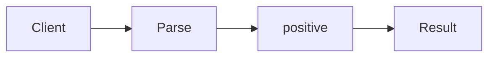

# Option / Maybe

**Season:** 6 · FP Foundations · **Category:** Functional · **Level:** Intermediate · **Runtime:** ~10–12 min · **Channel:** Build with Waqar

## Problem
**Parse positive port without null**

Key types: `Port`.

## Hook
Picture this: you are mid-demo and «Parse positive port without null» blows up the naive way — you see `missing`. That is the pain. In the next ten minutes we introduce **Option** with real types (Port), a runnable `ProblemDemo`, and the failure path locked in by tests. No abstract UML first — problem first.

## Intent
Parse a positive port without returning null or throwing for expected absence.

**When to use:** the force behind «Parse positive port without null» shows up more than once and a simpler language feature does not erase it.

**When to refuse:** you are pattern-collecting, the boundary is still unclear, or the team cannot yet test the abstraction (compensations, half-open recovery, interpreters).

## The Pain — Naive Design
Naive version fails to cleanly solve: Parse positive port without null

```java
package com.buildwithwaqar.patterns.functional.option.problem;

import java.util.*;

public final class NaivePort {
  public static Integer parse(String s){ try { int p=Integer.parseInt(s); return p>0?p:null; } catch(Exception e){ return null; } }
}

```

On camera, point at the smell: missing compensations, leaked XML, null at the boundary,
illegal transitions, or hard-wired `System.out` that you cannot assert.

## Pattern Structure


These roles are for **«Parse positive port without null»** — not a generic Client→Pattern poster. Keep them on screen
while you type the solution.

## Refactor to the Pattern

### Stage 1 — Name the boundary
Introduce the client-facing API the rest of the app should depend on. Hide the incompatible or
distributed details behind it. For this episode that boundary is what makes «Parse positive port without null» testable.

### Stage 2 — Encode the solution
```java
package com.buildwithwaqar.patterns.functional.option.problem;

import java.util.*;
import java.util.concurrent.*;
import java.util.concurrent.atomic.*;
import java.util.concurrent.locks.*;
import java.util.function.*;

final class Port {
  static OptionalInt parse(String s){
    try { int p=Integer.parseInt(s); return p>0? OptionalInt.of(p): OptionalInt.empty(); }
    catch(NumberFormatException e){ return OptionalInt.empty(); }
  }
  static String describe(OptionalInt p){ return p.isPresent()? "port="+p.getAsInt(): "missing"; }
}

```

### Stage 3 — Runnable main
```java
package com.buildwithwaqar.patterns.functional.option.problem;
import java.util.*; import java.util.concurrent.*; import java.util.concurrent.atomic.*;
public final class ProblemDemo {
  public static void main(String[] args) throws Exception {
    System.out.println("=== Option: parse positive port ===");
    System.out.println("--- naive ---"); System.out.println(NaivePort.parse("8080")); System.out.println(NaivePort.parse("-1"));
System.out.println("--- option ---");
System.out.println(Port.describe(Port.parse("8080")));
System.out.println(Port.describe(Port.parse("nope")));
System.out.println(Port.describe(Port.parse("0")));
  }
}

```

## Runnable Output (Verified on JDK 25)
Narrate each line. Do not invent numbers on camera.

```text
=== Option: parse positive port ===
--- naive ---
8080
null
--- option ---
port=8080
missing
missing
```

Happy-path cue: `8080`.
Failure-path cue: `missing`.
Fork the repo, set `JAVA_HOME` to JDK 25, and re-run the same `ProblemDemo` to verify.

## Modern Java 25 / Zazr Variant
Absence / errors use **Optional or Zazr/VAVR** control types instead of null.

## Trade-offs
- **Clarity vs ceremony:** extra types for «Parse positive port without null» only pay off when the force repeats.
- **Testability:** inject collaborators; assert the failure path, not only the happy path.
- **Distributed / concurrent reality:** demos omit metrics, backpressure, and multi-region clocks.
- **Refuse Option** when a sealed switch, a function value, or a simpler library call already erases the force.
- **Neighbor:** Either — Option is presence/absence; Either carries a typed error on the left.

## Interview Q&A
**Q1. What concrete problem does Option solve here?**
A: Parse positive port without null.

**Q2. What does the naive design get wrong?**
A: Naive version fails to cleanly solve: Parse positive port without null

**Q3. How do you test the failure path?**
A: Inject the fault and assert the observable outcome — e.g. `missing`.

**Q4. When is Option the wrong tool?**
A: When a smaller language feature erases the force, or when you really needed Either.


## Key Takeaways
- Lead with the problem: Parse positive port without null.
- Show naive pain (`missing`) before naming Option.
- Run the Demo; trust JDK 25 stdout (`8080`).
- Teach when NOT to use Option.

## Video Script (≈10–12 minutes)
Record for **Build with Waqar**. OBS for capture, CapCut for assembly. Import `slides.pdf`.
Facecam: full-screen for the hook, framed PiP over code slides.

**[0:00]** *(slide 01 title + talking head)*
Hey everyone — today we solve one concrete problem with **Option**:
*Parse positive port without null*. Keep these names in your head: Port.

**[0:45]** *(problem + hook slides)*
I am not starting with a textbook definition. Here is the product pain. By the end you will have
seen the naive leak, the pattern boundary, and real JDK 25 stdout.

**[2:00]** *(naive code)*
IDE time. This is the naive version. Call out the smell — that is what Option exists to erase.

**[3:30]** *(structure diagram)*
Roles for **this** problem, not a generic UML poster. Point at each box while you talk.

**[4:30]** *(refactor / solution code)*
Stage the solution. Highlight failure injection and the tests that lock it in.

**[7:00]** *(walkthrough output)*
Real stdout. Happy path cue: `8080`.
Failure cue: `missing`.
No invented numbers on camera.

**[8:30]** *(modern Java 25 / Zazr + trade-offs)*
Show the modernization, then slow down for when NOT to use Option. That is what seniors listen for.

**[10:30]** *(Q&A + recap + outro)*
Two interview questions, three takeaways, link the GitHub episode folder. I am Waqar — see you in the next one.


## Walkthrough Beats (Say These Out Loud)
1. **Setup:** open `series/42-option/` and `run-output.txt` beside the IDE.
2. **Naive:** reproduce the pain until you can point at `missing`.
3. **Structure:** on the diagram, trace `Client` → `Parse`, `Parse` → `positive`, `positive` → `Result`.
4. **Refactor:** encode the boundary, then run `ProblemDemo` — match `8080`.
5. **Break it:** flip one `ProblemTest` assertion, watch red, restore it.
6. **Refuse:** Contrast with **Either**: Option is presence/absence; Either carries a typed error on the left.

## Practice Drill
- Clone `waqarys/java-design-patterns`, set `JAVA_HOME` to JDK 25.
- Run the episode `ProblemDemo` (see `EP_MAIN` in `tools/enrich/build_problems.py`).
- Mutate one collaborator to fail; confirm the observable compensation / error path.
- Explain Option for «Parse positive port without null» in sixty seconds without notes.
