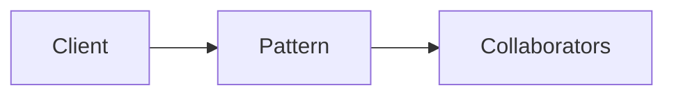

# Either & Railway-Oriented Programming

**Season:** 6 · FP Foundations · **Category:** Functional · **Level:** Intermediate

## Intent
Errors as values on the left track.

## Problem
Without this pattern, code tends toward: New things up with conditionals and duplicated construction.

## Real-world Analogy
Railway switch: success track vs error track.

## When to Use
- Pure functional style in Java 25 + Zazr.
- The design force named in Intent shows up more than once.

## When Not to Use
- Throwing exceptions everywhere is 'fine' for a script.
- A simpler language feature (record, sealed switch, function value) already solves it.

## Naive Approach
```text
New things up with conditionals and duplicated construction.
```

## Pattern Structure

Client -> Pattern -> Collaborators

## Classic Implementation
Primary code lives under `src/main/java/com/buildwithwaqar/patterns/functional/either/`.

```java
package com.buildwithwaqar.patterns.functional.either;

import dev.zazr.control.Either;

/** Railway-oriented programming with Zazr Either. */
public final class Railway {
    private Railway() {}

    public static Either<String, Integer> parseInt(String raw) {
        try {
            return Either.right(Integer.parseInt(raw));
        } catch (NumberFormatException e) {
            return Either.left("not an int: " + raw);
        }
    }

    public static Either<String, Integer> requirePositive(int n) {
        return n > 0 ? Either.right(n) : Either.left("not positive: " + n);
    }

    public static Either<String, String> label(String raw) {
        return parseInt(raw)
                .flatMap(Railway::requirePositive)
                .map(n -> "id-" + n);
    }

    public static String explain(Either<String, String> result) {
        return switch (result) {
            case Either.Right(var v) -> "ok:" + v;
            case Either.Left(var err) -> "err:" + err;
        };
    }
}
```

## Modern Java 25 / Functional
Primary examples use Zazr; VAVR shown in comparison episode.

## Worked Example
```text
See the JUnit test beside the implementation.
Run: mvn -Dtest=*Test test
Focus package matching: functional/either/
```

## Pitfalls
- Zazr rejects null inside Option/collections.
- Keep interpreters at the edge.

## Interview Q&A
**Q: Interview: what problem does Either & Railway-Oriented Programming solve?**
A: Errors as values on the left track.

**Q: How would you test this?**
A: Prefer injecting interfaces or interpreters; keep demos deterministic (fixed clocks, canned inputs).

## Key Takeaways
- Errors as values on the left track.
- Prefer Java 25 sealed types / records / virtual threads where they simplify the classic shape.
- Ship working tests with every episode.

## Video Script
**[0:00] Hook** — Open with the analogy: Railway switch: success track vs error track.
**[0:40] Intent** — State the design force in one sentence: Errors as values on the left track.
**[1:30] Naive pain** — Show the messy approach: New things up with conditionals and duplicated construction.
**[3:00] Pattern** — Walk the code under `functional/either/`; draw the mermaid structure on-screen.
**[6:00] Modern take** — Primary examples use Zazr; VAVR shown in comparison episode.
**[8:00] Pitfalls & interview** — Cover: Interview: what problem does Either & Railway-Oriented Programming solve?
**[9:30] Outro** — Tease the next episode; point viewers to the GitHub repo and slides PDF.
