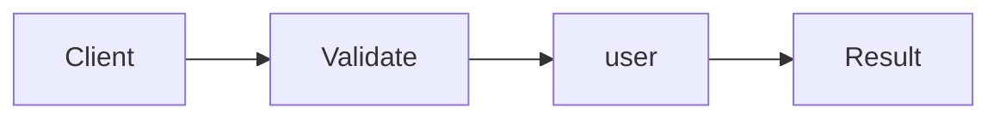

# Either & Railway-Oriented Programming

**Season:** 6 · FP Foundations · **Category:** Functional · **Level:** Intermediate · **Runtime:** ~10–12 min · **Channel:** Build with Waqar

## Problem
**Validate user id pipeline without exceptions**

Key types: `Either`, `Left`, `Right`, `UserPipeline`.

## Hook
Picture this: you are mid-demo and «Validate user id pipeline without exceptions» blows up the naive way — you see `Failure path is asserted in ProblemTest (injected fault / invalid input)`. That is the pain. In the next ten minutes we introduce **Either/Railway** with real types (Either, Left, Right), a runnable `ProblemDemo`, and the failure path locked in by tests. No abstract UML first — problem first.

## Intent
Validate a user-id pipeline as a railway that short-circuits on the first typed error.

**When to use:** the force behind «Validate user id pipeline without exceptions» shows up more than once and a simpler language feature does not erase it.

**When to refuse:** you are pattern-collecting, the boundary is still unclear, or the team cannot yet test the abstraction (compensations, half-open recovery, interpreters).

## The Pain — Naive Design
Naive version fails to cleanly solve: Validate user id pipeline without exceptions

```java
package com.buildwithwaqar.patterns.functional.either.problem;

import java.util.*;

public final class NaiveUser {
  public static String load(String id){ if(id==null) throw new RuntimeException("null"); return "user:"+id; }
}

```

On camera, point at the smell: missing compensations, leaked XML, null at the boundary,
illegal transitions, or hard-wired `System.out` that you cannot assert.

## Pattern Structure


These roles are for **«Validate user id pipeline without exceptions»** — not a generic Client→Pattern poster. Keep them on screen
while you type the solution.

## Refactor to the Pattern

### Stage 1 — Name the boundary
Introduce the client-facing API the rest of the app should depend on. Hide the incompatible or
distributed details behind it. For this episode that boundary is what makes «Validate user id pipeline without exceptions» testable.

### Stage 2 — Encode the solution
```java
package com.buildwithwaqar.patterns.functional.either.problem;

import java.util.*;
import java.util.concurrent.*;
import java.util.concurrent.atomic.*;
import java.util.concurrent.locks.*;
import java.util.function.*;

sealed interface Either<L,R> permits Left, Right { boolean isRight(); L left(); R right(); }
record Left<L,R>(L value) implements Either<L,R> { public boolean isRight(){return false;} public L left(){return value;} public R right(){throw new IllegalStateException();} }
record Right<L,R>(R value) implements Either<L,R> { public boolean isRight(){return true;} public L left(){throw new IllegalStateException();} public R right(){return value;} }
final class UserPipeline {
  static Either<String,Integer> parseInt(String s){ try { return new Right<>(Integer.parseInt(s)); } catch(Exception e){ return new Left<>("parse"); } }
  static Either<String,Integer> requirePositive(int n){ return n>0? new Right<>(n): new Left<>("positive"); }
  static Either<String,String> label(int n){ return new Right<>("user:"+n); }
  static Either<String,String> run(String raw){
    var a=parseInt(raw); if(!a.isRight()) return new Left<>(a.left());
    var b=requirePositive(a.right()); if(!b.isRight()) return new Left<>(b.left());
    return label(b.right());
  }
}

```

### Stage 3 — Runnable main
```java
package com.buildwithwaqar.patterns.functional.either.problem;
import java.util.*; import java.util.concurrent.*; import java.util.concurrent.atomic.*;
public final class ProblemDemo {
  public static void main(String[] args) throws Exception {
    System.out.println("=== Either: user id railway ===");
    System.out.println("--- naive ---");
try { System.out.println(NaiveUser.load(null)); } catch(Exception e){ System.out.println("caught"); }
System.out.println("--- either ---");
System.out.println(UserPipeline.run("42"));
System.out.println(UserPipeline.run("x"));
System.out.println(UserPipeline.run("-1"));
  }
}

```

## Runnable Output (Verified on JDK 25)
Narrate each line. Do not invent numbers on camera.

```text
=== Either: user id railway ===
--- naive ---
caught
--- either ---
Right[value=user:42]
Left[value=parse]
Left[value=positive]
```

Happy-path cue: `caught`.
Failure-path cue: `Failure path is asserted in ProblemTest (injected fault / invalid input)`.
Fork the repo, set `JAVA_HOME` to JDK 25, and re-run the same `ProblemDemo` to verify.

## Modern Java 25 / Zazr Variant
This solution already leans on **sealed types** — keep the exhaustive `switch`. **Records** carry the immutable results (`StepResult`, DTOs) with almost no boilerplate.

## Trade-offs
- **Clarity vs ceremony:** extra types for «Validate user id pipeline without exceptions» only pay off when the force repeats.
- **Testability:** inject collaborators; assert the failure path, not only the happy path.
- **Distributed / concurrent reality:** demos omit metrics, backpressure, and multi-region clocks.
- **Refuse Either/Railway** when a sealed switch, a function value, or a simpler library call already erases the force.
- **Neighbor:** Validation — Either short-circuits on first error; Validation accumulates all errors.

## Interview Q&A
**Q1. What concrete problem does Either/Railway solve here?**
A: Validate user id pipeline without exceptions.

**Q2. What does the naive design get wrong?**
A: Naive version fails to cleanly solve: Validate user id pipeline without exceptions

**Q3. How do you test the failure path?**
A: Inject the fault and assert the observable outcome — e.g. `Failure path is asserted in ProblemTest (injected fault / invalid input)`.

**Q4. When is Either/Railway the wrong tool?**
A: When a smaller language feature erases the force, or when you really needed Validation.


## Key Takeaways
- Lead with the problem: Validate user id pipeline without exceptions.
- Show naive pain (`Failure path is asserted in ProblemTest (injected fault / invalid input)`) before naming Either/Railway.
- Run the Demo; trust JDK 25 stdout (`caught`).
- Teach when NOT to use Either/Railway.

## Video Script (≈10–12 minutes)
Record for **Build with Waqar**. OBS for capture, CapCut for assembly. Import `slides.pdf`.
Facecam: full-screen for the hook, framed PiP over code slides.

**[0:00]** *(slide 01 title + talking head)*
Hey everyone — today we solve one concrete problem with **Either/Railway**:
*Validate user id pipeline without exceptions*. Keep these names in your head: Either, Left, Right, UserPipeline.

**[0:45]** *(problem + hook slides)*
I am not starting with a textbook definition. Here is the product pain. By the end you will have
seen the naive leak, the pattern boundary, and real JDK 25 stdout.

**[2:00]** *(naive code)*
IDE time. This is the naive version. Call out the smell — that is what Either/Railway exists to erase.

**[3:30]** *(structure diagram)*
Roles for **this** problem, not a generic UML poster. Point at each box while you talk.

**[4:30]** *(refactor / solution code)*
Stage the solution. Highlight failure injection and the tests that lock it in.

**[7:00]** *(walkthrough output)*
Real stdout. Happy path cue: `caught`.
Failure cue: `Failure path is asserted in ProblemTest (injected fault / invalid input)`.
No invented numbers on camera.

**[8:30]** *(modern Java 25 / Zazr + trade-offs)*
Show the modernization, then slow down for when NOT to use Either/Railway. That is what seniors listen for.

**[10:30]** *(Q&A + recap + outro)*
Two interview questions, three takeaways, link the GitHub episode folder. I am Waqar — see you in the next one.


## Walkthrough Beats (Say These Out Loud)
1. **Setup:** open `series/43-either-railway/` and `run-output.txt` beside the IDE.
2. **Naive:** reproduce the pain until you can point at `Failure path is asserted in ProblemTest (injected fault / invalid input)`.
3. **Structure:** on the diagram, trace `Client` → `Validate`, `Validate` → `user`, `user` → `Result`.
4. **Refactor:** encode the boundary, then run `ProblemDemo` — match `caught`.
5. **Break it:** flip one `ProblemTest` assertion, watch red, restore it.
6. **Refuse:** Contrast with **Validation**: Either short-circuits on first error; Validation accumulates all errors.

## Practice Drill
- Clone `waqarys/java-design-patterns`, set `JAVA_HOME` to JDK 25.
- Run the episode `ProblemDemo` (see `EP_MAIN` in `tools/enrich/build_problems.py`).
- Mutate one collaborator to fail; confirm the observable compensation / error path.
- Explain Either/Railway for «Validate user id pipeline without exceptions» in sixty seconds without notes.
