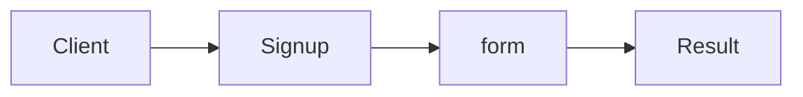

# Validation

**Season:** 6 · FP Foundations · **Category:** Functional · **Level:** Intermediate · **Runtime:** ~10–12 min · **Channel:** Build with Waqar

## Problem
**Signup form accumulates all field errors**

Key types: `Validation`, `Valid`, `Invalid`, `Signup`.

## Hook
Picture this: you are mid-demo and «Signup form accumulates all field errors» blows up the naive way — you see `caught=email`. That is the pain. In the next ten minutes we introduce **Validation** with real types (Validation, Valid, Invalid), a runnable `ProblemDemo`, and the failure path locked in by tests. No abstract UML first — problem first.

## Intent
Accumulate every signup field error instead of failing on the first one.

**When to use:** the force behind «Signup form accumulates all field errors» shows up more than once and a simpler language feature does not erase it.

**When to refuse:** you are pattern-collecting, the boundary is still unclear, or the team cannot yet test the abstraction (compensations, half-open recovery, interpreters).

## The Pain — Naive Design
Naive version fails to cleanly solve: Signup form accumulates all field errors

```java
package com.buildwithwaqar.patterns.functional.validation.problem;

import java.util.*;

public final class NaiveSignup {
  public static String signup(String email, int age){
    if(!email.contains("@")) throw new IllegalArgumentException("email");
    if(age<18) throw new IllegalArgumentException("age");
    return "ok:"+email;
  }
}

```

On camera, point at the smell: missing compensations, leaked XML, null at the boundary,
illegal transitions, or hard-wired `System.out` that you cannot assert.

## Pattern Structure


These roles are for **«Signup form accumulates all field errors»** — not a generic Client→Pattern poster. Keep them on screen
while you type the solution.

## Refactor to the Pattern

### Stage 1 — Name the boundary
Introduce the client-facing API the rest of the app should depend on. Hide the incompatible or
distributed details behind it. For this episode that boundary is what makes «Signup form accumulates all field errors» testable.

### Stage 2 — Encode the solution
```java
package com.buildwithwaqar.patterns.functional.validation.problem;

import java.util.*;
import java.util.function.*;

sealed interface Validation<E,A> permits Valid, Invalid {
  boolean isValid(); A get(); List<E> errors();
  default <B> Validation<E,B> map(Function<A,B> f){ return isValid()? new Valid<>(f.apply(get())): new Invalid<>(errors()); }
  default <B> Validation<E,B> zipWith(Validation<E,B> other, BiFunction<A,B,?> ignored){ throw new UnsupportedOperationException(); }
}
record Valid<E,A>(A value) implements Validation<E,A> {
  public boolean isValid(){return true;} public A get(){return value;} public List<E> errors(){return List.of();}
}
record Invalid<E,A>(List<E> errs) implements Validation<E,A> {
  public boolean isValid(){return false;} public A get(){throw new IllegalStateException();} public List<E> errors(){return errs;}
}
final class Signup {
  static Validation<String,String> email(String e){ return e!=null && e.contains("@")? new Valid<>(e): new Invalid<>(List.of("email has no @")); }
  static Validation<String,Integer> age(int a){ return a>=18? new Valid<>(a): new Invalid<>(List.of("age under 18")); }
  static Validation<String,String> form(String e, int a){
    var ve=email(e); var va=age(a);
    if (ve.isValid() && va.isValid()) return new Valid<>("welcome "+ve.get());
    List<String> errs=new ArrayList<>(); errs.addAll(ve.errors()); errs.addAll(va.errors());
    return new Invalid<>(errs);
  }
}

```

### Stage 3 — Runnable main
```java
package com.buildwithwaqar.patterns.functional.validation.problem;
import java.util.*; import java.util.function.*;
public final class ProblemDemo {
  public static void main(String[] args) {
    System.out.println("=== Validation: signup accumulates errors ===");
    System.out.println("--- naive ---");
try { System.out.println(NaiveSignup.signup("bad", 10)); } catch(Exception e){ System.out.println("caught="+e.getMessage()); }
System.out.println("--- validation ---");
System.out.println(Signup.form("a@b.c", 20));
System.out.println(Signup.form("bad", 10));
  }
}

```

## Runnable Output (Verified on JDK 25)
Narrate each line. Do not invent numbers on camera.

```text
=== Validation: signup accumulates errors ===
--- naive ---
caught=email
--- validation ---
Valid[value=welcome a@b.c]
Invalid[errs=[email has no @, age under 18]]
```

Happy-path cue: `Valid[value=welcome a@b.c]`.
Failure-path cue: `caught=email`.
Fork the repo, set `JAVA_HOME` to JDK 25, and re-run the same `ProblemDemo` to verify.

## Modern Java 25 / Zazr Variant
This solution already leans on **sealed types** — keep the exhaustive `switch`. **Records** carry the immutable results (`StepResult`, DTOs) with almost no boilerplate.

## Trade-offs
- **Clarity vs ceremony:** extra types for «Signup form accumulates all field errors» only pay off when the force repeats.
- **Testability:** inject collaborators; assert the failure path, not only the happy path.
- **Distributed / concurrent reality:** demos omit metrics, backpressure, and multi-region clocks.
- **Refuse Validation** when a sealed switch, a function value, or a simpler library call already erases the force.
- **Neighbor:** Either — Validation accumulates; switch to Either once you must short-circuit.

## Interview Q&A
**Q1. What concrete problem does Validation solve here?**
A: Signup form accumulates all field errors.

**Q2. What does the naive design get wrong?**
A: Naive version fails to cleanly solve: Signup form accumulates all field errors

**Q3. How do you test the failure path?**
A: Inject the fault and assert the observable outcome — e.g. `caught=email`.

**Q4. When is Validation the wrong tool?**
A: When a smaller language feature erases the force, or when you really needed Either.


## Key Takeaways
- Lead with the problem: Signup form accumulates all field errors.
- Show naive pain (`caught=email`) before naming Validation.
- Run the Demo; trust JDK 25 stdout (`Valid[value=welcome a@b.c]`).
- Teach when NOT to use Validation.

## Video Script (≈10–12 minutes)
Record for **Build with Waqar**. OBS for capture, CapCut for assembly. Import `slides.pdf`.
Facecam: full-screen for the hook, framed PiP over code slides.

**[0:00]** *(slide 01 title + talking head)*
Hey everyone — today we solve one concrete problem with **Validation**:
*Signup form accumulates all field errors*. Keep these names in your head: Validation, Valid, Invalid, Signup.

**[0:45]** *(problem + hook slides)*
I am not starting with a textbook definition. Here is the product pain. By the end you will have
seen the naive leak, the pattern boundary, and real JDK 25 stdout.

**[2:00]** *(naive code)*
IDE time. This is the naive version. Call out the smell — that is what Validation exists to erase.

**[3:30]** *(structure diagram)*
Roles for **this** problem, not a generic UML poster. Point at each box while you talk.

**[4:30]** *(refactor / solution code)*
Stage the solution. Highlight failure injection and the tests that lock it in.

**[7:00]** *(walkthrough output)*
Real stdout. Happy path cue: `Valid[value=welcome a@b.c]`.
Failure cue: `caught=email`.
No invented numbers on camera.

**[8:30]** *(modern Java 25 / Zazr + trade-offs)*
Show the modernization, then slow down for when NOT to use Validation. That is what seniors listen for.

**[10:30]** *(Q&A + recap + outro)*
Two interview questions, three takeaways, link the GitHub episode folder. I am Waqar — see you in the next one.


## Walkthrough Beats (Say These Out Loud)
1. **Setup:** open `series/45-validation/` and `run-output.txt` beside the IDE.
2. **Naive:** reproduce the pain until you can point at `caught=email`.
3. **Structure:** on the diagram, trace `Client` → `Signup`, `Signup` → `form`, `form` → `Result`.
4. **Refactor:** encode the boundary, then run `ProblemDemo` — match `Valid[value=welcome a@b.c]`.
5. **Break it:** flip one `ProblemTest` assertion, watch red, restore it.
6. **Refuse:** Contrast with **Either**: Validation accumulates; switch to Either once you must short-circuit.

## Practice Drill
- Clone `waqarys/java-design-patterns`, set `JAVA_HOME` to JDK 25.
- Run the episode `ProblemDemo` (see `EP_MAIN` in `tools/enrich/build_problems.py`).
- Mutate one collaborator to fail; confirm the observable compensation / error path.
- Explain Validation for «Signup form accumulates all field errors» in sixty seconds without notes.
