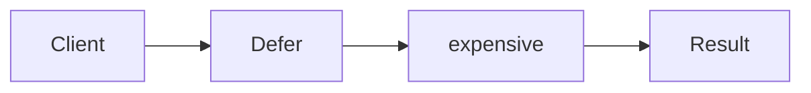

# Lazy & IO

**Season:** 6 · FP Foundations · **Category:** Functional · **Level:** Intermediate · **Runtime:** ~10–12 min · **Channel:** Build with Waqar

## Problem
**Defer expensive report until edge**

Key types: `Lazy`, `IO`.

## Hook
Picture this: you are mid-demo and «Defer expensive report until edge» blows up the naive way — you see `Failure path is asserted in ProblemTest (injected fault / invalid input)`. That is the pain. In the next ten minutes we introduce **Lazy/IO** with real types (Lazy, IO), a runnable `ProblemDemo`, and the failure path locked in by tests. No abstract UML first — problem first.

## Intent
Use **Lazy/IO** to cleanly solve: Defer expensive report until edge.

**When to use:** the force behind «Defer expensive report until edge» shows up more than once and a simpler language feature does not erase it.

**When to refuse:** you are pattern-collecting, the boundary is still unclear, or the team cannot yet test the abstraction (compensations, half-open recovery, interpreters).

## The Pain — Naive Design
Naive version fails to cleanly solve: Defer expensive report until edge

```java
package com.buildwithwaqar.patterns.functional.lazy.problem;

import java.util.*;

public final class NaiveReport {
  public static String build(){ System.out.println("BUILD"); return "report"; }
}

```

On camera, point at the smell: missing compensations, leaked XML, null at the boundary,
illegal transitions, or hard-wired `System.out` that you cannot assert.

## Pattern Structure


These roles are for **«Defer expensive report until edge»** — not a generic Client→Pattern poster. Keep them on screen
while you type the solution.

## Refactor to the Pattern

### Stage 1 — Name the boundary
Introduce the client-facing API the rest of the app should depend on. Hide the incompatible or
distributed details behind it. For this episode that boundary is what makes «Defer expensive report until edge» testable.

### Stage 2 — Encode the solution
```java
package com.buildwithwaqar.patterns.functional.lazy.problem;

import java.util.*;
import java.util.function.*;

final class Lazy<A> {
  private final Supplier<A> thunk; private A value; private boolean ready;
  Lazy(Supplier<A> thunk){ this.thunk=thunk; }
  static <A> Lazy<A> of(Supplier<A> s){ return new Lazy<>(s); }
  synchronized A get(){ if(!ready){ value=thunk.get(); ready=true; } return value; }
}
final class IO<A> {
  private final Supplier<A> effect; IO(Supplier<A> effect){ this.effect=effect; }
  static <A> IO<A> delay(Supplier<A> s){ return new IO<>(s); }
  <B> IO<B> map(Function<A,B> f){ return new IO<>(() -> f.apply(effect.get())); }
  A unsafeRun(){ return effect.get(); }
}

```

### Stage 3 — Runnable main
```java
package com.buildwithwaqar.patterns.functional.lazy.problem;
import java.util.*; import java.util.function.*;
public final class ProblemDemo {
  public static void main(String[] args) {
    System.out.println("=== Lazy/IO: defer expensive report ===");
    System.out.println("--- naive ---"); System.out.println(NaiveReport.build());
System.out.println("--- lazy ---");
var lazy=Lazy.of(() -> { System.out.println("BUILD"); return "report"; });
System.out.println("created"); System.out.println(lazy.get()); System.out.println(lazy.get());
System.out.println("--- io ---");
System.out.println(IO.delay(() -> "edge").map(s -> s+"!").unsafeRun());
  }
}

```

## Runnable Output (Verified on JDK 25)
Narrate each line. Do not invent numbers on camera.

```text
=== Lazy/IO: defer expensive report ===
--- naive ---
BUILD
report
--- lazy ---
created
BUILD
report
report
--- io ---
edge!
```

Happy-path cue: `BUILD`.
Failure-path cue: `Failure path is asserted in ProblemTest (injected fault / invalid input)`.
Fork the repo, set `JAVA_HOME` to JDK 25, and re-run the same `ProblemDemo` to verify.

## Modern Java 25 / Zazr Variant
For **Lazy/IO**, prefer records for results, sealed types for closed variants, and Zazr `Option`/`Either`/`Validation` when the force is absence or accumulated errors. Keep the classic shape when interview literacy matters.

## Trade-offs
- **Clarity vs ceremony:** extra types for «Defer expensive report until edge» only pay off when the force repeats.
- **Testability:** inject collaborators; assert the failure path, not only the happy path.
- **Distributed / concurrent reality:** demos omit metrics, backpressure, and multi-region clocks.
- **Refuse Lazy/IO** when a sealed switch, a function value, or a simpler library call already erases the force.
- **Neighbor:** Future — Lazy/IO defers effect description; Future schedules async work.

## Interview Q&A
**Q1. What concrete problem does Lazy/IO solve here?**
A: Defer expensive report until edge.

**Q2. What does the naive design get wrong?**
A: Naive version fails to cleanly solve: Defer expensive report until edge

**Q3. How do you test the failure path?**
A: Inject the fault and assert the observable outcome — e.g. `Failure path is asserted in ProblemTest (injected fault / invalid input)`.

**Q4. When is Lazy/IO the wrong tool?**
A: When a smaller language feature erases the force, or when you really needed Future.


## Key Takeaways
- Lead with the problem: Defer expensive report until edge.
- Show naive pain (`Failure path is asserted in ProblemTest (injected fault / invalid input)`) before naming Lazy/IO.
- Run the Demo; trust JDK 25 stdout (`BUILD`).
- Teach when NOT to use Lazy/IO.

## Video Script (≈10–12 minutes)
Record for **Build with Waqar**. OBS for capture, CapCut for assembly. Import `slides.pdf`.
Facecam: full-screen for the hook, framed PiP over code slides.

**[0:00]** *(slide 01 title + talking head)*
Hey everyone — today we solve one concrete problem with **Lazy/IO**:
*Defer expensive report until edge*. Keep these names in your head: Lazy, IO.

**[0:45]** *(problem + hook slides)*
I am not starting with a textbook definition. Here is the product pain. By the end you will have
seen the naive leak, the pattern boundary, and real JDK 25 stdout.

**[2:00]** *(naive code)*
IDE time. This is the naive version. Call out the smell — that is what Lazy/IO exists to erase.

**[3:30]** *(structure diagram)*
Roles for **this** problem, not a generic UML poster. Point at each box while you talk.

**[4:30]** *(refactor / solution code)*
Stage the solution. Highlight failure injection and the tests that lock it in.

**[7:00]** *(walkthrough output)*
Real stdout. Happy path cue: `BUILD`.
Failure cue: `Failure path is asserted in ProblemTest (injected fault / invalid input)`.
No invented numbers on camera.

**[8:30]** *(modern Java 25 / Zazr + trade-offs)*
Show the modernization, then slow down for when NOT to use Lazy/IO. That is what seniors listen for.

**[10:30]** *(Q&A + recap + outro)*
Two interview questions, three takeaways, link the GitHub episode folder. I am Waqar — see you in the next one.


## Walkthrough Beats (Say These Out Loud)
1. **Setup:** open `series/46-lazy-io/` and `run-output.txt` beside the IDE.
2. **Naive:** reproduce the pain until you can point at `Failure path is asserted in ProblemTest (injected fault / invalid input)`.
3. **Structure:** on the diagram, trace `Client` → `Defer`, `Defer` → `expensive`, `expensive` → `Result`.
4. **Refactor:** encode the boundary, then run `ProblemDemo` — match `BUILD`.
5. **Break it:** flip one `ProblemTest` assertion, watch red, restore it.
6. **Refuse:** Contrast with **Future**: Lazy/IO defers effect description; Future schedules async work.

## Practice Drill
- Clone `waqarys/java-design-patterns`, set `JAVA_HOME` to JDK 25.
- Run the episode `ProblemDemo` (see `EP_MAIN` in `tools/enrich/build_problems.py`).
- Mutate one collaborator to fail; confirm the observable compensation / error path.
- Explain Lazy/IO for «Defer expensive report until edge» in sixty seconds without notes.
