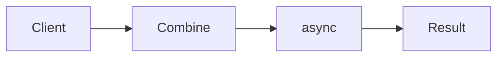

# Functor, Applicative, Monad

**Season:** 6 · FP Foundations · **Category:** Functional · **Level:** Advanced · **Runtime:** ~10–12 min · **Channel:** Build with Waqar

## Problem
**Combine async user+order fetches into a dashboard view**

Key types: `AsyncDashboard`, `User`, `Order`, `Dashboard`.

## Hook
Picture this: you are mid-demo and «Combine async user+order fetches into a dashboard view» blows up the naive way — you see `Optional.empty`. That is the pain. In the next ten minutes we introduce **Functor/Applicative/Monad** with real types (AsyncDashboard, User, Order), a runnable `ProblemDemo`, and the failure path locked in by tests. No abstract UML first — problem first.

## Intent
Use **Functor/Applicative/Monad** to cleanly solve: Combine async user+order fetches into a dashboard view.

**When to use:** the force behind «Combine async user+order fetches into a dashboard view» shows up more than once and a simpler language feature does not erase it.

**When to refuse:** you are pattern-collecting, the boundary is still unclear, or the team cannot yet test the abstraction (compensations, half-open recovery, interpreters).

## The Pain — Naive Design
Naive: nested null checks / sequential blocking gets — no composition.

```java
package com.buildwithwaqar.patterns.functional.fam.problem;

/** Naive: nested null checks / sequential blocking gets — no composition. */
public final class NaiveCombine {
    public static AsyncDashboard.Dashboard combine(AsyncDashboard.User u, AsyncDashboard.Order o) {
        if (u == null || o == null) return null;
        return new AsyncDashboard.Dashboard(u.name(), o.totalCents());
    }
}

```

On camera, point at the smell: missing compensations, leaked XML, null at the boundary,
illegal transitions, or hard-wired `System.out` that you cannot assert.

## Pattern Structure


These roles are for **«Combine async user+order fetches into a dashboard view»** — not a generic Client→Pattern poster. Keep them on screen
while you type the solution.

## Refactor to the Pattern

### Stage 1 — Name the boundary
Introduce the client-facing API the rest of the app should depend on. Hide the incompatible or
distributed details behind it. For this episode that boundary is what makes «Combine async user+order fetches into a dashboard view» testable.

### Stage 2 — Encode the solution
```java
package com.buildwithwaqar.patterns.functional.fam.problem;

import java.util.Optional;
import java.util.concurrent.CompletableFuture;
import java.util.function.BiFunction;
import java.util.function.Function;

/**
 * Functor / Applicative / Monad over Optional and CompletableFuture:
 * combine async user + order fetches into a dashboard view.
 */
public final class AsyncDashboard {
    private AsyncDashboard() {}

    public record User(String id, String name) {}
    public record Order(String id, String userId, int totalCents) {}
    public record Dashboard(String name, int totalCents) {}

    // ---- Optional as Functor/Applicative/Monad ----
    public static <A, B> Optional<B> map(Optional<A> fa, Function<A, B> f) { return fa.map(f); }
    public static <A, B> Optional<B> flatMap(Optional<A> fa, Function<A, Optional<B>> f) { return fa.flatMap(f); }
    public static <A, B, C> Optional<C> map2(Optional<A> fa, Optional<B> fb, BiFunction<A, B, C> f) {
        return fa.flatMap(a -> fb.map(b -> f.apply(a, b)));
    }

    public static Optional<Dashboard> dashboardOpt(Optional<User> user, Optional<Order> order) {
        return map2(user, order, (u, o) -> new Dashboard(u.name(), o.totalCents()));
    }

    // ---- CompletableFuture applicative-style zip ----
    public static <A, B, C> CompletableFuture<C> map2Future(
            CompletableFuture<A> fa, CompletableFuture<B> fb, BiFunction<A, B, C> f) {
        return fa.thenCombine(fb, f);
    }

    public static CompletableFuture<Dashboard> dashboardAsync(
            CompletableFuture<User> user, CompletableFuture<Order> order) {
        return map2Future(user, order, (u, o) -> new Dashboard(u.name(), o.totalCents()));
    }

    public static CompletableFuture<User> fetchUser(String id, boolean ok) {
        return CompletableFuture.supplyAsync(() -> {
            if (!ok) throw new IllegalStateException("user-missing");
            return new User(id, "User-" + id);
        });
    }

    public static CompletableFuture<Order> fetchOrder(String id, String userId, boolean ok) {
        return CompletableFuture.supplyAsync(() -> {
            if (!ok) throw new IllegalStateException("order-missing");
            return new Order(id, userId, 4200);
        });
    }
}

```

### Stage 3 — Runnable main
```java
package com.buildwithwaqar.patterns.functional.fam.problem;

import java.util.Optional;
import java.util.concurrent.CompletionException;

public final class ProblemDemo {
    public static void main(String[] args) throws Exception {
        System.out.println("=== Functor/Applicative/Monad: async dashboard ===");
        System.out.println("--- naive null combine ---");
        System.out.println(NaiveCombine.combine(new AsyncDashboard.User("1", "Ada"), null));

        System.out.println("--- Optional map2 ---");
        System.out.println(AsyncDashboard.dashboardOpt(
                Optional.of(new AsyncDashboard.User("1", "Ada")),
                Optional.of(new AsyncDashboard.Order("o1", "1", 4200))));
        System.out.println(AsyncDashboard.dashboardOpt(Optional.of(new AsyncDashboard.User("1", "Ada")), Optional.empty()));

        System.out.println("--- CompletableFuture map2 ---");
        var dash = AsyncDashboard.dashboardAsync(
                AsyncDashboard.fetchUser("1", true),
                AsyncDashboard.fetchOrder("o1", "1", true)).join();
        System.out.println(dash);

        System.out.println("--- failure path ---");
        try {
            AsyncDashboard.dashboardAsync(
                    AsyncDashboard.fetchUser("1", true),
                    AsyncDashboard.fetchOrder("o1", "1", false)).join();
        } catch (CompletionException e) {
            System.out.println("caught=" + e.getCause().getMessage());
        }
    }
}

```

## Runnable Output (Verified on JDK 25)
Narrate each line. Do not invent numbers on camera.

```text
=== Functor/Applicative/Monad: async dashboard ===
--- naive null combine ---
null
--- Optional map2 ---
Optional[Dashboard[name=Ada, totalCents=4200]]
Optional.empty
--- CompletableFuture map2 ---
Dashboard[name=User-1, totalCents=4200]
--- failure path ---
caught=order-missing
```

Happy-path cue: `null`.
Failure-path cue: `Optional.empty`.
Fork the repo, set `JAVA_HOME` to JDK 25, and re-run the same `ProblemDemo` to verify.

## Modern Java 25 / Zazr Variant
**Records** carry the immutable results (`StepResult`, DTOs) with almost no boilerplate. Absence / errors use **Optional or Zazr/VAVR** control types instead of null. `CompletableFuture` composition covers the async variant; prefer virtual threads when the work is blocking I/O.

## Trade-offs
- **Clarity vs ceremony:** extra types for «Combine async user+order fetches into a dashboard view» only pay off when the force repeats.
- **Testability:** inject collaborators; assert the failure path, not only the happy path.
- **Distributed / concurrent reality:** demos omit metrics, backpressure, and multi-region clocks.
- **Refuse Functor/Applicative/Monad** when a sealed switch, a function value, or a simpler library call already erases the force.
- **Neighbor:** Tagless Final — FAM are the building blocks; Tagless Final abstracts the effect F.

## Interview Q&A
**Q1. What concrete problem does Functor/Applicative/Monad solve here?**
A: Combine async user+order fetches into a dashboard view.

**Q2. What does the naive design get wrong?**
A: Naive: nested null checks / sequential blocking gets — no composition.

**Q3. How do you test the failure path?**
A: Inject the fault and assert the observable outcome — e.g. `Optional.empty`.

**Q4. When is Functor/Applicative/Monad the wrong tool?**
A: When a smaller language feature erases the force, or when you really needed Tagless Final.


## Key Takeaways
- Lead with the problem: Combine async user+order fetches into a dashboard view.
- Show naive pain (`Optional.empty`) before naming Functor/Applicative/Monad.
- Run the Demo; trust JDK 25 stdout (`null`).
- Teach when NOT to use Functor/Applicative/Monad.

## Video Script (≈10–12 minutes)
Record for **Build with Waqar**. OBS for capture, CapCut for assembly. Import `slides.pdf`.
Facecam: full-screen for the hook, framed PiP over code slides.

**[0:00]** *(slide 01 title + talking head)*
Hey everyone — today we solve one concrete problem with **Functor/Applicative/Monad**:
*Combine async user+order fetches into a dashboard view*. Keep these names in your head: AsyncDashboard, User, Order, Dashboard.

**[0:45]** *(problem + hook slides)*
I am not starting with a textbook definition. Here is the product pain. By the end you will have
seen the naive leak, the pattern boundary, and real JDK 25 stdout.

**[2:00]** *(naive code)*
IDE time. This is the naive version. Call out the smell — that is what Functor/Applicative/Monad exists to erase.

**[3:30]** *(structure diagram)*
Roles for **this** problem, not a generic UML poster. Point at each box while you talk.

**[4:30]** *(refactor / solution code)*
Stage the solution. Highlight failure injection and the tests that lock it in.

**[7:00]** *(walkthrough output)*
Real stdout. Happy path cue: `null`.
Failure cue: `Optional.empty`.
No invented numbers on camera.

**[8:30]** *(modern Java 25 / Zazr + trade-offs)*
Show the modernization, then slow down for when NOT to use Functor/Applicative/Monad. That is what seniors listen for.

**[10:30]** *(Q&A + recap + outro)*
Two interview questions, three takeaways, link the GitHub episode folder. I am Waqar — see you in the next one.


## Walkthrough Beats (Say These Out Loud)
1. **Setup:** open `series/47-functor-applicative-monad/` and `run-output.txt` beside the IDE.
2. **Naive:** reproduce the pain until you can point at `Optional.empty`.
3. **Structure:** on the diagram, trace `Client` → `Combine`, `Combine` → `async`, `async` → `Result`.
4. **Refactor:** encode the boundary, then run `ProblemDemo` — match `null`.
5. **Break it:** flip one `ProblemTest` assertion, watch red, restore it.
6. **Refuse:** Contrast with **Tagless Final**: FAM are the building blocks; Tagless Final abstracts the effect F.

## Practice Drill
- Clone `waqarys/java-design-patterns`, set `JAVA_HOME` to JDK 25.
- Run the episode `ProblemDemo` (see `EP_MAIN` in `tools/enrich/build_problems.py`).
- Mutate one collaborator to fail; confirm the observable compensation / error path.
- Explain Functor/Applicative/Monad for «Combine async user+order fetches into a dashboard view» in sixty seconds without notes.
