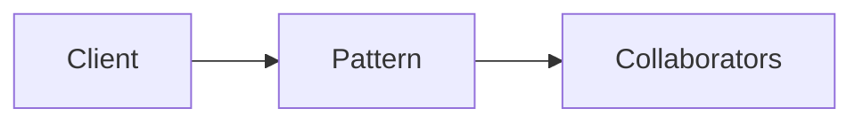

# Functor, Applicative, Monad

**Season:** 6 · FP Foundations · **Category:** Functional · **Level:** Intermediate · **Target runtime:** ~10–12 min · **Channel:** Build with Waqar · **Target runtime:** ~10–12 min · **Channel:** Build with Waqar · **Target runtime:** ~10–12 min · **Channel:** Build with Waqar

## Problem
**Combine async user+order fetches into a dashboard view**

This episode is built around that concrete problem — not a shared StreamForge framing.
You will see a real naive implementation that hurts, a full pattern-based solution, a
runnable main with meaningful stdout, and JUnit failure-path coverage where the pattern lives.

## Hook
Welcome back to **Build with Waqar**. Today we earn **Functor/Applicative/Monad** by solving one problem well:
*Combine async user+order fetches into a dashboard view*. By the end you will have walked naive pain → pattern refactor → real JDK 25
stdout → trade-offs, with CapCut slides and a spoken script.

## Intent
Functor/Applicative/Monad exists because this force kept showing up: combine async user+order fetches into a dashboard view. Name the force, sketch
the roles, and — critically — know when you would refuse the pattern.

## The Pain — Naive Design
Before the pattern, teams usually thread details everywhere, leak resources on partial
failure, or couple call sites to a third-party shape. That feels fast on day one and expensive
on day thirty.

```java
package com.buildwithwaqar.patterns.functional.fam.problem;

/** Naive: nested null checks / sequential blocking gets — no composition. */
public final class NaiveCombine {
    public static AsyncDashboard.Dashboard combine(AsyncDashboard.User u, AsyncDashboard.Order o) {
        if (u == null || o == null) return null;
        return new AsyncDashboard.Dashboard(u.name(), o.totalCents());
    }
}

```

Call out the smell on camera: duplicated envelopes, missing compensations, parameter drilling,
illegal transitions, or null at the boundary.

## Pattern Structure


Roles matter more than class counts. The diagram slide draws the collaboration for **this**
problem so viewers can point at boxes while you type.

## Refactor to the Pattern

### Stage 1 — Name the boundary
Identify the client-facing API the rest of the app should depend on. Hide the incompatible
or distributed details behind it.

### Stage 2 — Encode the solution
```java
package com.buildwithwaqar.patterns.functional.fam.problem;

import java.util.Optional;
import java.util.concurrent.CompletableFuture;
import java.util.function.BiFunction;
import java.util.function.Function;

/**
 * Functor / Applicative / Monad over Optional and CompletableFuture:
 * combine async user + order fetches into a dashboard view.
 */
public final class AsyncDashboard {
    private AsyncDashboard() {}

    public record User(String id, String name) {}
    public record Order(String id, String userId, int totalCents) {}
    public record Dashboard(String name, int totalCents) {}

    // ---- Optional as Functor/Applicative/Monad ----
    public static <A, B> Optional<B> map(Optional<A> fa, Function<A, B> f) { return fa.map(f); }
    public static <A, B> Optional<B> flatMap(Optional<A> fa, Function<A, Optional<B>> f) { return fa.flatMap(f); }
    public static <A, B, C> Optional<C> map2(Optional<A> fa, Optional<B> fb, BiFunction<A, B, C> f) {
        return fa.flatMap(a -> fb.map(b -> f.apply(a, b)));
    }

    public static Optional<Dashboard> dashboardOpt(Optional<User> user, Optional<Order> order) {
        return map2(user, order, (u, o) -> new Dashboard(u.name(), o.totalCents()));
    }

    // ---- CompletableFuture applicative-style zip ----
    public static <A, B, C> CompletableFuture<C> map2Future(
            CompletableFuture<A> fa, CompletableFuture<B> fb, BiFunction<A, B, C> f) {
        return fa.thenCombine(fb, f);
    }

    public static CompletableFuture<Dashboard> dashboardAsync(
            CompletableFuture<User> user, CompletableFuture<Order> order) {
        return map2Future(user, order, (u, o) -> new Dashboard(u.name(), o.totalCents()));
    }

    public static CompletableFuture<User> fetchUser(String id, boolean ok) {
        return CompletableFuture.supplyAsync(() -> {
            if (!ok) throw new IllegalStateException("user-missing");
            return new User(id, "User-" + id);
        });
    }

    public static CompletableFuture<Order> fetchOrder(String id, String userId, boolean ok) {
        return CompletableFuture.supplyAsync(() -> {
            if (!ok) throw new IllegalStateException("order-missing");
            return new Order(id, userId, 4200);
        });
    }
}

```

### Stage 3 — Runnable main
```java
package com.buildwithwaqar.patterns.functional.fam.problem;

import java.util.Optional;
import java.util.concurrent.CompletionException;

public final class ProblemDemo {
    public static void main(String[] args) throws Exception {
        System.out.println("=== Functor/Applicative/Monad: async dashboard ===");
        System.out.println("--- naive null combine ---");
        System.out.println(NaiveCombine.combine(new AsyncDashboard.User("1", "Ada"), null));

        System.out.println("--- Optional map2 ---");
        System.out.println(AsyncDashboard.dashboardOpt(
                Optional.of(new AsyncDashboard.User("1", "Ada")),
                Optional.of(new AsyncDashboard.Order("o1", "1", 4200))));
        System.out.println(AsyncDashboard.dashboardOpt(Optional.of(new AsyncDashboard.User("1", "Ada")), Optional.empty()));

        System.out.println("--- CompletableFuture map2 ---");
        var dash = AsyncDashboard.dashboardAsync(
                AsyncDashboard.fetchUser("1", true),
                AsyncDashboard.fetchOrder("o1", "1", true)).join();
        System.out.println(dash);

        System.out.println("--- failure path ---");
        try {
            AsyncDashboard.dashboardAsync(
                    AsyncDashboard.fetchUser("1", true),
                    AsyncDashboard.fetchOrder("o1", "1", false)).join();
        } catch (CompletionException e) {
            System.out.println("caught=" + e.getCause().getMessage());
        }
    }
}

```

## Hand-Traced Walkthrough (Verified on JDK 25)
Narrate each line. Do not invent numbers on camera.

```text
=== Functor/Applicative/Monad: async dashboard ===
--- naive null combine ---
null
--- Optional map2 ---
Optional[Dashboard[name=Ada, totalCents=4200]]
Optional.empty
--- CompletableFuture map2 ---
Dashboard[name=User-1, totalCents=4200]
--- failure path ---
caught=order-missing
```

Trace: match each printed line to a stage above. Fork the repo, set `JAVA_HOME` to JDK 25,
and re-run the same main class to verify.

## Modern Java 25 / Zazr Variant
Prefer records for results, sealed types for closed variants, pattern matching for exhaustive
handling, virtual threads for blocking fan-out, and Zazr for Option/Either/Try/Validation
when the force is about absence or accumulated errors. Keep the classic shape when interview
literacy matters.

## Trade-offs
- **Clarity vs ceremony:** five types for a two-line problem is a fail.
- **Testability:** inject collaborators; for Saga, inject failure at each step.
- **Distributed reality:** teaching demos omit metrics, poison pills, and multi-region clocks.
- **Refuse the pattern** when a sealed switch, a function value, or a simpler library call
  already erases the force.

## When to Use / When Not to Use
**Use when** the problem above shows up more than once and a simpler language feature does
not erase it.

**Avoid when** you are pattern-collecting, when the boundary is still unclear, or when the
team cannot yet test the abstraction (especially compensations and half-open recovery).

## Related Patterns
Contrast Functor/Applicative/Monad with its usual twin (Adapter vs Facade, Saga vs Outbox, Reader vs DI/Cake,
State vs Strategy, Free vs Tagless). Say the distinguishing sentence out loud.

## Interview Q&A
**Q1. What concrete problem does Functor/Applicative/Monad solve here?**
A: Combine async user+order fetches into a dashboard view.

**Q2. What does the naive design get wrong?**
A: Point at the naive code smells from this episode.

**Q3. How do you test failure paths?**
A: Inject a failing collaborator (Saga step, SOAP fault, missing file) and assert the
observable outcome — compensation order, FAILED result, or thrown IllegalStateException.

**Q4. When is Functor/Applicative/Monad the wrong tool?**
A: Give a smaller counterexample where a function, Option, or facade is enough.

**Q5. How does Java 25 change the encoding?**
A: Records, sealed types, virtual threads, Zazr control types — pick what applies.

## Key Takeaways
- Lead with the problem: Combine async user+order fetches into a dashboard view.
- Show naive pain before naming Functor/Applicative/Monad.
- Run the Demo; trust JDK 25 stdout.
- Teach when NOT to use it.

## Video Script (≈10–12 minutes)
Record for **Build with Waqar**. OBS for capture, CapCut for assembly. Import `slides.pdf`.

**[0:00]** *(slide 01 title)*
Hey everyone, welcome back to Build with Waqar. Today we solve a real problem with Functor/Applicative/Monad:
Combine async user+order fetches into a dashboard view.

**[0:40]** *(slide 02–03 problem)*
I am not starting with a definition. Here is the product pain. Keep these names — they
reappear in the Demo output.

**[2:00]** *(naive code)*
IDE time. This is the naive version. Call out the smell.

**[3:30]** *(diagram)*
Structure for **this** problem. Point at each role.

**[4:30]** *(refactor stages)*
Stage by stage into the pattern. Highlight tests and failure injection.

**[7:00]** *(walkthrough output)*
Real stdout from JDK 25. Line by line. No fake numbers.

**[8:30]** *(modern + trade-offs)*
Java 25 / Zazr take, then slow down for when NOT to use Functor/Applicative/Monad.

**[10:30]** *(interview + recap)*
Two interview questions, three takeaways, link the GitHub episode folder. I am Waqar —
see you in the next one.
