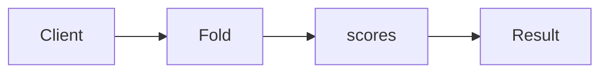

# Foldable & Traverse

**Season:** 6 · FP Foundations · **Category:** Functional · **Level:** Intermediate · **Runtime:** ~10–12 min · **Channel:** Build with Waqar

## Problem
**Fold scores; traverse validated IDs**

Key types: `Foldables`.

## Hook
Picture this: you are mid-demo and «Fold scores; traverse validated IDs» blows up the naive way — you see `Optional.empty`. That is the pain. In the next ten minutes we introduce **Foldable/Traverse** with real types (Foldables), a runnable `ProblemDemo`, and the failure path locked in by tests. No abstract UML first — problem first.

## Intent
Use **Foldable/Traverse** to cleanly solve: Fold scores; traverse validated IDs.

**When to use:** the force behind «Fold scores; traverse validated IDs» shows up more than once and a simpler language feature does not erase it.

**When to refuse:** you are pattern-collecting, the boundary is still unclear, or the team cannot yet test the abstraction (compensations, half-open recovery, interpreters).

## The Pain — Naive Design
Naive version fails to cleanly solve: Fold scores; traverse validated IDs

```java
package com.buildwithwaqar.patterns.functional.foldable.problem;

import java.util.*;

public final class NaiveFold {
  public static int sum(List<Integer> xs){ return xs.stream().mapToInt(i->i).sum(); }
}

```

On camera, point at the smell: missing compensations, leaked XML, null at the boundary,
illegal transitions, or hard-wired `System.out` that you cannot assert.

## Pattern Structure


These roles are for **«Fold scores; traverse validated IDs»** — not a generic Client→Pattern poster. Keep them on screen
while you type the solution.

## Refactor to the Pattern

### Stage 1 — Name the boundary
Introduce the client-facing API the rest of the app should depend on. Hide the incompatible or
distributed details behind it. For this episode that boundary is what makes «Fold scores; traverse validated IDs» testable.

### Stage 2 — Encode the solution
```java
package com.buildwithwaqar.patterns.functional.foldable.problem;

import java.util.*;
import java.util.function.*;

final class Foldables {
  static int foldLeft(List<Integer> xs, int z, java.util.function.IntBinaryOperator op){
    int acc=z; for(int x: xs) acc=op.applyAsInt(acc,x); return acc;
  }
  static Optional<List<Integer>> traverse(List<String> ids, Function<String, Optional<Integer>> parse){
    List<Integer> out=new ArrayList<>();
    for(String id: ids){ var p=parse.apply(id); if(p.isEmpty()) return Optional.empty(); out.add(p.get()); }
    return Optional.of(out);
  }
}

```

### Stage 3 — Runnable main
```java
package com.buildwithwaqar.patterns.functional.foldable.problem;
import java.util.*; import java.util.function.*;
public final class ProblemDemo {
  public static void main(String[] args) {
    System.out.println("=== Foldable/Traverse: scores + validated IDs ===");
    System.out.println("--- naive ---"); System.out.println(NaiveFold.sum(List.of(1,2,3)));
System.out.println("--- foldable ---");
System.out.println(Foldables.foldLeft(List.of(1,2,3), 0, Integer::sum));
System.out.println(Foldables.traverse(List.of("1","2"), s -> { try{return Optional.of(Integer.parseInt(s));}catch(Exception e){return Optional.empty();} }));
System.out.println(Foldables.traverse(List.of("1","x"), s -> { try{return Optional.of(Integer.parseInt(s));}catch(Exception e){return Optional.empty();} }));
  }
}

```

## Runnable Output (Verified on JDK 25)
Narrate each line. Do not invent numbers on camera.

```text
=== Foldable/Traverse: scores + validated IDs ===
--- naive ---
6
--- foldable ---
6
Optional[[1, 2]]
Optional.empty
```

Happy-path cue: `6`.
Failure-path cue: `Optional.empty`.
Fork the repo, set `JAVA_HOME` to JDK 25, and re-run the same `ProblemDemo` to verify.

## Modern Java 25 / Zazr Variant
Absence / errors use **Optional or Zazr/VAVR** control types instead of null.

## Trade-offs
- **Clarity vs ceremony:** extra types for «Fold scores; traverse validated IDs» only pay off when the force repeats.
- **Testability:** inject collaborators; assert the failure path, not only the happy path.
- **Distributed / concurrent reality:** demos omit metrics, backpressure, and multi-region clocks.
- **Refuse Foldable/Traverse** when a sealed switch, a function value, or a simpler library call already erases the force.
- **Neighbor:** name the pattern usually confused with Foldable/Traverse and separate the forces.

## Interview Q&A
**Q1. What concrete problem does Foldable/Traverse solve here?**
A: Fold scores; traverse validated IDs.

**Q2. What does the naive design get wrong?**
A: Naive version fails to cleanly solve: Fold scores; traverse validated IDs

**Q3. How do you test the failure path?**
A: Inject the fault and assert the observable outcome — e.g. `Optional.empty`.

**Q4. When is Foldable/Traverse the wrong tool?**
A: When a smaller language feature erases the force, or when you really needed a neighboring pattern.


## Key Takeaways
- Lead with the problem: Fold scores; traverse validated IDs.
- Show naive pain (`Optional.empty`) before naming Foldable/Traverse.
- Run the Demo; trust JDK 25 stdout (`6`).
- Teach when NOT to use Foldable/Traverse.

## Video Script (≈10–12 minutes)
Record for **Build with Waqar**. OBS for capture, CapCut for assembly. Import `slides.pdf`.
Facecam: full-screen for the hook, framed PiP over code slides.

**[0:00]** *(slide 01 title + talking head)*
Hey everyone — today we solve one concrete problem with **Foldable/Traverse**:
*Fold scores; traverse validated IDs*. Keep these names in your head: Foldables.

**[0:45]** *(problem + hook slides)*
I am not starting with a textbook definition. Here is the product pain. By the end you will have
seen the naive leak, the pattern boundary, and real JDK 25 stdout.

**[2:00]** *(naive code)*
IDE time. This is the naive version. Call out the smell — that is what Foldable/Traverse exists to erase.

**[3:30]** *(structure diagram)*
Roles for **this** problem, not a generic UML poster. Point at each box while you talk.

**[4:30]** *(refactor / solution code)*
Stage the solution. Highlight failure injection and the tests that lock it in.

**[7:00]** *(walkthrough output)*
Real stdout. Happy path cue: `6`.
Failure cue: `Optional.empty`.
No invented numbers on camera.

**[8:30]** *(modern Java 25 / Zazr + trade-offs)*
Show the modernization, then slow down for when NOT to use Foldable/Traverse. That is what seniors listen for.

**[10:30]** *(Q&A + recap + outro)*
Two interview questions, three takeaways, link the GitHub episode folder. I am Waqar — see you in the next one.


## Walkthrough Beats (Say These Out Loud)
1. **Setup:** open `series/49-foldable-traverse/` and `run-output.txt` beside the IDE.
2. **Naive:** reproduce the pain until you can point at `Optional.empty`.
3. **Structure:** on the diagram, trace `Client` → `Fold`, `Fold` → `scores`, `scores` → `Result`.
4. **Refactor:** encode the boundary, then run `ProblemDemo` — match `6`.
5. **Break it:** flip one `ProblemTest` assertion, watch red, restore it.
6. **Refuse:** Name the neighbor pattern usually confused with Foldable/Traverse.

## Practice Drill
- Clone `waqarys/java-design-patterns`, set `JAVA_HOME` to JDK 25.
- Run the episode `ProblemDemo` (see `EP_MAIN` in `tools/enrich/build_problems.py`).
- Mutate one collaborator to fail; confirm the observable compensation / error path.
- Explain Foldable/Traverse for «Fold scores; traverse validated IDs» in sixty seconds without notes.
