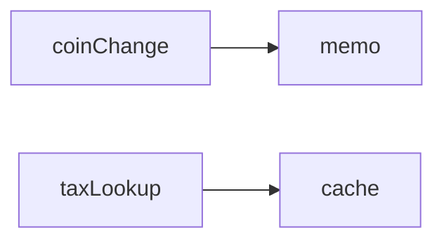

# Memoization

**Season:** 6 · FP Foundations · **Category:** Functional · **Level:** Intermediate · **Runtime:** ~10–12 min · **Channel:** Build with Waqar

## Problem
**Cache coin-change DP / tax-rate lookups with call-count trace**

Key types: `CoinChangeMemo`, `Counter`.

## Hook
Picture this: you are mid-demo and «Cache coin-change DP / tax-rate lookups with call-count trace» blows up the naive way — you see `Failure path is asserted in ProblemTest (injected fault / invalid input)`. That is the pain. In the next ten minutes we introduce **Memoization** with real types (CoinChangeMemo, Counter), a runnable `ProblemDemo`, and the failure path locked in by tests. No abstract UML first — problem first.

## Intent
Cache pure coin-change / tax-rate results so repeated inputs skip the exponential work.

**When to use:** the force behind «Cache coin-change DP / tax-rate lookups with call-count trace» shows up more than once and a simpler language feature does not erase it.

**When to refuse:** you are pattern-collecting, the boundary is still unclear, or the team cannot yet test the abstraction (compensations, half-open recovery, interpreters).

## The Pain — Naive Design
Naive version fails to cleanly solve: Cache coin-change DP / tax-rate lookups with call-count trace

```java
package com.buildwithwaqar.patterns.functional.memoization.problem;

public final class ProblemDemo {
    public static void main(String[] args) {
        System.out.println("=== Memoization: coin-change DP + tax lookup ===");
        int[] coins = {1, 5, 10, 25};
        int amount = 30;

        var naiveC = new CoinChangeMemo.Counter();
        long t0 = System.nanoTime();
        int naive = CoinChangeMemo.naiveWays(amount, coins, naiveC);
        long naiveMs = (System.nanoTime() - t0) / 1_000_000;
        System.out.println("naive ways=" + naive + " calls=" + naiveC.get() + " ms=" + naiveMs);

        var memoC = new CoinChangeMemo.Counter();
        t0 = System.nanoTime();
        int memo = CoinChangeMemo.memoWays(amount, coins, memoC);
        long memoMs = (System.nanoTime() - t0) / 1_000_000;
        System.out.println("memo  ways=" + memo + " calls=" + memoC.get() + " ms=" + memoMs);

        System.out.println("--- tax-rate lookup memoize ---");
        var taxC = new CoinChangeMemo.Counter();
        var tax = CoinChangeMemo.memoize(CoinChangeMemo::expensiveTaxRate, taxC);
        long t1 = System.nanoTime();
        System.out.println("CA1=" + tax.apply("CA") + " CA2=" + tax.apply("CA") + " NY=" + tax.apply("NY"));
        System.out.println("computeCalls=" + taxC.get() + " elapsedMs=" + (System.nanoTime() - t1) / 1_000_000);
    }
}

```

On camera, point at the smell: missing compensations, leaked XML, null at the boundary,
illegal transitions, or hard-wired `System.out` that you cannot assert.

## Pattern Structure


These roles are for **«Cache coin-change DP / tax-rate lookups with call-count trace»** — not a generic Client→Pattern poster. Keep them on screen
while you type the solution.

## Refactor to the Pattern

### Stage 1 — Name the boundary
Introduce the client-facing API the rest of the app should depend on. Hide the incompatible or
distributed details behind it. For this episode that boundary is what makes «Cache coin-change DP / tax-rate lookups with call-count trace» testable.

### Stage 2 — Encode the solution
```java
package com.buildwithwaqar.patterns.functional.memoization.problem;

import java.util.Arrays;
import java.util.HashMap;
import java.util.Map;
import java.util.concurrent.atomic.AtomicInteger;
import java.util.function.Function;

/** Memoized coin-change DP + tax-rate lookup with call-count / timing traces. */
public final class CoinChangeMemo {
    private CoinChangeMemo() {}

    public static final class Counter {
        private final AtomicInteger calls = new AtomicInteger();
        public int inc() { return calls.incrementAndGet(); }
        public int get() { return calls.get(); }
        public void reset() { calls.set(0); }
    }

    /** Naive exponential recursion. */
    public static int naiveWays(int amount, int[] coins, Counter c) {
        c.inc();
        if (amount == 0) return 1;
        if (amount < 0 || coins.length == 0) return 0;
        int with = naiveWays(amount - coins[0], coins, c);
        int without = naiveWays(amount, Arrays.copyOfRange(coins, 1, coins.length), c);
        return with + without;
    }

    public static int memoWays(int amount, int[] coins, Counter c) {
        return memoWays(amount, coins, 0, new HashMap<>(), c);
    }

    private static int memoWays(int amount, int[] coins, int i, Map<String, Integer> cache, Counter c) {
        c.inc();
        if (amount == 0) return 1;
        if (amount < 0 || i >= coins.length) return 0;
        String key = amount + ":" + i;
        Integer hit = cache.get(key);
        if (hit != null) return hit;
        int with = memoWays(amount - coins[i], coins, i, cache, c);
        int without = memoWays(amount, coins, i + 1, cache, c);
        int ans = with + without;
        cache.put(key, ans);
        return ans;
    }

    /** Generic memoize wrapper for expensive lookups. */
    public static <A, B> Function<A, B> memoize(Function<A, B> f, Counter c) {
        Map<A, B> cache = new HashMap<>();
        return a -> {
            if (cache.containsKey(a)) return cache.get(a);
            c.inc();
            B b = f.apply(a);
            cache.put(a, b);
            return b;
        };
    }

    public static int expensiveTaxRate(String region) {
        try { Thread.sleep(5); } catch (InterruptedException e) { Thread.currentThread().interrupt(); }
        return switch (region) {
            case "CA" -> 725; case "NY" -> 800; default -> 500;
        };
    }
}

```

### Stage 3 — Runnable main
```java
package com.buildwithwaqar.patterns.functional.memoization.problem;

public final class ProblemDemo {
    public static void main(String[] args) {
        System.out.println("=== Memoization: coin-change DP + tax lookup ===");
        int[] coins = {1, 5, 10, 25};
        int amount = 30;

        var naiveC = new CoinChangeMemo.Counter();
        long t0 = System.nanoTime();
        int naive = CoinChangeMemo.naiveWays(amount, coins, naiveC);
        long naiveMs = (System.nanoTime() - t0) / 1_000_000;
        System.out.println("naive ways=" + naive + " calls=" + naiveC.get() + " ms=" + naiveMs);

        var memoC = new CoinChangeMemo.Counter();
        t0 = System.nanoTime();
        int memo = CoinChangeMemo.memoWays(amount, coins, memoC);
        long memoMs = (System.nanoTime() - t0) / 1_000_000;
        System.out.println("memo  ways=" + memo + " calls=" + memoC.get() + " ms=" + memoMs);

        System.out.println("--- tax-rate lookup memoize ---");
        var taxC = new CoinChangeMemo.Counter();
        var tax = CoinChangeMemo.memoize(CoinChangeMemo::expensiveTaxRate, taxC);
        long t1 = System.nanoTime();
        System.out.println("CA1=" + tax.apply("CA") + " CA2=" + tax.apply("CA") + " NY=" + tax.apply("NY"));
        System.out.println("computeCalls=" + taxC.get() + " elapsedMs=" + (System.nanoTime() - t1) / 1_000_000);
    }
}

```

## Runnable Output (Verified on JDK 25)
Narrate each line. Do not invent numbers on camera.

```text
=== Memoization: coin-change DP + tax lookup ===
naive ways=18 calls=961 ms=0
memo  ways=18 calls=241 ms=1
--- tax-rate lookup memoize ---
CA1=725 CA2=725 NY=800
computeCalls=2 elapsedMs=12
```

Happy-path cue: `naive ways=18 calls=961 ms=0`.
Failure-path cue: `Failure path is asserted in ProblemTest (injected fault / invalid input)`.
Fork the repo, set `JAVA_HOME` to JDK 25, and re-run the same `ProblemDemo` to verify.

## Modern Java 25 / Zazr Variant
For **Memoization**, prefer records for results, sealed types for closed variants, and Zazr `Option`/`Either`/`Validation` when the force is absence or accumulated errors. Keep the classic shape when interview literacy matters.

## Trade-offs
- **Clarity vs ceremony:** extra types for «Cache coin-change DP / tax-rate lookups with call-count trace» only pay off when the force repeats.
- **Testability:** inject collaborators; assert the failure path, not only the happy path.
- **Distributed / concurrent reality:** demos omit metrics, backpressure, and multi-region clocks.
- **Refuse Memoization** when a sealed switch, a function value, or a simpler library call already erases the force.
- **Neighbor:** Flyweight — Memoization caches pure results; Flyweight shares immutable identity.

## Interview Q&A
**Q1. What concrete problem does Memoization solve here?**
A: Cache coin-change DP / tax-rate lookups with call-count trace.

**Q2. What does the naive design get wrong?**
A: Naive version fails to cleanly solve: Cache coin-change DP / tax-rate lookups with call-count trace

**Q3. How do you test the failure path?**
A: Inject the fault and assert the observable outcome — e.g. `Failure path is asserted in ProblemTest (injected fault / invalid input)`.

**Q4. When is Memoization the wrong tool?**
A: When a smaller language feature erases the force, or when you really needed Flyweight.


## Key Takeaways
- Lead with the problem: Cache coin-change DP / tax-rate lookups with call-count trace.
- Show naive pain (`Failure path is asserted in ProblemTest (injected fault / invalid input)`) before naming Memoization.
- Run the Demo; trust JDK 25 stdout (`naive ways=18 calls=961 ms=0`).
- Teach when NOT to use Memoization.

## Video Script (≈10–12 minutes)
Record for **Build with Waqar**. OBS for capture, CapCut for assembly. Import `slides.pdf`.
Facecam: full-screen for the hook, framed PiP over code slides.

**[0:00]** *(slide 01 title + talking head)*
Hey everyone — today we solve one concrete problem with **Memoization**:
*Cache coin-change DP / tax-rate lookups with call-count trace*. Keep these names in your head: CoinChangeMemo, Counter.

**[0:45]** *(problem + hook slides)*
I am not starting with a textbook definition. Here is the product pain. By the end you will have
seen the naive leak, the pattern boundary, and real JDK 25 stdout.

**[2:00]** *(naive code)*
IDE time. This is the naive version. Call out the smell — that is what Memoization exists to erase.

**[3:30]** *(structure diagram)*
Roles for **this** problem, not a generic UML poster. Point at each box while you talk.

**[4:30]** *(refactor / solution code)*
Stage the solution. Highlight failure injection and the tests that lock it in.

**[7:00]** *(walkthrough output)*
Real stdout. Happy path cue: `naive ways=18 calls=961 ms=0`.
Failure cue: `Failure path is asserted in ProblemTest (injected fault / invalid input)`.
No invented numbers on camera.

**[8:30]** *(modern Java 25 / Zazr + trade-offs)*
Show the modernization, then slow down for when NOT to use Memoization. That is what seniors listen for.

**[10:30]** *(Q&A + recap + outro)*
Two interview questions, three takeaways, link the GitHub episode folder. I am Waqar — see you in the next one.

