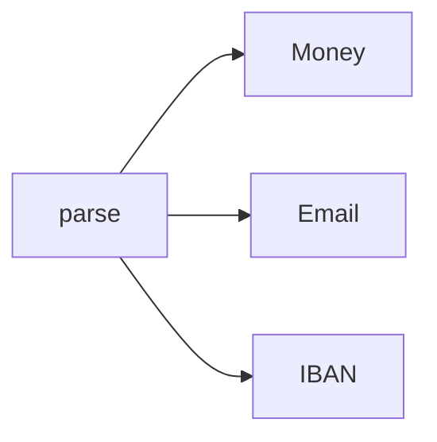

# Smart Constructors

**Season:** 6 · FP Foundations · **Category:** Functional · **Level:** Intermediate · **Runtime:** ~10–12 min · **Channel:** Build with Waqar

## Problem
**Money, Email, IBAN value objects with validated creation**

Key types: `ValueObjects`, `Money`, `Email`, `Iban`, `RawMoney`, `RawEmail`.

## Hook
Picture this: you are mid-demo and «Money, Email, IBAN value objects with validated creation» blows up the naive way — you see `badMoney=Optional.empty`. That is the pain. In the next ten minutes we introduce **Smart Constructors** with real types (ValueObjects, Money, Email), a runnable `ProblemDemo`, and the failure path locked in by tests. No abstract UML first — problem first.

## Intent
Make illegal `Money` / `Email` / `IBAN` values unrepresentable via validated factory methods.

**When to use:** the force behind «Money, Email, IBAN value objects with validated creation» shows up more than once and a simpler language feature does not erase it.

**When to refuse:** you are pattern-collecting, the boundary is still unclear, or the team cannot yet test the abstraction (compensations, half-open recovery, interpreters).

## The Pain — Naive Design
Naive: public constructors / raw strings — invalid money/email/IBAN compile fine.

```java
package com.buildwithwaqar.patterns.functional.smartctor.problem;

/** Naive: public constructors / raw strings — invalid money/email/IBAN compile fine. */
public final class NaiveValues {
    public record RawMoney(String currency, int cents) {}
    public record RawEmail(String value) {}
    public record RawIban(String value) {}
    public static RawMoney money(String c, int cents) { return new RawMoney(c, cents); } // accepts -1
    public static RawEmail email(String v) { return new RawEmail(v); } // accepts "not-an-email"
    public static RawIban iban(String v) { return new RawIban(v); }
}

```

On camera, point at the smell: missing compensations, leaked XML, null at the boundary,
illegal transitions, or hard-wired `System.out` that you cannot assert.

## Pattern Structure


These roles are for **«Money, Email, IBAN value objects with validated creation»** — not a generic Client→Pattern poster. Keep them on screen
while you type the solution.

## Refactor to the Pattern

### Stage 1 — Name the boundary
Introduce the client-facing API the rest of the app should depend on. Hide the incompatible or
distributed details behind it. For this episode that boundary is what makes «Money, Email, IBAN value objects with validated creation» testable.

### Stage 2 — Encode the solution
```java
package com.buildwithwaqar.patterns.functional.smartctor.problem;

import java.util.Optional;

/** Smart constructors: Money, Email, IBAN — invalid values cannot be constructed. */
public final class ValueObjects {
    private ValueObjects() {}

    public static final class Money {
        private final String currency;
        private final int cents;
        private Money(String currency, int cents) {
            this.currency = currency;
            this.cents = cents;
        }
        public String currency() { return currency; }
        public int cents() { return cents; }
        public static Optional<Money> of(String currency, int cents) {
            if (currency == null || currency.length() != 3) return Optional.empty();
            if (cents < 0) return Optional.empty();
            return Optional.of(new Money(currency.toUpperCase(), cents));
        }
        public String toString() { return currency + ":" + cents; }
    }

    public static final class Email {
        private final String value;
        private Email(String value) { this.value = value; }
        public String value() { return value; }
        public static Optional<Email> of(String raw) {
            if (raw == null) return Optional.empty();
            String s = raw.trim();
            int at = s.indexOf('@');
            if (at <= 0 || at != s.lastIndexOf('@') || at == s.length() - 1) return Optional.empty();
            if (s.contains(" ")) return Optional.empty();
            return Optional.of(new Email(s.toLowerCase()));
        }
        public String toString() { return value; }
    }

    public static final class Iban {
        private final String value;
        private Iban(String value) { this.value = value; }
        public String value() { return value; }
        public static Optional<Iban> of(String raw) {
            if (raw == null) return Optional.empty();
            String s = raw.replace(" ", "").toUpperCase();
            if (s.length() < 15 || s.length() > 34) return Optional.empty();
            if (!s.matches("[A-Z]{2}[0-9]{2}[A-Z0-9]+")) return Optional.empty();
            return Optional.of(new Iban(s));
        }
        public String toString() { return value; }
    }
}

```

### Stage 3 — Runnable main
```java
package com.buildwithwaqar.patterns.functional.smartctor.problem;

public final class ProblemDemo {
    public static void main(String[] args) {
        System.out.println("=== Smart Constructors: Money / Email / IBAN ===");
        System.out.println("--- naive allows illegal states ---");
        System.out.println(NaiveValues.money("US", -5));
        System.out.println(NaiveValues.email("not-an-email"));
        System.out.println(NaiveValues.iban("xx"));

        System.out.println("--- smart constructors ---");
        System.out.println("money=" + ValueObjects.Money.of("USD", 1999));
        System.out.println("badMoney=" + ValueObjects.Money.of("US", -1));
        System.out.println("email=" + ValueObjects.Email.of("A@B.C"));
        System.out.println("badEmail=" + ValueObjects.Email.of("nope"));
        System.out.println("iban=" + ValueObjects.Iban.of("DE89 3704 0044 0532 0130 00"));
        System.out.println("badIban=" + ValueObjects.Iban.of("12"));
    }
}

```

## Runnable Output (Verified on JDK 25)
Narrate each line. Do not invent numbers on camera.

```text
=== Smart Constructors: Money / Email / IBAN ===
--- naive allows illegal states ---
RawMoney[currency=US, cents=-5]
RawEmail[value=not-an-email]
RawIban[value=xx]
--- smart constructors ---
money=Optional[USD:1999]
badMoney=Optional.empty
email=Optional[a@b.c]
badEmail=Optional.empty
iban=Optional[DE89370400440532013000]
badIban=Optional.empty
```

Happy-path cue: `RawMoney[currency=US, cents=-5]`.
Failure-path cue: `badMoney=Optional.empty`.
Fork the repo, set `JAVA_HOME` to JDK 25, and re-run the same `ProblemDemo` to verify.

## Modern Java 25 / Zazr Variant
Absence / errors use **Optional or Zazr/VAVR** control types instead of null.

## Trade-offs
- **Clarity vs ceremony:** extra types for «Money, Email, IBAN value objects with validated creation» only pay off when the force repeats.
- **Testability:** inject collaborators; assert the failure path, not only the happy path.
- **Distributed / concurrent reality:** demos omit metrics, backpressure, and multi-region clocks.
- **Refuse Smart Constructors** when a sealed switch, a function value, or a simpler library call already erases the force.
- **Neighbor:** Builder — Smart constructors validate at the boundary; Builder assembles many fields.

## Interview Q&A
**Q1. What concrete problem does Smart Constructors solve here?**
A: Money, Email, IBAN value objects with validated creation.

**Q2. What does the naive design get wrong?**
A: Naive: public constructors / raw strings — invalid money/email/IBAN compile fine.

**Q3. How do you test the failure path?**
A: Inject the fault and assert the observable outcome — e.g. `badMoney=Optional.empty`.

**Q4. When is Smart Constructors the wrong tool?**
A: When a smaller language feature erases the force, or when you really needed Builder.


## Key Takeaways
- Lead with the problem: Money, Email, IBAN value objects with validated creation.
- Show naive pain (`badMoney=Optional.empty`) before naming Smart Constructors.
- Run the Demo; trust JDK 25 stdout (`RawMoney[currency=US, cents=-5]`).
- Teach when NOT to use Smart Constructors.

## Video Script (≈10–12 minutes)
Record for **Build with Waqar**. OBS for capture, CapCut for assembly. Import `slides.pdf`.
Facecam: full-screen for the hook, framed PiP over code slides.

**[0:00]** *(slide 01 title + talking head)*
Hey everyone — today we solve one concrete problem with **Smart Constructors**:
*Money, Email, IBAN value objects with validated creation*. Keep these names in your head: ValueObjects, Money, Email, Iban.

**[0:45]** *(problem + hook slides)*
I am not starting with a textbook definition. Here is the product pain. By the end you will have
seen the naive leak, the pattern boundary, and real JDK 25 stdout.

**[2:00]** *(naive code)*
IDE time. This is the naive version. Call out the smell — that is what Smart Constructors exists to erase.

**[3:30]** *(structure diagram)*
Roles for **this** problem, not a generic UML poster. Point at each box while you talk.

**[4:30]** *(refactor / solution code)*
Stage the solution. Highlight failure injection and the tests that lock it in.

**[7:00]** *(walkthrough output)*
Real stdout. Happy path cue: `RawMoney[currency=US, cents=-5]`.
Failure cue: `badMoney=Optional.empty`.
No invented numbers on camera.

**[8:30]** *(modern Java 25 / Zazr + trade-offs)*
Show the modernization, then slow down for when NOT to use Smart Constructors. That is what seniors listen for.

**[10:30]** *(Q&A + recap + outro)*
Two interview questions, three takeaways, link the GitHub episode folder. I am Waqar — see you in the next one.


## Walkthrough Beats (Say These Out Loud)
1. **Setup:** open `series/52-smart-constructors/` and `run-output.txt` beside the IDE.
2. **Naive:** reproduce the pain until you can point at `badMoney=Optional.empty`.
3. **Structure:** on the diagram, trace `parse` → `Money`, `parse` → `Email`, `parse` → `IBAN`.
4. **Refactor:** encode the boundary, then run `ProblemDemo` — match `RawMoney[currency=US, cents=-5]`.
5. **Break it:** flip one `ProblemTest` assertion, watch red, restore it.
6. **Refuse:** Contrast with **Builder**: Smart constructors validate at the boundary; Builder assembles many fields.

## Practice Drill
- Clone `waqarys/java-design-patterns`, set `JAVA_HOME` to JDK 25.
- Run the episode `ProblemDemo` (see `EP_MAIN` in `tools/enrich/build_problems.py`).
- Mutate one collaborator to fail; confirm the observable compensation / error path.
- Explain Smart Constructors for «Money, Email, IBAN value objects with validated creation» in sixty seconds without notes.
