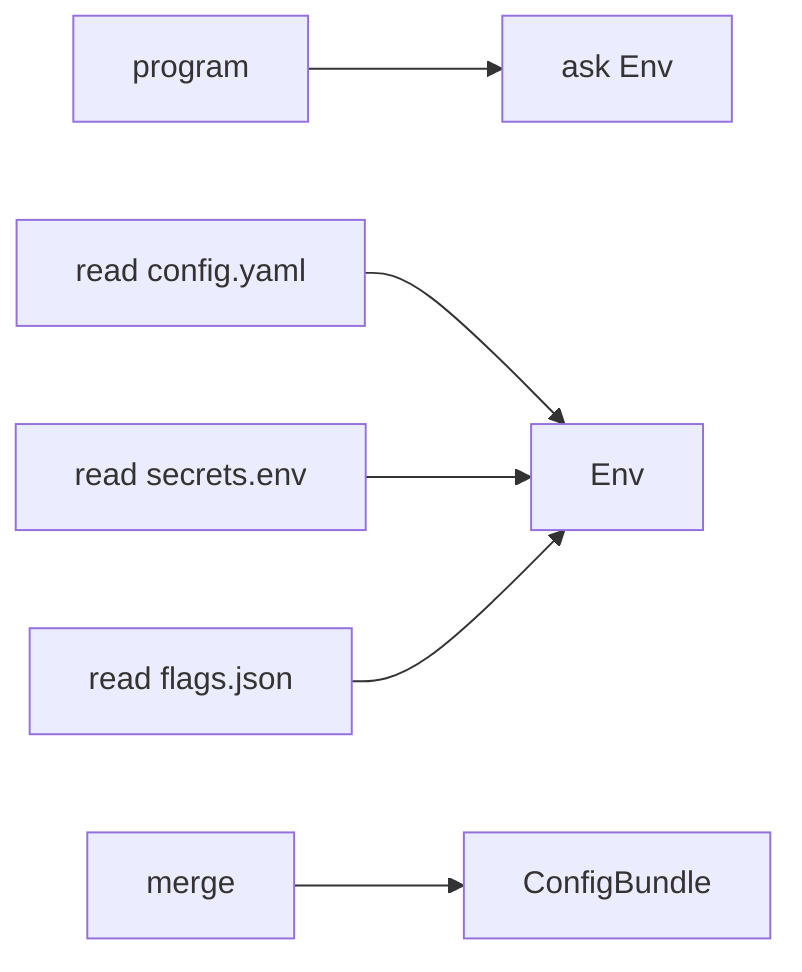

# Reader Monad

**Season:** 7 · Advanced FP · **Category:** Functional · **Level:** Advanced · **Runtime:** ~10–12 min · **Channel:** Build with Waqar

## Problem
**Load+merge config.yaml, secrets.env, flags.json via Env**

Key types: `ReaderConfigLoader`.

**Reader nuance:** Reader is not a file-I/O API. It is `Reader<Env, A>` — a computation that *depends on* an environment. Loading several files together fits because every step needs the same Env (baseDir, charset, FileSystem, logger). Inject Env once at the edge with `.run(env)`.

## Hook
Picture this: you are mid-demo and «Load+merge config.yaml, secrets.env, flags.json via Env» blows up the naive way — you see `Failure path is asserted in ProblemTest (injected fault / invalid input)`. That is the pain. In the next ten minutes we introduce **Reader** with real types (ReaderConfigLoader), a runnable `ProblemDemo`, and the failure path locked in by tests. No abstract UML first — problem first.

## Intent
Thread a shared Env (baseDir, charset, FileSystem) through a pure multi-file config merge — Reader is not a file API.

**When to use:** the force behind «Load+merge config.yaml, secrets.env, flags.json via Env» shows up more than once and a simpler language feature does not erase it.

**When to refuse:** you are pattern-collecting, the boundary is still unclear, or the team cannot yet test the abstraction (compensations, half-open recovery, interpreters).

## The Pain — Naive Design
Naive: every helper takes fs/charset/baseDir explicitly — parameter drilling. Easy to pass the wrong charset to one of three files.

```java
package com.buildwithwaqar.patterns.functional.reader.problem;

import java.nio.charset.StandardCharsets;
import java.util.LinkedHashMap;
import java.util.Map;

/**
 * Naive: every helper takes fs/charset/baseDir explicitly — parameter drilling.
 * Easy to pass the wrong charset to one of three files.
 */
public final class NaiveMultiFileLoader {
    private final FileSystem fs;
    private final String baseDir;

    public NaiveMultiFileLoader(FileSystem fs, String baseDir) {
        this.fs = fs;
        this.baseDir = baseDir;
    }

    public ConfigBundle load() {
        var yaml = parseKv(read("config.yaml"));
        var secrets = parseKv(read("secrets.env"));
        var flags = parseKv(read("feature-flags.json"));
        return new ConfigBundle(yaml, secrets, flags);
    }

    private String read(String name) {
        // "accidentally" hard-codes UTF-8 and ignores baseDir semantics
        return fs.readString(name, StandardCharsets.UTF_8)
                .orElseThrow(() -> new IllegalStateException("missing " + baseDir + "/" + name));
    }

    static Map<String, String> parseKv(String raw) {
        Map<String, String> m = new LinkedHashMap<>();
        for (String line : raw.split("\n")) {
            line = line.trim();
            if (line.isEmpty() || line.startsWith("#") || line.startsWith("{") || line.startsWith("}")) continue;
            line = line.replace("\"", "").replace(",", "");
            int eq = line.indexOf('=');
            int colon = line.indexOf(':');
            int sep = eq >= 0 ? eq : colon;
            if (sep > 0) {
                m.put(line.substring(0, sep).trim(), line.substring(sep + 1).trim());
            }
        }
        return m;
    }
}

```

On camera, point at the smell: missing compensations, leaked XML, null at the boundary,
illegal transitions, or hard-wired `System.out` that you cannot assert.

## Pattern Structure


These roles are for **«Load+merge config.yaml, secrets.env, flags.json via Env»** — not a generic Client→Pattern poster. Keep them on screen
while you type the solution.

## Refactor to the Pattern

### Stage 1 — Name the boundary
Introduce the client-facing API the rest of the app should depend on. Hide the incompatible or
distributed details behind it. For this episode that boundary is what makes «Load+merge config.yaml, secrets.env, flags.json via Env» testable.

### Stage 2 — Encode the solution
```java
package com.buildwithwaqar.patterns.functional.reader.problem;

import com.buildwithwaqar.patterns.functional.reader.Reader;

import java.util.Map;

/**
 * Reader-based loader: Env (baseDir, charset, FileSystem, logger) is asked once
 * and threaded through composed reads — no parameter drilling.
 *
 * Nuance: Reader is not "a file reader API". It is a computation that depends on
 * an environment. Reading multiple files together is a great fit because every
 * step needs the same Env.
 */
public final class ReaderConfigLoader {
    private ReaderConfigLoader() {}

    public static Reader<Env, String> readFile(String relative) {
        return Reader.<Env>ask().flatMap(env -> Reader.pure(env.fs()
                .readString(relative, env.charset())
                .map(content -> {
                    env.info("read " + env.baseDir() + "/" + relative + " (" + content.length() + " bytes)");
                    return content;
                })
                .orElseThrow(() -> new IllegalStateException("missing " + env.baseDir() + "/" + relative))));
    }

    public static Reader<Env, ConfigBundle> loadBundle() {
        return readFile("config.yaml").flatMap(yamlRaw ->
                readFile("secrets.env").flatMap(secretsRaw ->
                        readFile("feature-flags.json").map(flagsRaw -> {
                            Map<String, String> yaml = NaiveMultiFileLoader.parseKv(yamlRaw);
                            Map<String, String> secrets = NaiveMultiFileLoader.parseKv(secretsRaw);
                            Map<String, String> flags = NaiveMultiFileLoader.parseKv(flagsRaw);
                            return new ConfigBundle(yaml, secrets, flags);
                        })));
    }
}

```

### Stage 3 — Runnable main
```java
package com.buildwithwaqar.patterns.functional.reader.problem;

/** Problem: load config.yaml + secrets.env + flags.json with Env injected once. */
public final class ProblemDemo {
    public static void main(String[] args) {
        System.out.println("=== Reader problem: multi-file config merge ===");
        var fs = new FileSystem.InMemory()
                .put("config.yaml", "app=demo\nport=8080\n")
                .put("secrets.env", "DB_PASS=s3cret\n")
                .put("feature-flags.json", "beta=true\n");

        System.out.println("--- naive (paths + charset threaded everywhere) ---");
        System.out.println(new NaiveMultiFileLoader(fs, "/app").load());

        System.out.println("--- reader (Env asked once at the edge) ---");
        var env = Env.inMemory(fs);
        ConfigBundle bundle = ReaderConfigLoader.loadBundle().run(env);
        System.out.println(bundle);
        System.out.println("log=" + env.log());
    }
}

```

## Runnable Output (Verified on JDK 25)
Narrate each line. Do not invent numbers on camera.

```text
=== Reader problem: multi-file config merge ===
--- naive (paths + charset threaded everywhere) ---
ConfigBundle[yaml={app=demo, port=8080}, secrets={DB_PASS=s3cret}, flags={beta=true}]
--- reader (Env asked once at the edge) ---
ConfigBundle[yaml={app=demo, port=8080}, secrets={DB_PASS=s3cret}, flags={beta=true}]
log=[read /app/config/config.yaml (19 bytes), read /app/config/secrets.env (15 bytes), read /app/config/feature-flags.json (10 bytes)]
```

Happy-path cue: `ConfigBundle[yaml={app=demo, port=8080}, secrets={DB_PASS=s3cret}, flags={beta=true}]`.
Failure-path cue: `Failure path is asserted in ProblemTest (injected fault / invalid input)`.
Fork the repo, set `JAVA_HOME` to JDK 25, and re-run the same `ProblemDemo` to verify.

## Modern Java 25 / Zazr Variant
For **Reader**, prefer records for results, sealed types for closed variants, and Zazr `Option`/`Either`/`Validation` when the force is absence or accumulated errors. Keep the classic shape when interview literacy matters. Reader stays pure: put `baseDir` / charset / `FileSystem` in `Env`, compose `Reader<Env,A>` steps, and call `.run(env)` once at the edge.

## Trade-offs
- **Clarity vs ceremony:** Reader shines when many steps share Env; overkill for one file read.
- **Testability:** pass a fake `FileSystem` Env in unit tests.
- **Refuse Reader** when a simple method parameter already threads the config.
- **Do not confuse Reader with I/O** — I/O lives in the interpreters / Env collaborators.
- **Neighbor:** DI / Cake — Reader threads Env through pure code; Cake/DI wire concrete services at the edge.

## Interview Q&A
**Q1. Does Reader read files?**
A: No. Reader threads Env. File reads are ordinary functions that *ask* Env for baseDir/charset/FileSystem.

**Q2. Why merge config.yaml + secrets.env + flags.json this way?**
A: Every step needs the same Env; `.run(env)` injects it once at the edge.

**Q3. How do you test it?**
A: Pass an in-memory FileSystem Env and assert the merged view without touching disk.

**Q4. When is Reader the wrong tool?**
A: When a smaller language feature erases the force, or when you really needed DI / Cake.


## Key Takeaways
- Lead with the problem: Load+merge config.yaml, secrets.env, flags.json via Env.
- Show naive pain (`Failure path is asserted in ProblemTest (injected fault / invalid input)`) before naming Reader.
- Run the Demo; trust JDK 25 stdout (`ConfigBundle[yaml={app=demo, port=8080}, secrets={DB_PASS=s3cret}, flags={beta=true}]`).
- Teach when NOT to use Reader.

## Video Script (≈10–12 minutes)
Record for **Build with Waqar**. OBS for capture, CapCut for assembly. Import `slides.pdf`.
Facecam: full-screen for the hook, framed PiP over code slides.

**[0:00]** *(slide 01 title + talking head)*
Hey everyone — today we solve one concrete problem with **Reader**:
*Load+merge config.yaml, secrets.env, flags.json via Env*. Keep these names in your head: ReaderConfigLoader.

**[0:45]** *(problem + hook slides)*
I am not starting with a textbook definition. Here is the product pain. By the end you will have
seen the naive leak, the pattern boundary, and real JDK 25 stdout.

**[2:00]** *(naive code)*
IDE time. This is the naive version. Call out the smell — that is what Reader exists to erase.

**[3:30]** *(structure diagram)*
Roles for **this** problem, not a generic UML poster. Point at each box while you talk.

**[4:30]** *(refactor / solution code)*
Stage the solution. Highlight failure injection and the tests that lock it in.

**[7:00]** *(walkthrough output)*
Real stdout. Happy path cue: `ConfigBundle[yaml={app=demo, port=8080}, secrets={DB_PASS=s3cret}, flags={beta=true}]`.
Failure cue: `Failure path is asserted in ProblemTest (injected fault / invalid input)`.
No invented numbers on camera.

**[8:30]** *(modern Java 25 / Zazr + trade-offs)*
Show the modernization, then slow down for when NOT to use Reader. That is what seniors listen for.

**[10:30]** *(Q&A + recap + outro)*
Two interview questions, three takeaways, link the GitHub episode folder. I am Waqar — see you in the next one.

