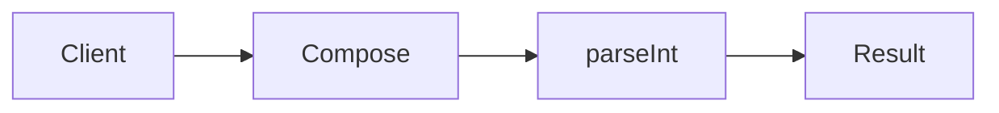

# Kleisli Composition

**Season:** 7 · Advanced FP · **Category:** Functional · **Level:** Advanced · **Runtime:** ~10–12 min · **Channel:** Build with Waqar

## Problem
**Compose parseInt → enrichUser → authorize**

Key types: `Kleisli`, `AuthPipe`.

## Hook
Picture this: you are mid-demo and «Compose parseInt → enrichUser → authorize» blows up the naive way — you see `Optional.empty`. That is the pain. In the next ten minutes we introduce **Kleisli** with real types (Kleisli, AuthPipe), a runnable `ProblemDemo`, and the failure path locked in by tests. No abstract UML first — problem first.

## Intent
Use **Kleisli** to cleanly solve: Compose parseInt → enrichUser → authorize.

**When to use:** the force behind «Compose parseInt → enrichUser → authorize» shows up more than once and a simpler language feature does not erase it.

**When to refuse:** you are pattern-collecting, the boundary is still unclear, or the team cannot yet test the abstraction (compensations, half-open recovery, interpreters).

## The Pain — Naive Design
Naive version fails to cleanly solve: Compose parseInt → enrichUser → authorize

```java
package com.buildwithwaqar.patterns.functional.kleisli.problem;

import java.util.*;

public final class NaiveAuth {
  public static String auth(String raw){ int id=Integer.parseInt(raw); return id>0? "allow:"+id: "deny"; }
}

```

On camera, point at the smell: missing compensations, leaked XML, null at the boundary,
illegal transitions, or hard-wired `System.out` that you cannot assert.

## Pattern Structure


These roles are for **«Compose parseInt → enrichUser → authorize»** — not a generic Client→Pattern poster. Keep them on screen
while you type the solution.

## Refactor to the Pattern

### Stage 1 — Name the boundary
Introduce the client-facing API the rest of the app should depend on. Hide the incompatible or
distributed details behind it. For this episode that boundary is what makes «Compose parseInt → enrichUser → authorize» testable.

### Stage 2 — Encode the solution
```java
package com.buildwithwaqar.patterns.functional.kleisli.problem;

import java.util.*;
import java.util.function.*;

final class Kleisli<A,B> {
  private final Function<A, Optional<B>> run;
  Kleisli(Function<A, Optional<B>> run){ this.run=run; }
  static <A,B> Kleisli<A,B> of(Function<A, Optional<B>> f){ return new Kleisli<>(f); }
  <C> Kleisli<A,C> andThen(Kleisli<B,C> next){ return new Kleisli<>(a -> run.apply(a).flatMap(next.run)); }
  Optional<B> apply(A a){ return run.apply(a); }
}
final class AuthPipe {
  static final Kleisli<String,Integer> parse = Kleisli.of(s -> { try { return Optional.of(Integer.parseInt(s)); } catch(Exception e){ return Optional.empty(); } });
  static final Kleisli<Integer,Integer> enrich = Kleisli.of(id -> id>0? Optional.of(id+1000): Optional.empty());
  static final Kleisli<Integer,String> authorize = Kleisli.of(id -> Optional.of("allow:"+id));
  static final Kleisli<String,String> pipeline = parse.andThen(enrich).andThen(authorize);
}

```

### Stage 3 — Runnable main
```java
package com.buildwithwaqar.patterns.functional.kleisli.problem;
import java.util.*; import java.util.function.*;
public final class ProblemDemo {
  public static void main(String[] args) {
    System.out.println("=== Kleisli: parse → enrich → authorize ===");
    System.out.println("--- naive ---"); System.out.println(NaiveAuth.auth("7"));
System.out.println("--- kleisli ---");
System.out.println(AuthPipe.pipeline.apply("7"));
System.out.println(AuthPipe.pipeline.apply("x"));
System.out.println(AuthPipe.pipeline.apply("-1"));
  }
}

```

## Runnable Output (Verified on JDK 25)
Narrate each line. Do not invent numbers on camera.

```text
=== Kleisli: parse → enrich → authorize ===
--- naive ---
allow:7
--- kleisli ---
Optional[allow:1007]
Optional.empty
Optional.empty
```

Happy-path cue: `allow:7`.
Failure-path cue: `Optional.empty`.
Fork the repo, set `JAVA_HOME` to JDK 25, and re-run the same `ProblemDemo` to verify.

## Modern Java 25 / Zazr Variant
Absence / errors use **Optional or Zazr/VAVR** control types instead of null.

## Trade-offs
- **Clarity vs ceremony:** extra types for «Compose parseInt → enrichUser → authorize» only pay off when the force repeats.
- **Testability:** inject collaborators; assert the failure path, not only the happy path.
- **Distributed / concurrent reality:** demos omit metrics, backpressure, and multi-region clocks.
- **Refuse Kleisli** when a sealed switch, a function value, or a simpler library call already erases the force.
- **Neighbor:** Reader — Kleisli composes A→F[B] arrows; Reader is Env→A.

## Interview Q&A
**Q1. What concrete problem does Kleisli solve here?**
A: Compose parseInt → enrichUser → authorize.

**Q2. What does the naive design get wrong?**
A: Naive version fails to cleanly solve: Compose parseInt → enrichUser → authorize

**Q3. How do you test the failure path?**
A: Inject the fault and assert the observable outcome — e.g. `Optional.empty`.

**Q4. When is Kleisli the wrong tool?**
A: When a smaller language feature erases the force, or when you really needed Reader.


## Key Takeaways
- Lead with the problem: Compose parseInt → enrichUser → authorize.
- Show naive pain (`Optional.empty`) before naming Kleisli.
- Run the Demo; trust JDK 25 stdout (`allow:7`).
- Teach when NOT to use Kleisli.

## Video Script (≈10–12 minutes)
Record for **Build with Waqar**. OBS for capture, CapCut for assembly. Import `slides.pdf`.
Facecam: full-screen for the hook, framed PiP over code slides.

**[0:00]** *(slide 01 title + talking head)*
Hey everyone — today we solve one concrete problem with **Kleisli**:
*Compose parseInt → enrichUser → authorize*. Keep these names in your head: Kleisli, AuthPipe.

**[0:45]** *(problem + hook slides)*
I am not starting with a textbook definition. Here is the product pain. By the end you will have
seen the naive leak, the pattern boundary, and real JDK 25 stdout.

**[2:00]** *(naive code)*
IDE time. This is the naive version. Call out the smell — that is what Kleisli exists to erase.

**[3:30]** *(structure diagram)*
Roles for **this** problem, not a generic UML poster. Point at each box while you talk.

**[4:30]** *(refactor / solution code)*
Stage the solution. Highlight failure injection and the tests that lock it in.

**[7:00]** *(walkthrough output)*
Real stdout. Happy path cue: `allow:7`.
Failure cue: `Optional.empty`.
No invented numbers on camera.

**[8:30]** *(modern Java 25 / Zazr + trade-offs)*
Show the modernization, then slow down for when NOT to use Kleisli. That is what seniors listen for.

**[10:30]** *(Q&A + recap + outro)*
Two interview questions, three takeaways, link the GitHub episode folder. I am Waqar — see you in the next one.


## Walkthrough Beats (Say These Out Loud)
1. **Setup:** open `series/57-kleisli/` and `run-output.txt` beside the IDE.
2. **Naive:** reproduce the pain until you can point at `Optional.empty`.
3. **Structure:** on the diagram, trace `Client` → `Compose`, `Compose` → `parseInt`, `parseInt` → `Result`.
4. **Refactor:** encode the boundary, then run `ProblemDemo` — match `allow:7`.
5. **Break it:** flip one `ProblemTest` assertion, watch red, restore it.
6. **Refuse:** Contrast with **Reader**: Kleisli composes A→F[B] arrows; Reader is Env→A.

## Practice Drill
- Clone `waqarys/java-design-patterns`, set `JAVA_HOME` to JDK 25.
- Run the episode `ProblemDemo` (see `EP_MAIN` in `tools/enrich/build_problems.py`).
- Mutate one collaborator to fail; confirm the observable compensation / error path.
- Explain Kleisli for «Compose parseInt → enrichUser → authorize» in sixty seconds without notes.
