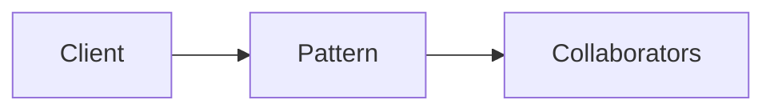

# Free Monad

**Season:** 7 · Advanced FP · **Category:** Functional · **Level:** Advanced · **Target runtime:** ~10–12 min · **Channel:** Build with Waqar · **Target runtime:** ~10–12 min · **Channel:** Build with Waqar · **Target runtime:** ~10–12 min · **Channel:** Build with Waqar

## Problem
**Bank-transfer DSL with Map interpreter + logging optimizer**

This episode is built around that concrete problem — not a shared StreamForge framing.
You will see a real naive implementation that hurts, a full pattern-based solution, a
runnable main with meaningful stdout, and JUnit failure-path coverage where the pattern lives.

## Hook
Welcome back to **Build with Waqar**. Today we earn **Free** by solving one problem well:
*Bank-transfer DSL with Map interpreter + logging optimizer*. By the end you will have walked naive pain → pattern refactor → real JDK 25
stdout → trade-offs, with CapCut slides and a spoken script.

## Intent
Free exists because this force kept showing up: bank-transfer dsl with map interpreter + logging optimizer. Name the force, sketch
the roles, and — critically — know when you would refuse the pattern.

## The Pain — Naive Design
Before the pattern, teams usually thread details everywhere, leak resources on partial
failure, or couple call sites to a third-party shape. That feels fast on day one and expensive
on day thirty.

```java
package com.buildwithwaqar.patterns.functional.free.problem;

import java.util.LinkedHashMap;
import java.util.Map;

/** Naive: transfer logic inlined; no program to optimize or log separately. */
public final class NaiveBank {
    private final Map<String, Integer> ledger = new LinkedHashMap<>();
    public void seed(String acct, int cents) { ledger.put(acct, cents); }
    public int transfer(String from, String to, int cents) {
        int bal = ledger.getOrDefault(from, 0);
        if (bal < cents) throw new IllegalStateException("insufficient:" + from);
        ledger.put(from, bal - cents);
        ledger.put(to, ledger.getOrDefault(to, 0) + cents);
        return ledger.get(to);
    }
    public Map<String, Integer> ledger() { return Map.copyOf(ledger); }
}

```

Call out the smell on camera: duplicated envelopes, missing compensations, parameter drilling,
illegal transitions, or null at the boundary.

## Pattern Structure


Roles matter more than class counts. The diagram slide draws the collaboration for **this**
problem so viewers can point at boxes while you type.

## Refactor to the Pattern

### Stage 1 — Name the boundary
Identify the client-facing API the rest of the app should depend on. Hide the incompatible
or distributed details behind it.

### Stage 2 — Encode the solution
```java
package com.buildwithwaqar.patterns.functional.free.problem;

import java.util.ArrayList;
import java.util.LinkedHashMap;
import java.util.List;
import java.util.Map;
import java.util.function.Function;

/** Free-style bank DSL: Balance / Withdraw / Deposit / Transfer as an AST of instructions. */
public final class BankDsl {
    private BankDsl() {}

    public sealed interface Instr permits Balance, Withdraw, Deposit, Transfer {}
    public record Balance(String account) implements Instr {}
    public record Withdraw(String account, int cents) implements Instr {}
    public record Deposit(String account, int cents) implements Instr {}
    public record Transfer(String from, String to, int cents) implements Instr {}

    public abstract static class Free<A> {
        private Free() {}
        public abstract <B> Free<B> flatMap(Function<? super A, Free<B>> f);
        public final <B> Free<B> map(Function<? super A, ? extends B> f) {
            return flatMap(a -> pure(f.apply(a)));
        }
        public static <A> Free<A> pure(A a) { return new Pure<>(a); }
        public static Free<Integer> balance(String acct) { return new Suspend<>(new Balance(acct)); }
        public static Free<Void> withdraw(String acct, int cents) { return new Suspend<>(new Withdraw(acct, cents)); }
        public static Free<Void> deposit(String acct, int cents) { return new Suspend<>(new Deposit(acct, cents)); }
        public static Free<Void> transfer(String from, String to, int cents) {
            return new Suspend<>(new Transfer(from, to, cents));
        }
    }

    private static final class Pure<A> extends Free<A> {
        final A value;
        Pure(A value) { this.value = value; }
        public <B> Free<B> flatMap(Function<? super A, Free<B>> f) { return f.apply(value); }
    }
    private static final class Suspend<A> extends Free<A> {
        final Instr instr;
        Suspend(Instr instr) { this.instr = instr; }
        public <B> Free<B> flatMap(Function<? super A, Free<B>> f) { return new Bind<>(this, f); }
    }
    private static final class Bind<A, B> extends Free<B> {
        final Free<A> prev;
        final Function<? super A, Free<B>> f;
        Bind(Free<A> prev, Function<? super A, Free<B>> f) { this.prev = prev; this.f = f; }
        public <C> Free<C> flatMap(Function<? super B, Free<C>> g) {
            return new Bind<>(prev, a -> f.apply(a).flatMap(g));
        }
    }

    /** Optimize Transfer into Withdraw+Deposit for the Map interpreter. */
    @SuppressWarnings({"rawtypes", "unchecked"})
    public static <A> Free<A> optimize(Free<A> program) {
        // rewrite Suspend(Transfer) into withdraw.flatMap(_ -> deposit)
        Free cur = program;
        if (cur instanceof Suspend<?> s && s.instr instanceof Transfer t) {
            return (Free<A>) Free.withdraw(t.from(), t.cents())
                    .flatMap(x -> Free.deposit(t.to(), t.cents()));
        }
        if (cur instanceof Bind<?, ?> b) {
            Free optPrev = optimize(b.prev);
            return new Bind<>(optPrev, a -> { @SuppressWarnings("unchecked") Function f = b.f; return optimize((Free) f.apply(a)); });
        }
        return program;
    }

    public static <A> A interpretMap(Free<A> program, Map<String, Integer> ledger) {
        return interpretMap(program, ledger, null);
    }

    @SuppressWarnings({"rawtypes", "unchecked"})
    public static <A> A interpretMap(Free<A> program, Map<String, Integer> ledger, List<String> log) {
        Fr
```

### Stage 3 — Runnable main
```java
package com.buildwithwaqar.patterns.functional.free.problem;

import java.util.ArrayList;
import java.util.LinkedHashMap;
import java.util.List;

/** Problem: bank-transfer DSL — Map interpreter + logging + Transfer optimizer. */
public final class ProblemDemo {
    public static void main(String[] args) {
        System.out.println("=== Free: bank-transfer DSL ===");
        System.out.println("--- naive ---");
        var naive = new NaiveBank();
        naive.seed("payroll", 10_000);
        naive.seed("alice", 0);
        System.out.println("toBal=" + naive.transfer("payroll", "alice", 2500));
        System.out.println("ledger=" + naive.ledger());

        System.out.println("--- Free program + Map interpreter ---");
        var ledger = new LinkedHashMap<String, Integer>();
        ledger.put("payroll", 10_000);
        ledger.put("alice", 0);
        var prog = BankDsl.paydayBonus("payroll", "alice", 2500);
        int bal = BankDsl.interpretMap(prog, ledger);
        System.out.println("toBal=" + bal + " ledger=" + ledger);

        System.out.println("--- logging interpreter ---");
        var ledger2 = new LinkedHashMap<String, Integer>();
        ledger2.put("payroll", 10_000);
        ledger2.put("bob", 0);
        List<String> log = new ArrayList<>();
        BankDsl.interpretMap(BankDsl.Free.transfer("payroll", "bob", 100), ledger2, log);
        System.out.println("log=" + log);

        System.out.println("--- optimized Transfer → Withdraw+Deposit ---");
        var opt = BankDsl.optimize(BankDsl.Free.transfer("payroll", "bob", 50));
        var ledger3 = new LinkedHashMap<String, Integer>();
        ledger3.put("payroll", 10_000);
        ledger3.put("bob", 100);
        List<String> log3 = new ArrayList<>();
        BankDsl.interpretMap(opt, ledger3, log3);
        System.out.println("optLog=" + log3);
        System.out.println("ledger=" + ledger3);

        System.out.println("--- failure: insufficient funds ---");
        try {
            var bad = new LinkedHashMap<String, Integer>();
            bad.put("empty", 0);
            BankDsl.interpretMap(BankDsl.Free.withdraw("empty", 1), bad);
        } catch (IllegalStateException e) {
            System.out.println("caught=" + e.getMessage());
        }
    }
}

```

## Hand-Traced Walkthrough (Verified on JDK 25)
Narrate each line. Do not invent numbers on camera.

```text
=== Free: bank-transfer DSL ===
--- naive ---
toBal=2500
ledger={payroll=7500, alice=2500}
--- Free program + Map interpreter ---
toBal=2500 ledger={payroll=7500, alice=2500}
--- logging interpreter ---
log=[Transfer[from=payroll, to=bob, cents=100], Withdraw[account=payroll, cents=100], Deposit[account=bob, cents=100]]
--- optimized Transfer → Withdraw+Deposit ---
optLog=[Withdraw[account=payroll, cents=50], Deposit[account=bob, cents=50]]
ledger={payroll=9950, bob=150}
--- failure: insufficient funds ---
caught=insufficient:empty
```

Trace: match each printed line to a stage above. Fork the repo, set `JAVA_HOME` to JDK 25,
and re-run the same main class to verify.

## Modern Java 25 / Zazr Variant
Prefer records for results, sealed types for closed variants, pattern matching for exhaustive
handling, virtual threads for blocking fan-out, and Zazr for Option/Either/Try/Validation
when the force is about absence or accumulated errors. Keep the classic shape when interview
literacy matters.

## Trade-offs
- **Clarity vs ceremony:** five types for a two-line problem is a fail.
- **Testability:** inject collaborators; for Saga, inject failure at each step.
- **Distributed reality:** teaching demos omit metrics, poison pills, and multi-region clocks.
- **Refuse the pattern** when a sealed switch, a function value, or a simpler library call
  already erases the force.

## When to Use / When Not to Use
**Use when** the problem above shows up more than once and a simpler language feature does
not erase it.

**Avoid when** you are pattern-collecting, when the boundary is still unclear, or when the
team cannot yet test the abstraction (especially compensations and half-open recovery).

## Related Patterns
Contrast Free with its usual twin (Adapter vs Facade, Saga vs Outbox, Reader vs DI/Cake,
State vs Strategy, Free vs Tagless). Say the distinguishing sentence out loud.

## Interview Q&A
**Q1. What concrete problem does Free solve here?**
A: Bank-transfer DSL with Map interpreter + logging optimizer.

**Q2. What does the naive design get wrong?**
A: Point at the naive code smells from this episode.

**Q3. How do you test failure paths?**
A: Inject a failing collaborator (Saga step, SOAP fault, missing file) and assert the
observable outcome — compensation order, FAILED result, or thrown IllegalStateException.

**Q4. When is Free the wrong tool?**
A: Give a smaller counterexample where a function, Option, or facade is enough.

**Q5. How does Java 25 change the encoding?**
A: Records, sealed types, virtual threads, Zazr control types — pick what applies.

## Key Takeaways
- Lead with the problem: Bank-transfer DSL with Map interpreter + logging optimizer.
- Show naive pain before naming Free.
- Run the Demo; trust JDK 25 stdout.
- Teach when NOT to use it.

## Video Script (≈10–12 minutes)
Record for **Build with Waqar**. OBS for capture, CapCut for assembly. Import `slides.pdf`.

**[0:00]** *(slide 01 title)*
Hey everyone, welcome back to Build with Waqar. Today we solve a real problem with Free:
Bank-transfer DSL with Map interpreter + logging optimizer.

**[0:40]** *(slide 02–03 problem)*
I am not starting with a definition. Here is the product pain. Keep these names — they
reappear in the Demo output.

**[2:00]** *(naive code)*
IDE time. This is the naive version. Call out the smell.

**[3:30]** *(diagram)*
Structure for **this** problem. Point at each role.

**[4:30]** *(refactor stages)*
Stage by stage into the pattern. Highlight tests and failure injection.

**[7:00]** *(walkthrough output)*
Real stdout from JDK 25. Line by line. No fake numbers.

**[8:30]** *(modern + trade-offs)*
Java 25 / Zazr take, then slow down for when NOT to use Free.

**[10:30]** *(interview + recap)*
Two interview questions, three takeaways, link the GitHub episode folder. I am Waqar —
see you in the next one.
