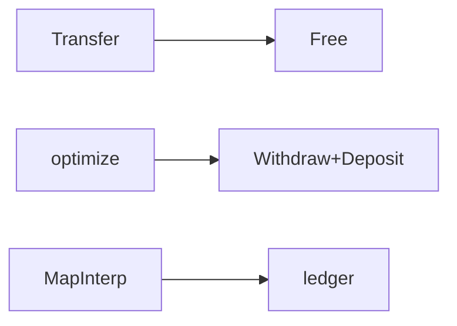

# Free Monad

**Season:** 7 · Advanced FP · **Category:** Functional · **Level:** Advanced · **Runtime:** ~10–12 min · **Channel:** Build with Waqar

## Problem
**Bank-transfer DSL with Map interpreter + logging optimizer**

Key types: `BankDsl`, `Instr`, `Balance`, `Withdraw`, `Deposit`, `Transfer`.

**Free nuance:** the program is data. You can optimize (`Transfer` → `Withdraw` then `Deposit`) before any interpreter runs — that inspection is Free's superpower versus Tagless.

## Hook
Picture this: you are mid-demo and «Bank-transfer DSL with Map interpreter + logging optimizer» blows up the naive way — you see `caught=insufficient:empty`. That is the pain. In the next ten minutes we introduce **Free** with real types (BankDsl, Instr, Balance), a runnable `ProblemDemo`, and the failure path locked in by tests. No abstract UML first — problem first.

## Intent
Describe a bank-transfer DSL as data (`Free` instructions), optimize it, then interpret against an in-memory ledger.

**When to use:** the force behind «Bank-transfer DSL with Map interpreter + logging optimizer» shows up more than once and a simpler language feature does not erase it.

**When to refuse:** you are pattern-collecting, the boundary is still unclear, or the team cannot yet test the abstraction (compensations, half-open recovery, interpreters).

## The Pain — Naive Design
Naive: transfer logic inlined; no program to optimize or log separately.

```java
package com.buildwithwaqar.patterns.functional.free.problem;

import java.util.LinkedHashMap;
import java.util.Map;

/** Naive: transfer logic inlined; no program to optimize or log separately. */
public final class NaiveBank {
    private final Map<String, Integer> ledger = new LinkedHashMap<>();
    public void seed(String acct, int cents) { ledger.put(acct, cents); }
    public int transfer(String from, String to, int cents) {
        int bal = ledger.getOrDefault(from, 0);
        if (bal < cents) throw new IllegalStateException("insufficient:" + from);
        ledger.put(from, bal - cents);
        ledger.put(to, ledger.getOrDefault(to, 0) + cents);
        return ledger.get(to);
    }
    public Map<String, Integer> ledger() { return Map.copyOf(ledger); }
}

```

On camera, point at the smell: missing compensations, leaked XML, null at the boundary,
illegal transitions, or hard-wired `System.out` that you cannot assert.

## Pattern Structure


These roles are for **«Bank-transfer DSL with Map interpreter + logging optimizer»** — not a generic Client→Pattern poster. Keep them on screen
while you type the solution.

## Refactor to the Pattern

### Stage 1 — Name the boundary
Introduce the client-facing API the rest of the app should depend on. Hide the incompatible or
distributed details behind it. For this episode that boundary is what makes «Bank-transfer DSL with Map interpreter + logging optimizer» testable.

### Stage 2 — Encode the solution
```java
package com.buildwithwaqar.patterns.functional.free.problem;

import java.util.ArrayList;
import java.util.LinkedHashMap;
import java.util.List;
import java.util.Map;
import java.util.function.Function;

/** Free-style bank DSL: Balance / Withdraw / Deposit / Transfer as an AST of instructions. */
public final class BankDsl {
    private BankDsl() {}

    public sealed interface Instr permits Balance, Withdraw, Deposit, Transfer {}
    public record Balance(String account) implements Instr {}
    public record Withdraw(String account, int cents) implements Instr {}
    public record Deposit(String account, int cents) implements Instr {}
    public record Transfer(String from, String to, int cents) implements Instr {}

    public abstract static class Free<A> {
        private Free() {}
        public abstract <B> Free<B> flatMap(Function<? super A, Free<B>> f);
        public final <B> Free<B> map(Function<? super A, ? extends B> f) {
            return flatMap(a -> pure(f.apply(a)));
        }
        public static <A> Free<A> pure(A a) { return new Pure<>(a); }
        public static Free<Integer> balance(String acct) { return new Suspend<>(new Balance(acct)); }
        public static Free<Void> withdraw(String acct, int cents) { return new Suspend<>(new Withdraw(acct, cents)); }
        public static Free<Void> deposit(String acct, int cents) { return new Suspend<>(new Deposit(acct, cents)); }
        public static Free<Void> transfer(String from, String to, int cents) {
            return new Suspend<>(new Transfer(from, to, cents));
        }
    }

    private static final class Pure<A> extends Free<A> {
        final A value;
        Pure(A value) { this.value = value; }
        public <B> Free<B> flatMap(Function<? super A, Free<B>> f) { return f.apply(value); }
    }
    private static final class Suspend<A> extends Free<A> {
        final Instr instr;
        Suspend(Instr instr) { this.instr = instr; }
        public <B> Free<B> flatMap(Function<? super A, Free<B>> f) { return new Bind<>(this, f); }
    }
    private static final class Bind<A, B> extends Free<B> {
        final Free<A> prev;
        final Function<? super A, Free<B>> f;
        Bind(Free<A> prev, Function<? super A, Free<B>> f) { this.prev = prev; this.f = f; }
        public <C> Free<C> flatMap(Function<? super B, Free<C>> g) {
            return new Bind<>(prev, a -> f.apply(a).flatMap(g));
        }
    }

    /** Optimize Transfer into Withdraw+Deposit for the Map interpreter. */
    @SuppressWarnings({"rawtypes", "unchecked"})
    public static <A> Free<A> optimize(Free<A> program) {
        // rewrite Suspend(Transfer) into withdraw.flatMap(_ -> deposit)
        Free cur = program;
        if (cur instanceof Suspend<?> s && s.instr instanceof Transfer t) {
            return (Free<A>) Free.withdraw(t.from(), t.cents())
                    .flatMap(x -> Free.deposit(t.to(), t.cents()));
        }
        if (cur instanceof Bind<?, ?> b) {
            Free optPrev = optimize(b.prev);
            return new Bind<>(optPrev, a -> { @SuppressWarnings("unchecked") Function f = b.f; return optimize((Free) f.apply(a)); });
        }
        return program;
    }

    pu
```

### Stage 3 — Runnable main
```java
package com.buildwithwaqar.patterns.functional.free.problem;

import java.util.ArrayList;
import java.util.LinkedHashMap;
import java.util.List;

/** Problem: bank-transfer DSL — Map interpreter + logging + Transfer optimizer. */
public final class ProblemDemo {
    public static void main(String[] args) {
        System.out.println("=== Free: bank-transfer DSL ===");
        System.out.println("--- naive ---");
        var naive = new NaiveBank();
        naive.seed("payroll", 10_000);
        naive.seed("alice", 0);
        System.out.println("toBal=" + naive.transfer("payroll", "alice", 2500));
        System.out.println("ledger=" + naive.ledger());

        System.out.println("--- Free program + Map interpreter ---");
        var ledger = new LinkedHashMap<String, Integer>();
        ledger.put("payroll", 10_000);
        ledger.put("alice", 0);
        var prog = BankDsl.paydayBonus("payroll", "alice", 2500);
        int bal = BankDsl.interpretMap(prog, ledger);
        System.out.println("toBal=" + bal + " ledger=" + ledger);

        System.out.println("--- logging interpreter ---");
        var ledger2 = new LinkedHashMap<String, Integer>();
        ledger2.put("payroll", 10_000);
        ledger2.put("bob", 0);
        List<String> log = new ArrayList<>();
        BankDsl.interpretMap(BankDsl.Free.transfer("payroll", "bob", 100), ledger2, log);
        System.out.println("log=" + log);

        System.out.println("--- optimized Transfer → Withdraw+Deposit ---");
        var opt = BankDsl.optimize(BankDsl.Free.transfer("payroll", "bob", 50));
        var ledger3 = new LinkedHashMap<String, Integer>();
        ledger3.put("payroll", 10_000);
        ledger3.put("bob", 100);
        List<String> log3 = new ArrayList<>();
        BankDsl.interpretMap(opt, ledger3, log3);
        System.out.println("optLog=" + log3);
        System.out.println("ledger=" + ledger3);

        System.out.println("--- failure: insufficient funds ---");
        try {
            var bad = new LinkedHashMap<String, Integer>();
            bad.put("empty", 0);
            BankDsl.interpretMap(BankDsl.Free.withdraw("empty", 1), bad);
        } catch (IllegalStateException e) {
            System.out.println("caught=" + e.getMessage());
        }
    }
}

```

## Runnable Output (Verified on JDK 25)
Narrate each line. Do not invent numbers on camera.

```text
=== Free: bank-transfer DSL ===
--- naive ---
toBal=2500
ledger={payroll=7500, alice=2500}
--- Free program + Map interpreter ---
toBal=2500 ledger={payroll=7500, alice=2500}
--- logging interpreter ---
log=[Transfer[from=payroll, to=bob, cents=100], Withdraw[account=payroll, cents=100], Deposit[account=bob, cents=100]]
--- optimized Transfer → Withdraw+Deposit ---
optLog=[Withdraw[account=payroll, cents=50], Deposit[account=bob, cents=50]]
ledger={payroll=9950, bob=150}
--- failure: insufficient funds ---
caught=insufficient:empty
```

Happy-path cue: `toBal=2500`.
Failure-path cue: `caught=insufficient:empty`.
Fork the repo, set `JAVA_HOME` to JDK 25, and re-run the same `ProblemDemo` to verify.

## Modern Java 25 / Zazr Variant
This solution already leans on **sealed types** — keep the exhaustive `switch`. **Records** carry the immutable results (`StepResult`, DTOs) with almost no boilerplate.

## Trade-offs
- **Clarity vs ceremony:** extra types for «Bank-transfer DSL with Map interpreter + logging optimizer» only pay off when the force repeats.
- **Testability:** inject collaborators; assert the failure path, not only the happy path.
- **Distributed / concurrent reality:** demos omit metrics, backpressure, and multi-region clocks.
- **Refuse Free** when a sealed switch, a function value, or a simpler library call already erases the force.
- **Neighbor:** Tagless Final — Free builds a data DSL then interprets; Tagless Final abstracts F up front.

## Interview Q&A
**Q1. What concrete problem does Free solve here?**
A: Bank-transfer DSL with Map interpreter + logging optimizer.

**Q2. What does the naive design get wrong?**
A: Naive: transfer logic inlined; no program to optimize or log separately.

**Q3. How do you test the failure path?**
A: Inject the fault and assert the observable outcome — e.g. `caught=insufficient:empty`.

**Q4. When is Free the wrong tool?**
A: When a smaller language feature erases the force, or when you really needed Tagless Final.


## Key Takeaways
- Lead with the problem: Bank-transfer DSL with Map interpreter + logging optimizer.
- Show naive pain (`caught=insufficient:empty`) before naming Free.
- Run the Demo; trust JDK 25 stdout (`toBal=2500`).
- Teach when NOT to use Free.

## Video Script (≈10–12 minutes)
Record for **Build with Waqar**. OBS for capture, CapCut for assembly. Import `slides.pdf`.
Facecam: full-screen for the hook, framed PiP over code slides.

**[0:00]** *(slide 01 title + talking head)*
Hey everyone — today we solve one concrete problem with **Free**:
*Bank-transfer DSL with Map interpreter + logging optimizer*. Keep these names in your head: BankDsl, Instr, Balance, Withdraw.

**[0:45]** *(problem + hook slides)*
I am not starting with a textbook definition. Here is the product pain. By the end you will have
seen the naive leak, the pattern boundary, and real JDK 25 stdout.

**[2:00]** *(naive code)*
IDE time. This is the naive version. Call out the smell — that is what Free exists to erase.

**[3:30]** *(structure diagram)*
Roles for **this** problem, not a generic UML poster. Point at each box while you talk.

**[4:30]** *(refactor / solution code)*
Stage the solution. Highlight failure injection and the tests that lock it in.

**[7:00]** *(walkthrough output)*
Real stdout. Happy path cue: `toBal=2500`.
Failure cue: `caught=insufficient:empty`.
No invented numbers on camera.

**[8:30]** *(modern Java 25 / Zazr + trade-offs)*
Show the modernization, then slow down for when NOT to use Free. That is what seniors listen for.

**[10:30]** *(Q&A + recap + outro)*
Two interview questions, three takeaways, link the GitHub episode folder. I am Waqar — see you in the next one.

