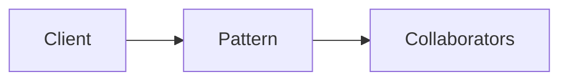

# Free Monad

**Season:** 7 · Advanced FP · **Category:** Functional · **Level:** Advanced

## Intent
Build programs from an instruction set; interpret later.

## Problem
Without this pattern, code tends toward: New things up with conditionals and duplicated construction.

## Real-world Analogy
Sheet music played by different orchestras.

## When to Use
- Serious FP architecture in Java.
- The design force named in Intent shows up more than once.

## When Not to Use
- CRUD apps that don't need effect algebras.
- A simpler language feature (record, sealed switch, function value) already solves it.

## Naive Approach
```text
New things up with conditionals and duplicated construction.
```

## Pattern Structure

Client -> Pattern -> Collaborators

## Classic Implementation
Primary code lives under `src/main/java/com/buildwithwaqar/patterns/functional/free/`.

```java
package com.buildwithwaqar.patterns.functional.free;

import java.util.function.Function;

/** Free monad over a console instruction set (simplified educational encoding). */
public abstract class Free<A> {
    private Free() {}

    public abstract <B> Free<B> flatMap(Function<? super A, Free<B>> f);

    public final <B> Free<B> map(Function<? super A, ? extends B> f) {
        return flatMap(a -> pure(f.apply(a)));
    }

    public static <A> Free<A> pure(A a) { return new Pure<>(a); }

    public static Free<Void> printLine(String s) { return new SuspendPrint(s); }

    public static Free<String> readLine() { return SuspendRead.INSTANCE; }

    private static final class Pure<A> extends Free<A> {
        private final A value;
        Pure(A value) { this.value = value; }
        A value() { return value; }
        public <B> Free<B> flatMap(Function<? super A, Free<B>> f) { return f.apply(value); }
    }

    private static final class SuspendPrint extends Free<Void> {
        private final String line;
        SuspendPrint(String line) { this.line = line; }
        public <B> Free<B> flatMap(Function<? super Void, Free<B>> f) {
            return new Bind<>(this, f);
        }
    }

    private static final class SuspendRead extends Free<String> {
        static final SuspendRead INSTANCE = new SuspendRead();
        public <B> Free<B> flatMap(Function<? super String, Free<B>> f) {
            return new Bind<>(this, f);
        }
    }

    private static final class Bind<A, B> extends Free<B> {
        private final Free<A> prev;
        private final Function<? super A, Free<B>> f;
        Bind(Free<A> prev, Function<? super A, Free<B>> f) {
            this.prev = prev;
            this.f = f;
        }
        public <C> Free<C> flatMap(Function<? super B, Free<C>> g) {
            return new Bind<>(prev, a -> f.apply(a).flatMap(g));
        }
    }

    @SuppressWarnings({"rawtypes", "unchecked"})
    public static <A> A interpret(Free<A> program, String cannedInput, StringBuilder out) {
        Free cur = program;
        while (true) {
            if (cur instanceof Pure<?> p) {
                return (A) p.value();
            } else if (cur instanceof SuspendPrint sp) {
                out.append(sp.line).append('\n');
                cur = pure(null);
            } else if (cur instanceof SuspendRead) {
                cur = pure(cannedInput);
            } else if (cur instanceof Bind<?, ?> b) {
                Object inner = interpret(b.prev, cannedInput, out);
                Function f = b.f;
                cur = (Free) f.apply(inner);
            } else {
                throw new IllegalStateException(cur.getClass().getName());
            }
        }
    }
}
```

## Modern Java 25 / Functional
Witness types emulate higher-kinded types.

## Worked Example
```text
See the JUnit test beside the implementation.
Run: mvn -Dtest=*Test test
Focus package matching: functional/free/
```

## Pitfalls
- Encodings are educational — production may use libraries.
- Tagless Final needs Kind encoding without HKTs.

## Interview Q&A
**Q: When to pick Free Monad?**
A: When you need testable effect boundaries or pure state threading.

**Q: How would you test this?**
A: Prefer injecting interfaces or interpreters; keep demos deterministic (fixed clocks, canned inputs).

## Key Takeaways
- Build programs from an instruction set; interpret later.
- Prefer Java 25 sealed types / records / virtual threads where they simplify the classic shape.
- Ship working tests with every episode.

## Video Script
**[0:00] Hook** — Open with the analogy: Sheet music played by different orchestras.
**[0:40] Intent** — State the design force in one sentence: Build programs from an instruction set; interpret later.
**[1:30] Naive pain** — Show the messy approach: New things up with conditionals and duplicated construction.
**[3:00] Pattern** — Walk the code under `functional/free/`; draw the mermaid structure on-screen.
**[6:00] Modern take** — Witness types emulate higher-kinded types.
**[8:00] Pitfalls & interview** — Cover: When to pick Free Monad?
**[9:30] Outro** — Tease the next episode; point viewers to the GitHub repo and slides PDF.
