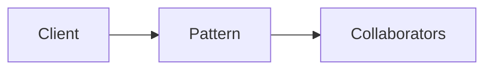

# Tagless Final

**Season:** 7 · Advanced FP · **Category:** Functional · **Level:** Advanced

## Intent
Program against algebras; swap interpreters.

## Problem
Without this pattern, code tends toward: New things up with conditionals and duplicated construction.

## Real-world Analogy
Plug the same script into Stage or Rehearsal mode.

## When to Use
- Serious FP architecture in Java.
- The design force named in Intent shows up more than once.

## When Not to Use
- CRUD apps that don't need effect algebras.
- A simpler language feature (record, sealed switch, function value) already solves it.

## Naive Approach
```text
New things up with conditionals and duplicated construction.
```

## Pattern Structure

Client -> Pattern -> Collaborators

## Classic Implementation
Primary code lives under `src/main/java/com/buildwithwaqar/patterns/functional/tagless/`.

```java
package com.buildwithwaqar.patterns.functional.tagless;

import com.buildwithwaqar.patterns.functional.typeclass.Kind;
import com.buildwithwaqar.patterns.functional.typeclass.Monad;
import com.buildwithwaqar.patterns.functional.typeclass.OptionKind;
import dev.zazr.control.Option;

/**
 * Tagless Final: programs are written against an algebra (interface of capabilities),
 * not a concrete effect type. Interpreters provide the algebra for Option, IO, etc.
 */
public final class TaglessFinal {
    private TaglessFinal() {}

    /** Unit type — Zazr Option rejects null, so Void is awkward; use a singleton. */
    public enum Unit { INSTANCE }

    public interface Console<F> {
        Kind<F, String> readLine();
        Kind<F, Unit> printLine(String s);
    }

    public static <F> Kind<F, String> greet(Monad<F> M, Console<F> console) {
        return M.flatMap(console.printLine("What is your name?"), ignored ->
                M.flatMap(console.readLine(), name ->
                        M.flatMap(console.printLine("Hello, " + name), ignored2 ->
                                M.pure(name))));
    }

    /** Test interpreter using Option as a trivial effect (pre-canned input). */
    public static final class OptionConsole implements Console<OptionKind.Witness> {
        private final String input;
        public OptionConsole(String input) { this.input = input; }

        public Kind<OptionKind.Witness, String> readLine() {
            return OptionKind.lift(Option.some(input));
        }

        public Kind<OptionKind.Witness, Unit> printLine(String s) {
            return OptionKind.lift(Option.some(Unit.INSTANCE));
        }
    }
}
```

## Modern Java 25 / Functional
Witness types emulate higher-kinded types.

## Worked Example
```text
See the JUnit test beside the implementation.
Run: mvn -Dtest=*Test test
Focus package matching: functional/tagless/
```

## Pitfalls
- Encodings are educational — production may use libraries.
- Tagless Final needs Kind encoding without HKTs.

## Interview Q&A
**Q: When to pick Tagless Final?**
A: When you need testable effect boundaries or pure state threading.

**Q: How would you test this?**
A: Prefer injecting interfaces or interpreters; keep demos deterministic (fixed clocks, canned inputs).

## Key Takeaways
- Program against algebras; swap interpreters.
- Prefer Java 25 sealed types / records / virtual threads where they simplify the classic shape.
- Ship working tests with every episode.

## Video Script
**[0:00] Hook** — Open with the analogy: Plug the same script into Stage or Rehearsal mode.
**[0:40] Intent** — State the design force in one sentence: Program against algebras; swap interpreters.
**[1:30] Naive pain** — Show the messy approach: New things up with conditionals and duplicated construction.
**[3:00] Pattern** — Walk the code under `functional/tagless/`; draw the mermaid structure on-screen.
**[6:00] Modern take** — Witness types emulate higher-kinded types.
**[8:00] Pitfalls & interview** — Cover: When to pick Tagless Final?
**[9:30] Outro** — Tease the next episode; point viewers to the GitHub repo and slides PDF.
