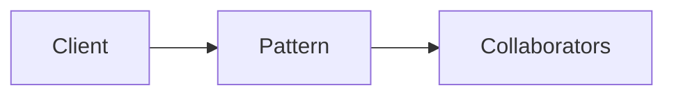

# Tagless Final

**Season:** 7 · Advanced FP · **Category:** Functional · **Level:** Advanced · **Target runtime:** ~10–12 min · **Channel:** Build with Waqar · **Target runtime:** ~10–12 min · **Channel:** Build with Waqar · **Target runtime:** ~10–12 min · **Channel:** Build with Waqar

## Problem
**User registration against UserRepo/Email/Logger algebras; IO + pure test interpreters**

This episode is built around that concrete problem — not a shared StreamForge framing.
You will see a real naive implementation that hurts, a full pattern-based solution, a
runnable main with meaningful stdout, and JUnit failure-path coverage where the pattern lives.

## Hook
Welcome back to **Build with Waqar**. Today we earn **Tagless Final** by solving one problem well:
*User registration against UserRepo/Email/Logger algebras; IO + pure test interpreters*. By the end you will have walked naive pain → pattern refactor → real JDK 25
stdout → trade-offs, with CapCut slides and a spoken script.

## Intent
Tagless Final exists because this force kept showing up: user registration against userrepo/email/logger algebras; io + pure test interpreters. Name the force, sketch
the roles, and — critically — know when you would refuse the pattern.

## The Pain — Naive Design
Before the pattern, teams usually thread details everywhere, leak resources on partial
failure, or couple call sites to a third-party shape. That feels fast on day one and expensive
on day thirty.

```java
package com.buildwithwaqar.patterns.functional.tagless.problem;

import java.util.ArrayList;
import java.util.LinkedHashMap;
import java.util.List;
import java.util.Map;

/** Naive: registration hard-wires Map DB + System.out email — untestable without mocks frameworks. */
public final class NaiveRegistration {
    private final Map<String, Algebras.User> db = new LinkedHashMap<>();
    private final List<String> outbox = new ArrayList<>();

    public Algebras.User register(String id, String email) {
        if (db.containsKey(email)) {
            System.out.println("dup " + email); // side effect baked in
            return db.get(email);
        }
        var u = new Algebras.User(id, email);
        db.put(email, u);
        outbox.add("welcome->" + email); // cannot swap for test assertion easily in unit style
        System.out.println("sent welcome to " + email);
        return u;
    }

    public List<String> outbox() { return List.copyOf(outbox); }
}

```

Call out the smell on camera: duplicated envelopes, missing compensations, parameter drilling,
illegal transitions, or null at the boundary.

## Pattern Structure


Roles matter more than class counts. The diagram slide draws the collaboration for **this**
problem so viewers can point at boxes while you type.

## Refactor to the Pattern

### Stage 1 — Name the boundary
Identify the client-facing API the rest of the app should depend on. Hide the incompatible
or distributed details behind it.

### Stage 2 — Encode the solution
```java
package com.buildwithwaqar.patterns.functional.tagless.problem;

import java.util.ArrayList;
import java.util.LinkedHashMap;
import java.util.List;
import java.util.Map;
import java.util.Optional;
import java.util.function.Function;

/**
 * Tagless Final algebras for user registration.
 * Programs are written once against UserRepo/EmailSender/Logger; interpreters choose the effect.
 */
public final class Algebras {
    private Algebras() {}

    public record User(String id, String email) {}

    /** Minimal "effect" wrapper — either Identity (prod sync) or accumulating TestState. */
    public interface Kind<F, A> {
        A unsafeRun();
    }

    public interface Monad<F> {
        <A> Kind<F, A> pure(A a);
        <A, B> Kind<F, B> flatMap(Kind<F, A> fa, Function<A, Kind<F, B>> f);
        default <A, B> Kind<F, B> map(Kind<F, A> fa, Function<A, B> f) {
            return flatMap(fa, a -> pure(f.apply(a)));
        }
    }

    public interface UserRepo<F> {
        Kind<F, Optional<User>> findByEmail(String email);
        Kind<F, User> save(User user);
    }

    public interface EmailSender<F> {
        Kind<F, Void> send(String to, String subject, String body);
    }

    public interface Logger<F> {
        Kind<F, Void> info(String msg);
    }

    /** Shared registration program — no concrete effect type. */
    public static <F> Kind<F, User> register(
            Monad<F> M, UserRepo<F> users, EmailSender<F> email, Logger<F> log,
            String id, String address) {
        return M.flatMap(log.info("register " + address), ignored ->
                M.flatMap(users.findByEmail(address), existing -> {
                    if (existing.isPresent()) {
                        return M.flatMap(log.info("duplicate " + address), x ->
                                M.pure(existing.get())); // return existing — caller may treat as failure
                    }
                    var user = new User(id, address);
                    return M.flatMap(users.save(user), saved ->
                            M.flatMap(email.send(address, "Welcome", "Hi " + id), sent ->
                                    M.flatMap(log.info("registered " + id), y -> M.pure(saved))));
                }));
    }

    // ---- Identity / "IO-style" interpreter (eager, side-effecting) ----
    public enum IoWitness { W }
    public record Io<A>(A value) implements Kind<IoWitness, A> {
        public A unsafeRun() { return value; }
    }
    public static final Monad<IoWitness> IO = new Monad<>() {
        public <A> Kind<IoWitness, A> pure(A a) { return new Io<>(a); }
        public <A, B> Kind<IoWitness, B> flatMap(Kind<IoWitness, A> fa, Function<A, Kind<IoWitness, B>> f) {
            return f.apply(fa.unsafeRun());
        }
    };

    public static final class IoUserRepo implements UserRepo<IoWitness> {
        private final Map<String, User> db = new LinkedHashMap<>();
        public Kind<IoWitness, Optional<User>> findByEmail(String email) {
            return new Io<>(Optional.ofNullable(db.get(email)));
        }
        public Kind<IoWitness, User> save(User user) {
            db.put(user.email(), user);
            return new Io<>(user);
        }
        public Map<String, User> db() { return Map.copyOf(db); }
    }
    public static final class IoEmail implements EmailSender<IoWitness> {
        private final List<String> sent = new ArrayList<>();
        public Kind<IoWitness, Void> send(String to, String subject, String body) {
           
```

### Stage 3 — Runnable main
```java
package com.buildwithwaqar.patterns.functional.tagless.problem;

/** Problem: same registration program under IO-style and pure test interpreters. */
public final class ProblemDemo {
    public static void main(String[] args) {
        System.out.println("=== Tagless Final: user registration algebras ===");
        System.out.println("--- naive (hard-wired Map + System.out) ---");
        var naive = new NaiveRegistration();
        System.out.println(naive.register("u1", "a@b.c"));
        System.out.println("outbox=" + naive.outbox());

        System.out.println("--- IO-style interpreter ---");
        var repo = new Algebras.IoUserRepo();
        var mail = new Algebras.IoEmail();
        var log = new Algebras.IoLogger();
        var user = Algebras.register(Algebras.IO, repo, mail, log, "u2", "x@y.z").unsafeRun();
        System.out.println("user=" + user);
        System.out.println("emails=" + mail.sent());
        System.out.println("logs=" + log.lines());

        System.out.println("--- pure test interpreter (shared state) ---");
        var state = Algebras.TestState.empty();
        var prog = Algebras.register(
                Algebras.TEST, new Algebras.TestUserRepo(), new Algebras.TestEmail(), new Algebras.TestLogger(),
                "u3", "t@est.io");
        var saved = ((Algebras.Test<Algebras.User>) prog).runWith(state);
        System.out.println("user=" + saved);
        System.out.println("emails=" + state.emails());
        System.out.println("logs=" + state.logs());
        System.out.println("db=" + state.users().keySet());
    }
}

```

## Hand-Traced Walkthrough (Verified on JDK 25)
Narrate each line. Do not invent numbers on camera.

```text
=== Tagless Final: user registration algebras ===
--- naive (hard-wired Map + System.out) ---
sent welcome to a@b.c
User[id=u1, email=a@b.c]
outbox=[welcome->a@b.c]
--- IO-style interpreter ---
user=User[id=u2, email=x@y.z]
emails=[x@y.z|Welcome|Hi u2]
logs=[register x@y.z, registered u2]
--- pure test interpreter (shared state) ---
user=User[id=u3, email=t@est.io]
emails=[t@est.io|Welcome]
logs=[register t@est.io, registered u3]
db=[t@est.io]
```

Trace: match each printed line to a stage above. Fork the repo, set `JAVA_HOME` to JDK 25,
and re-run the same main class to verify.

## Modern Java 25 / Zazr Variant
Prefer records for results, sealed types for closed variants, pattern matching for exhaustive
handling, virtual threads for blocking fan-out, and Zazr for Option/Either/Try/Validation
when the force is about absence or accumulated errors. Keep the classic shape when interview
literacy matters.

## Trade-offs
- **Clarity vs ceremony:** five types for a two-line problem is a fail.
- **Testability:** inject collaborators; for Saga, inject failure at each step.
- **Distributed reality:** teaching demos omit metrics, poison pills, and multi-region clocks.
- **Refuse the pattern** when a sealed switch, a function value, or a simpler library call
  already erases the force.

## When to Use / When Not to Use
**Use when** the problem above shows up more than once and a simpler language feature does
not erase it.

**Avoid when** you are pattern-collecting, when the boundary is still unclear, or when the
team cannot yet test the abstraction (especially compensations and half-open recovery).

## Related Patterns
Contrast Tagless Final with its usual twin (Adapter vs Facade, Saga vs Outbox, Reader vs DI/Cake,
State vs Strategy, Free vs Tagless). Say the distinguishing sentence out loud.

## Interview Q&A
**Q1. What concrete problem does Tagless Final solve here?**
A: User registration against UserRepo/Email/Logger algebras; IO + pure test interpreters.

**Q2. What does the naive design get wrong?**
A: Point at the naive code smells from this episode.

**Q3. How do you test failure paths?**
A: Inject a failing collaborator (Saga step, SOAP fault, missing file) and assert the
observable outcome — compensation order, FAILED result, or thrown IllegalStateException.

**Q4. When is Tagless Final the wrong tool?**
A: Give a smaller counterexample where a function, Option, or facade is enough.

**Q5. How does Java 25 change the encoding?**
A: Records, sealed types, virtual threads, Zazr control types — pick what applies.

## Key Takeaways
- Lead with the problem: User registration against UserRepo/Email/Logger algebras; IO + pure test interpreters.
- Show naive pain before naming Tagless Final.
- Run the Demo; trust JDK 25 stdout.
- Teach when NOT to use it.

## Video Script (≈10–12 minutes)
Record for **Build with Waqar**. OBS for capture, CapCut for assembly. Import `slides.pdf`.

**[0:00]** *(slide 01 title)*
Hey everyone, welcome back to Build with Waqar. Today we solve a real problem with Tagless Final:
User registration against UserRepo/Email/Logger algebras; IO + pure test interpreters.

**[0:40]** *(slide 02–03 problem)*
I am not starting with a definition. Here is the product pain. Keep these names — they
reappear in the Demo output.

**[2:00]** *(naive code)*
IDE time. This is the naive version. Call out the smell.

**[3:30]** *(diagram)*
Structure for **this** problem. Point at each role.

**[4:30]** *(refactor stages)*
Stage by stage into the pattern. Highlight tests and failure injection.

**[7:00]** *(walkthrough output)*
Real stdout from JDK 25. Line by line. No fake numbers.

**[8:30]** *(modern + trade-offs)*
Java 25 / Zazr take, then slow down for when NOT to use Tagless Final.

**[10:30]** *(interview + recap)*
Two interview questions, three takeaways, link the GitHub episode folder. I am Waqar —
see you in the next one.
