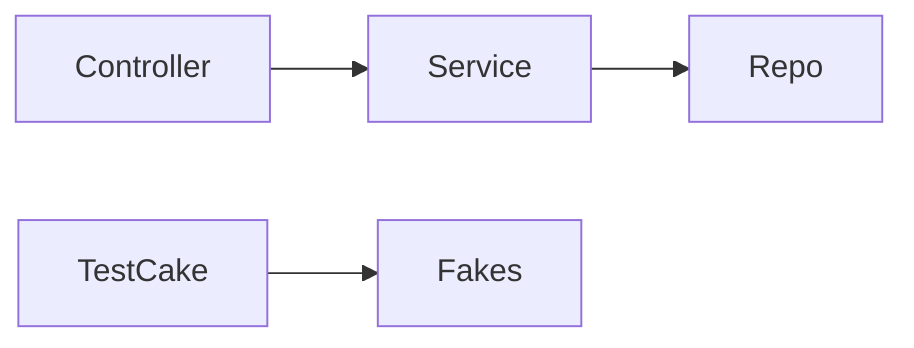

# Cake Pattern

**Season:** 7 · Advanced FP · **Category:** Functional · **Level:** Advanced · **Runtime:** ~10–12 min · **Channel:** Build with Waqar

## Problem
**Multi-layer repo→service→controller app; test cake swaps fakes**

Key types: `AppCake`, `User`, `UserRepo`, `EmailGateway`, `UserService`, `UserController`.

**Cake nuance:** self-types wire modules in source (`LiveCake` vs `TestCake`). No runtime container required — tests swap fakes by mixing in a different cake.

## Hook
Picture this: you are mid-demo and «Multi-layer repo→service→controller app; test cake swaps fakes» blows up the naive way — you see `409:exists:u2`. That is the pain. In the next ten minutes we introduce **Cake** with real types (AppCake, User, UserRepo), a runnable `ProblemDemo`, and the failure path locked in by tests. No abstract UML first — problem first.

## Intent
Wire repo → service → controller with self-types so tests swap a `TestCake` of fakes without a DI framework.

**When to use:** the force behind «Multi-layer repo→service→controller app; test cake swaps fakes» shows up more than once and a simpler language feature does not erase it.

**When to refuse:** you are pattern-collecting, the boundary is still unclear, or the team cannot yet test the abstraction (compensations, half-open recovery, interpreters).

## The Pain — Naive Design
Naive: controller news service news repo — cannot swap fakes without rewriting.

```java
package com.buildwithwaqar.patterns.functional.cake.problem;

import java.util.LinkedHashMap;
import java.util.Map;

/** Naive: controller news service news repo — cannot swap fakes without rewriting. */
public final class NaiveApp {
    private final Map<String, String> db = new LinkedHashMap<>();
    public String postRegister(String id, String email) {
        if (db.containsKey(id)) return "409:exists";
        db.put(id, email);
        System.out.println("email " + email); // hard-wired
        return "201:" + id;
    }
}

```

On camera, point at the smell: missing compensations, leaked XML, null at the boundary,
illegal transitions, or hard-wired `System.out` that you cannot assert.

## Pattern Structure


These roles are for **«Multi-layer repo→service→controller app; test cake swaps fakes»** — not a generic Client→Pattern poster. Keep them on screen
while you type the solution.

## Refactor to the Pattern

### Stage 1 — Name the boundary
Introduce the client-facing API the rest of the app should depend on. Hide the incompatible or
distributed details behind it. For this episode that boundary is what makes «Multi-layer repo→service→controller app; test cake swaps fakes» testable.

### Stage 2 — Encode the solution
```java
package com.buildwithwaqar.patterns.functional.cake.problem;

import java.util.ArrayList;
import java.util.LinkedHashMap;
import java.util.List;
import java.util.Map;
import java.util.Optional;

/** Multi-layer cake: Repo → Service → Controller, with a test cake swapping fakes. */
public final class AppCake {
    private AppCake() {}

    public record User(String id, String email) {}

    public interface UserRepo {
        Optional<User> find(String id);
        User save(User user);
    }

    public interface EmailGateway {
        void send(String to, String body);
        List<String> sent();
    }

    public interface UserService {
        User register(String id, String email);
        String welcome(String id);
    }

    public interface UserController {
        String postRegister(String id, String email);
        String getWelcome(String id);
    }

    public interface UserRepoComponent { UserRepo userRepo(); }
    public interface EmailComponent { EmailGateway emailGateway(); }
    public interface UserServiceComponent extends UserRepoComponent, EmailComponent {
        default UserService userService() {
            return new UserService() {
                public User register(String id, String email) {
                    var existing = userRepo().find(id);
                    if (existing.isPresent()) throw new IllegalStateException("exists:" + id);
                    var u = userRepo().save(new User(id, email));
                    emailGateway().send(email, "welcome " + id);
                    return u;
                }
                public String welcome(String id) {
                    return userRepo().find(id)
                            .map(u -> "hello " + u.email())
                            .orElseThrow(() -> new IllegalArgumentException("missing:" + id));
                }
            };
        }
    }
    public interface UserControllerComponent extends UserServiceComponent {
        default UserController userController() {
            return new UserController() {
                public String postRegister(String id, String email) {
                    try {
                        var u = userService().register(id, email);
                        return "201:" + u.id();
                    } catch (IllegalStateException e) {
                        return "409:" + e.getMessage();
                    }
                }
                public String getWelcome(String id) {
                    try {
                        return "200:" + userService().welcome(id);
                    } catch (IllegalArgumentException e) {
                        return "404:" + e.getMessage();
                    }
                }
            };
        }
    }

    public static final class LiveCake implements UserControllerComponent {
        private final Map<String, User> db = new LinkedHashMap<>();
        private final List<String> mail = new ArrayList<>();
        public UserRepo userRepo() {
            return new UserRepo() {
                public Optional<User> find(String id) { return Optional.ofNullable(db.get(id)); }
                public User save(User user) { db.put(user.id(), user); return user; }

```

### Stage 3 — Runnable main
```java
package com.buildwithwaqar.patterns.functional.cake.problem;

public final class ProblemDemo {
    public static void main(String[] args) {
        System.out.println("=== Cake: repo → service → controller ===");
        System.out.println("--- naive ---");
        System.out.println(new NaiveApp().postRegister("u1", "a@b.c"));

        System.out.println("--- live cake ---");
        var live = new AppCake.LiveCake();
        System.out.println(live.userController().postRegister("u2", "x@y.z"));
        System.out.println(live.userController().getWelcome("u2"));
        System.out.println("mail=" + live.mailbox());
        System.out.println(live.userController().postRegister("u2", "x@y.z")); // conflict

        System.out.println("--- test cake with fakes ---");
        var test = new AppCake.TestCake().seed(new AppCake.User("seed", "s@e.ed"));
        System.out.println(test.userController().getWelcome("seed"));
        System.out.println(test.userController().postRegister("u3", "t@est.io"));
        System.out.println("mail=" + test.mailbox());
        System.out.println(test.userController().getWelcome("missing"));
    }
}

```

## Runnable Output (Verified on JDK 25)
Narrate each line. Do not invent numbers on camera.

```text
=== Cake: repo → service → controller ===
--- naive ---
email a@b.c
201:u1
--- live cake ---
201:u2
200:hello x@y.z
mail=[x@y.z:welcome u2]
409:exists:u2
--- test cake with fakes ---
200:hello s@e.ed
201:u3
mail=[t@est.io:welcome u3]
404:missing:missing
```

Happy-path cue: `201:u1`.
Failure-path cue: `409:exists:u2`.
Fork the repo, set `JAVA_HOME` to JDK 25, and re-run the same `ProblemDemo` to verify.

## Modern Java 25 / Zazr Variant
**Records** carry the immutable results (`StepResult`, DTOs) with almost no boilerplate. Absence / errors use **Optional or Zazr/VAVR** control types instead of null.

## Trade-offs
- **Clarity vs ceremony:** extra types for «Multi-layer repo→service→controller app; test cake swaps fakes» only pay off when the force repeats.
- **Testability:** inject collaborators; assert the failure path, not only the happy path.
- **Distributed / concurrent reality:** demos omit metrics, backpressure, and multi-region clocks.
- **Refuse Cake** when a sealed switch, a function value, or a simpler library call already erases the force.
- **Neighbor:** DI — Cake self-types wire modules in code; a DI container wires at runtime.

## Interview Q&A
**Q1. What concrete problem does Cake solve here?**
A: Multi-layer repo→service→controller app; test cake swaps fakes.

**Q2. What does the naive design get wrong?**
A: Naive: controller news service news repo — cannot swap fakes without rewriting.

**Q3. How do you test the failure path?**
A: Inject the fault and assert the observable outcome — e.g. `409:exists:u2`.

**Q4. When is Cake the wrong tool?**
A: When a smaller language feature erases the force, or when you really needed DI.


## Key Takeaways
- Lead with the problem: Multi-layer repo→service→controller app; test cake swaps fakes.
- Show naive pain (`409:exists:u2`) before naming Cake.
- Run the Demo; trust JDK 25 stdout (`201:u1`).
- Teach when NOT to use Cake.

## Video Script (≈10–12 minutes)
Record for **Build with Waqar**. OBS for capture, CapCut for assembly. Import `slides.pdf`.
Facecam: full-screen for the hook, framed PiP over code slides.

**[0:00]** *(slide 01 title + talking head)*
Hey everyone — today we solve one concrete problem with **Cake**:
*Multi-layer repo→service→controller app; test cake swaps fakes*. Keep these names in your head: AppCake, User, UserRepo, EmailGateway.

**[0:45]** *(problem + hook slides)*
I am not starting with a textbook definition. Here is the product pain. By the end you will have
seen the naive leak, the pattern boundary, and real JDK 25 stdout.

**[2:00]** *(naive code)*
IDE time. This is the naive version. Call out the smell — that is what Cake exists to erase.

**[3:30]** *(structure diagram)*
Roles for **this** problem, not a generic UML poster. Point at each box while you talk.

**[4:30]** *(refactor / solution code)*
Stage the solution. Highlight failure injection and the tests that lock it in.

**[7:00]** *(walkthrough output)*
Real stdout. Happy path cue: `201:u1`.
Failure cue: `409:exists:u2`.
No invented numbers on camera.

**[8:30]** *(modern Java 25 / Zazr + trade-offs)*
Show the modernization, then slow down for when NOT to use Cake. That is what seniors listen for.

**[10:30]** *(Q&A + recap + outro)*
Two interview questions, three takeaways, link the GitHub episode folder. I am Waqar — see you in the next one.


## Walkthrough Beats (Say These Out Loud)
1. **Setup:** open `series/60-cake-pattern/` and `run-output.txt` beside the IDE.
2. **Naive:** reproduce the pain until you can point at `409:exists:u2`.
3. **Structure:** on the diagram, trace `Controller` → `Service`, `Service` → `Repo`, `TestCake` → `Fakes`.
4. **Refactor:** encode the boundary, then run `ProblemDemo` — match `201:u1`.
5. **Break it:** flip one `ProblemTest` assertion, watch red, restore it.
6. **Refuse:** Contrast with **DI**: Cake self-types wire modules in code; a DI container wires at runtime.

## Practice Drill
- Clone `waqarys/java-design-patterns`, set `JAVA_HOME` to JDK 25.
- Run the episode `ProblemDemo` (see `EP_MAIN` in `tools/enrich/build_problems.py`).
- Mutate one collaborator to fail; confirm the observable compensation / error path.
- Explain Cake for «Multi-layer repo→service→controller app; test cake swaps fakes» in sixty seconds without notes.
