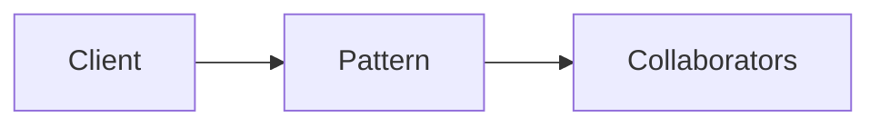

# Type Classes via Dictionaries

**Season:** 7 · Advanced FP · **Category:** Functional · **Level:** Advanced · **Target runtime:** ~10–12 min · **Channel:** Build with Waqar · **Target runtime:** ~10–12 min · **Channel:** Build with Waqar · **Target runtime:** ~10–12 min · **Channel:** Build with Waqar

## Problem
**JSON encoder + Show/Eq for domain records and composites**

This episode is built around that concrete problem — not a shared StreamForge framing.
You will see a real naive implementation that hurts, a full pattern-based solution, a
runnable main with meaningful stdout, and JUnit failure-path coverage where the pattern lives.

## Hook
Welcome back to **Build with Waqar**. Today we earn **Type Classes** by solving one problem well:
*JSON encoder + Show/Eq for domain records and composites*. By the end you will have walked naive pain → pattern refactor → real JDK 25
stdout → trade-offs, with CapCut slides and a spoken script.

## Intent
Type Classes exists because this force kept showing up: json encoder + show/eq for domain records and composites. Name the force, sketch
the roles, and — critically — know when you would refuse the pattern.

## The Pain — Naive Design
Before the pattern, teams usually thread details everywhere, leak resources on partial
failure, or couple call sites to a third-party shape. That feels fast on day one and expensive
on day thirty.

```java
package com.buildwithwaqar.patterns.functional.typeclass.problem;

/** Naive: ad-hoc toString/JSON in every call site — no reuse, easy to drift. */
public final class NaiveJson {
    public static String moneyJson(TypeClasses.Money m) {
        return "{cents:" + m.cents() + "}"; // forgot currency
    }
    public static String orderJson(TypeClasses.Order o) {
        return "{id:" + o.id() + "}"; // forgot items
    }
}

```

Call out the smell on camera: duplicated envelopes, missing compensations, parameter drilling,
illegal transitions, or null at the boundary.

## Pattern Structure


Roles matter more than class counts. The diagram slide draws the collaboration for **this**
problem so viewers can point at boxes while you type.

## Refactor to the Pattern

### Stage 1 — Name the boundary
Identify the client-facing API the rest of the app should depend on. Hide the incompatible
or distributed details behind it.

### Stage 2 — Encode the solution
```java
package com.buildwithwaqar.patterns.functional.typeclass.problem;

import java.util.List;
import java.util.Objects;
import java.util.stream.Collectors;

/** Explicit type-class dictionaries: Show, Eq, JsonEncoder for domain records. */
public final class TypeClasses {
    private TypeClasses() {}

    public record Money(String currency, int cents) {}
    public record LineItem(String sku, int qty, Money price) {}
    public record Order(String id, List<LineItem> items) {}

    public interface Show<A> { String show(A a); }
    public interface Eq<A> { boolean eqv(A a, A b); }
    public interface JsonEncoder<A> { String encode(A a); }

    public static final Show<Money> showMoney = m -> m.currency() + " " + (m.cents() / 100.0);
    public static final Eq<Money> eqMoney = (a, b) ->
            Objects.equals(a.currency(), b.currency()) && a.cents() == b.cents();
    public static final JsonEncoder<Money> jsonMoney = m ->
            "{\"currency\":\"" + m.currency() + "\",\"cents\":" + m.cents() + "}";

    public static final Show<LineItem> showLine = li ->
            li.qty() + "x" + li.sku() + "@" + showMoney.show(li.price());
    public static final JsonEncoder<LineItem> jsonLine = li ->
            "{\"sku\":\"" + li.sku() + "\",\"qty\":" + li.qty() + ",\"price\":" + jsonMoney.encode(li.price()) + "}";

    /** Derivation for composites. */
    public static final JsonEncoder<Order> jsonOrder = o -> {
        String items = o.items().stream().map(jsonLine::encode).collect(Collectors.joining(","));
        return "{\"id\":\"" + o.id() + "\",\"items\":[" + items + "]}";
    };
    public static final Show<Order> showOrder = o ->
            "Order(" + o.id() + ": " + o.items().stream().map(showLine::show).collect(Collectors.joining(", ")) + ")";
    public static final Eq<Order> eqOrder = (a, b) ->
            Objects.equals(a.id(), b.id()) && a.items().equals(b.items());
}

```

### Stage 3 — Runnable main
```java
package com.buildwithwaqar.patterns.functional.typeclass.problem;

import java.util.List;

public final class ProblemDemo {
    public static void main(String[] args) {
        System.out.println("=== Type Classes: Show / Eq / JsonEncoder ===");
        var m = new TypeClasses.Money("USD", 1999);
        var order = new TypeClasses.Order("o1", List.of(
                new TypeClasses.LineItem("SKU1", 2, m),
                new TypeClasses.LineItem("SKU2", 1, new TypeClasses.Money("USD", 500))));
        System.out.println("--- naive (incomplete JSON) ---");
        System.out.println(NaiveJson.moneyJson(m));
        System.out.println(NaiveJson.orderJson(order));
        System.out.println("--- type-class dictionaries ---");
        System.out.println("show=" + TypeClasses.showOrder.show(order));
        System.out.println("json=" + TypeClasses.jsonOrder.encode(order));
        System.out.println("eqSelf=" + TypeClasses.eqOrder.eqv(order, order));
        System.out.println("eqOther=" + TypeClasses.eqOrder.eqv(order, new TypeClasses.Order("o2", List.of())));
    }
}

```

## Hand-Traced Walkthrough (Verified on JDK 25)
Narrate each line. Do not invent numbers on camera.

```text
=== Type Classes: Show / Eq / JsonEncoder ===
--- naive (incomplete JSON) ---
{cents:1999}
{id:o1}
--- type-class dictionaries ---
show=Order(o1: 2xSKU1@USD 19.99, 1xSKU2@USD 5.0)
json={"id":"o1","items":[{"sku":"SKU1","qty":2,"price":{"currency":"USD","cents":1999}},{"sku":"SKU2","qty":1,"price":{"currency":"USD","cents":500}}]}
eqSelf=true
eqOther=false
```

Trace: match each printed line to a stage above. Fork the repo, set `JAVA_HOME` to JDK 25,
and re-run the same main class to verify.

## Modern Java 25 / Zazr Variant
Prefer records for results, sealed types for closed variants, pattern matching for exhaustive
handling, virtual threads for blocking fan-out, and Zazr for Option/Either/Try/Validation
when the force is about absence or accumulated errors. Keep the classic shape when interview
literacy matters.

## Trade-offs
- **Clarity vs ceremony:** five types for a two-line problem is a fail.
- **Testability:** inject collaborators; for Saga, inject failure at each step.
- **Distributed reality:** teaching demos omit metrics, poison pills, and multi-region clocks.
- **Refuse the pattern** when a sealed switch, a function value, or a simpler library call
  already erases the force.

## When to Use / When Not to Use
**Use when** the problem above shows up more than once and a simpler language feature does
not erase it.

**Avoid when** you are pattern-collecting, when the boundary is still unclear, or when the
team cannot yet test the abstraction (especially compensations and half-open recovery).

## Related Patterns
Contrast Type Classes with its usual twin (Adapter vs Facade, Saga vs Outbox, Reader vs DI/Cake,
State vs Strategy, Free vs Tagless). Say the distinguishing sentence out loud.

## Interview Q&A
**Q1. What concrete problem does Type Classes solve here?**
A: JSON encoder + Show/Eq for domain records and composites.

**Q2. What does the naive design get wrong?**
A: Point at the naive code smells from this episode.

**Q3. How do you test failure paths?**
A: Inject a failing collaborator (Saga step, SOAP fault, missing file) and assert the
observable outcome — compensation order, FAILED result, or thrown IllegalStateException.

**Q4. When is Type Classes the wrong tool?**
A: Give a smaller counterexample where a function, Option, or facade is enough.

**Q5. How does Java 25 change the encoding?**
A: Records, sealed types, virtual threads, Zazr control types — pick what applies.

## Key Takeaways
- Lead with the problem: JSON encoder + Show/Eq for domain records and composites.
- Show naive pain before naming Type Classes.
- Run the Demo; trust JDK 25 stdout.
- Teach when NOT to use it.

## Video Script (≈10–12 minutes)
Record for **Build with Waqar**. OBS for capture, CapCut for assembly. Import `slides.pdf`.

**[0:00]** *(slide 01 title)*
Hey everyone, welcome back to Build with Waqar. Today we solve a real problem with Type Classes:
JSON encoder + Show/Eq for domain records and composites.

**[0:40]** *(slide 02–03 problem)*
I am not starting with a definition. Here is the product pain. Keep these names — they
reappear in the Demo output.

**[2:00]** *(naive code)*
IDE time. This is the naive version. Call out the smell.

**[3:30]** *(diagram)*
Structure for **this** problem. Point at each role.

**[4:30]** *(refactor stages)*
Stage by stage into the pattern. Highlight tests and failure injection.

**[7:00]** *(walkthrough output)*
Real stdout from JDK 25. Line by line. No fake numbers.

**[8:30]** *(modern + trade-offs)*
Java 25 / Zazr take, then slow down for when NOT to use Type Classes.

**[10:30]** *(interview + recap)*
Two interview questions, three takeaways, link the GitHub episode folder. I am Waqar —
see you in the next one.
