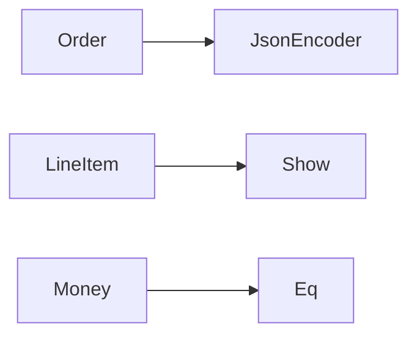

# Type Classes via Dictionaries

**Season:** 7 · Advanced FP · **Category:** Functional · **Level:** Advanced · **Runtime:** ~10–12 min · **Channel:** Build with Waqar

## Problem
**JSON encoder + Show/Eq for domain records and composites**

Key types: `dictionaries`, `TypeClasses`, `Money`, `LineItem`, `Order`, `Show`.

## Hook
Picture this: you are mid-demo and «JSON encoder + Show/Eq for domain records and composites» blows up the naive way — you see `Failure path is asserted in ProblemTest (injected fault / invalid input)`. That is the pain. In the next ten minutes we introduce **Type Classes** with real types (dictionaries, TypeClasses, Money), a runnable `ProblemDemo`, and the failure path locked in by tests. No abstract UML first — problem first.

## Intent
Use **Type Classes** to cleanly solve: JSON encoder + Show/Eq for domain records and composites.

**When to use:** the force behind «JSON encoder + Show/Eq for domain records and composites» shows up more than once and a simpler language feature does not erase it.

**When to refuse:** you are pattern-collecting, the boundary is still unclear, or the team cannot yet test the abstraction (compensations, half-open recovery, interpreters).

## The Pain — Naive Design
Naive: ad-hoc toString/JSON in every call site — no reuse, easy to drift.

```java
package com.buildwithwaqar.patterns.functional.typeclass.problem;

/** Naive: ad-hoc toString/JSON in every call site — no reuse, easy to drift. */
public final class NaiveJson {
    public static String moneyJson(TypeClasses.Money m) {
        return "{cents:" + m.cents() + "}"; // forgot currency
    }
    public static String orderJson(TypeClasses.Order o) {
        return "{id:" + o.id() + "}"; // forgot items
    }
}

```

On camera, point at the smell: missing compensations, leaked XML, null at the boundary,
illegal transitions, or hard-wired `System.out` that you cannot assert.

## Pattern Structure


These roles are for **«JSON encoder + Show/Eq for domain records and composites»** — not a generic Client→Pattern poster. Keep them on screen
while you type the solution.

## Refactor to the Pattern

### Stage 1 — Name the boundary
Introduce the client-facing API the rest of the app should depend on. Hide the incompatible or
distributed details behind it. For this episode that boundary is what makes «JSON encoder + Show/Eq for domain records and composites» testable.

### Stage 2 — Encode the solution
```java
package com.buildwithwaqar.patterns.functional.typeclass.problem;

import java.util.List;
import java.util.Objects;
import java.util.stream.Collectors;

/** Explicit type-class dictionaries: Show, Eq, JsonEncoder for domain records. */
public final class TypeClasses {
    private TypeClasses() {}

    public record Money(String currency, int cents) {}
    public record LineItem(String sku, int qty, Money price) {}
    public record Order(String id, List<LineItem> items) {}

    public interface Show<A> { String show(A a); }
    public interface Eq<A> { boolean eqv(A a, A b); }
    public interface JsonEncoder<A> { String encode(A a); }

    public static final Show<Money> showMoney = m -> m.currency() + " " + (m.cents() / 100.0);
    public static final Eq<Money> eqMoney = (a, b) ->
            Objects.equals(a.currency(), b.currency()) && a.cents() == b.cents();
    public static final JsonEncoder<Money> jsonMoney = m ->
            "{\"currency\":\"" + m.currency() + "\",\"cents\":" + m.cents() + "}";

    public static final Show<LineItem> showLine = li ->
            li.qty() + "x" + li.sku() + "@" + showMoney.show(li.price());
    public static final JsonEncoder<LineItem> jsonLine = li ->
            "{\"sku\":\"" + li.sku() + "\",\"qty\":" + li.qty() + ",\"price\":" + jsonMoney.encode(li.price()) + "}";

    /** Derivation for composites. */
    public static final JsonEncoder<Order> jsonOrder = o -> {
        String items = o.items().stream().map(jsonLine::encode).collect(Collectors.joining(","));
        return "{\"id\":\"" + o.id() + "\",\"items\":[" + items + "]}";
    };
    public static final Show<Order> showOrder = o ->
            "Order(" + o.id() + ": " + o.items().stream().map(showLine::show).collect(Collectors.joining(", ")) + ")";
    public static final Eq<Order> eqOrder = (a, b) ->
            Objects.equals(a.id(), b.id()) && a.items().equals(b.items());
}

```

### Stage 3 — Runnable main
```java
package com.buildwithwaqar.patterns.functional.typeclass.problem;

import java.util.List;

public final class ProblemDemo {
    public static void main(String[] args) {
        System.out.println("=== Type Classes: Show / Eq / JsonEncoder ===");
        var m = new TypeClasses.Money("USD", 1999);
        var order = new TypeClasses.Order("o1", List.of(
                new TypeClasses.LineItem("SKU1", 2, m),
                new TypeClasses.LineItem("SKU2", 1, new TypeClasses.Money("USD", 500))));
        System.out.println("--- naive (incomplete JSON) ---");
        System.out.println(NaiveJson.moneyJson(m));
        System.out.println(NaiveJson.orderJson(order));
        System.out.println("--- type-class dictionaries ---");
        System.out.println("show=" + TypeClasses.showOrder.show(order));
        System.out.println("json=" + TypeClasses.jsonOrder.encode(order));
        System.out.println("eqSelf=" + TypeClasses.eqOrder.eqv(order, order));
        System.out.println("eqOther=" + TypeClasses.eqOrder.eqv(order, new TypeClasses.Order("o2", List.of())));
    }
}

```

## Runnable Output (Verified on JDK 25)
Narrate each line. Do not invent numbers on camera.

```text
=== Type Classes: Show / Eq / JsonEncoder ===
--- naive (incomplete JSON) ---
{cents:1999}
{id:o1}
--- type-class dictionaries ---
show=Order(o1: 2xSKU1@USD 19.99, 1xSKU2@USD 5.0)
json={"id":"o1","items":[{"sku":"SKU1","qty":2,"price":{"currency":"USD","cents":1999}},{"sku":"SKU2","qty":1,"price":{"currency":"USD","cents":500}}]}
eqSelf=true
eqOther=false
```

Happy-path cue: `json={"id":"o1","items":[{"sku":"SKU1","qty":2,"price":{"currency":"USD","cents":1999}},{"sku":"SKU2","qty":1,"price":{"`.
Failure-path cue: `Failure path is asserted in ProblemTest (injected fault / invalid input)`.
Fork the repo, set `JAVA_HOME` to JDK 25, and re-run the same `ProblemDemo` to verify.

## Modern Java 25 / Zazr Variant
**Records** carry the immutable results (`StepResult`, DTOs) with almost no boilerplate.

## Trade-offs
- **Clarity vs ceremony:** extra types for «JSON encoder + Show/Eq for domain records and composites» only pay off when the force repeats.
- **Testability:** inject collaborators; assert the failure path, not only the happy path.
- **Distributed / concurrent reality:** demos omit metrics, backpressure, and multi-region clocks.
- **Refuse Type Classes** when a sealed switch, a function value, or a simpler library call already erases the force.
- **Neighbor:** Visitor — Type classes add behavior without modifying types; Witnesses emulate HKTs in Java.

## Interview Q&A
**Q1. What concrete problem does Type Classes solve here?**
A: JSON encoder + Show/Eq for domain records and composites.

**Q2. What does the naive design get wrong?**
A: Naive: ad-hoc toString/JSON in every call site — no reuse, easy to drift.

**Q3. How do you test the failure path?**
A: Inject the fault and assert the observable outcome — e.g. `Failure path is asserted in ProblemTest (injected fault / invalid input)`.

**Q4. When is Type Classes the wrong tool?**
A: When a smaller language feature erases the force, or when you really needed Visitor.


## Key Takeaways
- Lead with the problem: JSON encoder + Show/Eq for domain records and composites.
- Show naive pain (`Failure path is asserted in ProblemTest (injected fault / invalid input)`) before naming Type Classes.
- Run the Demo; trust JDK 25 stdout (`json={"id":"o1","items":[{"sku":"SKU1","qty":2,"price":{"currency":"USD","cents":1999}},{"sku":"SKU2","qty":1,"price":{"`).
- Teach when NOT to use Type Classes.

## Video Script (≈10–12 minutes)
Record for **Build with Waqar**. OBS for capture, CapCut for assembly. Import `slides.pdf`.
Facecam: full-screen for the hook, framed PiP over code slides.

**[0:00]** *(slide 01 title + talking head)*
Hey everyone — today we solve one concrete problem with **Type Classes**:
*JSON encoder + Show/Eq for domain records and composites*. Keep these names in your head: dictionaries, TypeClasses, Money, LineItem.

**[0:45]** *(problem + hook slides)*
I am not starting with a textbook definition. Here is the product pain. By the end you will have
seen the naive leak, the pattern boundary, and real JDK 25 stdout.

**[2:00]** *(naive code)*
IDE time. This is the naive version. Call out the smell — that is what Type Classes exists to erase.

**[3:30]** *(structure diagram)*
Roles for **this** problem, not a generic UML poster. Point at each box while you talk.

**[4:30]** *(refactor / solution code)*
Stage the solution. Highlight failure injection and the tests that lock it in.

**[7:00]** *(walkthrough output)*
Real stdout. Happy path cue: `json={"id":"o1","items":[{"sku":"SKU1","qty":2,"price":{"currency":"USD","cents":1999}},{"sku":"SKU2","qty":1,"price":{"`.
Failure cue: `Failure path is asserted in ProblemTest (injected fault / invalid input)`.
No invented numbers on camera.

**[8:30]** *(modern Java 25 / Zazr + trade-offs)*
Show the modernization, then slow down for when NOT to use Type Classes. That is what seniors listen for.

**[10:30]** *(Q&A + recap + outro)*
Two interview questions, three takeaways, link the GitHub episode folder. I am Waqar — see you in the next one.


## Walkthrough Beats (Say These Out Loud)
1. **Setup:** open `series/61-type-classes/` and `run-output.txt` beside the IDE.
2. **Naive:** reproduce the pain until you can point at `Failure path is asserted in ProblemTest (injected fault / invalid input)`.
3. **Structure:** on the diagram, trace `Order` → `JsonEncoder`, `LineItem` → `Show`, `Money` → `Eq`.
4. **Refactor:** encode the boundary, then run `ProblemDemo` — match `json={"id":"o1","items":[{"sku":"SKU1","qty":2,"price":{"currency":"USD","cents":1999}},{"sku":"SKU2","qty":1,"price":{"`.
5. **Break it:** flip one `ProblemTest` assertion, watch red, restore it.
6. **Refuse:** Contrast with **Visitor**: Type classes add behavior without modifying types; Witnesses emulate HKTs in Java.

## Practice Drill
- Clone `waqarys/java-design-patterns`, set `JAVA_HOME` to JDK 25.
- Run the episode `ProblemDemo` (see `EP_MAIN` in `tools/enrich/build_problems.py`).
- Mutate one collaborator to fail; confirm the observable compensation / error path.
- Explain Type Classes for «JSON encoder + Show/Eq for domain records and composites» in sixty seconds without notes.
