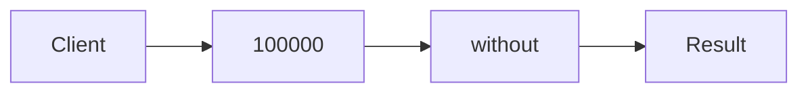

# Trampolining & Stack Safety

**Season:** 7 · Advanced FP · **Category:** Functional · **Level:** Advanced · **Runtime:** ~10–12 min · **Channel:** Build with Waqar

## Problem
**Sum 1..100000 without StackOverflowError**

Key types: `Trampoline`, `Done`, `More`, `SafeSum`.

## Hook
Picture this: you are mid-demo and «Sum 1..100000 without StackOverflowError» blows up the naive way — you see `Failure path is asserted in ProblemTest (injected fault / invalid input)`. That is the pain. In the next ten minutes we introduce **Trampoline** with real types (Trampoline, Done, More), a runnable `ProblemDemo`, and the failure path locked in by tests. No abstract UML first — problem first.

## Intent
Use **Trampoline** to cleanly solve: Sum 1..100000 without StackOverflowError.

**When to use:** the force behind «Sum 1..100000 without StackOverflowError» shows up more than once and a simpler language feature does not erase it.

**When to refuse:** you are pattern-collecting, the boundary is still unclear, or the team cannot yet test the abstraction (compensations, half-open recovery, interpreters).

## The Pain — Naive Design
Naive version fails to cleanly solve: Sum 1..100000 without StackOverflowError

```java
package com.buildwithwaqar.patterns.functional.trampoline.problem;

import java.util.*;

public final class NaiveSum {
  public static long sum(long n){ return n<=0?0: n+sum(n-1); }
}

```

On camera, point at the smell: missing compensations, leaked XML, null at the boundary,
illegal transitions, or hard-wired `System.out` that you cannot assert.

## Pattern Structure


These roles are for **«Sum 1..100000 without StackOverflowError»** — not a generic Client→Pattern poster. Keep them on screen
while you type the solution.

## Refactor to the Pattern

### Stage 1 — Name the boundary
Introduce the client-facing API the rest of the app should depend on. Hide the incompatible or
distributed details behind it. For this episode that boundary is what makes «Sum 1..100000 without StackOverflowError» testable.

### Stage 2 — Encode the solution
```java
package com.buildwithwaqar.patterns.functional.trampoline.problem;

import java.util.*;
import java.util.function.*;

sealed interface Trampoline<A> permits Done, More {
  A run();
  static <A> Trampoline<A> done(A a){ return new Done<>(a); }
  static <A> Trampoline<A> more(Supplier<Trampoline<A>> next){ return new More<>(next); }
}
record Done<A>(A value) implements Trampoline<A> { public A run(){ return value; } }
record More<A>(Supplier<Trampoline<A>> next) implements Trampoline<A> {
  public A run(){ Trampoline<A> cur=this; while(cur instanceof More<A> m) cur=m.next.get(); return ((Done<A>)cur).value(); }
}
final class SafeSum {
  static Trampoline<Long> sum(long n, long acc){
    return n<=0? Trampoline.done(acc): Trampoline.more(() -> sum(n-1, acc+n));
  }
}

```

### Stage 3 — Runnable main
```java
package com.buildwithwaqar.patterns.functional.trampoline.problem;
import java.util.*; import java.util.function.*;
public final class ProblemDemo {
  public static void main(String[] args) {
    System.out.println("=== Trampoline: deep sum without SOE ===");
    System.out.println("--- naive (may SOE for large n) ---");
System.out.println(NaiveSum.sum(100));
System.out.println("--- trampoline ---");
System.out.println(SafeSum.sum(100000, 0).run());
  }
}

```

## Runnable Output (Verified on JDK 25)
Narrate each line. Do not invent numbers on camera.

```text
=== Trampoline: deep sum without SOE ===
--- naive (may SOE for large n) ---
5050
--- trampoline ---
5000050000
```

Happy-path cue: `5050`.
Failure-path cue: `Failure path is asserted in ProblemTest (injected fault / invalid input)`.
Fork the repo, set `JAVA_HOME` to JDK 25, and re-run the same `ProblemDemo` to verify.

## Modern Java 25 / Zazr Variant
This solution already leans on **sealed types** — keep the exhaustive `switch`. **Records** carry the immutable results (`StepResult`, DTOs) with almost no boilerplate.

## Trade-offs
- **Clarity vs ceremony:** extra types for «Sum 1..100000 without StackOverflowError» only pay off when the force repeats.
- **Testability:** inject collaborators; assert the failure path, not only the happy path.
- **Distributed / concurrent reality:** demos omit metrics, backpressure, and multi-region clocks.
- **Refuse Trampoline** when a sealed switch, a function value, or a simpler library call already erases the force.
- **Neighbor:** Tail recursion — Trampoline converts deep recursion to a heap loop on the JVM.

## Interview Q&A
**Q1. What concrete problem does Trampoline solve here?**
A: Sum 1..100000 without StackOverflowError.

**Q2. What does the naive design get wrong?**
A: Naive version fails to cleanly solve: Sum 1..100000 without StackOverflowError

**Q3. How do you test the failure path?**
A: Inject the fault and assert the observable outcome — e.g. `Failure path is asserted in ProblemTest (injected fault / invalid input)`.

**Q4. When is Trampoline the wrong tool?**
A: When a smaller language feature erases the force, or when you really needed Tail recursion.


## Key Takeaways
- Lead with the problem: Sum 1..100000 without StackOverflowError.
- Show naive pain (`Failure path is asserted in ProblemTest (injected fault / invalid input)`) before naming Trampoline.
- Run the Demo; trust JDK 25 stdout (`5050`).
- Teach when NOT to use Trampoline.

## Video Script (≈10–12 minutes)
Record for **Build with Waqar**. OBS for capture, CapCut for assembly. Import `slides.pdf`.
Facecam: full-screen for the hook, framed PiP over code slides.

**[0:00]** *(slide 01 title + talking head)*
Hey everyone — today we solve one concrete problem with **Trampoline**:
*Sum 1..100000 without StackOverflowError*. Keep these names in your head: Trampoline, Done, More, SafeSum.

**[0:45]** *(problem + hook slides)*
I am not starting with a textbook definition. Here is the product pain. By the end you will have
seen the naive leak, the pattern boundary, and real JDK 25 stdout.

**[2:00]** *(naive code)*
IDE time. This is the naive version. Call out the smell — that is what Trampoline exists to erase.

**[3:30]** *(structure diagram)*
Roles for **this** problem, not a generic UML poster. Point at each box while you talk.

**[4:30]** *(refactor / solution code)*
Stage the solution. Highlight failure injection and the tests that lock it in.

**[7:00]** *(walkthrough output)*
Real stdout. Happy path cue: `5050`.
Failure cue: `Failure path is asserted in ProblemTest (injected fault / invalid input)`.
No invented numbers on camera.

**[8:30]** *(modern Java 25 / Zazr + trade-offs)*
Show the modernization, then slow down for when NOT to use Trampoline. That is what seniors listen for.

**[10:30]** *(Q&A + recap + outro)*
Two interview questions, three takeaways, link the GitHub episode folder. I am Waqar — see you in the next one.


## Walkthrough Beats (Say These Out Loud)
1. **Setup:** open `series/63-trampolining/` and `run-output.txt` beside the IDE.
2. **Naive:** reproduce the pain until you can point at `Failure path is asserted in ProblemTest (injected fault / invalid input)`.
3. **Structure:** on the diagram, trace `Client` → `100000`, `100000` → `without`, `without` → `Result`.
4. **Refactor:** encode the boundary, then run `ProblemDemo` — match `5050`.
5. **Break it:** flip one `ProblemTest` assertion, watch red, restore it.
6. **Refuse:** Contrast with **Tail recursion**: Trampoline converts deep recursion to a heap loop on the JVM.

## Practice Drill
- Clone `waqarys/java-design-patterns`, set `JAVA_HOME` to JDK 25.
- Run the episode `ProblemDemo` (see `EP_MAIN` in `tools/enrich/build_problems.py`).
- Mutate one collaborator to fail; confirm the observable compensation / error path.
- Explain Trampoline for «Sum 1..100000 without StackOverflowError» in sixty seconds without notes.
