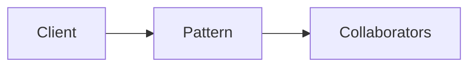

# Effect Systems & Interpreters

**Season:** 7 · Advanced FP · **Category:** Functional · **Level:** Advanced

## Intent
Separate describing effects from running them.

## Problem
Without this pattern, code tends toward: New things up with conditionals and duplicated construction.

## Real-world Analogy
Screenplay vs performance.

## When to Use
- Serious FP architecture in Java.
- The design force named in Intent shows up more than once.

## When Not to Use
- CRUD apps that don't need effect algebras.
- A simpler language feature (record, sealed switch, function value) already solves it.

## Naive Approach
```text
New things up with conditionals and duplicated construction.
```

## Pattern Structure

Client -> Pattern -> Collaborators

## Classic Implementation
Primary code lives under `src/main/java/com/buildwithwaqar/patterns/functional/io/ + tagless + free`.

```java
package com.buildwithwaqar.patterns.functional.io;

import java.util.function.Function;
import java.util.function.Supplier;

/** Tiny IO effect — suspend side effects, interpret at the edge. */
public final class IO<A> {
    private final Supplier<A> thunk;

    private IO(Supplier<A> thunk) { this.thunk = thunk; }

    public static <A> IO<A> delay(Supplier<A> thunk) { return new IO<>(thunk); }
    public static <A> IO<A> pure(A a) { return new IO<>(() -> a); }

    public <B> IO<B> map(Function<? super A, ? extends B> f) {
        return new IO<>(() -> f.apply(thunk.get()));
    }

    public <B> IO<B> flatMap(Function<? super A, IO<B>> f) {
        return new IO<>(() -> f.apply(thunk.get()).unsafeRun());
    }

    /** Unsafe: runs effects. Call only at the program edge. */
    public A unsafeRun() { return thunk.get(); }
}
```

## Modern Java 25 / Functional
Witness types emulate higher-kinded types.

## Worked Example
```text
See the JUnit test beside the implementation.
Run: mvn -Dtest=*Test test
Focus package matching: functional/io/ + tagless + free
```

## Pitfalls
- Encodings are educational — production may use libraries.
- Tagless Final needs Kind encoding without HKTs.

## Interview Q&A
**Q: When to pick Effect Systems & Interpreters?**
A: When you need testable effect boundaries or pure state threading.

**Q: How would you test this?**
A: Prefer injecting interfaces or interpreters; keep demos deterministic (fixed clocks, canned inputs).

## Key Takeaways
- Separate describing effects from running them.
- Prefer Java 25 sealed types / records / virtual threads where they simplify the classic shape.
- Ship working tests with every episode.

## Video Script
**[0:00] Hook** — Open with the analogy: Screenplay vs performance.
**[0:40] Intent** — State the design force in one sentence: Separate describing effects from running them.
**[1:30] Naive pain** — Show the messy approach: New things up with conditionals and duplicated construction.
**[3:00] Pattern** — Walk the code under `functional/io/ + tagless + free`; draw the mermaid structure on-screen.
**[6:00] Modern take** — Witness types emulate higher-kinded types.
**[8:00] Pitfalls & interview** — Cover: When to pick Effect Systems & Interpreters?
**[9:30] Outro** — Tease the next episode; point viewers to the GitHub repo and slides PDF.
